# Swimlane Diagram — Hospital Accreditation Management System

## Mermaid Code

```mermaid
flowchart LR
    Start(["Start Accreditation Cycle"])

    subgraph Lane_Dept["Department Head"]
        D1["Map Clinical SOPs to Standard Clauses"]
        D2["Receive Non-Compliance CAP Tasks"]
        D3["Execute Corrective Actions & Upload Evidence"]
    end

    subgraph Lane_Quality["Quality & Accreditation Officer"]
        Q1["Configure Standard Framework & Schedule Audits"]
        Q2["Conduct Patient Tracer Methodology Audits"]
        Q3{"Is CAP Verified Closed & Evidence Valid?"}
        Q4["Compile Digital Evidence Binder"]
        Q5["Execute Mock Accreditation Survey"]
    end

    subgraph Lane_System["Accreditation System"]
        S1["Link Policies to Standard Clause Nodes"]
        S2["Score Tracer Items & Auto-Generate CAP Tickets"]
        S3["Update Compliance Score Heatmap"]
        S4["Compile Pre-Survey Electronic Package"]
    end

    subgraph Lane_Agency["External Surveyor / Agency"]
        A1["Access Digital Evidence Binders"]
        A2["Conduct On-Site Accreditation Survey"]
        A3["Issue Official Accreditation Certification"]
    end

    Finish(["End Accreditation Cycle"])

    Start --> Q1 --> D1 --> S1 --> Q2 --> S2 --> D2 --> D3 --> Q3
    Q3 -->|"Yes"| S3 --> Q4 --> Q5 --> S4 --> A1 --> A2 --> A3 --> Finish
    Q3 -->|"No / Incomplete"| D3
```

## Flow Description | Mô tả luồng

| Lane | Actor | Role in Flow |
|------|-------|-------------|
| 1 | Department Head | Maps clinical SOPs to standard clauses, receives non-compliance CAP tasks, executes corrective actions, and uploads evidence files for verification. |
| 2 | Quality & Accreditation Officer | Configures accreditation frameworks, conducts patient tracer audits, verifies CAP task completion evidence, compiles digital evidence binders, and leads mock surveys. |
| 3 | Accreditation Management System | Links policy documents to standards, scores tracer observation items, auto-generates CAP tickets, updates compliance heatmaps, and packages pre-survey documentation. |
| 4 | External Surveyor / Agency | Reviews compiled digital evidence binders, conducts on-site accreditation surveys, scores standard compliance, and issues official accreditation certifications. |
