# Action Tree — Hospital Accreditation Management System

## Mermaid Code

```mermaid
graph TD
    Root["Hospital Accreditation Management System"]

    Root --> M1["Standards & Policy Mapping Setup"]
    Root --> M2["Patient Tracer & Self-Assessment Audits"]
    Root --> M3["International Patient Safety Goals (IPSG)"]
    Root --> M4["Corrective Action Plan (CAP) Tracking"]
    Root --> M5["Digital Evidence Binders & Mock Surveys"]
    Root --> M6["Agency Reporting & Quality Analytics"]

    M1 --> A11["Import JCI, ISO & MOH Standard Frameworks"]
    M1 --> A12["Map Clinical SOPs to Standard Clauses"]
    M1 --> A13["Track Expired Policy Review Warnings"]
    M1 --> A14["Maintain Standard Clause Lexicon Index"]

    M2 --> A21["Execute Patient Tracer Methodology Audits"]
    M2 --> A22["Score Observations (Met, Partial, Not Met)"]
    M2 --> A23["Attach On-Site Audit Photos & Notes"]
    M2 --> A24["Conduct Internal Self-Assessment Surveys"]

    M3 --> A31["Audit IPSG 1 Patient Identification Wristbands"]
    M3 --> A32["Audit IPSG 2 Verbal Order Read-Back Logs"]
    M3 --> A33["Audit IPSG 3 High-Alert Electrolyte Storage"]
    M3 --> A34["Audit IPSG 4 Surgical Safety Checklist Sign-Offs"]

    M4 --> A41["Auto-Generate CAP Tickets from Audit Gaps"]
    M4 --> A42["Assign CAP Owners & Target Completion Dates"]
    M4 --> A43["Upload Corrective Action Evidence Files"]
    M4 --> A44["Verify & Close Resolved CAP Task Tickets"]

    M5 --> A51["Build Chapter Digital Evidence Binders"]
    M5 --> A52["Execute Simulated Mock Accreditation Surveys"]
    M5 --> A53["Audit Staff Credentials & BLS Certifications"]
    M5 --> A54["Grant Read-Only Access to External Surveyors"]

    M6 --> A61["Export Pre-Survey E-App Packets to JCI"]
    M6 --> A62["Generate Strategic Improvement Plans (SIP)"]
    M6 --> A63["Render Real-Time Hospital Compliance Heatmaps"]
    M6 --> A64["Track Clinical Quality Indicators & RCA Logs"]
```

## Module Description | Mô tả Module

| # | Module | Description | Actions |
|---|--------|-------------|---------|
| 1 | Standards & Policy Mapping Setup | Imports accreditation standards (JCI, ISO, MOH), maps policies/SOPs to standard clauses, tracks policy expirations, and maintains standard lexicons. | Import Standard Frameworks, Map SOPs to Clauses, Track Expired Policies, Maintain Standard Lexicons. |
| 2 | Patient Tracer & Self-Assessment Audits | Executes patient tracer methodology audits, scores observations (Met, Partial, Not Met), attaches photo evidence, and conducts self-assessments. | Execute Patient Tracers, Score Audit Observations, Attach On-Site Photos, Conduct Self-Assessments. |
| 3 | International Patient Safety Goals (IPSG) | Audits compliance with IPSG 1 (Patient ID), IPSG 2 (Verbal Read-Back), IPSG 3 (High-Alert Meds), and IPSG 4 (Surgical Time-Out Checklists). | Audit Patient ID Wristbands, Audit Verbal Read-Back Logs, Audit High-Alert Electrolytes, Audit Surgical Checklists. |
| 4 | Corrective Action Plan (CAP) Tracking | Auto-generates CAP tickets from audit gaps, assigns owners and deadlines, ingests uploaded resolution evidence, and verifies task closure. | Auto-Generate CAP Tickets, Assign CAP Owners & Dates, Upload Resolution Evidence, Verify & Close CAP Tickets. |
| 5 | Digital Evidence Binders & Mock Surveys | Compiles chapter digital evidence binders, executes mock surveys, audits staff primary source credentials, and grants read-only access to surveyors. | Build Digital Evidence Binders, Execute Mock Surveys, Audit Staff Credentials, Grant Surveyor Access. |
| 6 | Agency Reporting & Quality Analytics | Auto-packages pre-survey packets for JCI, generates post-survey Strategic Improvement Plans (SIP), renders compliance heatmaps, and tracks quality KPIs. | Export Pre-Survey Packets to JCI, Generate SIP Plans, Render Compliance Heatmaps, Track Quality Indicators. |
