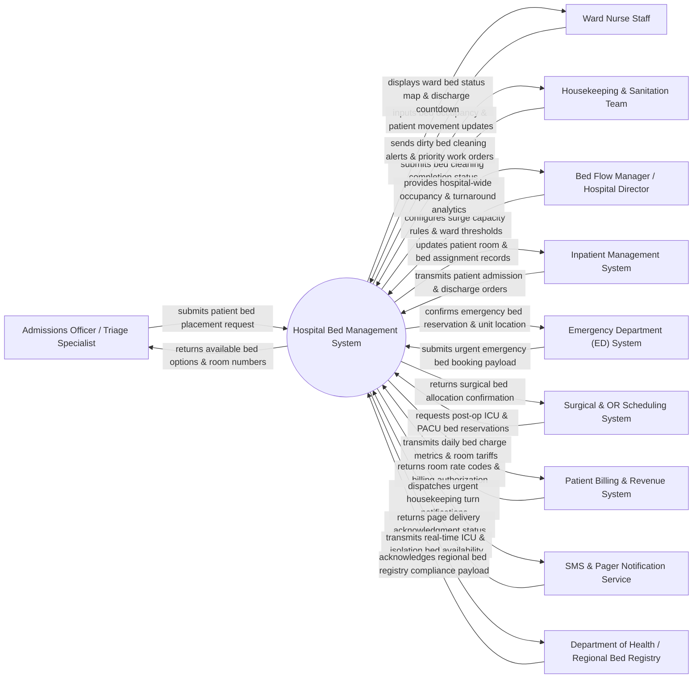

# Context Diagram — Hospital Bed Management System

## Mermaid Code

## Actor & Interaction Table | Bảng Actor & Tương tác

| # | Actor | Actor Type | Data Sent TO System | Data Received FROM System | Notes |
|---|-------|------------|---------------------|---------------------------|-------|
| 1 | Admissions Officer / Triage Specialist | Primary | Patient admission records, clinical acuity level, requested ward type, gender isolation needs, bed reservation requests. | Real-time bed availability matrix, recommended room numbers, bed feature matches (bariatric, telemetry, isolation). | Hospital intake staff responsible for placing newly admitted patients into appropriate ward beds. |
| 2 | Ward Nurse Staff | Primary | Real-time bed status changes (Occupied, Pending Discharge, Vacant), patient bed transfers, discharge readiness updates, special equipment requirements. | Ward visual bed layout map, patient location tracking, cleaning status indicators, expected patient arrival countdowns. | Unit nurses maintaining live operational status of inpatient beds within specific ward units. |
| 3 | Housekeeping & Sanitation Team | Primary | Cleaning task acceptance, bed sanitation completion logs, biohazard decontamination status, bed maintenance issue flags. | Automated dirty bed cleaning dispatches, priority room turn work orders, target turnaround countdown timers. | Environmental services staff responsible for cleaning, sanitizing, and preparing discharged beds for new admissions. |
| 4 | Bed Flow Manager / Hospital Director | Primary | Ward capacity threshold configurations, emergency surge activation rules, bed reallocation policies, priority queue overrides. | Hospital-wide occupancy dashboards, bed turnaround time (TAT) metrics, bottleneck alert reports, surge capacity indicators. | Executive role overseeing overall hospital bed utilization, throughput efficiency, and surge management. |
| 5 | Inpatient Management System | Supporting | Patient master index (MPI), clinical admission orders, physician ward transfer notes, final discharge orders. | Confirmed room/bed location codes, admission placement updates, inpatient location audit history. | Main hospital EHR/Inpatient system integrated via HL7 ADT (Admission, Discharge, Transfer) messages. |
| 6 | Emergency Department (ED) System | Supporting | Emergency patient acuity data, immediate bed request payloads, expected ED boarder transfer times. | Expedited bed reservation confirmations, assigned ward/unit details, holding bed status alerts. | Emergency software sending high-priority bed booking requests to reduce ED boarding bottlenecks. |
| 7 | Surgical & OR Scheduling System | Supporting | Post-operative bed reservation payloads (ICU, PACU, Surgical Ward), post-op recovery timeline expectations. | Confirmed post-op bed reservations, assigned surgical unit bed numbers, room equipment readiness checks. | Operating room scheduling platform reserving specialized beds for post-surgical recovery. |
| 8 | Patient Billing & Revenue System | Supporting | Room billing classification tariffs, co-pay rate codes, daily financial billing authorization confirmations. | Daily bed occupancy charges, room transfer timestamps, upgraded amenity bed billing events, final bed release events. | Hospital revenue software consuming daily room & board charge data for patient invoicing. |
| 9 | SMS & Pager Notification Service | Supporting | Page delivery receipts, SMS delivery status codes, staff response timestamps. | Priority staff alert payloads, target pager/phone IDs, urgent bed cleaning dispatch messages. | Internal messaging infrastructure delivering instant pings to housekeeping and bed flow managers. |
| 10 | Department of Health / Regional Bed Registry | Supporting / Regulatory | Mandated reporting schemas, regional disaster response protocols, compliance acknowledgment receipts. | Aggregated regional bed capacity reports, available ICU bed counts, negative-pressure isolation bed availability metrics. | Government health authority tracking regional hospital bed availability during surge or pandemic events. |

## System Boundary Description | Mô tả Phạm vi Hệ thống

The **Hospital Bed Management System (HBMS)** is an enterprise healthcare operational platform designed to automate real-time inpatient bed tracking, patient bed allocation, housekeeping turnaround workflows, and bed capacity analytics across hospital wards.

**Inside System Scope:**
- Real-time visualization and tracking of hospital-wide bed states (Occupied, Vacant, Dirty/Cleaning In Progress, Reserved, Out of Service, Maintenance).
- Intelligent bed allocation engine matching patient clinical requirements (gender, isolation protocols, telemetry monitoring, bariatric needs) with available beds.
- Automated housekeeping dispatching and bed turnaround time (TAT) tracking from discharge initiation to room sanitization approval.
- Inter-ward patient bed transfer management, emergency department (ED) bed reservation queueing, and surgical bed pre-allocation.
- Real-time hospital bed flow analytics, ward occupancy heatmaps, bottleneck forecasting, and regional emergency capacity reporting.

**Outside System Scope:**
- Direct clinical diagnosis or treatment order entry (handled by hospital EHR/Inpatient Management Systems).
- Physical execution of room cleaning and biohazard waste handling (performed by Housekeeping personnel).
- Financial ledger posting and insurance claim generation (delegated to Patient Billing Systems).
- Physical repair and engineering maintenance of bed mechanical hardware (managed by Hospital Facilities & Maintenance).
