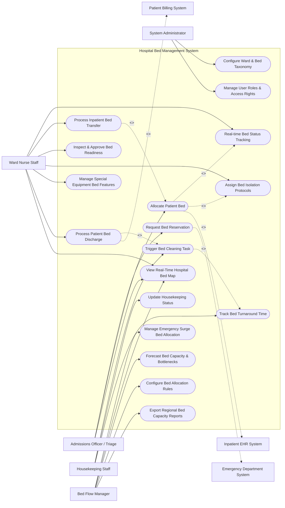

# Use Case Diagram — Hospital Bed Management System

## Mermaid Code

## Actor Table | Bảng Actor

| # | Actor | Actor Type | Role Description | Related Use Cases |
|---|-------|------------|------------------|-------------------|
| 1 | Admissions Officer / Triage | Primary | Intake staff assigning incoming patients to available ward beds matching clinical criteria. | UC03, UC04, UC14 |
| 2 | Ward Nurse Staff | Primary | Clinical nurses managing day-to-day patient placement, transfers, isolation tags, and discharge events. | UC02, UC05, UC09, UC10, UC11, UC12, UC14 |
| 3 | Housekeeping Staff | Primary | Environmental service workers accepting cleaning dispatches, updating sanitization progress, and completing bed turnover. | UC07, UC08, UC13 |
| 4 | Bed Flow Manager | Primary | Hospital bed coordinator monitoring capacity, managing emergency surges, setting allocation rules, and reviewing TAT metrics. | UC06, UC14, UC15, UC17, UC18 |
| 5 | System Administrator | Primary | IT administrative user configuring ward structures, bed taxonomies, system user roles, and security permissions. | UC01, UC16 |
| 6 | Inpatient EHR System | System (Secondary) | Hospital EHR system providing admission/discharge orders and updating patient location master records. | UC04 |
| 7 | Emergency Department System | System (Secondary) | ED system generating urgent bed placement requests for admitted emergency boarders. | UC03 |
| 8 | Patient Billing System | System (Secondary) | Financial platform receiving room occupancy data and discharge timestamps for patient billing. | UC12 |

## Use Case Table | Bảng Use Case

| # | UC ID | Use Case Name | Primary Actor | Secondary Actor | Description | Priority |
|---|-------|---------------|---------------|-----------------|-------------|----------|
| 1 | UC01 | Configure Ward & Bed Taxonomy | Admin | None | Configures hospital ward structures, room numbers, bed IDs, ward types, and bed classifications. | Medium |
| 2 | UC02 | Real-time Bed Status Tracking | Ward Nurse | None | Provides real-time status updates (Occupied, Vacant, Dirty, Reserved, Maintenance) for all hospital beds. | High |
| 3 | UC03 | Request Bed Reservation | Admissions Officer | ED System | Submits bed booking requests for incoming admissions, ED boarders, or scheduled surgical patients. | High |
| 4 | UC04 | Allocate Patient Bed | Admissions Officer | Inpatient EHR | Matches patient clinical requirements with available beds and commits patient placement. | High |
| 5 | UC05 | Process Inpatient Bed Transfer | Ward Nurse | Inpatient EHR | Manages patient transfers between wards (e.g., General Ward to ICU) and releases previous bed. | High |
| 6 | UC06 | Manage Emergency Surge Bed Allocation | Bed Flow Manager | None | Activates emergency surge protocols, opens overflow beds, and overrides bed reservation priorities. | High |
| 7 | UC07 | Trigger Bed Cleaning Task | Housekeeping | Ward Nurse | Automatically creates and dispatches a cleaning task ticket to environmental services upon bed release. | High |
| 8 | UC08 | Update Housekeeping Status | Housekeeping | None | Captures housekeeping progress updates (Cleaning Started, Disinfecting, Clean & Ready) on mobile devices. | High |
| 9 | UC09 | Inspect & Approve Bed Readiness | Ward Nurse | Housekeeping | Allows ward nurses to perform final inspection of cleaned beds and mark them as ready for admission. | Medium |
| 10 | UC10 | Assign Bed Isolation Protocols | Ward Nurse | None | Flags beds with clinical isolation constraints (Negative Pressure, Contact Isolation, Airborne Protection). | High |
| 11 | UC11 | Manage Special Equipment Bed Features | Ward Nurse | None | Tracks specialized bed features attached to specific beds (Telemetry, Bariatric support, Ventilator access). | Medium |
| 12 | UC12 | Process Patient Bed Discharge | Ward Nurse | Patient Billing | Records patient discharge event, frees assigned bed, and triggers downstream billing/cleaning workflows. | High |
| 13 | UC13 | Track Bed Turnaround Time | Housekeeping | Bed Flow Manager | Measures timestamp metrics from discharge initiation to cleaning completion to monitor operational efficiency. | Medium |
| 14 | UC14 | View Real-Time Hospital Bed Map | Bed Flow Manager | Admissions Officer | Displays interactive color-coded floor plan map of all hospital wards and bed statuses in real time. | High |
| 15 | UC15 | Forecast Bed Capacity & Bottlenecks | Bed Flow Manager | None | Analyzes historical occupancy and pending discharges to predict upcoming bed shortages and bottlenecks. | Medium |
| 16 | UC16 | Manage User Roles & Access Rights | Admin | None | Manages user access accounts, RBAC permissions, and ward assignment permissions for staff. | High |
| 17 | UC17 | Configure Bed Allocation Rules | Bed Flow Manager | None | Sets automated matching priority rules (e.g., ED admissions priority over elective admissions). | Medium |
| 18 | UC18 | Export Regional Bed Capacity Reports | Bed Flow Manager | None | Generates and exports mandatory state/regional ICU and isolation bed capacity compliance reports. | Medium |

## Use Case Specification | Đặc tả Use Case

---

### UC04 — Allocate Patient Bed

| Field | Detail |
|-------|--------|
| **UC ID** | UC04 |
| **Use Case Name** | Allocate Patient Bed |
| **Actor(s)** | Primary: Admissions Officer / Triage Specialist   Secondary: Inpatient EHR System |
| **Description** | Searches for and assigns an available hospital bed matching patient clinical parameters (gender, diagnosis, isolation requirement, bed feature needs) and commits the placement. |
| **Precondition** | 1. Patient admission order exists in the Inpatient EHR System.   2. Admissions Officer is authenticated into HBMS with bed allocation privileges. |
| **Main Flow** | 1. Admissions Officer enters Patient ID or admission order number into the allocation screen.   2. System fetches patient clinical parameters (gender, age, diagnosis, isolation tag, required telemetry/bariatric equipment) from Inpatient EHR.   3. System queries active bed database and displays a ranked list of available beds matching clinical criteria.   4. Admissions Officer selects an optimal bed location (e.g., Ward 4B, Room 412, Bed B).   5. System verifies bed status is `Clean & Ready` and has no conflicting pending reservations.   6. Admissions Officer clicks "Confirm Bed Allocation".   7. System updates bed status to `Occupied`, links Patient ID to Bed ID, and sends HL7 ADT assignment message to Inpatient EHR System. |
| **Alternative Flow** | **AF1** — Direct Manual Selection: If automated matching yields no exact match, Admissions Officer overrides filters, selects an acceptable alternative bed, enters override justification notes, and confirms allocation.   **AF2** — Pre-Allocation Holding Reservation: Admissions Officer pre-allocates a bed for a patient en route from ED; System flags bed status as `Reserved (ED Holding)` for 60 minutes. |
| **Exception Flow** | **EX1** — Bed Status Conflict: If target bed was marked `Occupied` or `Dirty` by another nurse seconds prior, System blocks allocation, displays alert "Target bed status changed to Dirty", and refreshes available bed choices.   **EX2** — Infection Control Conflict: If selected room contains a patient with incompatible isolation requirements (e.g., placing non-isolated patient in active MRSA room), System displays critical warning: "Infection Control Violation" and halts allocation. |
| **Postcondition** | Target bed status changes to `Occupied`, patient location is registered hospital-wide, and ward nurse dashboard alerts incoming patient arrival. |
| **Business Rule** | **BR1**: Male and female patients must not be placed in the same multi-occupancy room unless room is explicitly flagged as Mixed-Gender.   **BR2**: Pediatric patients (< 18 years) must only be allocated to designated Pediatric Ward beds. |

---

### UC05 — Process Inpatient Bed Transfer

| Field | Detail |
|-------|--------|
| **UC ID** | UC05 |
| **Use Case Name** | Process Inpatient Bed Transfer |
| **Actor(s)** | Primary: Ward Nurse Staff   Secondary: Inpatient EHR System |
| **Description** | Executes internal patient transfers from one hospital bed/ward to another (e.g., General Ward to ICU or Step-down), updating locations and releasing the previous bed. |
| **Precondition** | 1. Patient currently occupies an active hospital bed.   2. Approved transfer order exists or target bed is pre-reserved. |
| **Main Flow** | 1. Ward Nurse selects patient on current ward layout screen and clicks "Initiate Bed Transfer".   2. Nurse selects transfer reason (e.g., Clinical Deterioration - ICU Transfer, Patient Request) and target receiving ward/bed.   3. System validates that receiving bed is `Clean & Ready` and available.   4. Nurse confirms physical transport execution and clicks "Complete Transfer".   5. System updates receiving bed status to `Occupied` with current patient record.   6. System changes previous bed status to `Dirty` and triggers automated cleaning task workflow (UC07).   7. System dispatches HL7 ADT transfer notification to Inpatient EHR and Billing Systems. |
| **Alternative Flow** | **AF1** — Emergency Urgent ICU Transfer: Nurse initiates instant emergency transfer to ICU bed without prior booking; System bypasses standard queue, places patient in targeted ICU bed, and flags transfer for post-hoc administrative sign-off. |
| **Exception Flow** | **EX1** — Target Bed Not Ready: If receiving bed status is still `Dirty`, System prompts: "Target bed cleaning in progress. Notify Housekeeping to expedite?" and holds transfer in `Pending Transport` status.   **EX2** — Transport Cancellation: Nurse cancels transfer mid-process; System restores original bed status to `Occupied` and cancels pending transfer ticket. |
| **Postcondition** | Patient is registered in new bed location, original bed is marked `Dirty`, and cleaning task is automatically queued. |
| **Business Rule** | **BR1**: Transferred bed timestamps must be recorded to exact minute for accurate room rate billing calculations. |

---

### UC07 — Trigger Bed Cleaning Task

| Field | Detail |
|-------|--------|
| **UC ID** | UC07 |
| **Use Case Name** | Trigger Bed Cleaning Task |
| **Actor(s)** | Primary: Housekeeping Staff   Secondary: Ward Nurse Staff |
| **Description** | Generates an automated cleaning task ticket when a bed is vacated, dispatches it to environmental services, and tracks cleaning turnaround progress. |
| **Precondition** | 1. Hospital bed status transitions to `Dirty` via discharge (UC12) or transfer (UC05). |
| **Main Flow** | 1. System detects bed status transition to `Dirty`.   2. System automatically generates a `CLEANING_TASK_LOG` ticket containing Ward ID, Room/Bed number, Isolation Decontamination level, and priority rank.   3. System dispatches notification alert to Housekeeping mobile app and ward dispatch board.   4. Housekeeping Staff member accepts task ticket on mobile app; System updates task status to `Cleaning In Progress`.   5. Housekeeping Staff completes cleaning, sanitizes mattress, replaces linens, and taps "Mark Clean" on mobile app.   6. System updates bed status to `Clean & Pending Inspection` and records cleaning turnaround duration. |
| **Alternative Flow** | **AF1** — High Priority / ED Expedite Cleaning: If bed is marked `STAT Emergency Priority`, System highlights ticket in red on housekeeping dashboards and sends loud pager alerts to supervisor for immediate dispatch. |
| **Exception Flow** | **EX1** — Cleaning SLA Breach: If cleaning is not accepted within 20 minutes of discharge, System escalates alert to Housekeeping Supervisor and updates bed flow bottleneck dashboard.   **EX2** — Maintenance Defect Found: Housekeeping discovers broken bed frame or faulty telemetry outlet; Housekeeping taps "Report Defect", System sets bed status to `Out of Service - Maintenance`, and dispatches ticket to Facilities Engineering. |
| **Postcondition** | Bed cleaning is logged, bed status updates to `Clean & Pending Inspection`, and turnaround time metrics (TAT) are logged. |
| **Business Rule** | **BR1**: Beds vacated by patients with infectious disease isolation tags (e.g., C. difficile, COVID-19) must require specialized biohazard terminal cleaning protocols. |

---

### UC12 — Process Patient Bed Discharge

| Field | Detail |
|-------|--------|
| **UC ID** | UC12 |
| **Use Case Name** | Process Patient Bed Discharge |
| **Actor(s)** | Primary: Ward Nurse Staff   Secondary: Patient Billing System |
| **Description** | Executes patient bed discharge in the system, records physical vacation of room, notifies billing, and releases bed for cleaning turnaround. |
| **Precondition** | 1. Physician discharge order is signed in EHR.   2. Patient currently occupies the target hospital bed. |
| **Main Flow** | 1. Ward Nurse opens ward bed view and selects patient bed marked for discharge.   2. Nurse selects "Process Physical Discharge".   3. Nurse confirms patient departure timestamp and verifies personal belongings cleared.   4. System updates patient admission record to `Discharged`.   5. System updates bed status from `Occupied` to `Dirty`.   6. System automatically triggers cleaning task workflow (UC07).   7. System transmits HL7 discharge event payload to Patient Billing System to stop daily bed charge accruals. |
| **Alternative Flow** | **AF1** — Pending Discharge Countdown: Nurse marks bed as `Pending Discharge (Expected at 2:00 PM)`; System displays yellow countdown icon on bed map, allowing bed flow manager to pre-book bed for incoming afternoon admissions. |
| **Exception Flow** | **EX1** — Discharge Delay: Patient transport or pharmacy discharge medications delayed; Nurse updates discharge estimate time, System maintains `Occupied - Pending Discharge` status and adjusts capacity forecasts.   **EX2** — Unplanned Discharge / AMA (Against Medical Advice): Nurse selects discharge type "AMA", System logs exception code, releases bed, and sends flag to billing. |
| **Postcondition** | Patient bed is marked `Dirty`, patient billing for room ends, and housekeeping ticket is dispatched. |
| **Business Rule** | **BR1**: Bed discharge timestamp stops daily room charge accrual in billing system. |

---

### UC14 — View Real-Time Hospital Bed Map

| Field | Detail |
|-------|--------|
| **UC ID** | UC14 |
| **Use Case Name** | View Real-Time Hospital Bed Map |
| **Actor(s)** | Primary: Bed Flow Manager, Admissions Officer, Ward Nurse Staff   Secondary: None |
| **Description** | Renders an interactive, color-coded floor map and grid matrix of all hospital wards, displaying real-time bed occupancy, cleaning status, isolation tags, and patient details. |
| **Precondition** | 1. User is authenticated into HBMS. |
| **Main Flow** | 1. User navigates to "Hospital Bed Map" screen.   2. System renders floor plan layout categorized by Wards (e.g., ICU, Cardiac, Surgical, Pediatrics, Medical Wards).   3. System color-codes each bed icon based on live status: Green = Clean/Vacant, Red = Occupied, Yellow = Dirty/Cleaning In Progress, Blue = Reserved, Grey = Out of Service.   4. User clicks or hovers over a specific bed icon.   5. System displays popup card showing Bed ID, Patient Name, Attending Doctor, Length of Stay (LOS), Isolation Status, and Equipment attached.   6. System auto-refreshes bed status indicators every 15 seconds via WebSocket stream. |
| **Alternative Flow** | **AF1** — Filter Map View: User applies filter dropdowns (e.g., Filter by "Negative Pressure Isolation Beds Only" or "Vacant Telemetry Beds"); System highlights matching beds and dims non-matching beds. |
| **Exception Flow** | **EX1** — WebSocket Stream Interruption: If real-time stream disconnects, System displays a warning badge "Live Stream Offline - Data Stale", and provides a manual "Refresh Map" button. |
| **Postcondition** | User gains instant visual situation awareness of hospital-wide bed availability and ward occupancy. |
| **Business Rule** | **BR1**: Patient confidential details displayed on public wall-mounted bed maps must mask patient names to ensure HIPAA privacy compliance. |
