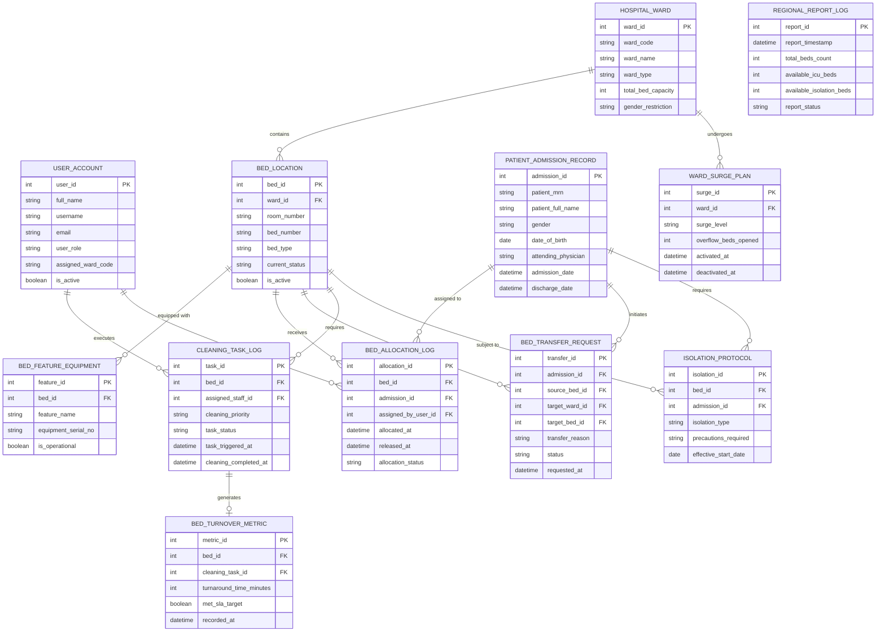

# Conceptual ERD — Hospital Bed Management System

## Mermaid Code

## Entity Description Table | Bảng mô tả Entity

| # | Entity Name | Vietnamese Name | Description | Key Attributes | Main Relationships |
|---|-------------|-----------------|-------------|----------------|-------------------|
| 1 | USER_ACCOUNT | Tài khoản Nguời dùng | System credentials and RBAC access roles for nurses, admissions officers, and managers. | `user_id`, `username`, `email`, `user_role`, `assigned_ward_code` | Manages `BED_ALLOCATION_LOG`, executes `CLEANING_TASK_LOG`. |
| 2 | HOSPITAL_WARD | Khoa / Phân khu Benh | Physical hospital ward or unit organizational entity (e.g., ICU, Cardiac Ward, Surgical Unit). | `ward_id`, `ward_code`, `ward_name`, `ward_type`, `total_bed_capacity` | Contains many `BED_LOCATION`, undergoes `WARD_SURGE_PLAN`. |
| 3 | BED_LOCATION | Vị trí Giường bệnh | Master record for individual physical hospital beds, room numbers, and current live status. | `bed_id`, `ward_id`, `room_number`, `bed_number`, `bed_type`, `current_status` | Belongs to `HOSPITAL_WARD`, equipped with `BED_FEATURE_EQUIPMENT`, receives `BED_ALLOCATION_LOG`. |
| 4 | BED_FEATURE_EQUIPMENT | Trang thiết bị Giường | Specific medical features attached to a bed (e.g., Telemetry Monitor, Bariatric frame, Ventilator port). | `feature_id`, `bed_id`, `feature_name`, `equipment_serial_no`, `is_operational` | Belongs to `BED_LOCATION`. |
| 5 | PATIENT_ADMISSION_RECORD | Hồ sơ Nhập viện | Clinical patient admission details synchronized from the EHR system. | `admission_id`, `patient_mrn`, `patient_full_name`, `gender`, `admission_date` | Assigned to `BED_ALLOCATION_LOG`, initiates `BED_TRANSFER_REQUEST`. |
| 6 | BED_ALLOCATION_LOG | Nhật ký Phân bổ Giường | Transactional history of patient assignments to specific bed locations over time. | `allocation_id`, `bed_id`, `admission_id`, `allocated_at`, `released_at`, `allocation_status` | Relates `PATIENT_ADMISSION_RECORD` to `BED_LOCATION`. |
| 7 | BED_TRANSFER_REQUEST | Yêu cầu Chuyển Giường | Patient inter-ward transfer requests, approvals, and execution movements. | `transfer_id`, `admission_id`, `source_bed_id`, `target_ward_id`, `transfer_reason` | Relates `PATIENT_ADMISSION_RECORD` to `BED_LOCATION` (source & target). |
| 8 | CLEANING_TASK_LOG | Nhật ký Vệ sinh Giường | Housekeeping work orders, cleaning stages, and sanitation completion timestamps. | `task_id`, `bed_id`, `assigned_staff_id`, `cleaning_priority`, `task_status` | Belongs to `BED_LOCATION`, executed by `USER_ACCOUNT`, generates `BED_TURNOVER_METRIC`. |
| 9 | ISOLATION_PROTOCOL | Giao thức Cách ly | Infection control requirements (Contact, Airborne, Droplet) assigned to a bed and patient. | `isolation_id`, `bed_id`, `admission_id`, `isolation_type`, `precautions_required` | Relates `PATIENT_ADMISSION_RECORD` and `BED_LOCATION`. |
| 10 | BED_TURNOVER_METRIC | Chỉ số Xoay vòng Giường | Analytical performance metrics tracking bed turnaround time (TAT) efficiency against SLAs. | `metric_id`, `bed_id`, `cleaning_task_id`, `turnaround_time_minutes`, `met_sla_target` | Belongs to `CLEANING_TASK_LOG`. |
| 11 | WARD_SURGE_PLAN | Kế hoạch Quá tải Khoa | Surge capacity logs when hospital opens temporary overflow beds during high occupancy. | `surge_id`, `ward_id`, `surge_level`, `overflow_beds_opened`, `activated_at` | Belongs to `HOSPITAL_WARD`. |
| 12 | REGIONAL_REPORT_LOG | Nhật ký Báo cáo Vùng | Compliance data snapshots of hospital bed capacity submitted to regional government health agencies. | `report_id`, `report_timestamp`, `total_beds_count`, `available_icu_beds`, `report_status` | Standalone analytical audit log. |

## Relationship Description | Mô tả Quan hệ

| # | From Entity | Cardinality | To Entity | Label | Business Explanation |
|---|-------------|-------------|-----------|-------|----------------------|
| 1 | HOSPITAL_WARD | 1 to 0..N | BED_LOCATION | contains | A hospital ward contains multiple physical bed locations. |
| 2 | BED_LOCATION | 1 to 0..N | BED_FEATURE_EQUIPMENT | equipped with | A bed location can be equipped with zero or more specialized medical features. |
| 3 | BED_LOCATION | 1 to 0..N | BED_ALLOCATION_LOG | receives | A bed location receives multiple patient allocation records over time. |
| 4 | PATIENT_ADMISSION_RECORD | 1 to 0..N | BED_ALLOCATION_LOG | assigned to | A patient admission record is linked to bed allocation history events. |
| 5 | PATIENT_ADMISSION_RECORD | 1 to 0..N | BED_TRANSFER_REQUEST | initiates | A patient admission record can have multiple bed transfer requests. |
| 6 | BED_LOCATION | 1 to 0..N | BED_TRANSFER_REQUEST | acts as source for | A bed location serves as the source bed for transfer requests. |
| 7 | BED_LOCATION | 1 to 0..N | CLEANING_TASK_LOG | requires | A vacated bed location requires housekeeping cleaning tasks. |
| 8 | USER_ACCOUNT | 1 to 0..N | CLEANING_TASK_LOG | executes | A housekeeping staff user account accepts and executes cleaning task logs. |
| 9 | BED_LOCATION | 1 to 0..N | ISOLATION_PROTOCOL | subject to | A bed location can be tagged with active infection control isolation protocols. |
| 10 | PATIENT_ADMISSION_RECORD | 1 to 0..N | ISOLATION_PROTOCOL | requires | A patient's diagnosis may require specific isolation protocols. |
| 11 | CLEANING_TASK_LOG | 1 to 0..1 | BED_TURNOVER_METRIC | generates | Each completed cleaning task generates a bed turnaround time (TAT) metric record. |
| 12 | HOSPITAL_WARD | 1 to 0..N | WARD_SURGE_PLAN | undergoes | A hospital ward can undergo surge capacity plan activations during peak volume. |
| 13 | USER_ACCOUNT | 1 to 0..N | BED_ALLOCATION_LOG | manages | An admissions officer user account manages patient bed allocations. |
