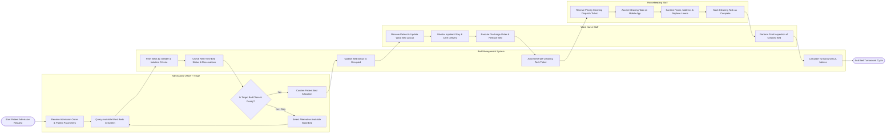

# Swimlane Diagram — Hospital Bed Management System

## Mermaid Code

## Flow Description | Mô tả luồng

| Lane | Actor | Role in Flow |
|------|-------|-------------|
| 1 | Admissions Officer / Triage | Ingests admission orders, queries the system for available beds matching clinical requirements, evaluates bed readiness, confirms placement, or selects alternative beds. |
| 2 | Bed Management System | Processes automated matching filters (gender, isolation, telemetry), verifies live bed status, updates database records to `Occupied`, triggers housekeeping work orders upon discharge, and computes turnaround SLA metrics. |
| 3 | Ward Nurse Staff | Welcomes patient to ward unit, manages bed placement, executes discharge orders when care is finished, releases bed, and conducts final inspection of sanitized beds. |
| 4 | Housekeeping Staff | Receives automated cleaning task tickets, accepts work orders via mobile app, sanitizes mattress/room according to biohazard protocols, and updates task status to `Clean & Pending Inspection`. |
