# Action Tree — Hospital Bed Management System

## Mermaid Code

```mermaid
graph TD
    Root["Hospital Bed Management System"]

    Root --> M1["Ward & Bed Master Setup"]
    Root --> M2["Bed Allocation & Patient Placement"]
    Root --> M3["Bed Transfer & Surge Management"]
    Root --> M4["Housekeeping & Bed Turnaround"]
    Root --> M5["Clinical Isolation & Equipment Control"]
    Root --> M6["Bed Analytics & Capacity Forecast"]

    M1 --> A11["Configure Ward Hierarchy & Structures"]
    M1 --> A12["Define Room & Bed ID Taxonomies"]
    M1 --> A13["Set Ward Gender & Specialty Constraints"]
    M1 --> A14["Maintain Bed Operational Statuses"]

    M2 --> A21["Search Available Beds by Clinical Criteria"]
    M2 --> A22["Reserve Beds for Emergency & Surgical Intake"]
    M2 --> A23["Allocate Confirmed Inpatient Bed Placement"]
    M2 --> A24["Process Physical Patient Bed Discharge"]

    M3 --> A31["Request Inter-Ward Patient Bed Transfer"]
    M3 --> A32["Approve Pending Bed Transfer Tickets"]
    M3 --> A33["Activate Emergency Surge Capacity Overflow"]
    M3 --> A34["Override Bed Reservation Priority Rules"]

    M4 --> A41["Dispatch Automated Dirty Bed Cleaning Tickets"]
    M4 --> A42["Accept & Update Housekeeping Progress"]
    M4 --> A43["Inspect & Sign-Off Bed Sanitization"]
    M4 --> A44["Track Bed Turnaround Time SLA Performance"]

    M5 --> A51["Assign Infection Control Isolation Tags"]
    M5 --> A52["Attach Medical Telemetry & Bariatric Equipment"]
    M5 --> A53["Flag Bed Maintenance & Engineering Defects"]
    M5 --> A54["Deactivate Contaminated Room Locations"]

    M6 --> A61["View Interactive Real-Time Hospital Bed Map"]
    M6 --> A62["Generate Ward Occupancy & Bottleneck Heatmaps"]
    M6 --> A63["Predict Upcoming Bed Availability Shortages"]
    M6 --> A64["Export Regional ICU & Isolation Bed Capacity Reports"]
```

## Module Description | Mô tả Module

| # | Module | Description | Actions |
|---|--------|-------------|---------|
| 1 | Ward & Bed Master Setup | Establishes hospital ward hierarchies, room numbers, bed taxonomies, gender restrictions, specialty ward definitions, and bed operational lifecycle states. | Configure Ward Hierarchy, Define Room & Bed Taxonomies, Set Ward Constraints, Maintain Operational Statuses. |
| 2 | Bed Allocation & Patient Placement | Facilitates automated bed matching, emergency/surgical bed reservations, patient placement assignment, and bed release processing upon discharge. | Search Available Beds, Reserve Intake Beds, Allocate Inpatient Bed Placement, Process Physical Discharge. |
| 3 | Bed Transfer & Surge Management | Manages inter-ward patient transfer requests, receiving ward approvals, surge overflow bed activations, and reservation priority queue overrides. | Request Inter-Ward Transfer, Approve Transfer Tickets, Activate Surge Capacity Overflow, Override Priority Rules. |
| 4 | Housekeeping & Bed Turnaround | Orchestrates environmental cleaning work order dispatches, mobile housekeeping progress tracking, bed inspection sign-offs, and turnaround SLA metrics. | Dispatch Cleaning Tickets, Update Housekeeping Progress, Inspect Bed Sanitization, Track Turnaround Time SLAs. |
| 5 | Clinical Isolation & Equipment Control | Controls infection isolation tagging (Contact, Airborne), specialized bed equipment tracking (Telemetry, Bariatric), and maintenance defect ticketing. | Assign Isolation Tags, Attach Telemetry/Bariatric Equipment, Flag Engineering Defects, Deactivate Contaminated Rooms. |
| 6 | Bed Analytics & Capacity Forecast | Renders interactive real-time hospital bed maps, ward occupancy heatmaps, predictive bottleneck analytics, and regional compliance reporting. | View Interactive Bed Map, Generate Occupancy Heatmaps, Predict Bed Availability Shortages, Export Regional Capacity Reports. |
