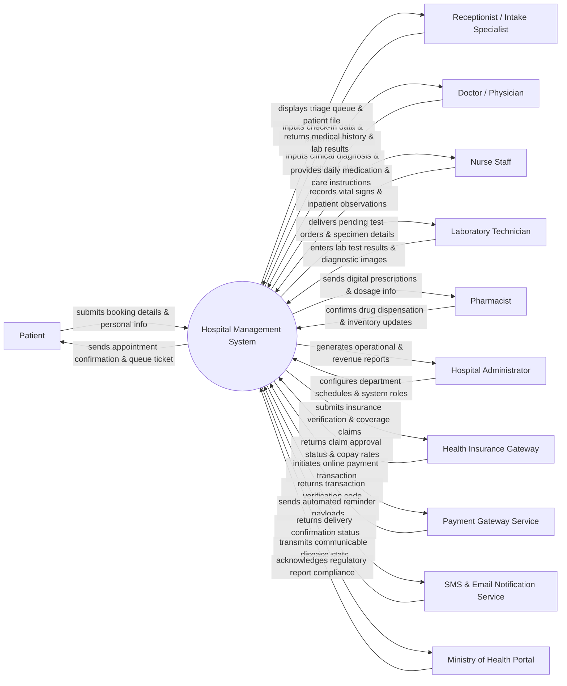

# Context Diagram — Hospital Management System

## Mermaid Code

## Actor & Interaction Table | Bảng Actor & Tương tác

| # | Actor | Actor Type | Data Sent TO System | Data Received FROM System | Notes |
|---|-------|------------|---------------------|---------------------------|-------|
| 1 | Patient | Primary | Personal demographics, symptom details, appointment booking requests, payment information. | Appointment reminders, queue numbers, digital medical summaries, bill invoices. | End-user accessing outpatient booking and personal health record features. |
| 2 | Doctor / Physician | Primary | Clinical notes, ICD-10 diagnostic codes, electronic prescriptions, lab/radiology orders, discharge orders. | Patient medical history, vital signs history, lab/radiology results, drug interaction alerts. | Healthcare provider responsible for diagnosis, treatment planning, and ordering tests. |
| 3 | Nurse Staff | Primary | Triage vital signs, nursing assessment notes, daily medication administration records (MAR), bed updates. | Doctor orders, patient allergy alerts, shift care plans, inpatient bed allocation matrix. | Clinical support staff performing triage, inpatient monitoring, and administering prescribed care. |
| 4 | Receptionist / Intake Specialist | Primary | Patient registration info, insurance cards, walk-in check-in data, consultation queue assignments. | Available doctor slots, patient identity lookup, consultation fees, queue status displays. | Front-desk staff managing patient registration, queueing, and initial intake workflows. |
| 5 | Pharmacist | Primary | Dispensing verification records, inventory stock adjustments, drug batch allocations, fulfillment updates. | Valid e-prescriptions, dosage instructions, patient allergy profile, drug stock availability. | Pharmacy staff handling prescription verification, medicine dispensing, and drug inventory control. |
| 6 | Laboratory Technician | Primary | Specimen status, laboratory test values, pathology reports, diagnostic imaging file attachments. | Pending lab test requisitions, patient identification barcodes, doctor ordering notes. | Diagnostic staff executing blood, pathology, and imaging tests ordered by physicians. |
| 7 | Hospital Administrator | Primary | System user management, department schedules, fee tariffs, security permissions, audit policies. | Operational performance analytics, financial revenue summaries, system access logs, occupancy metrics. | Management role overseeing hospital operations, compliance, staffing, and system administration. |
| 8 | Health Insurance Gateway | Supporting | Insurance coverage status, pre-authorization approvals, co-pay rules, claim settlement responses. | Electronic insurance verification requests, itemized claim details, medical codes (ICD/CPT). | Third-party or government insurance verification and claim settlement platform API. |
| 9 | Payment Gateway Service | Supporting | Credit/debit card tokens, QR payment confirmations, electronic transaction IDs, status webhooks. | Transaction payment requests, merchant identifiers, order bill amounts. | External financial service handling cashless digital payments (credit card, bank transfers, e-wallets). |
| 10 | SMS & Email Notification Service | Supporting | Message delivery status updates, push notification status codes, failure alerts. | Notification templates, target phone/email addresses, message contents (OTP, reminders). | Third-party communication provider sending SMS, Zalo, and Email notifications to users. |
| 11 | Ministry of Health Portal | Regulatory | Regulatory compliance guidelines, mandatory disease reporting standards, approval receipts. | Communicable disease statistics, hospital capacity reports, national health index metrics. | Governmental health authority requiring automated reporting for public health surveillance. |

## System Boundary Description | Mô tả Phạn vi Hệ thống

The **Hospital Management System (HMS)** serves as an integrated enterprise platform that automates administrative, clinical, financial, and operational workflows across outpatient clinics and inpatient wards. 

**Inside System Scope:**
- Management of patient registration, master patient index (MPI), appointment scheduling, and outpatient queue tracking.
- Electronic Health Records (EHR), physician consultation notes, diagnostic test ordering, and electronic prescribing (e-Rx).
- Inpatient bed management, admission, daily nursing rounds, medication administration records (MAR), and discharge summaries.
- Pharmacy dispensing, laboratory test result processing, cashier billing, co-pay calculation, and itemized invoicing.
- User authentication, role-based access control (RBAC), department scheduling, and operational/financial reporting.

**Outside System Scope:**
- Direct processing of bank transactions (delegated to external Payment Gateways).
- Standalone laboratory machine automation/hardware calibration (handled by independent LIS/PACS hardware, integrated via APIs).
- Direct national insurance policy determination (delegated to external Health Insurance Portal APIs).
- Physical delivery and courier transport of pharmacy medications.
