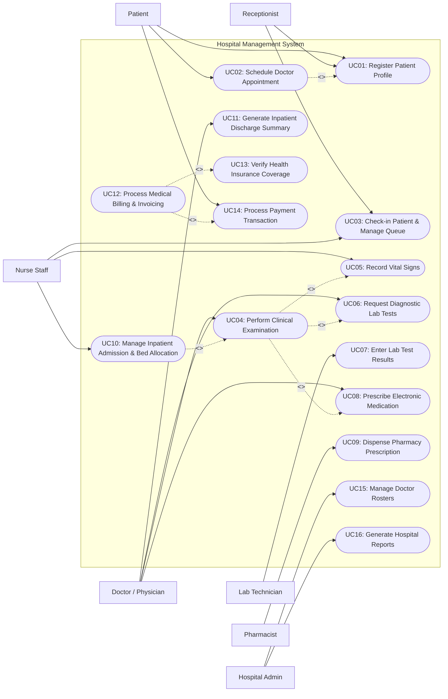

# Use Case Diagram — Hospital Management System

## Mermaid Code

## Actor Table | Bảng Actor

| # | Actor | Actor Type | Role Description | Related Use Cases |
|---|-------|------------|------------------|-------------------|
| 1 | Patient | Primary | Outpatient or inpatient receiving healthcare services and making appointments/payments. | UC01, UC02, UC14 |
| 2 | Receptionist | Primary | Front-desk staff handling registration, patient check-in, demographic updates, and ticket queueing. | UC01, UC03 |
| 3 | Nurse Staff | Primary | Healthcare practitioner recording vital signs, performing triage, and managing inpatient room allocations. | UC03, UC05, UC10 |
| 4 | Doctor / Physician | Primary | Licensed medical professional examining patients, ordering lab tests, prescribing drugs, and authorizing discharges. | UC04, UC06, UC08, UC11 |
| 5 | Lab Technician | Primary | Laboratory specialist executing blood, tissue, or radiology exams and inputting laboratory findings. | UC07 |
| 6 | Pharmacist | Primary | Pharmacy staff reviewing electronic prescriptions, checking drug interactions, and dispensing medication. | UC09 |
| 7 | Hospital Admin | Primary | Management personnel configuring department master data, physician rosters, user roles, and viewing analytics. | UC15, UC16 |
| 8 | Health Insurance Gateway | System | Supporting system performing real-time insurance validation, co-pay calculation, and pre-authorization. | UC13 |
| 9 | Payment Gateway Service | System | Supporting financial portal executing online credit card and mobile wallet settlement. | UC14 |

## Use Case Table | Bảng Use Case

| # | UC ID | Use Case Name | Primary Actor | Secondary Actor | Description | Priority |
|---|-------|---------------|---------------|-----------------|-------------|----------|
| 1 | UC01 | Register Patient Profile | Receptionist / Patient | None | Capture and maintain patient demographic, emergency contact, and medical history details. | High |
| 2 | UC02 | Schedule Doctor Appointment | Patient | Receptionist | Reserve consultation time slots with specific physicians or specialty departments. | High |
| 3 | UC03 | Check-in Patient & Manage Queue | Receptionist | Nurse Staff | Validate arrival, assign queue numbers, and route patients to clinical waiting areas. | High |
| 4 | UC04 | Perform Clinical Examination | Doctor / Physician | Nurse Staff | Examine patient, record clinical notes, diagnose ailments (ICD-10), and define care plans. | High |
| 5 | UC05 | Record Vital Signs | Nurse Staff | Doctor | Measure and record patient body temperature, blood pressure, pulse, rate, and SPO2. | High |
| 6 | UC06 | Request Diagnostic Lab Tests | Doctor / Physician | Lab Technician | Order laboratory or radiology investigations based on preliminary clinical evaluation. | High |
| 7 | UC07 | Enter Lab Test Results | Lab Technician | Doctor | Upload lab examination data, biological metrics, and diagnostic imaging reports into EHR. | High |
| 8 | UC08 | Prescribe Electronic Medication | Doctor / Physician | Pharmacist | Generate electronic prescriptions (e-Rx) with drug details, dosage, frequency, and duration. | High |
| 9 | UC09 | Dispense Pharmacy Prescription | Pharmacist | Patient | Verify e-Rx validity, check drug stock/allergies, package medicine, and issue dosage instructions. | High |
| 10 | UC10 | Manage Inpatient Admission & Bed Allocation | Nurse Staff | Doctor | Transfer patient from ER/outpatient to inpatient department and assign an available ward bed. | Medium |
| 11 | UC11 | Generate Inpatient Discharge Summary | Doctor / Physician | Nurse Staff | Finalize inpatient treatment, record recovery outcome, generate discharge summary and follow-up plan. | Medium |
| 12 | UC12 | Process Medical Billing & Invoicing | Receptionist / Cashier | Insurance Gateway | Calculate consultation, test, room, and drug charges, apply insurance coverage, and issue invoice. | High |
| 13 | UC13 | Verify Health Insurance Coverage | Receptionist / Cashier | Insurance Gateway | Query insurance API to verify policy validity, claim benefit limits, and deductible percentages. | High |
| 14 | UC14 | Process Payment Transaction | Patient / Cashier | Payment Gateway | Accept cashless (card/QR) or cash payments and produce official financial receipts. | High |
| 15 | UC15 | Manage Doctor Rosters | Hospital Admin | Doctor | Define shift hours, room assignments, on-call schedules, and doctor leave calendars. | Medium |
| 16 | UC16 | Generate Hospital Reports | Hospital Admin | None | Aggregate bed occupancy rates, revenue metrics, outpatient counts, and pharmacy consumption. | Medium |

## Use Case Specification | Đặc tả Use Case

---

### UC02 — Schedule Doctor Appointment

| Field | Detail |
|-------|--------|
| **UC ID** | UC02 |
| **Use Case Name** | Schedule Doctor Appointment |
| **Actor(s)** | Primary: Patient   Secondary: Receptionist, Notification Service |
| **Description** | Allows a patient (or receptionist on behalf of a patient) to select a department, choose an available physician, pick an open date/time slot, and confirm an outpatient consultation appointment. |
| **Precondition** | 1. Patient profile must exist in the system (UC01 completed).   2. Physician schedules and availability rosters must be published for the requested date. |
| **Main Flow** | 1. Patient logs into the portal/app (or receptionist opens appointment module) and selects "Book Appointment".   2. System displays medical specialties and list of available doctors.   3. Patient selects a doctor and views the interactive availability calendar.   4. Patient selects an open time slot and enters reason for visit / chief complaint.   5. System validates slot availability, reserves the slot temporarily, and prompts for confirmation.   6. Patient confirms booking request.   7. System records appointment record, generates unique booking reference number, sends confirmation SMS/Email, and displays booking details. |
| **Alternative Flow** | **AF1** — First-time Patient Registration: If patient is not registered, system prompts for quick demographic input to complete UC01 before resuming slot selection.   **AF2** — Preferred Doctor Unavailable: If doctor has no open slots, system presents available alternative doctors in the same specialty or next available date. |
| **Exception Flow** | **EX1** — Slot Concurrently Booked: If selected slot was reserved by another user within the window, system displays error "Slot no longer available" and refreshes open slots.   **EX2** — Doctor Emergency Absence: If doctor is marked unavailable due to emergency, system notifies patient and offers automatic reschedule options. |
| **Postcondition** | Appointment status is set to "Scheduled", doctor slot is marked reserved, and notification queue entry is created. |
| **Business Rule** | **BR1**: Appointments must be booked at least 2 hours in advance of slot time.   **BR2**: A patient cannot hold more than 2 pending appointments with the same doctor on the same date. |

---

### UC04 — Perform Clinical Examination

| Field | Detail |
|-------|--------|
| **UC ID** | UC04 |
| **Use Case Name** | Perform Clinical Examination |
| **Actor(s)** | Primary: Doctor / Physician   Secondary: Nurse Staff |
| **Description** | Physician conducts clinical evaluation of patient, reviews vital signs, records medical history/symptoms, selects ICD-10 diagnostic codes, and formulates treatment plan. |
| **Precondition** | 1. Patient must be checked in and queued for the doctor's consultation room (UC03).   2. Nurse must have recorded initial vital signs (UC05). |
| **Main Flow** | 1. Doctor selects patient from daily consultation queue list in system.   2. System opens patient Electronic Health Record (EHR) containing triage vital signs and past medical history.   3. Doctor performs physical examination and inputs chief complaint, history of present illness (HPI), and clinical findings.   4. Doctor searches and selects appropriate primary and secondary ICD-10 diagnostic codes.   5. Doctor outlines physician clinical recommendations and treatment plan.   6. Doctor saves consultation record.   7. System saves clinical note, marks queue item as "In Progress / Examined", and enables order options (UC06 / UC08). |
| **Alternative Flow** | **AF1** — Follow-up Visit Review: If consultation is a follow-up, doctor compares current vital signs and symptom trends against previous encounter records in EHR.   **AF2** — Inpatient Admission Recommendation: If patient requires urgent hospitalization, doctor triggers inpatient admission workflow (UC10). |
| **Exception Flow** | **EX1** — Missing Vital Signs: If vital signs were not recorded at intake, system displays warning prompt and allows doctor to directly record vitals or alert nurse.   **EX2** — Patient Data Access Lock: If patient EHR is currently open by another physician, system permits read access but locks editing until previous session releases lock. |
| **Postcondition** | Consultation record is stored with timestamp, doctor digital signature, assigned ICD-10 codes, and clinical documentation. |
| **Business Rule** | **BR1**: Every saved consultation record must include at least one primary ICD-10 diagnostic code.   **BR2**: Clinical notes recorded by an attending physician cannot be deleted, only amended via addendum records. |

---

### UC08 — Prescribe Electronic Medication

| Field | Detail |
|-------|--------|
| **UC ID** | UC08 |
| **Use Case Name** | Prescribe Electronic Medication |
| **Actor(s)** | Primary: Doctor / Physician   Secondary: Pharmacist |
| **Description** | Physician orders prescription drugs electronically for outpatient fulfillment or inpatient administration, specifying dosage, route, frequency, and duration. |
| **Precondition** | 1. Doctor has an active clinical examination session (UC04) for the patient.   2. Hospital pharmacy drug master catalog is loaded and online. |
| **Main Flow** | 1. Doctor selects "Create Prescription" within the patient clinical session.   2. System displays drug search interface with current pharmacy inventory status and allergy warnings.   3. Doctor searches drug by generic or brand name and selects medication.   4. Doctor inputs dosage (e.g., 500mg), administration route (e.g., Oral), frequency (e.g., BID / twice daily), and duration (e.g., 7 days).   5. System checks for potential drug-drug interactions, patient allergy flags, and maximum daily dose limits.   6. Doctor reviews summary list of prescribed items and signs e-prescription.   7. System locks prescription, assigns e-Rx ID, and routes prescription to pharmacy fulfillment queue (UC09). |
| **Alternative Flow** | **AF1** — Off-Catalog Drug Order: If medication is not stocked in hospital pharmacy, doctor selects "External Prescription" to generate printable/digital PDF for outside pharmacy.   **AF2** — Chronic Refill Order: Doctor loads patient previous prescription history and selects "Reorder Duplicate" with adjusted duration. |
| **Exception Flow** | **EX1** — Severe Allergy Alert: System detects patient allergy to prescribed penicillin group; system displays critical warning pop-up requiring doctor to choose alternative drug or enter explicit clinical override justification.   **EX2** — Stock Out Alert: System alerts doctor that prescribed drug is out of stock in main hospital pharmacy, recommending equivalent substitute in stock. |
| **Postcondition** | Electronic prescription (e-Rx) is saved, linked to patient encounter, and rendered visible in pharmacy dispensing portal. |
| **Business Rule** | **BR1**: Narcotics and controlled substances require mandatory secondary authorization PIN from prescribing physician.   **BR2**: System must enforce automated drug interaction screening against current patient active medication list. |

---

### UC12 — Process Medical Billing & Invoicing

| Field | Detail |
|-------|--------|
| **UC ID** | UC12 |
| **Use Case Name** | Process Medical Billing & Invoicing |
| **Actor(s)** | Primary: Receptionist / Cashier   Secondary: Health Insurance Gateway |
| **Description** | Aggregates all charges incurred during consultation, diagnostic tests, prescriptions, and room stays, applies insurance coverage rates, and generates final itemized bill. |
| **Precondition** | 1. Patient consultation, lab tests, and pharmacy orders are marked completed or pending payment.   2. Price tariffs for medical services and hospital fees are active in system master data. |
| **Main Flow** | 1. Cashier opens medical billing module and enters patient ID or encounter ID.   2. System retrieves all unbilled fee items (consultation fee, lab orders, pharmacy items, room charges).   3. Cashier selects insurance coverage verification (UC13) to determine insurance eligible amounts.   4. System calculates total bill amount, insurance covered portion, and remaining patient co-pay amount.   5. Cashier reviews itemized line items with patient/family and clicks "Generate Final Invoice".   6. System generates official tax invoice with invoice ID and payment due breakdown.   7. Cashier initiates payment collection workflow (UC14). |
| **Alternative Flow** | **AF1** — Self-Pay Patient: If patient has no insurance, system bypasses UC13 verification and applies standard out-of-pocket pricing or promotional discounts.   **AF2** — Inpatient Interim Billing: Cashier generates preliminary progress bill for long-stay inpatients without closing the encounter. |
| **Exception Flow** | **EX1** — Disputed Line Item: Patient challenges an unperformed lab test fee; cashier places item on hold pending department manager verification.   **EX2** — Insurance Claim Rejection: Insurance API returns status "Policy Lapsed"; system recalculates total charges as 100% patient self-pay responsibility. |
| **Postcondition** | Invoice status transitions from "Draft" to "Unpaid / Pending Payment", financial ledger records line items, and receipt printing is unlocked. |
| **Business Rule** | **BR1**: Invoices cannot be finalized if there are pending unconfirmed emergency lab test charges.   **BR2**: Discounts exceeding 10% of total bill value require supervisor electronic signature approval. |

---

### UC13 — Verify Health Insurance Coverage

| Field | Detail |
|-------|--------|
| **UC ID** | UC13 |
| **Use Case Name** | Verify Health Insurance Coverage |
| **Actor(s)** | Primary: Receptionist / Cashier   Secondary: Health Insurance Gateway |
| **Description** | Transmits patient insurance card credentials to external insurance gateway to verify real-time policy validity, benefit caps, and co-payment ratios. |
| **Precondition** | 1. Patient insurance card ID, policy number, and national ID are recorded in patient profile.   2. Connection to Health Insurance Gateway API is active. |
| **Main Flow** | 1. Cashier initiates insurance verification during registration or billing workflow.   2. System constructs encrypted API payload containing patient identity, insurance number, and encounter ICD-10 code.   3. System sends SOAP/REST request to external Health Insurance Gateway.   4. Health Insurance Gateway verifies member active coverage, remaining annual benefit balance, and coverage tier.   5. Health Insurance Gateway returns approval response with co-pay percentage (e.g., 20% patient co-pay, 80% coverage) and authorization code.   6. System automatically updates invoice billing rules with verified co-pay metrics.   7. Cashier views green "Insurance Validated" status on billing screen. |
| **Alternative Flow** | **AF1** — Pre-authorization Required: Gateway returns flag "Pre-auth required for MRI scan"; cashier routes pre-auth request form to hospital insurance desk.   **AF2** — Secondary Insurance Policy: Cashier adds secondary insurance policy details to execute secondary claim calculation. |
| **Exception Flow** | **EX1** — Gateway Connection Timeout: External insurance server fails to respond within 15 seconds; system alerts cashier and offers "Retry" or "Proceed with Offline Verification".   **EX2** — Invalid Policy Number: Gateway returns error code "Member Not Found"; system prompts cashier to recheck card number or change payment mode to self-pay. |
| **Postcondition** | Insurance verification status, authorization code, coverage limit, and patient co-pay percentage are logged in encounter billing record. |
| **Business Rule** | **BR1**: Insurance verification responses are cached for 24 hours per encounter to avoid redundant API queries.   **BR2**: Services not listed in government/private insurance coverage catalogs must automatically default to 100% patient payment. |
