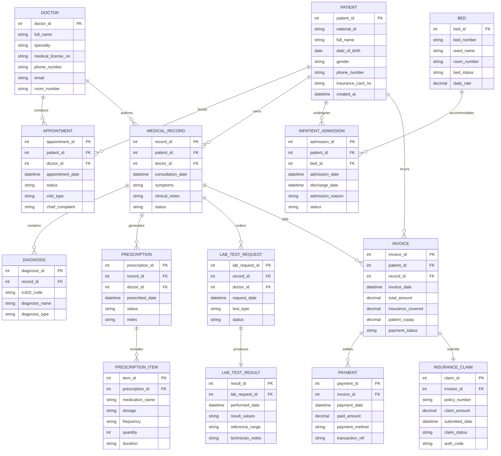

# Conceptual ERD — Hospital Management System

## Mermaid Code

## Entity Description Table | Bảng mô tả Entity

| # | Entity Name | Vietnamese Name | Description | Key Attributes | Main Relationships |
|---|-------------|-----------------|-------------|----------------|-------------------|
| 1 | PATIENT | Bệnh nhân | Master entity storing patient demographic and medical identity details. | patient_id (PK), national_id, full_name, date_of_birth, insurance_card_no | Has many APPOINTMENT, MEDICAL_RECORD, INPATIENT_ADMISSION, INVOICE |
| 2 | DOCTOR | Bác sĩ | Stores healthcare provider personal data, specialty, and room info. | doctor_id (PK), full_name, specialty, medical_license_no | Has many APPOINTMENT, MEDICAL_RECORD, PRESCRIPTION, LAB_TEST_REQUEST |
| 3 | APPOINTMENT | Lịch hẹn | Represents a scheduled outpatient consultation slot between a patient and doctor. | appointment_id (PK), patient_id (FK), doctor_id (FK), appointment_date, status | Belongs to PATIENT, DOCTOR |
| 4 | MEDICAL_RECORD | Hồ sơ bệnh án (EHR) | Encounter record detailing consultation findings, clinical notes, and treatment plan. | record_id (PK), patient_id (FK), doctor_id (FK), consultation_date, symptoms | Belongs to PATIENT, DOCTOR; Has many DIAGNOSIS, PRESCRIPTION, LAB_TEST_REQUEST, INVOICE |
| 5 | DIAGNOSIS | Chẩn đoán y khoa | Stores medical diagnoses mapped to standard ICD-10 codes for an encounter. | diagnosis_id (PK), record_id (FK), icd10_code, diagnosis_name | Belongs to MEDICAL_RECORD |
| 6 | PRESCRIPTION | Đơn thuốc | Electronic prescription header authorized by a physician during consultation. | prescription_id (PK), record_id (FK), doctor_id (FK), prescribed_date, status | Belongs to MEDICAL_RECORD, DOCTOR; Has many PRESCRIPTION_ITEM |
| 7 | PRESCRIPTION_ITEM | Chi tiết đơn thuốc | Line item specifying medication name, dosage, frequency, and treatment duration. | item_id (PK), prescription_id (FK), medication_name, dosage, frequency, duration | Belongs to PRESCRIPTION |
| 8 | LAB_TEST_REQUEST | Yêu cầu xét nghiệm | Requisition header for laboratory or imaging diagnostic procedures ordered by doctor. | lab_request_id (PK), record_id (FK), doctor_id (FK), test_type, status | Belongs to MEDICAL_RECORD, DOCTOR; Has one LAB_TEST_RESULT |
| 9 | LAB_TEST_RESULT | Kết quả xét nghiệm | Detailed findings, test metrics, and technician notes resulting from a lab request. | result_id (PK), lab_request_id (FK), performed_date, result_values, reference_range | Belongs to LAB_TEST_REQUEST |
| 10 | INPATIENT_ADMISSION | Nhập viện | Inpatient stay record tracking hospitalization period, bed assignment, and reason. | admission_id (PK), patient_id (FK), bed_id (FK), admission_date, discharge_date | Belongs to PATIENT, BED |
| 11 | BED | Giường bệnh | Ward bed master entity tracking bed location, occupancy status, and daily tariff. | bed_id (PK), bed_number, ward_name, room_number, bed_status, daily_rate | Has many INPATIENT_ADMISSION |
| 12 | INVOICE | Hóa đơn viện phí | Aggregated bill for medical services, tests, medicines, and room charges. | invoice_id (PK), patient_id (FK), record_id (FK), total_amount, patient_copay | Belongs to PATIENT, MEDICAL_RECORD; Has many PAYMENT; Has one INSURANCE_CLAIM |
| 13 | PAYMENT | Giao dịch thanh toán | Payment transaction record recording cash/cashless settlement against an invoice. | payment_id (PK), invoice_id (FK), payment_date, paid_amount, payment_method | Belongs to INVOICE |
| 14 | INSURANCE_CLAIM | Yêu cầu bảo hiểm | Claim transaction submitted to health insurance gateway for coverage reimbursement. | claim_id (PK), invoice_id (FK), policy_number, claim_amount, claim_status | Belongs to INVOICE |

## Relationship Description | Mô tả Quan hệ

| # | From Entity | Cardinality | To Entity | Relationship Label | Business Explanation |
|---|-------------|-------------|-----------|-------------------|----------------------|
| 1 | PATIENT | one-to-many | APPOINTMENT | books | Một bệnh nhân có thể đăng ký nhiều lịch hẹn khám bệnh. |
| 2 | DOCTOR | one-to-many | APPOINTMENT | conducts | Một bác sĩ thực hiện nhiều lịch hẹn khám bệnh trong ngày. |
| 3 | PATIENT | one-to-many | MEDICAL_RECORD | owns | Một bệnh nhân sở hữu nhiều hồ sơ bệnh án qua các lần khám. |
| 4 | DOCTOR | one-to-many | MEDICAL_RECORD | authors | Một bác sĩ lập nhiều hồ sơ bệnh án cho các bệnh nhân khác nhau. |
| 5 | MEDICAL_RECORD | one-to-many | DIAGNOSIS | contains | Một hồ sơ bệnh án có thể ghi nhận một hoặc nhiều mã chẩn đoán ICD-10. |
| 6 | MEDICAL_RECORD | one-to-many | PRESCRIPTION | generates | Một lượt khám có thể tạo ra một hoặc nhiều đơn thuốc (thuốc đông y, tây y). |
| 7 | PRESCRIPTION | one-to-many | PRESCRIPTION_ITEM | includes | Một đơn thuốc chứa nhiều chi tiết thuốc với liều dùng và cách dùng cụ thể. |
| 8 | MEDICAL_RECORD | one-to-many | LAB_TEST_REQUEST | orders | Một lượt khám có thể chỉ định nhiều yêu cầu xét nghiệm/chẩn đoán hình ảnh. |
| 9 | LAB_TEST_REQUEST | one-to-one | LAB_TEST_RESULT | produces | Mỗi yêu cầu xét nghiệm tạo ra đúng một phiếu trả kết quả xét nghiệm. |
| 10 | PATIENT | one-to-many | INPATIENT_ADMISSION | undergoes | Một bệnh nhân có thể trải qua nhiều đợt điều trị nội trú khác nhau. |
| 11 | BED | one-to-many | INPATIENT_ADMISSION | accommodates | Một giường bệnh phục vụ nhiều lượt bệnh nhân nhập viện theo thời gian. |
| 12 | PATIENT | one-to-many | INVOICE | incurs | Một bệnh nhân phát sinh nhiều hóa đơn thanh toán viện phí. |
| 13 | MEDICAL_RECORD | one-to-many | INVOICE | bills | Một lượt khám/điều trị tính toán chi phí để phát sinh hóa đơn. |
| 14 | INVOICE | one-to-many | PAYMENT | settles | Một hóa đơn có thể được thanh toán làm nhiều lần hoặc qua nhiều phương thức. |
| 15 | INVOICE | one-to-one | INSURANCE_CLAIM | submits | Mỗi hóa đơn viện phí có bảo hiểm xuất ra đúng một hồ sơ yêu cầu thanh toán bảo hiểm. |
