# Swimlane Diagram — Hospital Management System

## Mermaid Code

```mermaid
flowchart LR
    Start(["Start Outpatient Visit"])

    subgraph Lane1["Patient"]
        P1["Arrive at Hospital & Present ID"]
        P2["Proceed to Doctor Consultation Room"]
        P3["Undergo Diagnostic Tests if Required"]
        P4["Review Bill & Make Co-pay Payment"]
        P5["Receive Dispensed Medication & Leave"]
    end

    subgraph Lane2["Receptionist / Cashier"]
        R1["Search Profile & Register Check-in"]
        R2["Assign Consultation Room & Queue Ticket"]
        R3["Verify Insurance Coverage & Create Invoice"]
        R4["Collect Payment & Issue Official Receipt"]
    end

    subgraph Lane3["Doctor / Physician"]
        D1["Call Next Patient & Examine"]
        D2{"Need Diagnostic Tests?"}
        D3["Order Diagnostic Lab & Imaging Tests"]
        D4["Evaluate Test Results & Diagnose"]
        D5["Issue Electronic Prescription (e-Rx)"]
    end

    subgraph Lane4["Lab Technician / Pharmacist"]
        L1["Collect Specimen & Perform Lab Test"]
        L2["Enter & Publish Test Results"]
        PH1["Review e-Rx & Verify Drug Allergies"]
        PH2["Dispense Medicine & Counsel Patient"]
    end

    subgraph Lane5["Hospital Management System"]
        S1["Generate Queue Token & Notify Nurse"]
        S2["Route Test Orders to LIS Worklist"]
        S3["Update EHR & Send Notification to Doctor"]
        S4["Calculate Tariff, Insurance Co-pay & Bill"]
        S5["Deduct Inventory Stock & Log Transaction"]
    end

    Finish(["End Outpatient Encounter"])

    Start --> P1 --> R1 --> S1 --> R2 --> P2 --> D1 --> D2
    D2 -->|"Yes"| D3 --> S2 --> L1 --> L2 --> S3 --> D4
    D2 -->|"No"| D4
    D4 --> D5 --> PH1 --> PH2 --> S5 --> P5 --> Finish
    D5 --> R3 --> S4 --> R4 --> P4 --> PH1
```

## Flow Description | Mô tả luồng

| Lane | Actor / System | Role in Flow |
|------|----------------|--------------|
| 1 | Patient | Initiates encounter, provides personal identification, attends physician examination, undergoes lab tests, settles medical co-payment, and collects dispensed drugs. |
| 2 | Receptionist / Cashier | Manages front-desk check-in, issues queue tickets, verifies health insurance eligibility, creates final invoices, and processes patient payments. |
| 3 | Doctor / Physician | Conducts clinical examination, decides on diagnostic tests, interprets lab/radiology findings, records ICD-10 diagnosis, and authorizes electronic prescriptions. |
| 4 | Lab Technician / Pharmacist | Executes ordered laboratory/radiology tests, publishes biological test metrics to EHR, verifies e-Rx details against inventory, and dispenses prescribed drugs to patient. |
| 5 | Hospital Management System | Automates queue routing, synchronizes LIS test worklists, calculates itemized tariffs and insurance coverage breakdown, updates inventory stock levels, and records transaction logs. |
