# Action Tree — Hospital Management System

## Mermaid Code

```mermaid
graph TD
    Root["Hospital Management System"]

    Root --> M1["1. Patient Management"]
    Root --> M2["2. Appointment & Queue"]
    Root --> M3["3. EHR & Clinical Care"]
    Root --> M4["4. Lab & Radiology"]
    Root --> M5["5. Pharmacy & Inventory"]
    Root --> M6["6. Inpatient Management"]
    Root --> M7["7. Billing & Insurance"]
    Root --> M8["8. Admin & Reporting"]

    M1 --> A11["Register New Patient"]
    M1 --> A12["Update Demographics"]
    M1 --> A13["Search Master Patient Index"]
    M1 --> A14["Merge Duplicate Records"]

    M2 --> A21["Schedule Doctor Appointment"]
    M2 --> A22["Manage Patient Check-in"]
    M2 --> A23["Generate Queue Tickets"]
    M2 --> A24["Monitor Room Queue Status"]

    M3 --> A31["Record Vital Signs & Triage"]
    M3 --> A32["Input Clinical Notes & HPI"]
    M3 --> A33["Assign ICD-10 Diagnosis"]
    M3 --> A34["Create Electronic Prescription"]

    M4 --> A41["Create Lab & Imaging Requisition"]
    M4 --> A42["Process Specimen & Barcodes"]
    M4 --> A43["Input Lab Test Metrics"]
    M4 --> A44["Publish Diagnostic Results"]

    M5 --> A51["Verify Electronic Prescriptions"]
    M5 --> A52["Check Drug Stock Availability"]
    M5 --> A53["Dispense Prescribed Medication"]
    M5 --> A54["Manage Pharmacy Stock Refills"]

    M6 --> A61["Process Ward Admission"]
    M6 --> A62["Allocate Ward Room & Bed"]
    M6 --> A63["Record Daily Nursing Rounds"]
    M6 --> A64["Generate Discharge Summary"]

    M7 --> A71["Calculate Medical Service Tariff"]
    M7 --> A72["Verify Insurance Policy API"]
    M7 --> A73["Issue Itemized Patient Bill"]
    M7 --> A74["Process Cash & Card Payments"]

    M8 --> A81["Manage Users & RBAC Roles"]
    M8 --> A82["Configure Department Rosters"]
    M8 --> A83["Generate Financial Reports"]
    M8 --> A84["View Hospital Occupancy Analytics"]
```

## Module Description | Mô tả Module

| # | Module | Description | Actions |
|---|--------|-------------|---------|
| 1 | Patient Management | Centralized repository for managing master patient index (MPI), patient registration, and identity updates. | Register New Patient, Update Demographics, Search Master Patient Index, Merge Duplicate Records |
| 2 | Appointment & Queue | Handles online/walk-in appointment scheduling, check-in validation, and real-time consultation room queue tracking. | Schedule Doctor Appointment, Manage Patient Check-in, Generate Queue Tickets, Monitor Room Queue Status |
| 3 | EHR & Clinical Care | Electronic health record platform enabling physicians to capture clinical notes, vital signs, ICD-10 diagnoses, and e-prescriptions. | Record Vital Signs & Triage, Input Clinical Notes & HPI, Assign ICD-10 Diagnosis, Create Electronic Prescription |
| 4 | Lab & Radiology | Orders, tracks, and processes laboratory specimen testing, diagnostic imaging requisitions, and result publication. | Create Lab & Imaging Requisition, Process Specimen & Barcodes, Input Lab Test Metrics, Publish Diagnostic Results |
| 5 | Pharmacy & Inventory | Manages verification of electronic prescriptions, drug stock level tracking, pharmaceutical dispensing, and inventory refills. | Verify Electronic Prescriptions, Check Drug Stock Availability, Dispense Prescribed Medication, Manage Pharmacy Stock Refills |
| 6 | Inpatient Management | Manages hospitalization workflows including ward admissions, room/bed allocation matrix, daily nursing MAR, and discharge summaries. | Process Ward Admission, Allocate Ward Room & Bed, Record Daily Nursing Rounds, Generate Discharge Summary |
| 7 | Billing & Insurance | Aggregates treatment charges, interfaces with insurance gateways for co-pay calculation, generates invoices, and processes payments. | Calculate Medical Service Tariff, Verify Insurance Policy API, Issue Itemized Patient Bill, Process Cash & Card Payments |
| 8 | Admin & Reporting | Provides system administration, role-based access control (RBAC), physician shift scheduling, and enterprise analytics reporting. | Manage Users & RBAC Roles, Configure Department Rosters, Generate Financial Reports, View Hospital Occupancy Analytics |
