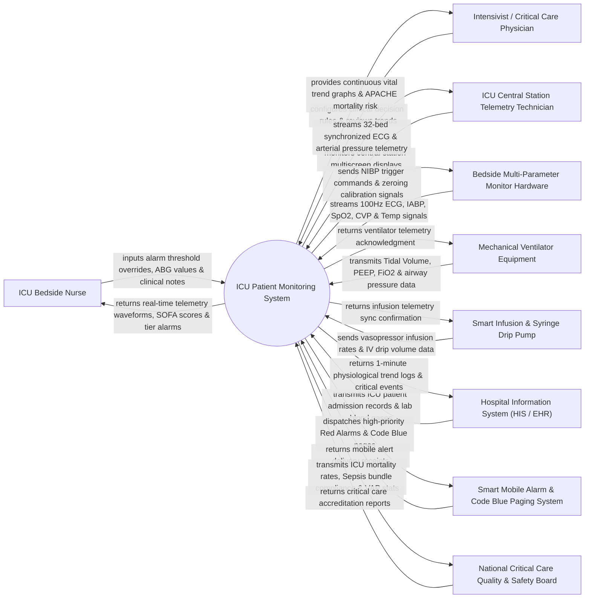

# Context Diagram — ICU Patient Monitoring System

## Mermaid Code

## Actor & Interaction Table | Bảng Actor & Tương tác

| # | Actor | Actor Type | Data Sent TO System | Data Received FROM System | Notes |
|---|-------|------------|---------------------|---------------------------|-------|
| 1 | ICU Bedside Nurse | Primary | Custom alarm threshold limits, manual ABG lab values, alarm silence commands, nursing intervention notes. | Real-time vital sign trends, high-priority Red Alarms, automated SOFA scores, 5-minute hemodynamics. | Certified critical care nurse managing 1:1 or 1:2 high-acuity ICU bedside care. |
| 2 | Intensivist / Critical Care Physician | Primary | Clinical decision rule triggers, vasopressor target MAP orders, ventilator weaning targets. | Continuous 24-hour vital trend graphs, APACHE II mortality risk predictions, organ failure indices. | Specialized critical care physician overseeing medical diagnosis and life-support management in ICU. |
| 3 | ICU Central Station Telemetry Technician | Primary | Central monitor screen layout preferences, arrhythmia tag confirmations, technician notes. | Multi-patient 32-bed synchronized ECG telemetry streams, central alarm status matrix. | Telemetry specialist monitoring multi-bed central displays at the main ICU nursing station. |
| 4 | Bedside Multi-Parameter Monitor Hardware | Supporting System | Continuous high-frequency ECG (12-lead), Invasive Arterial Blood Pressure (IABP), Central Venous Pressure (CVP), SpO2, EtCO2, Temp. | NIBP manual measure triggers, transducer zeroing commands, monitor clock sync tokens. | Bedside hardware acquisition box (e.g., Philips Intellivue, Mindray BeneVision, GE Carescape) capturing raw physiological signals. |
| 5 | Mechanical Ventilator Equipment | Supporting System | Real-time ventilator parameters: Mode (VCV/PCV/SIMV), Tidal Volume (Vt), PEEP, FiO2, Peak Airway Pressure (Ppeak), Minute Ventilation. | Device handshake tokens, time synchronization payloads. | Advanced respiratory support machine (e.g., Maquet Servo-i, Hamilton-C6, Draeger Evita) attached to intubated patients. |
| 6 | Smart Infusion & Syringe Drip Pump | Supporting System | Vasopressor/Inotrope drug name, infusion rate (mL/hr), dose rate (mcg/kg/min), total volume infused. | Pump telemetry acknowledgment, central rate confirmation. | Network-connected IV pumps (e.g., B.Braun Space, BD Alaris) delivering critical cardiovascular medications. |
| 7 | Hospital Information System (HIS / EHR) | Supporting System | ICU patient admission demographics, clinical lab results (Arterial Blood Gas, Lactate, Platelets, Creatinine), diagnosis codes. | High-frequency 1-minute vital trend arrays, critical event logs, 24-hour ICU fluid/hemodynamic summaries. | Enterprise hospital information platform storing permanent medical records and laboratory results. |
| 8 | Smart Mobile Alarm & Code Blue Paging System | Supporting System | Push notification delivery acknowledgments, nurse mobile device status, alarm response timestamps. | Tier-1 Crisis Red Alarms, lethal arrhythmia alerts (V-Fib, Asystole), automated Code Blue alerts. | Mobile paging network (e.g., Voicera, Spok) broadcasting urgent alarms to nurse smartphones. |
| 9 | National Critical Care Quality & Safety Board | Regulatory | ICU quality benchmarks, Ventilator-Associated Pneumonia (VAP) guidelines, Sepsis-3 bundle standards. | ICU standardized mortality ratios (SMR), sepsis early detection metrics, alarm fatigue reduction logs. | Governmental critical care oversight organization auditing ICU patient outcomes and safety. |

## System Boundary Description | Mô tả Phạm vi Hệ thống

The **ICU Patient Monitoring System** is a mission-critical, real-time clinical surveillance and telemetry platform engineered for high-acuity Intensive Care Units (ICUs). It continuously ingests, analyzes, and visualizes high-frequency physiological data streams from bedside multi-parameter monitors, mechanical ventilators, arterial lines, and smart infusion pumps. The system features intelligent tiered alarm management to minimize alarm fatigue, computes real-time organ failure scores (SOFA, qSOFA, APACHE II), detects acute clinical deterioration (Sepsis, Cardiac Arrest, Respiratory Failure), and dispatches automated high-priority alerts to clinical staff.

**Inside System Scope:**
- Real-time ingestion, filtering, and graphical plotting of multi-lead ECG, IABP, CVP, SpO2, and EtCO2 waveforms.
- Interfacing with mechanical ventilators to capture respiratory compliance, PEEP, FiO2, and airway pressures.
- Intelligent multi-tier alarm management (Crisis Red, Warning Amber, Advisory Blue) with alarm suppression and delay logic to reduce alarm fatigue.
- Automated calculation of Sepsis-3 SOFA scores, qSOFA, and APACHE II mortality risk models.
- Central nursing station telemetry dashboard displaying synchronized multi-bed patient statuses.
- Automated dispatch of Code Blue and lethal arrhythmia alerts to mobile devices.

**Outside System Scope:**
- Mechanical generation of physical ventilator air pressure or electrical defibrillation shocks.
- Long-term billing, financial ledger posting, and insurance clearing (delegated to HIS / Billing).
- Physical drug compounding and syringe filling (handled by Pharmacy).
- Direct physical maintenance of monitor cables, blood pressure transducers, and sensors (handled by Biomedical Engineering).
