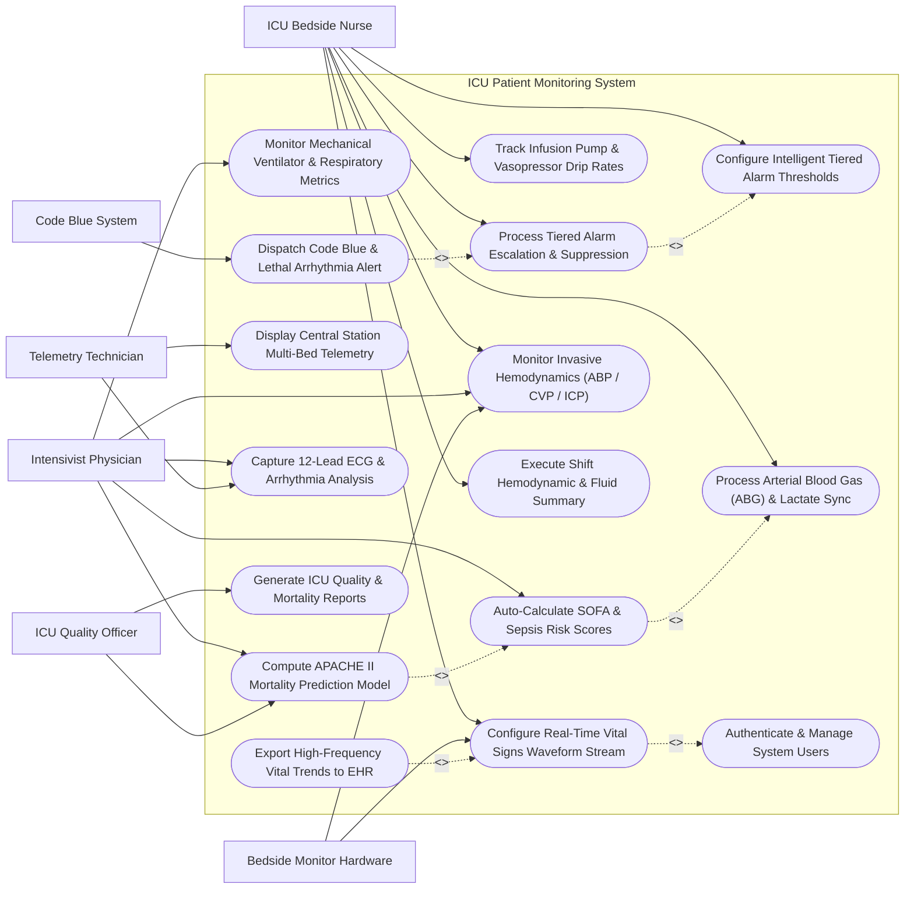

# Use Case Diagram — ICU Patient Monitoring System

## Mermaid Code

## Actor Table | Bảng Actor

| # | Actor | Actor Type | Role Description | Related Use Cases |
|---|-------|------------|------------------|-------------------|
| 1 | ICU Bedside Nurse | Primary | Critical care nurse monitoring real-time telemetry, adjusting alarm limits, tracking vasopressor drips, and acknowledging alerts. | UC01, UC03, UC04, UC05, UC08, UC09, UC13, UC16 |
| 2 | Intensivist Physician | Primary | Specialized critical care doctor configuring clinical rules, analyzing SOFA/APACHE scores, reviewing 12-lead ECGs, and setting target hemodynamics. | UC02, UC06, UC07, UC08, UC12 |
| 3 | Telemetry Technician | Primary | Central station operator managing 32-bed synchronized displays, validating arrhythmia tags, and monitoring central alarms. | UC10, UC12 |
| 4 | ICU Quality Officer | Primary | Quality assurance director evaluating ICU mortality prediction accuracy, sepsis compliance, and alarm fatigue metrics. | UC07, UC15 |
| 5 | Bedside Monitor Hardware | Secondary / System | External acquisition hardware streaming high-frequency ECG, arterial pressure, SpO2, and temperature signals. | UC01, UC08 |
| 6 | Code Blue System | Secondary / System | Mobile alert paging service receiving high-priority emergency alerts for automated Code Blue dispatch. | UC11 |

## Use Case Table | Bảng Use Case

| # | UC ID | Use Case Name | Primary Actor | Secondary Actor | Description | Priority |
|---|-------|---------------|---------------|-----------------|-------------|----------|
| 1 | UC01 | Configure Real-Time Vital Signs Waveform Stream | ICU Bedside Nurse | Bedside Monitor Hardware | Establish high-speed streaming acquisition of ECG, SpO2, and pressure waveforms on bedside displays. | High |
| 2 | UC02 | Monitor Mechanical Ventilator & Respiratory Metrics | Intensivist Physician | None | Capture and display Tidal Volume, PEEP, FiO2, Minute Ventilation, and Peak Airway Pressure from intubated patients. | High |
| 3 | UC03 | Track Infusion Pump & Vasopressor Drip Rates | ICU Bedside Nurse | None | Ingest IV drip rates (Norepinephrine, Epinephrine, Propofol) and correlate vasopressor titration with MAP responses. | High |
| 4 | UC04 | Configure Intelligent Tiered Alarm Thresholds | ICU Bedside Nurse | None | Customize patient-specific upper/lower alarm limits and apply alarm delay algorithms to reduce false alarms. | High |
| 5 | UC05 | Process Tiered Alarm Escalation & Suppression | ICU Bedside Nurse | None | Process Crisis Red, Warning Amber, and Advisory Blue alarms, enforcing automated escalation protocols. | High |
| 6 | UC06 | Auto-Calculate SOFA & Sepsis Risk Scores | Intensivist Physician | None | Calculate Sequential Organ Failure Assessment (SOFA) scores using ABG PaO2/FiO2, platelets, bilirubin, MAP, and GCS. | High |
| 7 | UC07 | Compute APACHE II Mortality Prediction Model | Intensivist Physician | ICU Quality Officer | Compute acute physiology, age, and chronic health scores within 24 hours of ICU admission to predict mortality risk. | High |
| 8 | UC08 | Monitor Invasive Hemodynamics (ABP / CVP / ICP) | ICU Bedside Nurse | Bedside Monitor Hardware | Measure and display continuous invasive Arterial Blood Pressure (ABP), Central Venous Pressure (CVP), and Intracranial Pressure (ICP). | High |
| 9 | UC09 | Process Arterial Blood Gas (ABG) & Lactate Sync | ICU Bedside Nurse | None | Synchronize arterial blood gas laboratory results (pH, PaCO2, PaO2, HCO3, Lactate) into physiological trend views. | High |
| 10 | UC10 | Display Central Station Multi-Bed Telemetry | Telemetry Technician | None | Render synchronized 32-bed central telemetry grid with color-coded alarm matrix and active waveform strips. | High |
| 11 | UC11 | Dispatch Code Blue & Lethal Arrhythmia Alert | ICU Bedside Nurse | Code Blue System | Detect Ventricular Fibrillation, Asystole, or severe cardiac arrest, triggering instant mobile Code Blue pages. | High |
| 12 | UC12 | Capture 12-Lead ECG & Arrhythmia Analysis | Telemetry Technician | Intensivist Physician | Capture 12-lead diagnostic ECG strips, run automated ST-segment and arrhythmia detection algorithms. | High |
| 13 | UC13 | Execute Shift Hemodynamic & Fluid Summary | ICU Bedside Nurse | None | Calculate 24-hour mean arterial pressure (MAP), cumulative fluid balance, and vasopressor total dosage summaries. | Medium |
| 14 | UC14 | Export High-Frequency Vital Trends to EHR | ICU Bedside Nurse | None | Transmit 1-minute averaged physiological vital signs data arrays to the hospital EHR database. | High |
| 15 | UC15 | Generate ICU Quality & Mortality Reports | ICU Quality Officer | None | Produce ICU Standardized Mortality Ratios (SMR), Ventilator Days, Sepsis Bundle compliance, and alarm audit reports. | Medium |
| 16 | UC16 | Authenticate & Manage System Users | All Users | None | Enforce biometrically or credentialed role access, emergency break-glass login, and electronic signature logs. | High |

## Use Case Specification | Đặc tả Use Case

---

### UC01 — Configure Real-Time Vital Signs Waveform Stream

| Field | Detail |
|-------|--------|
| **UC ID** | UC01 |
| **Use Case Name** | Configure Real-Time Vital Signs Waveform Stream |
| **Actor(s)** | Primary: ICU Bedside Nurse   Secondary: Bedside Monitor Hardware |
| **Description** | Establishes high-frequency digital signal acquisition from bedside multi-parameter acquisition hardware, processing continuous ECG (Lead I, II, III, V), SpO2 plethysmograph, and invasive pressure waveforms at 100Hz+ refresh rates for real-time display. |
| **Precondition** | 1. Bedside hardware acquisition box is powered, connected to patient electrodes/sensors, and assigned an IP address.   2. The patient is checked into the ICU bed in the system. |
| **Main Flow** | 1. The Nurse selects "Configure Waveform Display" on the bedside touch terminal.   2. The System connects to the hardware acquisition module via HL7 / IEEE 11073 Medical Device Communication standard.   3. The System receives high-speed digital stream containing 12-lead ECG, SpO2 pulse oximetry, and Invasive Arterial Pressure signals.   4. The System applies digital bandpass filters (e.g., 0.5-40Hz for ECG) to remove baseline wander and muscle artifact noise.   5. The Nurse configures visual sweep speeds (12.5mm/s, 25mm/s, 50mm/s) and waveform gain scales (e.g., 10mm/mV for ECG).   6. The System renders smooth continuous color-coded waveforms on the bedside monitor and mirrors the stream to the central nursing station.   7. The System logs signal quality metrics and continuous heart rate/pulse rate values derived from the waveform peaks. |
| **Alternative Flow** | **AF1** — Multi-Lead Fallback Selection: If Lead II signal quality degrades due to electrode loose contact, the System automatically switches primary arrhythmia analysis to Lead V1 and alerts the nurse.   **AF2** — Custom Waveform Layout Configuration: The Nurse selects a specialized "Hemodynamic View" layout, prioritizing Invasive Arterial Blood Pressure (IABP) and Central Venous Pressure (CVP) waveforms over ECG. |
| **Exception Flow** | **EX1** — Hardware Disconnection / Lead-Off Alert: If an ECG electrode detaches, the System immediately displays a "Lead II Off" warning banner on screen and pauses numerical heart rate calculation from that channel.   **EX2** — High-Frequency Noise Saturation: If severe patient shivering causes electrical noise saturation, the System applies an aggressive notch filter and prompts the Nurse to check electrode placement. |
| **Postcondition** | High-fidelity, filtered continuous vital signs waveforms are rendered on bedside and central monitors, and real-time numeric parameters are updated every second. |
| **Business Rule** | **BR1**: Real-time ECG signal streaming latency must not exceed 250 milliseconds from patient lead acquisition to screen rendering.   **BR2**: Arrhythmia detection algorithms must continuously analyze at least 2 simultaneous ECG leads to prevent single-lead artifact misdiagnoses. |

---

### UC02 — Monitor Mechanical Ventilator & Respiratory Metrics

| Field | Detail |
|-------|--------|
| **UC ID** | UC02 |
| **Use Case Name** | Monitor Mechanical Ventilator & Respiratory Metrics |
| **Actor(s)** | Primary: Intensivist Physician |
| **Description** | Ingests, analyzes, and visualizes real-time respiratory parameters from intubated mechanical ventilators, tracking Tidal Volume, PEEP, FiO2, Peak Airway Pressure, and Respiratory Rate to monitor lung mechanics and detect ventilator dyssynchrony. |
| **Precondition** | 1. The patient is intubated and connected to a compatible mechanical ventilator with digital data output enabled.   2. The ventilator communication cable/gateway is paired with the ICU bed profile. |
| **Main Flow** | 1. The Intensivist selects the "Ventilator & Respiratory Suite" on the ICU patient interface.   2. The System connects to the ventilator via RS-232/Ethernet medical protocol and retrieves active ventilation mode (e.g., Volume Control VCV, Pressure Control PCV, PRVC, PSV).   3. The System displays set parameters vs measured parameters: Set Tidal Volume (Vt) vs Exhaled Vt (mL), Set PEEP (cmH2O) vs Measured PEEP, Set FiO2 (%) vs Delivered FiO2, Peak Airway Pressure (Ppeak cmH2O), and Plateau Pressure (Pplat cmH2O).   4. The System calculates Driving Pressure (`Pdrive = Pplat - PEEP`) and Static Lung Compliance (`Cstat = Vt / (Pplat - PEEP)`).   5. The System plots real-time Flow-Volume loops and Pressure-Volume curves.   6. The Intensivist reviews respiratory trends over the past 24 hours, comparing FiO2 requirements against arterial blood gas PaO2 values.   7. The System logs respiratory parameters into the 1-minute flowsheets and updates the PaO2/FiO2 ratio for SOFA scoring. |
| **Alternative Flow** | **AF1** — Non-Invasive Ventilation (NIV) Mode: If the patient is transitioned to High-Flow Nasal Cannula (HFNC) or BiPAP, the System adjusts monitoring fields to display Flow Rate (L/min) and IPAP/EPAP pressures.   **AF2** — Ventilator Weaning Trial Tracking: The Intensivist initiates a Spontaneous Breathing Trial (SBT), and the System automatically tracks Rapid Shallow Breathing Index (`RSBI = RR / Vt_L`) every 5 minutes. |
| **Exception Flow** | **EX1** — High Airway Pressure Alarm (`Ppeak > 40 cmH2O`): The System flashes a high-priority Red Warning "High Airway Pressure - Risk of Barotrauma" and prompts immediate airway suctioning or pneumothorax evaluation.   **EX2** — Low Exhaled Volume / Circuit Disconnect: If exhaled tidal volume drops below 50 mL during mandatory breath, the System sounds an immediate Critical Red Alarm "Ventilator Circuit Disconnected". |
| **Postcondition** | Mechanical ventilator parameters and pulmonary compliance curves are logged continuously, driving pressure is calculated, and respiratory alerts are active. |
| **Business Rule** | **BR1**: High Peak Airway Pressure (> 35 cmH2O) must trigger an immediate visual and audible Red Alarm at both bedside and central station.   **BR2**: Lung-protective ventilation protocol compliance (Tidal Volume <= 6 mL/kg ideal body weight) must be evaluated continuously for ARDS patients. |

---

### UC03 — Process Tiered Alarm Escalation & Suppression

| Field | Detail |
|-------|--------|
| **UC ID** | UC03 |
| **Use Case Name** | Process Tiered Alarm Escalation & Suppression |
| **Actor(s)** | Primary: ICU Bedside Nurse |
| **Description** | Implements intelligent multi-tier alarm processing (Crisis Red, Warning Amber, Advisory Blue), applying threshold delay algorithms and nuisance-alarm suppression to prevent alarm fatigue while escalating unacknowledged critical events to mobile devices and Code Blue channels. |
| **Precondition** | 1. Patient vital signs and telemetry sensors are actively streaming data.   2. Alarm limit thresholds are configured for the patient's age and condition profile. |
| **Main Flow** | 1. The System continuously evaluates streaming parameters against configured upper and lower limits.   2. When a parameter breaches a limit (e.g., HR > 140 bpm for > 5 seconds), the System classifies the event severity tier: **Tier 1 (Red Crisis - Life Threatening)**: Asystole, V-Fib, Severe Apnea, Extreme Hypotension; **Tier 2 (Amber Warning - Serious)**: SpO2 < 88%, Sustained Tachycardia, High Airway Pressure; **Tier 3 (Blue Advisory - Informational)**: Lead Off, Low Battery, Artifact.   3. For Tier 3 and minor transient Tier 2 breaches, the System applies a 10-second smart delay filter to suppress self-correcting transient spikes.   4. If the breach persists, the System activates the bedside visual color banner and audible alarm tone appropriate for the tier.   5. The System starts an acknowledgment countdown timer (e.g., 30 seconds for Tier 1 Red).   6. The Nurse presses "Silence Alarm" (silences audio for 2 minutes while maintaining visual banner) or "Acknowledge Alert" on the bedside terminal.   7. The System logs the alarm event, duration, peak parameter value, and nurse acknowledgment timestamp in the alarm audit trail. |
| **Alternative Flow** | **AF1** — Automated Mobile Escalation: If a Tier 1 Red Alarm is unacknowledged at bedside after 15 seconds, the System automatically dispatches a high-priority push alert to the assigned nurse's mobile smartphone.   **AF2** — Smart Alarm Latching: For lethal arrhythmias (Asystole/V-Fib), the System latches the Red Alarm continuously—requiring explicit manual nurse reset even if the rhythm spontaneously converts. |
| **Exception Flow** | **EX1** — Unacknowledged Red Alarm Escalation: If a Tier 1 Red Alarm remains unacknowledged after 45 seconds on both bedside and primary nurse mobile app, the System escalates the alert to all ward nurse devices and the Charge Nurse dashboard.   **EX2** — Alarm Flooding / Sensor Failure: If a faulty sensor triggers > 10 false alarms in 2 minutes, the System prompts "Sensor Artifact Detected - Perform Lead Inspection" and allows temporary 5-minute technical suppression. |
| **Postcondition** | Alarms are processed according to severity tier, transient false alarms are filtered out, acknowledged alerts are logged, and unacknowledged critical alarms are escalated. |
| **Business Rule** | **BR1**: Lethal arrhythmia alarms (Asystole, Ventricular Fibrillation, Ventricular Tachycardia) can NEVER be suppressed by automated delay filters and must sound immediately.   **BR2**: Silencing an alarm audio must automatically expire after 120 seconds if the underlying physiological condition remains uncorrected. |

---

### UC04 — Auto-Calculate SOFA & Sepsis Risk Scores

| Field | Detail |
|-------|--------|
| **UC ID** | UC04 |
| **Use Case Name** | Auto-Calculate SOFA & Sepsis Risk Scores |
| **Actor(s)** | Primary: Intensivist Physician |
| **Description** | Automatically computes the Sepsis-3 Sequential Organ Failure Assessment (SOFA) score and qSOFA (quick SOFA) index in real-time by fusing laboratory ABG results, blood platelet counts, bilirubin, serum creatinine, mean arterial pressure (MAP), and Glasgow Coma Scale (GCS). |
| **Precondition** | 1. The patient is admitted in ICU with continuous hemodynamic monitoring.   2. Clinical laboratory results (ABG, CBC, Liver/Renal panels) are interfaced from HIS/LIS. |
| **Main Flow** | 1. The System background engine runs a continuous rule execution every 15 minutes or upon arrival of new lab results.   2. The System queries 6 organ system parameters: **Respiration**: PaO2 / FiO2 ratio (mmHg); **Coagulation**: Platelets (x10^3/uL); **Liver**: Bilirubin (mg/dL); **Cardiovascular**: Mean Arterial Pressure (MAP) and vasopressor dose rates (Dopamine, Epinephrine, Norepinephrine); **CNS**: Glasgow Coma Scale (GCS); **Renal**: Creatinine (mg/dL) or Urine Output (mL/day).   3. The System assigns sub-scores (0 to 4 points) for each organ system based on Sepsis-3 official criteria.   4. The System calculates total SOFA Score (Range: 0 to 24 points).   5. The System compares current SOFA score against admission baseline. If `Delta SOFA >= 2 points`, the System flags a high-risk "Sepsis-3 Organ Failure Trigger".   6. The System displays the SOFA organ sub-score radar chart on the Intensivist workstation.   7. The Intensivist reviews the calculated score and approves the automated Sepsis Care Bundle protocol recommendation. |
| **Alternative Flow** | **AF1** — Real-Time qSOFA Screening: The System calculates quick SOFA (qSOFA) every 5 minutes using 3 bedside parameters (Respiratory Rate >= 22, Altered Mentation GCS < 15, Systolic BP <= 100). If qSOFA >= 2, the System prompts immediate full SOFA calculation.   **AF2** — Missing Lab Value Imputation: If a laboratory value (e.g., Bilirubin) has not been drawn yet, the System uses normal baseline imputation (0 points) and flags "Lab Pending" on the score breakdown. |
| **Exception Flow** | **EX1** — Acute Sepsis Spike Alert (`Delta SOFA >= 3`): The System flashes an urgent red banner "ACUTE SEPSIS DETECTED - SOFA INCREASED BY 3 POINTS", notifying both nurse and attending intensivist.   **EX2** — Incorrect Vasopressor Dose Sync: If infusion pump vasopressor rate is updated manually without system sync, the System prompts the Nurse to verify current Norepinephrine mcg/kg/min rate for cardiovascular SOFA scoring. |
| **Postcondition** | SOFA score and organ failure sub-scores are calculated, Delta SOFA trends are plotted, and Sepsis-3 clinical alerts are activated if threshold is breached. |
| **Business Rule** | **BR1**: A SOFA score increase of >= 2 points from baseline must generate an automated Sepsis Alert notification to the critical care team within 3 minutes of lab result sync.   **BR2**: Cardiovascular SOFA scoring must update instantly whenever vasopressor infusion rates change on connected smart pumps. |

---

### UC05 — Dispatch Code Blue & Lethal Arrhythmia Alert

| Field | Detail |
|-------|--------|
| **UC ID** | UC05 |
| **Use Case Name** | Dispatch Code Blue & Lethal Arrhythmia Alert |
| **Actor(s)** | Primary: ICU Bedside Nurse   Secondary: Code Blue System |
| **Description** | Automatically detects lethal cardiac arrest rhythms (Asystole, Ventricular Fibrillation, Sustained Ventricular Tachycardia) or manual Code Blue button presses, instantly broadcasting emergency resuscitation alerts across ICU displays and mobile paging systems. |
| **Precondition** | 1. The patient is monitored with active multi-lead ECG telemetry.   2. The mobile Code Blue paging gateway is online. |
| **Main Flow** | 1. The real-time ECG analysis engine detects a lethal arrhythmia condition (e.g., Asystole: QRS absent for > 4 seconds, or V-Fib: chaotic rapid ventricular rhythm).   2. The System immediately bypasses all delay filters and triggers a Tier-1 Emergency Lethal Arrhythmia event.   3. The System activates maximum-volume continuous audible alarm tones and flashing red strobe banners across all ICU bedside and central station displays.   4. The System automatically transmits an emergency Code Blue payload to the Code Blue System containing Patient Name, ICU Room Number, Bed Code, and Lethal Rhythm Classification.   5. The Code Blue System dispatches instant emergency push notifications and audio pages to all resuscitation team members' mobile devices.   6. The System locks a 5-minute pre-event and post-event high-resolution ECG waveform strip into permanent emergency audit storage.   7. Resuscitation team members arrive, and the Nurse confirms Code Blue activation and initiates CPR/defibrillation protocols. |
| **Alternative Flow** | **AF1** — Manual Bedside Code Blue Button Activation: The Nurse manually presses the physical "CODE BLUE" button on the bedside terminal, and the System executes steps 3-6 immediately.   **AF2** — False Alarm Fast Cancellation: If Asystole was triggered by electrode lead detachment during patient turning, the Nurse clicks "Cancel Code Blue - Lead Disconnected" within 10 seconds, entering dual credentials to stop mobile dispatch. |
| **Exception Flow** | **EX1** — Mobile Paging Gateway Offline: If the mobile paging server fails, the System automatically routes the Code Blue alert through the hospital overhead speaker broadcast and backup SMS channels.   **EX2** — Multiple Simultaneous Code Blues: If 2 Code Blue events trigger concurrently in different beds, the System prioritizes both as Tier-1 Red and displays a split-screen emergency view at the central station. |
| **Postcondition** | Emergency Code Blue alerts are broadcasted across central displays and mobile devices, 12-lead ECG pre-event strips are archived, and resuscitation timing logs begin. |
| **Business Rule** | **BR1**: Code Blue and lethal arrhythmia alerts must be dispatched to mobile devices within 2 seconds of rhythm detection or manual button press.   **BR2**: Every Code Blue event must automatically save an unedited 10-minute continuous full-disclosure ECG and arterial pressure recording for morbidity & mortality review. |
