# Conceptual ERD — ICU Patient Monitoring System

## Mermaid Code

```mermaid
erDiagram
    ICU_PATIENT_ADMISSION {
        int patient_id PK
        string mrn_number
        string full_name
        string icu_bed_code
        datetime admission_datetime
        string primary_icd_code
        int attending_intensivist_id
        string patient_status
    }

    MONITORING_DEVICE {
        int device_id PK
        string device_serial_number
        string device_type
        string model_name
        string ip_address
        string room_number
        string bed_code
        string device_status
    }

    VITAL_WAVEFORM_SAMPLE {
        int sample_id PK
        int patient_id FK
        int device_id FK
        string ecg_lead_ii_data
        string arterial_line_pressure
        string spo2_waveform
        decimal etco2_value
        datetime sampled_at
    }

    VITAL_SIGNS_NUMERIC {
        int numeric_id PK
        int patient_id FK
        int heart_rate
        int systolic_abp
        int diastolic_abp
        int cvp_mmhg
        decimal spo2_percent
        decimal temperature_celsius
        datetime logged_at
    }

    VENTILATOR_METRICS {
        int ventilator_id PK
        int patient_id FK
        string ventilation_mode
        int tidal_volume_ml
        decimal peep_cmh2o
        decimal fio2_percent
        decimal peak_airway_pressure
        datetime logged_at
    }

    INFUSION_PUMP_TELEMETRY {
        int pump_id PK
        int patient_id FK
        string drug_name
        decimal infusion_rate_ml_hr
        decimal dose_rate_mcg_kg_min
        decimal volume_infused_ml
        string pump_status
        datetime updated_at
    }

    ICU_ALARM_EVENT {
        int alarm_id PK
        int patient_id FK
        int device_id FK
        string alarm_tier
        string alarm_type
        string parameter_name
        decimal threshold_breached
        datetime triggered_at
        datetime acknowledged_at
        datetime resolved_at
    }

    SEPSIS_SOFA_SCORE {
        int sofa_id PK
        int patient_id FK
        decimal pao2_fio2_ratio
        int platelet_count
        decimal bilirubin_level
        decimal map_pressure
        int glasgow_coma_scale
        decimal creatinine_level
        int sofa_total_score
        datetime calculated_at
    }

    APACHE_II_SCORE {
        int apache_id PK
        int patient_id FK
        int age_points
        int chronic_health_points
        int acute_physiology_score
        int total_apache_score
        decimal predicted_mortality_percent
        datetime calculated_at
    }

    ARTERY_BLOOD_GAS {
        int abg_id PK
        int patient_id FK
        decimal ph_level
        decimal paco2_mmhg
        decimal pao2_mmhg
        decimal hco3_meq_l
        decimal base_excess
        decimal lactate_mmol_l
        datetime sampled_at
    }

    CRITICAL_EVENT_LOG {
        int event_id PK
        int patient_id FK
        string event_type
        int initiating_user_id
        string summary_notes
        datetime event_timestamp
    }

    ICU_SHIFT_SUMMARY {
        int summary_id PK
        int patient_id FK
        int nurse_user_id
        int total_intake_ml
        int total_output_ml
        int net_24h_balance_ml
        decimal mean_map_mmhg
        datetime created_at
    }

    ICU_PATIENT_ADMISSION ||--o{ VITAL_WAVEFORM_SAMPLE : "streamed_for"
    ICU_PATIENT_ADMISSION ||--o{ VITAL_SIGNS_NUMERIC : "records"
    ICU_PATIENT_ADMISSION ||--o{ VENTILATOR_METRICS : "ventilated_by"
    ICU_PATIENT_ADMISSION ||--o{ INFUSION_PUMP_TELEMETRY : "infused_with"
    ICU_PATIENT_ADMISSION ||--o{ ICU_ALARM_EVENT : "triggers"
    ICU_PATIENT_ADMISSION ||--o{ SEPSIS_SOFA_SCORE : "evaluated_by"
    ICU_PATIENT_ADMISSION ||--o{ APACHE_II_SCORE : "scored_in"
    ICU_PATIENT_ADMISSION ||--o{ ARTERY_BLOOD_GAS : "sampled_for"
    ICU_PATIENT_ADMISSION ||--o{ CRITICAL_EVENT_LOG : "logs"
    ICU_PATIENT_ADMISSION ||--o{ ICU_SHIFT_SUMMARY : "summarized_in"
    MONITORING_DEVICE ||--o{ VITAL_WAVEFORM_SAMPLE : "captures"
    MONITORING_DEVICE ||--o{ ICU_ALARM_EVENT : "generates"
```

## Entity Description Table | Bảng mô tả Entity

| # | Entity Name | Vietnamese Name | Description | Key Attributes | Main Relationships |
|---|-------------|-----------------|-------------|----------------|-------------------|
| 1 | ICU_PATIENT_ADMISSION | Nhập viện ICU Master | Inpatient ICU bed admission profile tracking bed assignment, primary ICD diagnosis, and status. | patient_id, mrn_number, full_name, icu_bed_code, admission_datetime, patient_status | Has many VITAL_WAVEFORM_SAMPLE, VITAL_SIGNS_NUMERIC, VENTILATOR_METRICS, ICU_ALARM_EVENT, etc. |
| 2 | MONITORING_DEVICE | Thiết bị Giám sát | Hardware acquisition box definition holding serial number, IP address, room/bed assignment, and online status. | device_id, device_serial_number, device_type, ip_address, bed_code, device_status | Has many VITAL_WAVEFORM_SAMPLE and ICU_ALARM_EVENT entities. |
| 3 | VITAL_WAVEFORM_SAMPLE | Mẫu Sóng Sinh tồn | High-frequency continuous waveform data sample storing raw multi-lead ECG, arterial pressure, and SpO2 signals. | sample_id, patient_id, device_id, ecg_lead_ii_data, arterial_line_pressure, sampled_at | Belongs to ICU_PATIENT_ADMISSION and MONITORING_DEVICE. |
| 4 | VITAL_SIGNS_NUMERIC | Chỉ số Sinh tồn Chữ | High-frequency numeric parameters (HR, Invasive ABP, CVP, SpO2, Temp) logged every 1-60 seconds. | numeric_id, patient_id, heart_rate, systolic_abp, diastolic_abp, cvp_mmhg, spo2_percent | Belongs to ICU_PATIENT_ADMISSION. |
| 5 | VENTILATOR_METRICS | Thông số Máy thở | Mechanical ventilator parameters storing ventilation mode, Tidal Volume, PEEP, FiO2, and Peak Airway Pressure. | ventilator_id, patient_id, ventilation_mode, tidal_volume_ml, peep_cmh2o, fio2_percent, peak_airway_pressure | Belongs to ICU_PATIENT_ADMISSION. |
| 6 | INFUSION_PUMP_TELEMETRY | Nhật ký Bơm Tiêm điện | Telemetry record tracking IV vasopressor drug rates (mL/hr, mcg/kg/min) and total volume infused from smart pumps. | pump_id, patient_id, drug_name, infusion_rate_ml_hr, dose_rate_mcg_kg_min, volume_infused_ml | Belongs to ICU_PATIENT_ADMISSION. |
| 7 | ICU_ALARM_EVENT | Sự cố Cảnh báo ICU | Tiered alarm event record logging Crisis Red, Warning Amber, and Advisory Blue breaches with response timestamps. | alarm_id, patient_id, device_id, alarm_tier, alarm_type, threshold_breached, triggered_at, acknowledged_at | Belongs to ICU_PATIENT_ADMISSION and MONITORING_DEVICE. |
| 8 | SEPSIS_SOFA_SCORE | Điểm Đánh giá SOFA | Sepsis-3 Sequential Organ Failure Assessment calculating sub-scores across 6 organ systems and total SOFA score. | sofa_id, patient_id, pao2_fio2_ratio, platelet_count, bilirubin_level, map_pressure, sofa_total_score | Belongs to ICU_PATIENT_ADMISSION. |
| 9 | APACHE_II_SCORE | Mô hình Tử vong APACHE II | Acute Physiology and Chronic Health Evaluation II model predicting ICU patient percentage mortality risk. | apache_id, patient_id, age_points, chronic_health_points, acute_physiology_score, predicted_mortality_percent | Belongs to ICU_PATIENT_ADMISSION. |
| 10 | ARTERY_BLOOD_GAS | Xét nghiệm Khí máu (ABG) | Arterial Blood Gas lab result storing pH, PaCO2, PaO2, HCO3, Base Excess, and serum Lactate levels. | abg_id, patient_id, ph_level, paco2_mmhg, pao2_mmhg, hco3_meq_l, lactate_mmol_l | Belongs to ICU_PATIENT_ADMISSION. |
| 11 | CRITICAL_EVENT_LOG | Nhật ký Sự cố Khẩn | Audit event record capturing Code Blue activations, cardiac arrest episodes, and major clinical deterioration events. | event_id, patient_id, event_type, initiating_user_id, summary_notes, event_timestamp | Belongs to ICU_PATIENT_ADMISSION. |
| 12 | ICU_SHIFT_SUMMARY | Tóm tắt Ca Trực ICU | Shift-level summary aggregating 24-hour total fluid intake/output balance, mean arterial pressure, and vasopressor metrics. | summary_id, patient_id, nurse_user_id, total_intake_ml, total_output_ml, net_24h_balance_ml, mean_map_mmhg | Belongs to ICU_PATIENT_ADMISSION. |

## Relationship Description | Mô tả Quan hệ

| # | From Entity | Cardinality | To Entity | Relationship Label | Business Explanation |
|---|-------------|-------------|-----------|-------------------|----------------------|
| 1 | ICU_PATIENT_ADMISSION | one-to-many | VITAL_WAVEFORM_SAMPLE | streamed_for | One ICU patient admission has continuous real-time vital signs waveform samples. |
| 2 | ICU_PATIENT_ADMISSION | one-to-many | VITAL_SIGNS_NUMERIC | records | One ICU patient admission generates high-frequency numeric vital signs parameters over time. |
| 3 | ICU_PATIENT_ADMISSION | one-to-many | VENTILATOR_METRICS | ventilated_by | One ICU patient admission records continuous mechanical ventilator metrics while intubated. |
| 4 | ICU_PATIENT_ADMISSION | one-to-many | INFUSION_PUMP_TELEMETRY | infused_with | One ICU patient admission receives continuous vasopressor infusion telemetry from smart pumps. |
| 5 | ICU_PATIENT_ADMISSION | one-to-many | ICU_ALARM_EVENT | triggers | One ICU patient admission can trigger multiple tiered alarm events (Red, Amber, Blue) during stay. |
| 6 | ICU_PATIENT_ADMISSION | one-to-many | SEPSIS_SOFA_SCORE | evaluated_by | One ICU patient admission is evaluated by periodic automated SOFA organ failure calculations. |
| 7 | ICU_PATIENT_ADMISSION | one-to-many | APACHE_II_SCORE | scored_in | One ICU patient admission undergoes APACHE II mortality risk scoring within 24 hours. |
| 8 | ICU_PATIENT_ADMISSION | one-to-many | ARTERY_BLOOD_GAS | sampled_for | One ICU patient admission has multiple arterial blood gas (ABG) lab samples drawn. |
| 9 | ICU_PATIENT_ADMISSION | one-to-many | CRITICAL_EVENT_LOG | logs | One ICU patient admission logs major critical events (e.g., Code Blue, cardiac arrest). |
| 10 | ICU_PATIENT_ADMISSION | one-to-many | ICU_SHIFT_SUMMARY | summarized_in | One ICU patient admission is summarized across nursing shift care cycles. |
| 11 | MONITORING_DEVICE | one-to-many | VITAL_WAVEFORM_SAMPLE | captures | One bedside monitoring hardware device captures digital waveform samples. |
| 12 | MONITORING_DEVICE | one-to-many | ICU_ALARM_EVENT | generates | One bedside monitoring device generates physiological and technical hardware alarm events. |
