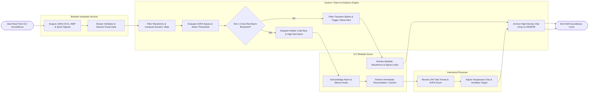

# Swimlane Diagram — ICU Patient Monitoring System

## Mermaid Code

## Flow Description | Mô tả luồng

| Lane | Actor / Subsystem | Role in Flow |
|------|-------------------|--------------|
| 1 | Bedside Hardware Devices | Captures high-speed continuous electrical signals (ECG, IABP, SpO2) and streams mechanical ventilator and infusion pump telemetry parameters into the system. |
| 2 | System / Alarm & Analytics Engine | Filters signal noise, calculates numeric vital signs, computes real-time SOFA organ failure scores, evaluates alarm threshold limits, filters transient false alarms, and dispatches Code Blue alerts. |
| 3 | ICU Bedside Nurse | Monitors continuous bedside telemetry displays, configures patient-specific alarm limits, acknowledges alarm alerts, silences audio, and performs immediate clinical resuscitation. |
| 4 | Intensivist Physician | Evaluates 24-hour vital trend graphs, analyzes APACHE II mortality predictions and SOFA scores, and adjusts vasopressor titration targets or ventilator settings. |
