# Action Tree — ICU Patient Monitoring System

## Mermaid Code

```mermaid
graph TD
    Root["ICU Patient Monitoring System"]

    Root --> M1["Real-Time Waveform Streaming"]
    Root --> M2["Mechanical Ventilator Integration"]
    Root --> M3["Invasive Hemodynamics Monitoring"]
    Root --> M4["Intelligent Alarm Management"]
    Root --> M5["Sepsis & SOFA Scoring Engine"]
    Root --> M6["APACHE II Mortality Modeling"]
    Root --> M7["Code Blue & Emergency Escalation"]
    Root --> M8["ICU Analytics & HIS Sync"]

    M1 --> A11["Acquire Multi-Lead 100Hz ECG Stream"]
    M1 --> A12["Filter Noise & Baseline Wander"]
    M1 --> A13["Render Bedside & Central Displays"]
    M1 --> A14["Detect Arrhythmia & ST Deviation"]

    M2 --> A21["Ingest Tidal Volume & PEEP Metrics"]
    M2 --> A22["Calculate Driving Pressure & Compliance"]
    M2 --> A23["Plot Flow-Volume & Pressure Loops"]
    M2 --> A24["Trigger Circuit Disconnect Alarm"]

    M3 --> A31["Calibrate Invasive Arterial Line (IABP)"]
    M3 --> A32["Monitor Central Venous Pressure (CVP)"]
    M3 --> A33["Track Intracranial Pressure (ICP)"]
    M3 --> A34["Correlate Vasopressor Drip to MAP"]

    M4 --> A41["Configure Patient Custom Limits"]
    M4 --> A42["Apply Smart Delay Noise Filters"]
    M4 --> A43["Process Red Amber Blue Alarm Tiers"]
    M4 --> A44["Audit Alarm Silence Timestamps"]

    M5 --> A51["Sync ABG PaO2/FiO2 & Lactate Data"]
    M5 --> A52["Calculate 6-Organ SOFA Sub-Scores"]
    M5 --> A53["Detect Delta-SOFA Sepsis Spikes"]
    M5 --> A54["Trigger Sepsis-3 Care Bundle Alert"]

    M6 --> A61["Calculate Acute Physiology APS Score"]
    M6 --> A62["Incorporate Age & Chronic Health Points"]
    M6 --> A63["Predict Percentage Mortality Risk"]
    M6 --> A64["Compare Admission SMR Benchmarks"]

    M7 --> A71["Detect Asystole & V-Fib Rhythms"]
    M7 --> A72["Broadcast Mobile Code Blue Pages"]
    M7 --> A73["Lock 10-Min Pre/Post Event Strip"]
    M7 --> A74["Log Emergency Resuscitation Timing"]

    M8 --> A81["Aggregate 1-Min High-Density Vitals"]
    M8 --> A82["Calculate 24-Hour Net Fluid Balance"]
    M8 --> A83["Export HL7 ORU/ADT Arrays to HIS"]
    M8 --> A84["Generate ICU Alarm Fatigue Metrics"]
```

## Module Description | Mô tả Module

| # | Module | Description | Actions |
|---|--------|-------------|---------|
| 1 | Real-Time Waveform Streaming | Ingests, filters, and renders high-frequency multi-lead ECG, SpO2, and pressure waveforms on bedside and central monitors. | Acquire Multi-Lead 100Hz ECG Stream, Filter Noise & Baseline Wander, Render Bedside & Central Displays, Detect Arrhythmia & ST Deviation |
| 2 | Mechanical Ventilator Integration | Ingests ventilation modes, Tidal Volume, PEEP, FiO2, calculates lung compliance and driving pressure, and plots pressure-volume loops. | Ingest Tidal Volume & PEEP Metrics, Calculate Driving Pressure & Compliance, Plot Flow-Volume & Pressure Loops, Trigger Circuit Disconnect Alarm |
| 3 | Invasive Hemodynamics Monitoring | Monitors invasive Arterial Line (IABP), Central Venous Pressure (CVP), and Intracranial Pressure (ICP), correlating vasopressor titration to MAP. | Calibrate Invasive Arterial Line (IABP), Monitor Central Venous Pressure (CVP), Track Intracranial Pressure (ICP), Correlate Vasopressor Drip to MAP |
| 4 | Intelligent Alarm Management | Classifies Crisis Red, Warning Amber, and Advisory Blue alarms, enforcing threshold delay filters to eliminate false nuisance alarms. | Configure Patient Custom Limits, Apply Smart Delay Noise Filters, Process Red Amber Blue Alarm Tiers, Audit Alarm Silence Timestamps |
| 5 | Sepsis & SOFA Scoring Engine | Synchronizes lab ABG results, computes 6-organ SOFA scores, tracks Delta-SOFA spikes, and triggers automated Sepsis-3 care bundle alerts. | Sync ABG PaO2/FiO2 & Lactate Data, Calculate 6-Organ SOFA Sub-Scores, Detect Delta-SOFA Sepsis Spikes, Trigger Sepsis-3 Care Bundle Alert |
| 6 | APACHE II Mortality Modeling | Computes Acute Physiology and Chronic Health Evaluation II score within 24 hours of ICU admission to predict mortality risk percentages. | Calculate Acute Physiology APS Score, Incorporate Age & Chronic Health Points, Predict Percentage Mortality Risk, Compare Admission SMR Benchmarks |
| 7 | Code Blue & Emergency Escalation | Detects lethal rhythms (Asystole, V-Fib), dispatches emergency mobile Code Blue pages, and locks pre/post event ECG strips for audit. | Detect Asystole & V-Fib Rhythms, Broadcast Mobile Code Blue Pages, Lock 10-Min Pre/Post Event Strip, Log Emergency Resuscitation Timing |
| 8 | ICU Analytics & HIS Sync | Aggregates 1-minute physiological vital arrays, calculates 24-hour fluid balances, exports data to HIS/EHR, and analyzes alarm fatigue metrics. | Aggregate 1-Min High-Density Vitals, Calculate 24-Hour Net Fluid Balance, Export HL7 ORU/ADT Arrays to HIS, Generate ICU Alarm Fatigue Metrics |
