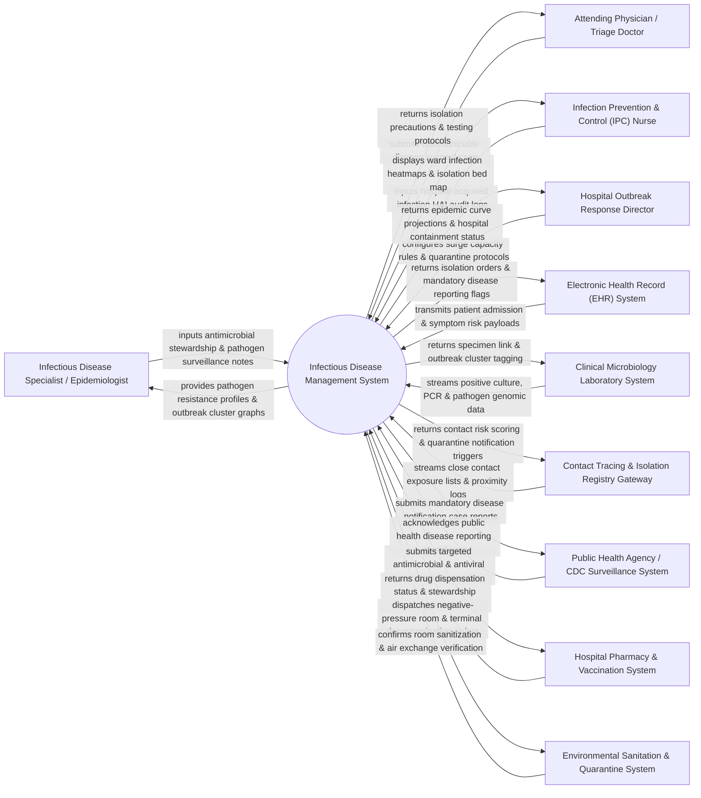

# Context Diagram — Infectious Disease Management System

## Mermaid Code

## Actor & Interaction Table | Bảng Actor & Tương tác

| # | Actor | Actor Type | Data Sent TO System | Data Received FROM System | Notes |
|---|-------|------------|---------------------|---------------------------|-------|
| 1 | Infectious Disease Specialist / Epidemiologist | Primary | Pathogen surveillance notes, antimicrobial stewardship recommendations, outbreak cluster investigations, case definitions. | Pathogen resistance profiles (antibiograms), epidemic curves, phylogenetic cluster graphs, drug stewardship alerts. | Medical specialist leading hospital outbreak containment and infectious disease clinical management. |
| 2 | Infection Prevention & Control (IPC) Nurse | Primary | Hospital-Acquired Infection (HAI) audits, central-line insertion logs, hand hygiene compliance data, isolation ward movement. | Ward infection heatmaps, active isolation bed status, HAI surveillance alerts (CLABSI, CAUTI, SSI), exposure risk lists. | Specialist nurse monitoring hospital infection control practices and tracking patient isolation compliance. |
| 3 | Attending Physician / Triage Doctor | Primary | Suspect infectious case notifications, travel history, fever/rash symptoms, empirical antibiotic orders. | Immediate isolation precaution guidelines (Airborne, Droplet, Contact), diagnostic testing protocols, PEP advice. | Front-line physician evaluating patients presenting with potential communicable diseases. |
| 4 | Hospital Outbreak Response Director | Primary | Outbreak declaration parameters, surge capacity policies, hospital visitor restriction rules, quarantine ward conversions. | Real-time epidemic curve projections, hospital capacity status, staff exposure counts, outbreak containment metrics. | Hospital executive managing emergency outbreak response and hospital-wide quarantine operations. |
| 5 | Electronic Health Record (EHR) System | Supporting | Patient admission demographics, travel history, chief complaint symptoms, baseline vitals, ICU admission status. | Active isolation alert banners, mandatory disease reporting flags, infectious disease consult notes. | Main hospital EHR integrated via HL7 interfaces for real-time infection surveillance data exchange. |
| 6 | Clinical Microbiology Laboratory System | Supporting | Positive blood/sputum culture results, PCR pathogen detection (COVID-19, TB, Influenza), MRSA/VRE screening, genomic sequencing. | Specimen linkage codes, outbreak cluster identification tags, priority pathogen testing requests. | Laboratory system providing diagnostic pathogen identification and antimicrobial susceptibility testing (AST). |
| 7 | Contact Tracing & Isolation Registry Gateway | Supporting | Close contact exposure lists, staff exposure tracking logs, Bluetooth/badge proximity timestamps. | Contact risk scores, quarantine duration rules, automated exposure notification payloads. | External or internal contact tracing platform tracking individuals exposed to confirmed infectious cases. |
| 8 | Public Health Agency / CDC Surveillance System | Supporting / Regulatory | Mandated disease reporting schemas (Notifiable Diseases List), epidemic alert bulletins, quarantine guidelines. | Electronic Case Reports (eCR), daily communicable disease counts, cluster outbreak notifications, vaccination data. | Government public health agency (CDC / Ministry of Health) receiving mandatory disease surveillance reports. |
| 9 | Hospital Pharmacy & Vaccination System | Supporting | Restricted antibiotic dispensation logs, antiviral stock levels, vaccine administration records, prophylaxis inventory. | Antimicrobial stewardship pre-authorization approvals, post-exposure prophylaxis (PEP) orders. | Pharmacy platform managing restricted anti-infective medications and employee vaccination tracking. |
| 10 | Environmental Sanitation & Quarantine System | Supporting | Negative-pressure room status, HEPA filter air exchange rates, terminal decontamination completion timestamps. | Automated terminal room cleaning dispatches, biohazard decontamination orders, room isolation hold flags. | Facilities management system controlling negative-pressure isolation room airflow and biohazard sanitization. |

## System Boundary Description | Mô tả Phạm vi Hệ thống

The **Infectious Disease Management System (IDMS)** is an enterprise public health and clinical infection control platform designed to detect communicable disease outbreaks, enforce isolation precautions, manage antimicrobial stewardship, and automate regulatory disease reporting.

**Inside System Scope:**
- Real-time automated surveillance analyzing EHR symptoms, microbiology cultures, and PCR tests to flag suspect communicable cases.
- Enforcement of clinical isolation protocols (Airborne, Droplet, Contact, Special Enteric) and negative-pressure room allocation.
- Outbreak cluster detection, epidemic curve modeling, contact tracing integration, and staff exposure risk tracking.
- Antimicrobial Stewardship Program (ASP) monitoring, restricted antibiotic approval workflows, and hospital antibiogram generation.
- Automated Electronic Case Reporting (eCR) generation for mandatory submission to national public health agencies (CDC).

**Outside System Scope:**
- Physical laboratory culturing, staining, and PCR amplification (performed by Clinical Microbiology instruments).
- Physical execution of room terminal decontamination and HEPA filter replacement (handled by Environmental Services).
- Direct enforcement of community-wide municipal lockdowns (managed by government civil defense authorities).
