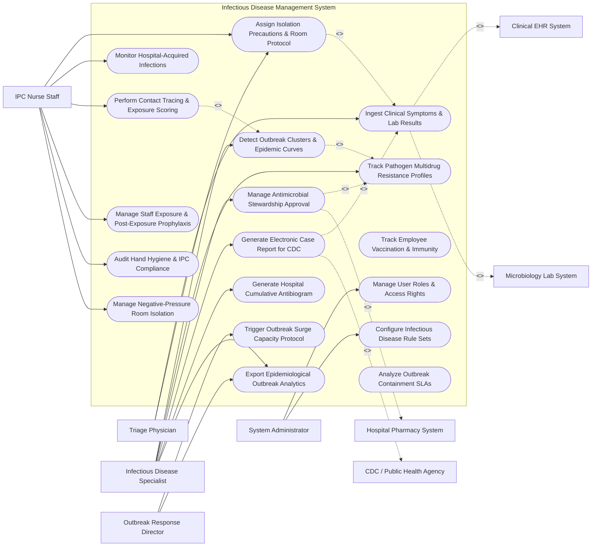

# Use Case Diagram — Infectious Disease Management System

## Mermaid Code

## Actor Table | Bảng Actor

| # | Actor | Actor Type | Role Description | Related Use Cases |
|---|-------|------------|------------------|-------------------|
| 1 | Triage Physician | Primary | Front-line doctor identifying suspect communicable cases and assigning initial isolation rules. | UC01, UC02 |
| 2 | IPC Nurse Staff | Primary | Infection control nurse tracking HAIs, managing negative-pressure rooms, contact tracing, and PEP. | UC02, UC03, UC06, UC07, UC09, UC12 |
| 3 | Infectious Disease Specialist | Primary | Physician expert leading pathogen surveillance, antimicrobial stewardship, antibiograms, and eCR reporting. | UC04, UC05, UC08, UC11, UC14, UC15 |
| 4 | Outbreak Response Director | Primary | Hospital leader declaring outbreak status, activating surge plans, and reviewing epidemiological analytics. | UC10, UC15 |
| 5 | System Administrator | Primary | IT administrator configuring disease rule sets, security access permissions, and notification endpoints. | UC16, UC17 |
| 6 | Clinical EHR System | System (Secondary) | Hospital EHR transferring clinical symptoms and receiving active isolation banners. | UC01 |
| 7 | Microbiology Lab System | System (Secondary) | Lab system streaming positive PCR and culture diagnostic pathogen data. | UC01 |
| 8 | CDC / Public Health Agency | System (Secondary) | Government public health agency receiving mandatory electronic case reports (eCR). | UC11 |
| 9 | Hospital Pharmacy System | System (Secondary) | Pharmacy platform processing restricted antimicrobial approvals and PEP drug distribution. | UC08 |

## Use Case Table | Bảng Use Case

| # | UC ID | Use Case Name | Primary Actor | Secondary Actor | Description | Priority |
|---|-------|---------------|---------------|-----------------|-------------|----------|
| 1 | UC01 | Ingest Clinical Symptoms & Lab Results | Triage Doc | EHR / MicroLab | Ingests travel history, fever symptoms, positive PCR/culture results, and genomic sequencing data. | High |
| 2 | UC02 | Assign Isolation Precautions & Room Protocol | IPC Nurse | Triage Doc | Flags patient record with clinical isolation rules (Airborne, Droplet, Contact) and assigns isolation room. | High |
| 3 | UC03 | Monitor Hospital-Acquired Infections | IPC Nurse | None | Tracks HAIs (CLABSI, CAUTI, SSI, VAE) against baseline hospital rates to identify internal transmissions. | High |
| 4 | UC04 | Detect Outbreak Clusters & Epidemic Curves | ID Specialist | None | Analyzes spatial and temporal pathogen data to detect emerging disease clusters and generate epidemic curves. | Critical |
| 5 | UC05 | Track Pathogen Multidrug Resistance Profiles | ID Specialist | MicroLab | Tracks MDRO pathogens (MRSA, VRE, CRE, Acinetobacter) and flags multi-drug resistance patterns. | High |
| 6 | UC06 | Perform Contact Tracing & Exposure Scoring | IPC Nurse | None | Identifies patients, visitors, and healthcare workers exposed to confirmed cases and computes exposure risk. | High |
| 7 | UC07 | Manage Staff Exposure & Post-Exposure Prophylaxis | IPC Nurse | Pharmacy | Tracks exposed hospital staff, manages symptom monitoring, and dispatches Post-Exposure Prophylaxis (PEP). | High |
| 8 | UC08 | Manage Antimicrobial Stewardship Approval | ID Specialist | Pharmacy | Processes pre-authorization requests for restricted broad-spectrum antibiotics to prevent drug resistance. | High |
| 9 | UC09 | Audit Hand Hygiene & IPC Compliance | IPC Nurse | None | Logs observational hand hygiene audits, PPE compliance checks, and environmental sanitation scores. | Medium |
| 10 | UC10 | Trigger Outbreak Surge Capacity Protocol | Director | None | Activates emergency outbreak surge plans, converts standard wards to isolation units, and restricts visitors. | Critical |
| 11 | UC11 | Generate Electronic Case Report for CDC | ID Specialist | CDC Agency | Auto-populates mandatory Electronic Case Reports (eCR) for confirmed reportable diseases and submits to CDC. | Critical |
| 12 | UC12 | Manage Negative-Pressure Room Isolation | IPC Nurse | None | Monitors airflow direction, differential pressure (Pa), and HEPA air exchange rates in negative-pressure rooms. | High |
| 13 | UC13 | Track Employee Vaccination & Immunity | IPC Nurse | None | Maintains staff immunization records (Influenza, COVID-19, Hep B, MMR) and tracks annual compliance. | Medium |
| 14 | UC14 | Generate Hospital Cumulative Antibiogram | ID Specialist | MicroLab | Compiles annual hospital-wide antibiogram summaries detailing bacterial susceptibility to specific antibiotics. | High |
| 15 | UC15 | Export Epidemiological Outbreak Analytics | ID Specialist | Director | Exports transmission heatmaps, reproduction number (R0) estimates, and outbreak containment metrics. | Medium |
| 16 | UC16 | Manage User Roles & Access Rights | Admin | None | Controls system access accounts, IPC authorization levels, and public health reporting privileges. | High |
| 17 | UC17 | Configure Infectious Disease Rule Sets | Admin | ID Specialist | Configures automated surveillance triggers, reportable disease lists, and mandatory isolation criteria. | High |
| 18 | UC18 | Analyze Outbreak Containment SLAs | System | None | Computes time-to-isolation, time-to-eCR submission, and contact tracing completion SLA performance. | Medium |

## Use Case Specification | Đặc tả Use Case

---

### UC02 — Assign Isolation Precautions & Room Protocol

| Field | Detail |
|-------|--------|
| **UC ID** | UC02 |
| **Use Case Name** | Assign Isolation Precautions & Room Protocol |
| **Actor(s)** | Primary: IPC Nurse Staff, Triage Physician   Secondary: None |
| **Description** | Establishes clinical isolation precaution tiers (Airborne, Droplet, Contact, Special Enteric) for suspect or confirmed infectious patients, updates EHR status banners, and reserves negative-pressure room. |
| **Precondition** | 1. Patient is admitted or present in ED with suspect communicable disease (UC01). |
| **Main Flow** | 1. Nurse opens "Isolation Management" module for patient.   2. Nurse selects isolation precaution type:   &nbsp;&nbsp;&nbsp;&nbsp; a. Airborne (e.g., Tuberculosis, Measles, Mpox).   &nbsp;&nbsp;&nbsp;&nbsp; b. Droplet (e.g., Influenza, Pertussis, Meningococcal).   &nbsp;&nbsp;&nbsp;&nbsp; c. Contact (e.g., MRSA, VRE, Scabies).   &nbsp;&nbsp;&nbsp;&nbsp; d. Special Enteric (e.g., C. difficile, Norovirus).   3. System checks negative-pressure room availability if Airborne isolation is selected.   4. Nurse confirms room assignment (e.g., Ward 4 Isolation Room 402 - Negative Pressure).   5. System updates patient record status to `ACTIVE_ISOLATION`.   6. System dispatches HL7 message to EHR to display prominent visual isolation alert banner across all patient screens.   7. System dispatches PPE requirement checklist (N95 respirator, gown, face shield) to ward nurse station. |
| **Alternative Flow** | **AF1** — Cohort Isolation Assignment: During severe epidemic surge when single isolation rooms are exhausted, Nurse assigns patient to designated cohort isolation unit sharing identical pathogen status. |
| **Exception Flow** | **EX1** — No Negative-Pressure Room Available: All negative-pressure airborne isolation rooms occupied; System triggers "Airborne Isolation Room Deficit Alert", prompts placement in single room with portable HEPA unit, and escalates to Bed Flow Manager. |
| **Postcondition** | Patient record is tagged with isolation precautions, EHR displays warning banner, and negative-pressure room is reserved. |
| **Business Rule** | **BR1**: Suspect Airborne pathogens (e.g., active Pulmonary TB) must be assigned to negative-pressure isolation within 15 minutes of triage identification. |

---

### UC04 — Detect Outbreak Clusters & Epidemic Curves

| Field | Detail |
|-------|--------|
| **UC ID** | UC04 |
| **Use Case Name** | Detect Outbreak Clusters & Epidemic Curves |
| **Actor(s)** | Primary: Infectious Disease Specialist / Epidemiologist   Secondary: None |
| **Description** | Analyzes spatial (ward location) and temporal (time sequence) pathogen data using surveillance algorithms to detect emerging hospital outbreaks and plot epidemic curves. |
| **Precondition** | 1. Microbiology lab results and clinical disease logs are ingested continuously (UC01). |
| **Main Flow** | 1. System background engine evaluates incoming positive pathogen cases every hour.   2. System applies spatial-temporal scan statistics (Knox test / SaTScan) to detect statistical disease clustering.   3. System identifies an unexpected cluster (e.g., 4 positive C. difficile cases on Ward 3B within 72 hours, exceeding baseline threshold of 0.5 cases/week).   4. System flags cluster alert `POSSIBLE_OUTBREAK_CLUSTER` on Epidemiologist dashboard.   5. Epidemiologist clicks cluster notification to view incident breakdown.   6. System renders interactive Epidemic Curve (Epi Curve) showing daily case counts by symptom onset date.   7. System displays ward spatial map highlighting infected bed locations and shared staff movements.   8. Epidemiologist confirms outbreak status and initiates cluster investigation workflow. |
| **Alternative Flow** | **AF1** — Genomic Sequencing Cluster Matching: Whole genome sequencing (WGS) data is ingested; System matches identical single-nucleotide polymorphism (SNP) strain patterns, confirming clonal hospital transmission. |
| **Exception Flow** | **EX1** — Pseudo-Outbreak Detection: Sudden rise in cases caused by new, hyper-sensitive lab testing kit rather than true transmission; Epidemiologist logs "Testing Artifact - False Outbreak", and System recalibrates baseline. |
| **Postcondition** | Outbreak cluster is confirmed, Epi curve is plotted, and outbreak response protocols (UC10) are queued. |
| **Business Rule** | **BR1**: An outbreak cluster alert must trigger automatically when case counts exceed 3 standard deviations above 30-day historical ward baseline. |

---

### UC06 — Perform Contact Tracing & Exposure Scoring

| Field | Detail |
|-------|--------|
| **UC ID** | UC06 |
| **Use Case Name** | Perform Contact Tracing & Exposure Scoring |
| **Actor(s)** | Primary: IPC Nurse Staff   Secondary: None |
| **Description** | Identifies all individuals (patients, healthcare workers, visitors) exposed to an index infectious case during the contagious period, calculates exposure risk scores, and initiates quarantine. |
| **Precondition** | 1. Index case is confirmed positive for a high-consequence communicable pathogen. |
| **Main Flow** | 1. IPC Nurse opens "Contact Tracing Module" and selects confirmed index case record.   2. System queries patient location history, room transfer logs, surgical suite encounters, and nurse assignment rosters during contagious window.   3. System compiles comprehensive list of potentially exposed contacts.   4. System calculates exposure risk score for each contact based on:   &nbsp;&nbsp;&nbsp;&nbsp; a. Proximity distance (< 2 meters).   &nbsp;&nbsp;&nbsp;&nbsp; b. Exposure duration (cumulative minutes).   &nbsp;&nbsp;&nbsp;&nbsp; c. PPE usage status (Masked vs Unmasked).   &nbsp;&nbsp;&nbsp;&nbsp; d. Environment type (Negative pressure vs enclosed room).   5. System classifies contacts into Risk Tiers: High Risk (Close Contact), Moderate Risk, Low Risk.   6. Nurse reviews and confirms contact list.   7. System dispatches automated exposure notifications and symptom monitoring instructions to high-risk contacts. |
| **Alternative Flow** | **AF1** — Staff Exposure Protocol Trigger: For exposed healthcare workers, System dispatches mandatory symptom log instructions and triggers Post-Exposure Prophylaxis (PEP) workflow (UC07). |
| **Exception Flow** | **EX1** — Untraceable Visitor Exposure: Index case spent 3 hours in public hospital waiting lounge; System flags "Public Exposure Zone", prompts release of public health advisory notice, and notifies local health department. |
| **Postcondition** | Contact exposure list is compiled, risk scores are assigned, notifications are sent, and daily symptom monitoring is initialized. |
| **Business Rule** | **BR1**: High-risk close contacts must be notified and placed under active symptom surveillance within 24 hours of index case confirmation. |

---

### UC08 — Manage Antimicrobial Stewardship Approval

| Field | Detail |
|-------|--------|
| **UC ID** | UC08 |
| **Use Case Name** | Manage Antimicrobial Stewardship Approval |
| **Actor(s)** | Primary: Infectious Disease Specialist   Secondary: Hospital Pharmacy System, Triage Physician |
| **Description** | Processes electronic pre-authorization requests for restricted broad-spectrum antimicrobials (e.g., Carbapenems, Colistin, Daptomycin) to optimize clinical outcomes and prevent drug resistance. |
| **Precondition** | 1. Physician orders a restricted antimicrobial drug in pharmacy system. |
| **Main Flow** | 1. System receives pre-authorization request from Pharmacy System for restricted antibiotic order.   2. System displays patient infection site, culture/sensitivity lab results (if available), renal function (eGFR), and prescribing physician rationale.   3. ID Specialist reviews request details and evaluates against hospital Antimicrobial Stewardship guidelines.   4. ID Specialist selects action:   &nbsp;&nbsp;&nbsp;&nbsp; a. Approve for 72 hours pending final microbiology culture results.   &nbsp;&nbsp;&nbsp;&nbsp; b. Recommend narrow-spectrum alternative based on AST sensitivities.   &nbsp;&nbsp;&nbsp;&nbsp; c. Deny request with clinical rationale notes.   5. ID Specialist clicks "Submit Stewardship Decision".   6. System dispatches approval token or recommendation note to Hospital Pharmacy System and ordering physician. |
| **Alternative Flow** | **AF1** — Automated 24-Hour Emergency Timeout: Physician orders restricted drug during weekend night shift; System grants temporary 24-hour emergency approval, scheduling mandatory ID Specialist review for Monday morning. |
| **Exception Flow** | **EX1** — Cultured Pathogen Resistant to All First-Line Drugs: Microbiology confirms pan-drug-resistant organism (PDR); System highlights request as "Critical Rescue Therapy Needed" and immediately approves restricted drug combination. |
| **Postcondition** | Antimicrobial pre-authorization decision is recorded, pharmacy dispenses approved drug, and stewardship audit log is updated. |
| **Business Rule** | **BR1**: Restricted broad-spectrum antibiotics must not be dispensed by pharmacy beyond 24 hours without explicit ID Specialist stewardship pre-authorization. |

---

### UC11 — Generate Electronic Case Report (eCR)

| Field | Detail |
|-------|--------|
| **UC ID** | UC11 |
| **Use Case Name** | Generate Electronic Case Report (eCR) |
| **Actor(s)** | Primary: Infectious Disease Specialist   Secondary: CDC / Public Health Agency |
| **Description** | Automatically extracts patient demographics, clinical symptoms, pathogen lab confirmations, and travel history to build standard Electronic Initial Case Reports (eICR) for mandatory CDC transmission. |
| **Precondition** | 1. Patient has a confirmed diagnosis of a legally reportable communicable disease (e.g., Measles, Cholera, Mpox, Tuberculosis, COVID-19). |
| **Main Flow** | 1. System detects positive confirmation of a reportable condition on National Notifiable Diseases List.   2. System automatically initiates Electronic Case Report (eCR) generation workflow.   3. System extracts required HL7 FHIR / eICR data fields:   &nbsp;&nbsp;&nbsp;&nbsp; a. Patient demographics, address, occupational exposure risk.   &nbsp;&nbsp;&nbsp;&nbsp; b. Clinical diagnosis codes (ICD-10) and onset date.   &nbsp;&nbsp;&nbsp;&nbsp; c. Diagnostic lab results (LOINC codes, organism SNOMED codes, PCR cycle threshold).   &nbsp;&nbsp;&nbsp;&nbsp; d. Treatment administered and hospitalization status.   4. ID Specialist reviews pre-populated eCR form for completeness and accuracy.   5. ID Specialist clicks "Approve & Transmit eCR".   6. System encrypts eCR payload using public health security standards and dispatches document via secure REST API to CDC / State Public Health Gateway.   7. CDC Gateway returns electronic receipt confirmation (`ACK_200_SUCCESS`), which System logs into audit record. |
| **Alternative Flow** | **AF1** — Fully Automated eCR Submission: System is configured for auto-submission; upon lab result confirmation, System automatically compiles and transmits eCR without requiring manual ID Specialist click. |
| **Exception Flow** | **EX1** — Mandatory Demographic Field Missing: Patient address or phone number is missing in EHR; System flags "eCR Transmission Held - Missing Patient Contact Info" and prompts IPC nurse to input data. |
| **Postcondition** | Electronic Case Report is submitted to public health authorities, transmission receipt is logged, and regulatory disease reporting compliance is fulfilled. |
| **Business Rule** | **BR1**: Mandatory reportable communicable disease cases must be reported to public health agencies within legally specified timeframes (e.g., Category I diseases within 4 hours). |
