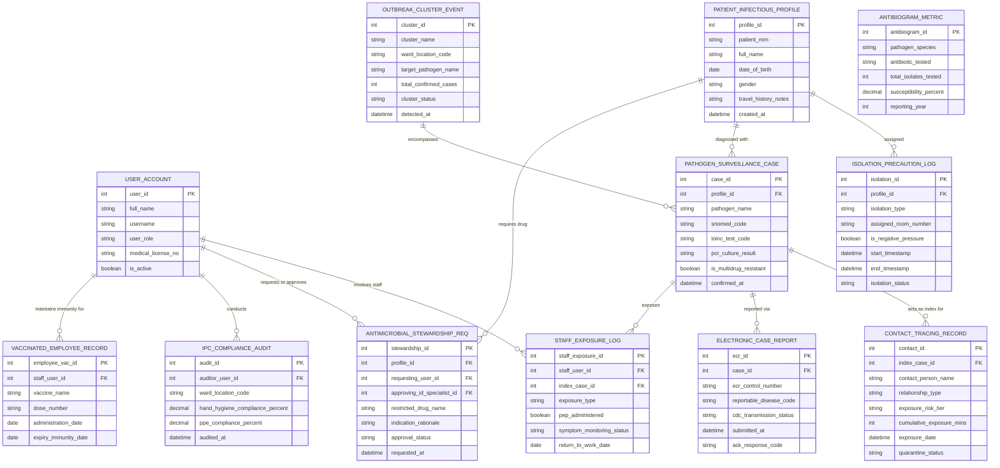

# Conceptual ERD — Infectious Disease Management System

## Mermaid Code

## Entity Description Table | Bảng mô tả Entity

| # | Entity Name | Vietnamese Name | Description | Key Attributes | Main Relationships |
|---|-------------|-----------------|-------------|----------------|-------------------|
| 1 | USER_ACCOUNT | Tài khoản Nguời dùng | Credentials and access permissions for IPC nurses, ID specialists, triage doctors, and staff. | `user_id`, `username`, `user_role`, `medical_license_no` | Conducts `IPC_COMPLIANCE_AUDIT`, requests/approves `ANTIMICROBIAL_STEWARDSHIP_REQ`, involves `STAFF_EXPOSURE_LOG`. |
| 2 | PATIENT_INFECTIOUS_PROFILE | Hồ sơ Bệnh truyền nhiễm | Demographics, travel history, and infection surveillance baseline for hospital patients. | `profile_id`, `patient_mrn`, `full_name`, `date_of_birth`, `travel_history_notes` | Assigned `ISOLATION_PRECAUTION_LOG`, diagnosed with `PATHOGEN_SURVEILLANCE_CASE`. |
| 3 | ISOLATION_PRECAUTION_LOG | Nhật ký Cách ly Y tế | Infection isolation precaution records (Airborne, Droplet, Contact) and negative-pressure room assignments. | `isolation_id`, `profile_id`, `isolation_type`, `assigned_room_number`, `is_negative_pressure` | Belongs to `PATIENT_INFECTIOUS_PROFILE`. |
| 4 | PATHOGEN_SURVEILLANCE_CASE | Ca Bệnh Giám sát Mầm bệnh | Confirmed or suspect pathogen case record detailing lab test results (PCR/culture) and MDRO status. | `case_id`, `profile_id`, `pathogen_name`, `snomed_code`, `is_multidrug_resistant` | Belongs to `PATIENT_INFECTIOUS_PROFILE`, reported via `ELECTRONIC_CASE_REPORT`. |
| 5 | OUTBREAK_CLUSTER_EVENT | Sự kiện Cụm Dịch bệnh | Spatial-temporal disease outbreak cluster event records detailing ward location and case counts. | `cluster_id`, `cluster_name`, `ward_location_code`, `target_pathogen_name`, `cluster_status` | Encompasses many `PATHOGEN_SURVEILLANCE_CASE`. |
| 6 | CONTACT_TRACING_RECORD | Hồ sơ Truy vết Tiếp xúc | Exposed contact tracking entries detailing contact details, exposure risk tier, and quarantine status. | `contact_id`, `index_case_id`, `contact_person_name`, `exposure_risk_tier`, `quarantine_status` | Relates to `PATHOGEN_SURVEILLANCE_CASE` (Index Case). |
| 7 | STAFF_EXPOSURE_LOG | Nhật ký Tiếp xúc Nhân viên | Hospital employee exposure records detailing pathogen exposure, PEP administration, and work clearance. | `staff_exposure_id`, `staff_user_id`, `index_case_id`, `exposure_type`, `pep_administered` | Relates `USER_ACCOUNT` and `PATHOGEN_SURVEILLANCE_CASE`. |
| 8 | ANTIMICROBIAL_STEWARDSHIP_REQ | Yêu cầu Quản lý Kháng sinh | Pre-authorization requests for restricted broad-spectrum antimicrobials evaluated by ID specialists. | `stewardship_id`, `profile_id`, `requesting_user_id`, `restricted_drug_name`, `approval_status` | Relates `PATIENT_INFECTIOUS_PROFILE` and `USER_ACCOUNT`. |
| 9 | ANTIBIOGRAM_METRIC | Chỉ số Kháng kháng sinh | Hospital-wide annual antibiogram metrics tracking bacterial strain susceptibility percentages. | `antibiogram_id`, `pathogen_species`, `antibiotic_tested`, `total_isolates_tested`, `susceptibility_percent` | Standalone analytical entity. |
| 10 | ELECTRONIC_CASE_REPORT | Báo cáo Ca Bệnh Điện tử | Mandatory electronic initial case reports (eCR) generated for transmission to the CDC or public health. | `ecr_id`, `case_id`, `ecr_control_number`, `reportable_disease_code`, `submitted_at` | Belongs to `PATHOGEN_SURVEILLANCE_CASE`. |
| 11 | IPC_COMPLIANCE_AUDIT | Kiểm toán Tuân thủ IPC | Observational hand hygiene and PPE compliance audit scores across hospital wards. | `audit_id`, `auditor_user_id`, `ward_location_code`, `hand_hygiene_compliance_percent` | Conducted by `USER_ACCOUNT`. |
| 12 | VACCINATED_EMPLOYEE_RECORD | Hồ sơ Têm chủng Nhân viên | Immunization history, booster doses, and antibody immunity expiration dates for healthcare workers. | `employee_vac_id`, `staff_user_id`, `vaccine_name`, `dose_number`, `expiry_immunity_date` | Belongs to `USER_ACCOUNT`. |

## Relationship Description | Mô tả Quan hệ

| # | From Entity | Cardinality | To Entity | Label | Business Explanation |
|---|-------------|-------------|-----------|-------|----------------------|
| 1 | PATIENT_INFECTIOUS_PROFILE | 1 to 0..N | ISOLATION_PRECAUTION_LOG | assigned | A patient profile is assigned isolation precaution logs over time. |
| 2 | PATIENT_INFECTIOUS_PROFILE | 1 to 0..N | PATHOGEN_SURVEILLANCE_CASE | diagnosed with | A patient profile is diagnosed with confirmed pathogen surveillance cases. |
| 3 | PATHOGEN_SURVEILLANCE_CASE | 1 to 0..N | CONTACT_TRACING_RECORD | acts as index for | A confirmed pathogen case acts as an index case for exposed contact records. |
| 4 | PATHOGEN_SURVEILLANCE_CASE | 1 to 0..1 | ELECTRONIC_CASE_REPORT | reported via | A reportable pathogen case is reported via an electronic case report (eCR). |
| 5 | OUTBREAK_CLUSTER_EVENT | 1 to 0..N | PATHOGEN_SURVEILLANCE_CASE | encompasses | An outbreak cluster event encompasses multiple linked pathogen cases. |
| 6 | USER_ACCOUNT | 1 to 0..N | STAFF_EXPOSURE_LOG | involves staff | A staff user account is involved in workplace exposure logs. |
| 7 | PATHOGEN_SURVEILLANCE_CASE | 1 to 0..N | STAFF_EXPOSURE_LOG | exposes | An index case exposes multiple healthcare worker staff members. |
| 8 | PATIENT_INFECTIOUS_PROFILE | 1 to 0..N | ANTIMICROBIAL_STEWARDSHIP_REQ | requires drug | A patient profile requires antimicrobial stewardship pre-authorizations. |
| 9 | USER_ACCOUNT | 1 to 0..N | ANTIMICROBIAL_STEWARDSHIP_REQ | requests or approves | A physician user account requests or approves antimicrobial pre-authorizations. |
| 10 | USER_ACCOUNT | 1 to 0..N | IPC_COMPLIANCE_AUDIT | conducts | An IPC nurse user account conducts ward compliance audits. |
| 11 | USER_ACCOUNT | 1 to 0..N | VACCINATED_EMPLOYEE_RECORD | maintains immunity for | A staff user account maintains employee vaccination and immunity records. |
