# Swimlane Diagram — Infectious Disease Management System

## Mermaid Code

```mermaid
flowchart LR
    Start(["Start Communicable Case Screening"])

    subgraph Lane_Doctor["Triage Physician"]
        D1["Evaluate Patient Symptoms & Travel History"]
        D2["Order Rapid PCR & Microbiology Pathogen Test"]
        D3["Assign Preliminary Suspect Isolation Rules"]
    end

    subgraph Lane_IPCNurse["IPC Nurse Staff"]
        N1["Assign Negative-Pressure Isolation Room"]
        N2["Conduct Contact Tracing for Exposed Contacts"]
        N3["Initiate Post-Exposure Prophylaxis for Staff"]
    end

    subgraph Lane_System["Infectious Disease System"]
        S1["Ingest Positive Lab PCR & Culture Results"]
        S2["Display Isolation Banner on Hospital EHR"]
        S3["Run Outbreak Spatial-Temporal Cluster Algorithm"]
        S4{"Is Pathogen Mandatory Reportable Disease?"}
        S5["Auto-Compile Electronic Case Report (eCR)"]
    end

    subgraph Lane_CDC["CDC / Public Health Agency"]
        C1["Receive Encrypted eCR API Payload"]
        C2["Return Electronic Receipt ACK Confirmation"]
    end

    Finish(["End Infection Containment Workflow"])

    Start --> D1 --> D2 --> D3 --> N1 --> S1 --> S2 --> S3 --> S4
    S4 -->|"Yes"| S5 --> C1 --> C2 --> N2 --> N3 --> Finish
    S4 -->|"No"| N2 --> N3 --> Finish
```

## Flow Description | Mô tả luồng

| Lane | Actor | Role in Flow |
|------|-------|-------------|
| 1 | Triage Physician | Evaluates patient symptoms, travel history, orders PCR pathogen testing, and assigns preliminary suspect isolation precautions. |
| 2 | IPC Nurse Staff | Assigns negative-pressure isolation rooms, manages patient placement, conducts contact tracing for exposed individuals, and initiates post-exposure prophylaxis for staff. |
| 3 | Infectious Disease System | Ingests positive microbiology PCR results, displays isolation warning banners across EHR screens, executes spatial-temporal cluster algorithms to detect outbreaks, and compiles electronic case reports (eCR). |
| 4 | CDC / Public Health Agency | Receives encrypted electronic case reports via secure API gateway and returns electronic receipt acknowledgments for public health surveillance compliance. |
