# Action Tree — Infectious Disease Management System

## Mermaid Code

```mermaid
graph TD
    Root["Infectious Disease Management System"]

    Root --> M1["Pathogen Surveillance & Ingestion"]
    Root --> M2["Isolation & Room Protocol Control"]
    Root --> M3["Outbreak Cluster & Epidemic Modeling"]
    Root --> M4["Contact Tracing & Staff Exposure"]
    Root --> M5["Antimicrobial Stewardship & Antibiograms"]
    Root --> M6["Public Health Reporting & Quality Audits"]

    M1 --> A11["Ingest Microbiology PCR & Culture Results"]
    M1 --> A12["Flag Multidrug Resistant Organisms (MDRO)"]
    M1 --> A13["Monitor Symptom Onset & Travel History"]
    M1 --> A14["Track Pathogen Genomic Sequencing Clones"]

    M2 --> A21["Assign Airborne, Droplet & Contact Isolation"]
    M2 --> A22["Monitor Negative-Pressure Room Airflow"]
    M2 --> A23["Display Active Isolation Banners in EHR"]
    M2 --> A24["Dispatch Terminal Decontamination Orders"]

    M3 --> A31["Detect Spatial-Temporal Ward Disease Clusters"]
    M3 --> A32["Plot Real-Time Epidemic Curves (Epi Curves)"]
    M3 --> A33["Calculate Reproduction Number (R0) Estimates"]
    M3 --> A34["Trigger Outbreak Surge Capacity Protocols"]

    M4 --> A41["Identify Exposed Patients & Visitors"]
    M4 --> A42["Calculate Proximity & Duration Risk Scores"]
    M4 --> A43["Track Healthcare Worker Workplace Exposure"]
    M4 --> A44["Dispatch Post-Exposure Prophylaxis (PEP) Orders"]

    M5 --> A51["Process Restricted Antibiotic Pre-Authorizations"]
    M5 --> A52["Evaluate Pathogen Susceptibility Profiles"]
    M5 --> A53["Generate Hospital Annual Cumulative Antibiograms"]
    M5 --> A54["Flag 72-Hour Empiric Antibiotic Timeouts"]

    M6 --> A61["Generate Electronic Case Reports (eCR) for CDC"]
    M6 --> A62["Audit Hand Hygiene & PPE Compliance Scores"]
    M6 --> A63["Track Employee Immunization & Immunity Expiry"]
    M6 --> A64["Export Epidemiological Outbreak Analytics"]
```

## Module Description | Mô tả Module

| # | Module | Description | Actions |
|---|--------|-------------|---------|
| 1 | Pathogen Surveillance & Ingestion | Ingests microbiology lab results, flags multidrug-resistant organisms (MDRO), monitors symptom history, and tracks genomic clone clusters. | Ingest Lab Results, Flag MDRO Pathogens, Monitor Travel History, Track Genomic Clones. |
| 2 | Isolation & Room Protocol Control | Establishes Airborne/Droplet/Contact precautions, monitors negative-pressure airflow, displays EHR banners, and dispatches terminal decontamination. | Assign Isolation Precautions, Monitor Negative-Pressure Rooms, Display EHR Banners, Dispatch Decontamination. |
| 3 | Outbreak Cluster & Epidemic Modeling | Detects spatial-temporal disease clusters, plots real-time epidemic curves, estimates reproduction numbers (R0), and triggers surge plans. | Detect Disease Clusters, Plot Epidemic Curves, Calculate R0 Estimates, Trigger Outbreak Surge. |
| 4 | Contact Tracing & Staff Exposure | Identifies exposed contacts, computes exposure risk scores, tracks healthcare worker exposures, and dispatches post-exposure prophylaxis (PEP). | Identify Exposed Contacts, Calculate Risk Scores, Track Staff Exposure, Dispatch PEP Orders. |
| 5 | Antimicrobial Stewardship & Antibiograms | Manages broad-spectrum antibiotic pre-authorizations, evaluates drug susceptibility profiles, generates annual antibiograms, and flags 72-hr timeouts. | Process Restricted Antibiotic Approvals, Evaluate Susceptibility Profiles, Generate Antibiograms, Flag 72-Hr Timeouts. |
| 6 | Public Health Reporting & Quality Audits | Auto-generates electronic case reports (eCR) for CDC submission, audits hand hygiene/PPE compliance, tracks staff vaccinations, and exports analytics. | Generate eCR Reports, Audit Hand Hygiene & PPE, Track Staff Immunizations, Export Epidemiological Analytics. |
