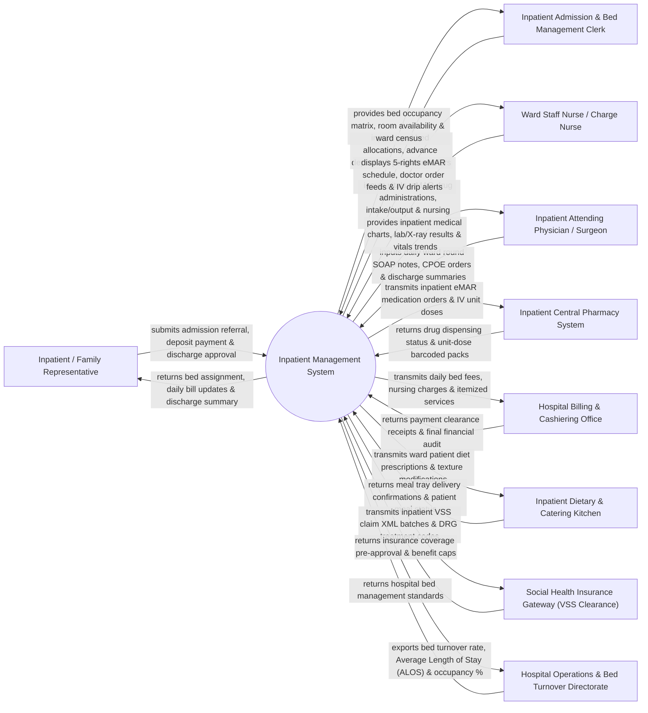

# Context Diagram — Inpatient Management System

## Mermaid Code

## Actor & Interaction Table | Bảng Actor & Tương tác

| # | Actor | Actor Type | Data Sent TO System | Data Received FROM System | Notes |
|---|-------|------------|---------------------|---------------------------|-------|
| 1 | Inpatient / Family Representative | Primary | Admission referral slip, advance financial deposit, emergency contact data, discharge confirmation. | Assigned bed details, daily itemized bill updates, discharge summary, follow-up advice. | Patient admitted to hospital ward bed or family member handling financial deposits. |
| 2 | Inpatient Admission & Bed Management Clerk | Primary | Bed allocations (Ward/Room/Bed number), advance deposit entries, inter-ward transfer requests. | Real-time hospital bed occupancy matrix, vacant bed availability, ward census lists. | Front-desk staff managing hospital bed inventory, admissions, transfers, and bed releases. |
| 3 | Ward Staff Nurse / Charge Nurse | Primary | Baseline vital signs, electronic Medication Administration Records (eMAR), fluid intake/output, nursing notes. | 5-Rights eMAR medication schedules, doctor CPOE order feeds, IV drip infusion alerts. | Registered ward nurse managing bedside care, drug administration, and vital signs monitoring. |
| 4 | Inpatient Attending Physician / Surgeon | Primary | Daily ward round SOAP notes, CPOE orders (IV fluids, meds, lab/X-ray), discharge summaries, ICD-10 codes. | Longitudinal medical charts, lab result panels, radiology DICOM views, vitals trend graphs. | Hospital doctor or surgeon managing inpatient clinical care from admission to discharge. |
| 5 | Inpatient Central Pharmacy System | Supporting System | Unit-dose barcoded medication packs, drug dispensing confirmations, pharmacy stock availability. | Inpatient eMAR drug orders, IV fluid order feeds, stat medication requests. | Hospital central pharmacy dispensing unit-dose medications and IV admixtures to wards. |
| 6 | Hospital Billing & Cashiering Office | Supporting System | Advance deposit receipts, final payment clearance tokens, cashiering audit sign-offs. | Daily bed fee ledgers, nursing charges, itemized inpatient service bills, final financial statements. | Finance department collecting advance deposits, co-pays, and settling final hospital bills. |
| 7 | Inpatient Dietary & Catering Kitchen | Supporting System | Meal tray delivery confirmations, kitchen diet preparation logs, patient dietary feedback. | Inpatient diet prescriptions (Diabetic, Low-Salt, NPO), texture modifications, bed numbers. | Hospital kitchen preparing therapeutic meal trays delivered to inpatient ward beds. |
| 8 | Social Health Insurance Gateway (VSS Clearance) | Supporting System | Inpatient insurance pre-authorization, Diagnosis-Related Group (DRG) cap approvals, benefit rates. | Inpatient insurance claim XML batches, ICD-10 discharge diagnoses, itemized fee breakdowns. | National social health insurance agency (Vietnam Social Security - VSS) clearing inpatient claims. |
| 9 | Hospital Operations & Bed Turnover Directorate | Regulatory | Target bed turnover metrics, maximum Average Length of Stay (ALOS) goals, ward capacity rules. | Real-time bed occupancy percentages, ALOS reports, bed cleaning turnaround times, ward analytics. | Hospital executive management overseeing inpatient bed utilization and operational efficiency. |

## System Boundary Description | Mô tả Phạm vi Hệ thống

The **Inpatient Management System (IPD System)** is an enterprise clinical software platform designed for hospital inpatient wards, Intensive Care Units (ICU), surgical wards, and bed management departments. It manages the complete inpatient lifecycle from admission bed allocation, advance deposit cashiering, daily physician ward rounds, nursing Electronic Medication Administration Records (eMAR), inpatient order entry (CPOE), daily bed charge ledgers, to discharge summary generation and final financial clearance.

**Inside System Scope:**
- Inpatient admission, ward/room/bed allocation, and inter-ward patient transfer management.
- Daily physician ward round clinical charting (SOAP format) and ICD-10 admission/discharge coding.
- Nursing care management, baseline vitals logging, fluid intake/output tracking, and eMAR administration (5 Rights).
- Computerized Provider Order Entry (CPOE) for IV fluids, inpatient medications, daily lab/X-ray orders, and diets.
- Daily automated bed fee, nursing fee, and medical equipment charge ledger accumulation.
- Inpatient discharge planning, official discharge summary generation, and outpatient follow-up advice.
- Financial advance deposit tracking, VSS health insurance coverage clearance, and final bill settlement.

**Outside System Scope:**
- Operating room surgical execution details (handled by Surgical Scheduling / OR System).
- Physical compounding of sterile TPN or IV bags inside pharmacy cleanrooms (handled by Pharmacy).
- Outpatient clinic registration and initial consultations (handled by Outpatient System / OPD).
- Commercial corporate financial general ledger accounting (handled by enterprise ERP).
