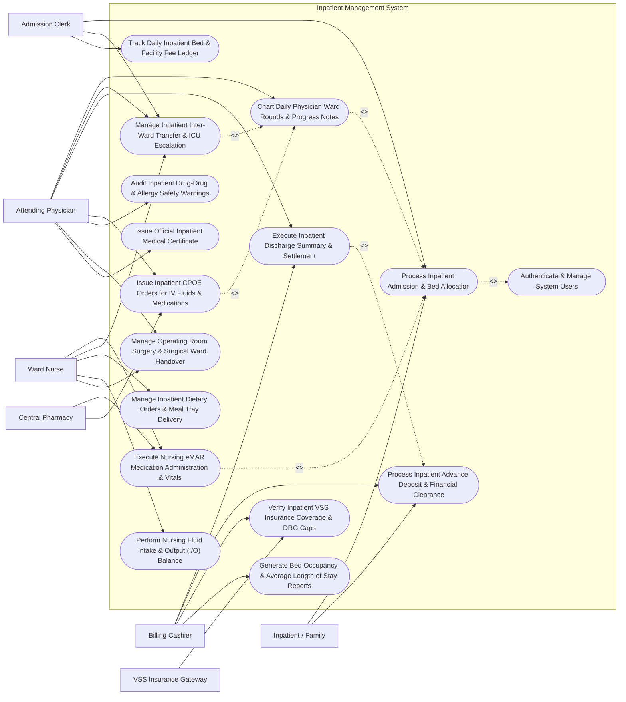

# Use Case Diagram — Inpatient Management System

## Mermaid Code

## Actor Table | Bảng Actor

| # | Actor | Actor Type | Role Description | Related Use Cases |
|---|-------|------------|------------------|-------------------|
| 1 | Inpatient / Family | Primary | Patient or family member completing admission check-in, paying advance deposits, and receiving discharge care. | UC01, UC06 |
| 2 | Admission Clerk | Primary | Front-desk staff managing bed inventory, assigning ward/room/bed numbers, and processing transfers. | UC01, UC04, UC08 |
| 3 | Ward Nurse | Primary | Registered nurse administering eMAR medications, recording vital signs, fluid I/O balance, and nursing care. | UC03, UC04, UC09, UC10, UC13 |
| 4 | Attending Physician | Primary | Hospital doctor or surgeon conducting daily rounds, charting SOAP notes, issuing CPOE orders, and signing discharge summaries. | UC02, UC04, UC05, UC07, UC12, UC13, UC14 |
| 5 | Billing Cashier | Primary | Hospital cashier processing advance financial deposits, accumulating daily bed ledgers, and settling final bills. | UC05, UC06, UC11, UC15 |
| 6 | Central Pharmacy | Secondary / System | Hospital central pharmacy receiving inpatient eMAR drug orders and delivering barcoded unit-dose medication packs. | UC03, UC07 |
| 7 | VSS Insurance Gateway | Secondary / System | National health insurance gateway clearing inpatient pre-authorizations and verifying DRG benefit rates. | UC11 |

## Use Case Table | Bảng Use Case

| # | UC ID | Use Case Name | Primary Actor | Secondary Actor | Description | Priority |
|---|-------|---------------|---------------|-----------------|-------------|----------|
| 1 | UC01 | Process Inpatient Admission & Bed Allocation | Admission Clerk | Inpatient / Family | Intake OPD/Emergency referral, allocate ward room/bed, verify VSS insurance card, and collect advance deposit. | High |
| 2 | UC02 | Chart Daily Physician Ward Rounds & Progress Notes | Attending Physician | None | Record daily physician ward round progress notes using SOAP format, review vitals trends, and update care plans. | High |
| 3 | UC03 | Execute Nursing eMAR Medication Administration & Vitals | Ward Nurse | Central Pharmacy | Administer inpatient medications using 5-Rights barcode scanning (eMAR), log vitals (BP, HR, Temp, SpO2), and record IV drips. | High |
| 4 | UC04 | Manage Inpatient Inter-Ward Transfer & ICU Escalation | Admission Clerk | Ward Nurse | Transfer patients between hospital wards (e.g., General Surgical Ward to ICU), updating bed status and custody logs. | High |
| 5 | UC05 | Execute Inpatient Discharge Summary & Settlement | Attending Physician | Billing Cashier | Authorize medical discharge, compile discharge summary with ICD-10 codes, deduct advance deposit, and settle final bill. | High |
| 6 | UC06 | Process Inpatient Advance Deposit & Financial Clearance | Billing Cashier | Inpatient / Family | Collect advance financial deposits upon admission or during long stays, tracking deposit usage against accrued fees. | High |
| 7 | UC07 | Issue Inpatient CPOE Orders for IV Fluids & Medications | Attending Physician | Central Pharmacy | Issue Computerized Provider Order Entry (CPOE) for IV fluids, parenteral medications, daily lab tests, and bedside procedures. | High |
| 8 | UC08 | Track Daily Inpatient Bed & Facility Fee Ledger | Admission Clerk | None | Automatically accumulate daily midnight bed charges, room tier rates, nursing care fees, and medical equipment rentals. | High |
| 9 | UC09 | Manage Inpatient Dietary Orders & Meal Tray Delivery | Ward Nurse | None | Prescribe therapeutic inpatient diets (Diabetic 1800 kcal, Low-Salt, NPO) and track kitchen meal tray delivery to beds. | Medium |
| 10 | UC10 | Perform Nursing Fluid Intake & Output (I/O) Balance | Ward Nurse | None | Log 24-hour fluid intake (oral, IV fluids) and output (urine, surgical drains, emesis) to calculate fluid balance. | Medium |
| 11 | UC11 | Verify Inpatient VSS Insurance Coverage & DRG Caps | Billing Cashier | VSS Insurance Gateway | Query VSS gateway to clear inpatient pre-authorization, verify Diagnosis-Related Group (DRG) cap limits, and copay %. | High |
| 12 | UC12 | Audit Inpatient Drug-Drug & Allergy Safety Warnings | Attending Physician | None | Screen inpatient CPOE medication orders against documented patient allergies, drug interactions, and renal dosing limits. | High |
| 13 | UC13 | Manage Operating Room Surgery & Surgical Ward Handover | Attending Physician | Ward Nurse | Coordinate pre-op checklist, surgical ward transfer to OR, post-op recovery notes, and PACU handover to ward nurse. | Medium |
| 14 | UC14 | Issue Official Inpatient Medical Certificate | Attending Physician | None | Generate official hospital discharge certificate, inpatient sick leave authorization (BHXH format), and disability notes. | Medium |
| 15 | UC15 | Generate Bed Occupancy & Average Length of Stay Reports | Billing Cashier | None | Produce daily bed occupancy percentage, ward turnover rates, Average Length of Stay (ALOS), and hospital revenue metrics. | Medium |
| 16 | UC16 | Authenticate & Manage System Users | All Users | None | Enforce secure role-based login (Clerk, Nurse, Doctor, Cashier), patient data privacy, and 21 CFR Part 11 audit trails. | High |

## Use Case Specification | Đặc tả Use Case

---

### UC01 — Process Inpatient Hospital Admission & Bed Allocation

| Field | Detail |
|-------|--------|
| **UC ID** | UC01 |
| **Use Case Name** | Process Inpatient Hospital Admission & Bed Allocation |
| **Actor(s)** | Primary: Admission Clerk   Secondary: Inpatient / Family |
| **Description** | Ingests an outpatient or emergency department referral for inpatient hospital admission, verifies patient demographics and VSS health insurance card, allocates an available ward, room, and bed (General, Semi-Private, VIP, ICU), collects an advance financial deposit, and creates the Inpatient Admission Master Record. |
| **Precondition** | 1. The patient has an approved Admission Referral Order from OPD or Emergency.   2. Hospital bed inventory is active. |
| **Main Flow** | 1. The Admission Clerk opens "New Inpatient Admission" and scans the Admission Referral Order barcode (e.g., REF-2026-08192).   2. The System loads patient demographics and admitting diagnosis: Primary ICD-10 `J18.9 (Pneumonia, Unspecified)`.   3. The Clerk verifies VSS Health Insurance Card eligibility (UC11): Benefit Rate = 80% Insured.   4. The System displays the **Interactive Hospital Bed Matrix** showing real-time bed status (Occupied, Vacant/Clean, Reserved, Maintenance).   5. The Clerk selects Target Ward and Room: Ward: Internal Medicine (3rd Floor), Room 304, Bed 304-A (Semi-Private Room, Daily Rate: $50/day).   6. The System reserves Bed 304-A and sets status to "Reserved - Admission Pending".   7. The Clerk collects the mandatory **Advance Financial Deposit** (e.g., $300 deposit) and issues an official deposit receipt (UC06).   8. The System generates an **Inpatient Master Record** (e.g., ADM-2026-99182) and prints the patient's **Waterproof Barcode ID Wristband**.   9. The System dispatches an electronic admission notification to Ward 3 Nursing Station, changing Bed 304-A status to "Occupied". |
| **Alternative Flow** | **AF1** — Direct Emergency ICU Admission: For critically ill patients admitted directly to ICU Bed 01, the Clerk bypasses advance deposit collection, creating an "Emergency Immediate Admission" record with a 24-hour deposit deferral.   **AF2** — VIP Room Selection with Cash Differential: Patient requests VIP Room 501 ($150/day); the System auto-calculates VSS base coverage deduction and logs patient responsibility for the $100/day room upgrade differential. |
| **Exception Flow** | **EX1** — No Vacant Beds Available in Target Ward: If all Internal Medicine beds are 100% occupied, the System alerts "Ward Fully Occupied", prompting overflow bed placement in General Medical Ward.   **EX2** — VSS Insurance Card Blocked / Suspended: If VSS query returns "Card Suspended for Non-Payment", the System converts admission type to "Self-Pay Out-of-Pocket" and doubles the required advance deposit. |
| **Postcondition** | Inpatient Admission Master Record is created, bed status is updated to Occupied, barcode wristband is printed, advance deposit is collected, and ward nursing station is notified. |
| **Business Rule** | **BR1**: Every admitted inpatient MUST be assigned a unique physical bed ID and issued a barcode ID wristband prior to ward admission.   **BR2**: Elective inpatient admissions require a minimum 50% advance financial deposit against estimated total hospital charges prior to bed allocation. |

---

### UC02 — Chart Daily Physician Ward Rounds & Inpatient Progress Notes

| Field | Detail |
|-------|--------|
| **UC ID** | UC02 |
| **Use Case Name** | Chart Daily Physician Ward Rounds & Inpatient Progress Notes |
| **Actor(s)** | Primary: Attending Physician |
| **Description** | Facilitates daily physician inpatient ward rounds, allowing the attending doctor or consultant to review longitudinal vital signs trends, lab/X-ray results, and nursing care notes, document clinical progress using SOAP format, update ICD-10 diagnoses, and issue CPOE treatment orders. |
| **Precondition** | 1. The patient is currently admitted to an inpatient ward bed (UC01).   2. The Physician is authenticated in the IPD Ward Round Module on tablet or workstation. |
| **Main Flow** | 1. The Doctor selects Ward 3 (Internal Medicine) on their mobile tablet, viewing the **Ward Patient Census List**.   2. The Doctor opens Bed 304-A (Patient: ADM-2026-99182, Day 3 of Admission for Pneumonia).   3. The System displays the **Inpatient Clinical Dashboard**:   &nbsp;&nbsp;&nbsp;&nbsp;- 24-Hour Vitals Graph (Temp down from 38.8°C to 37.1°C; SpO2 improved to 97%)   &nbsp;&nbsp;&nbsp;&nbsp;- Cumulative 24-Hour Fluid I/O Balance (+250 mL)   &nbsp;&nbsp;&nbsp;&nbsp;- Morning Lab Results (WBC decreased from 14.2 to 8.5 x10^9/L)   &nbsp;&nbsp;&nbsp;&nbsp;- Active Medications & eMAR Compliance (100% given).   4. The Doctor conducts physical examination at bedside and inputs **Daily SOAP Progress Notes**:   &nbsp;&nbsp;&nbsp;&nbsp;- **S (Subjective)**: Patient feels significantly better. Cough less productive, fever resolved.   &nbsp;&nbsp;&nbsp;&nbsp;- **O (Objective)**: Temp 37.1°C, BP 122/78. Lungs: Decreased crepitations in right lower lobe.   &nbsp;&nbsp;&nbsp;&nbsp;- **A (Assessment)**: Resolving Right Lower Lobe Pneumonia (`ICD-10 J18.0`). Clinical improvement.   &nbsp;&nbsp;&nbsp;&nbsp;- **P (Plan)**: Switch IV Ceftriaxone to Oral Cefuroxime 500mg BID. Plan discharge in 48 hours.   5. The Doctor updates CPOE Orders (UC07): Discontinues IV line, orders oral step-down antibiotics.   6. The Doctor electronically signs the daily round note, locking the Day 3 record. |
| **Alternative Flow** | **AF1** — Multi-Specialty Consultant Consultation Note: A consulting Cardiologist adds a specialist consultation note for co-existing Atrial Fibrillation, updating cardiac medication orders.   **AF2** — Pre-Operative Surgical Ward Round: For a surgical inpatient scheduled for cholecystectomy, the Surgeon completes pre-op evaluation notes and signs the Surgical Consent Form. |
| **Exception Flow** | **EX1** — Sudden Clinical Deterioration Alert (`SpO2 Drops < 90%`): If 24-hour vitals indicate acute respiratory drop, the System flashes a red "Deterioration Alert", prompting immediate ICU transfer evaluation (UC04).   **EX2** — Unsigned Daily Ward Round Warning: If the Doctor attempts to exit the ward module without signing draft notes, the System prompts "Unsaved SOAP Notes Exist for Bed 304-A". |
| **Postcondition** | Daily SOAP progress note is recorded, ICD-10 diagnosis is updated, treatment plan is modified, and CPOE orders are dispatched to nursing. |
| **Business Rule** | **BR1**: Attending physicians MUST document and electronically sign at least one SOAP progress note daily for every admitted inpatient under their care.   **BR2**: Clinical progress notes cannot be overwritten once signed; modifications must be appended as dated addendums. |

---

### UC03 — Execute Nursing eMAR Medication Administration & Vitals

| Field | Detail |
|-------|--------|
| **UC ID** | UC03 |
| **Use Case Name** | Execute Nursing eMAR Medication Administration & Vitals |
| **Actor(s)** | Primary: Ward Nurse   Secondary: Central Pharmacy |
| **Description** | Enables ward nurses to administer scheduled inpatient medications using barcode scanning (electronic Medication Administration Record - eMAR), verifying the **5 Rights of Medication Administration** (Right Patient, Right Drug, Right Dose, Right Route, Right Time), and logging routine vital signs. |
| **Precondition** | 1. The patient is wearing a scannable Barcode ID Wristband.   2. Inpatient CPOE medication orders are approved and unit-dose barcoded packs are delivered by Central Pharmacy. |
| **Main Flow** | 1. The Nurse logs into the Mobile eMAR Application on a handheld mobile cart scanner.   2. The System displays the **Ward eMAR Worklist** highlighting scheduled 08:00 AM medication doses.   3. The Nurse approaches Bed 304-A and scans the patient's **Barcode ID Wristband**.   4. The System verifies **Right Patient**: Confirms Patient ID, Name, and checks for Active Allergy Alerts (e.g., Penicillin Allergy).   5. The Nurse selects scheduled drug: *IV Ceftriaxone 1 gram*.   6. The Nurse scans the barcode on the unit-dose medication vial/bag.   7. The System performs **5-Rights Automated Audit**:   &nbsp;&nbsp;&nbsp;&nbsp;- **Right Drug**: Scanned barcode matches active order Ceftriaxone 1g -> PASS   &nbsp;&nbsp;&nbsp;&nbsp;- **Right Dose**: 1 gram -> PASS   &nbsp;&nbsp;&nbsp;&nbsp;- **Right Route**: Intravenous (IV Drip) -> PASS   &nbsp;&nbsp;&nbsp;&nbsp;- **Right Time**: Scheduled 08:00 AM (Administered 08:05 AM) -> PASS.   8. The Nurse administers the IV medication, confirms administration on screen, and logs current vital signs (BP 125/80, HR 76, Temp 37.0°C).   9. The System logs the timestamped eMAR entry, updates drug inventory, and marks the 08:00 AM dose as "Completed". |
| **Alternative Flow** | **AF1** — Patient Refusal / Held Medication: Patient refuses morning anti-hypertensive pill due to dizziness (BP 92/58); the Nurse logs status "Medication Held - Patient Hypotensive", notifying the doctor.   **AF2** — High-Alert Drug Dual Nurse Verification: For IV Insulin or Heparin drips, the System enforces "Dual Nurse Sign-Off", requiring a second nurse to scan their ID badge to co-sign the dose. |
| **Exception Flow** | **EX1** — Wrong Patient Barcode Mismatch Alert: If the Nurse scans a medication intended for Bed 304-B while scanning Patient 304-A's wristband, the System flashes a loud red "WRONG PATIENT WARNING" and blocks sign-off.   **EX2** — Expired Medication Barcode Warning: If the scanned unit-dose drug barcode indicates an expired batch lot, the System blocks administration and alerts pharmacy. |
| **Postcondition** | eMAR medication administration log is recorded with 5-Rights verification, timestamped nurse ID is attached, vital signs are saved, and dosage worklist is updated. |
| **Business Rule** | **BR1**: eMAR medication administration MUST enforce 5-Rights barcode validation (scanning both patient wristband and drug barcode) prior to drug administration.   **BR2**: High-alert medications (Insulin, Heparin, Concentrated Electrolytes, Narcotics) require mandatory dual-nurse electronic co-signature. |

---

### UC04 — Manage Inpatient Inter-Ward Transfer & ICU Escalation

| Field | Detail |
|-------|--------|
| **UC ID** | UC04 |
| **Use Case Name** | Manage Inpatient Inter-Ward Transfer & ICU Escalation |
| **Actor(s)** | Primary: Admission Clerk   Secondary: Ward Nurse |
| **Description** | Manages internal hospital bed transfers between wards (e.g., General Internal Medicine to Intensive Care Unit - ICU, or Post-Op Recovery to Surgical Ward), updating bed occupancy status, releasing old beds, transferring active care plans, and maintaining custody tracking. |
| **Precondition** | 1. A transfer order is issued by the physician due to clinical escalation or step-down care.   2. Target ward bed is available or reserved. |
| **Main Flow** | 1. The Attending Physician issues a "Transfer Order: General Ward to ICU" due to respiratory failure requiring mechanical ventilation.   2. The System dispatches an urgent "Bed Transfer Request" to the Admission Clerk and ICU Charge Nurse.   3. The Admission Clerk opens the Bed Matrix, selects ICU Ward (2nd Floor), and allocates vacant **ICU Bed 02** (Daily Rate: $300/day).   4. The ICU Charge Nurse accepts the transfer request and prepares ICU Bed 02 (Ventilator & Monitor set up).   5. The General Ward Nurse executes **SBAR Nurse Transfer Handover**:   &nbsp;&nbsp;&nbsp;&nbsp;- **S (Situation)**: 65-year-old male with worsening pneumonia   &nbsp;&nbsp;&nbsp;&nbsp;- **B (Background)**: Admitted 3 days ago, PMH Diabetes   &nbsp;&nbsp;&nbsp;&nbsp;- **A (Assessment)**: SpO2 86% on 10L oxygen, severe dyspnea   &nbsp;&nbsp;&nbsp;&nbsp;- **R (Recommendation)**: Immediate ICU intubation and mechanical ventilation.   6. The General Ward Nurse confirms physical patient transfer, and scans the patient's wristband at ICU Bed 02.   7. The System updates bed assignments:   &nbsp;&nbsp;&nbsp;&nbsp;- Bed 304-A (Old Bed): Set to "Vacant - Dirty / Cleaning Required"   &nbsp;&nbsp;&nbsp;&nbsp;- ICU Bed 02 (New Bed): Set to "Occupied".   8. The System transfers all active CPOE orders, eMAR records, and lab feeds to the ICU clinical workspace. |
| **Alternative Flow** | **AF1** — ICU Step-Down Transfer to General Ward: When an ICU patient stabilizes, the Physician issues a "Step-Down Transfer Order" to General Ward, reducing daily bed fee rates.   **AF2** — Intra-Ward Room Upgrade: Patient requests transfer from 4-bed ward room to Single Private Room 310; the Clerk updates room rate and logs patient room upgrade agreement. |
| **Exception Flow** | **EX1** — ICU Full - Emergency Transfer Hold: If all ICU beds are occupied, the System alerts "ICU 100% Full", auto-routing an emergency alert to the Medical Director for emergency bed clearing.   **EX2** — Transfer Canceled Due to Patient Stabilization: If patient condition improves after oxygen therapy, the Physician cancels the transfer order, restoring normal ward workflow. |
| **Postcondition** | Patient bed location is updated to new ward/bed, old bed is marked for house-cleaning, active clinical chart and eMAR are migrated, and SBAR nursing handover is logged. |
| **Business Rule** | **BR1**: Inter-ward transfers MUST include a documented SBAR (Situation, Background, Assessment, Recommendation) nursing handover checklist.   **BR2**: Upon bed release, the old bed status MUST be set to "Cleaning Required" and cannot be assigned to a new admission until housekeeping signs off clean status. |

---

### UC05 — Execute Inpatient Discharge Summary & Final Financial Settlement

| Field | Detail |
|-------|--------|
| **UC ID** | UC05 |
| **Use Case Name** | Execute Inpatient Discharge Summary & Final Financial Settlement |
| **Actor(s)** | Primary: Attending Physician   Secondary: Billing Cashier |
| **Description** | Finalizes the inpatient stay by generating the official clinical Discharge Summary (ICD-10 discharge diagnosis, treatment summary, post-discharge medications), reconciling total accrued hospital charges against advance deposits and VSS health insurance coverage, collecting remaining balance, and releasing the bed. |
| **Precondition** | 1. The patient is clinically fit for discharge.   2. All pending lab/X-ray tests and daily charges are posted. |
| **Main Flow** | 1. The Attending Physician opens "Discharge Planning" for patient ADM-2026-99182 (Bed 304-A).   2. The Doctor completes the **Official Discharge Summary**:   &nbsp;&nbsp;&nbsp;&nbsp;- **Primary Discharge Diagnosis**: ICD-10 `J18.0 (Bronchopneumonia, Unspecified)`   &nbsp;&nbsp;&nbsp;&nbsp;- **Secondary Diagnoses**: Type 2 Diabetes (`E11.9`), Hypertension (`I10`)   &nbsp;&nbsp;&nbsp;&nbsp;- **Treatment Summary**: 5-day IV Ceftriaxone, oxygen therapy, blood sugar control   &nbsp;&nbsp;&nbsp;&nbsp;- **Discharge Condition**: Improved / Stable   &nbsp;&nbsp;&nbsp;&nbsp;- **Post-Discharge Take-Home Medications**: Cefuroxime 500mg (10-day supply)   &nbsp;&nbsp;&nbsp;&nbsp;- **Follow-Up Advice**: Outpatient clinic check in 14 days.   3. The Doctor signs the Discharge Summary, changing patient status to "Medically Discharged - Pending Financial Settlement".   4. The Billing Cashier opens the **Inpatient Final Billing Module** (UC06):   &nbsp;&nbsp;&nbsp;&nbsp;- **Total Accrued Charges**: $1,250 (Bed fees, nursing, meds, lab/X-ray)   &nbsp;&nbsp;&nbsp;&nbsp;- **VSS Insurance Coverage (80%)**: -$920   &nbsp;&nbsp;&nbsp;&nbsp;- **Net Patient Responsibility**: $330   &nbsp;&nbsp;&nbsp;&nbsp;- **Advance Deposit Paid**: -$300   &nbsp;&nbsp;&nbsp;&nbsp;- **Remaining Balance Due**: $30.   5. The Cashier collects the $30 remaining balance, prints the **Final Financial Clearance Receipt**, and submits the VSS Claim XML batch (UC11).   6. The Ward Nurse verifies financial clearance, removes the patient's wristband, hands over discharge summary and take-home medications, and clicks "Patient Departed".   7. The System changes Bed 304-A status to "Vacant - Dirty", completing the admission lifecycle. |
| **Alternative Flow** | **AF1** — Patient Deposit Refund Settlement: If advance deposit ($500) exceeds net patient responsibility ($330), the Cashier issues a $170 cash/bank refund to the family representative.   **AF2** — Discharge Against Medical Advice (DAMA): If patient requests early discharge against doctor advice, the Doctor logs "DAMA Status", requiring patient sign-off on the DAMA Liability Waiver. |
| **Exception Flow** | **EX1** — Unsettled Outstanding Balance Block: If family cannot pay the remaining $330 balance, the System flags "Financial Hold", alerting Medical Social Work for financial assistance evaluation.   **EX2** — Unfinalized Diagnostic Test Alert: If a lab test ordered yesterday is still "In-Progress", the System alerts the Cashier to confirm whether to wait for lab billing or cancel the pending order. |
| **Postcondition** | Official Discharge Summary with ICD-10 codes is signed, final hospital bill is settled, VSS claim XML is generated, patient is discharged, and bed is marked for cleaning. |
| **Business Rule** | **BR1**: Patients shall not be physically discharged from the hospital ward until both Medical Discharge (Doctor sign-off) and Financial Clearance (Cashier sign-off) are completed.   **BR2**: Official Discharge Summaries must include primary ICD-10 discharge diagnosis, surgical/procedure notes, and post-discharge medication instructions. |
