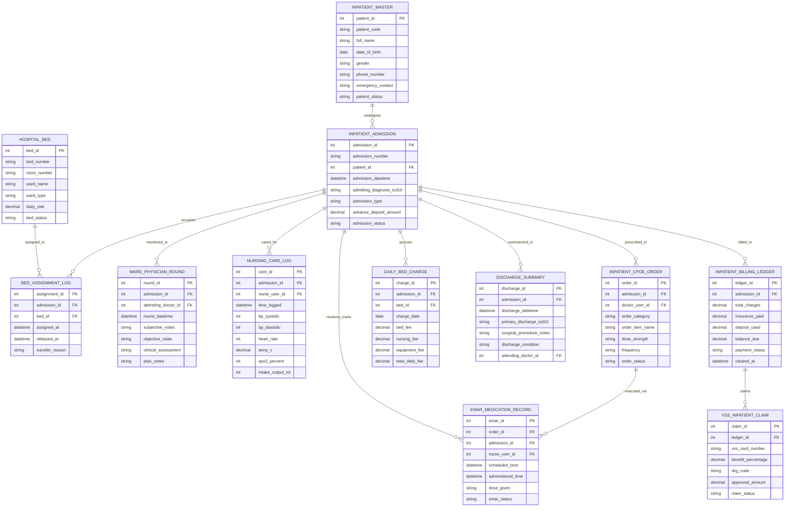

# Conceptual ERD — Inpatient Management System

## Mermaid Code

## Entity Description Table | Bảng mô tả Entity

| # | Entity Name | Vietnamese Name | Description | Key Attributes | Main Relationships |
|---|-------------|-----------------|-------------|----------------|-------------------|
| 1 | INPATIENT_MASTER | Bệnh nhân Nội trú Master | Master inpatient profile storing patient code, full name, DOB, gender, phone, emergency contact, and status. | patient_id, patient_code, full_name, dob, gender, phone_number, emergency_contact, patient_status | Has many INPATIENT_ADMISSION entities. |
| 2 | INPATIENT_ADMISSION | Đợt Nhập viện (Admission) | Inpatient admission episode record tracking admission number, datetime, admitting ICD-10 diagnosis, admission type, deposit, and status. | admission_id, admission_number, patient_id, admission_datetime, admitting_diagnosis_icd10, advance_deposit_amount, admission_status | Belongs to INPATIENT_MASTER; Has BED_ASSIGNMENT, WARD_ROUND, eMAR, DISCHARGE, BILLING, etc. |
| 3 | HOSPITAL_BED | Giường bệnh Bệnh viện | Hospital bed master inventory tracking bed number, room number, ward name, ward type (ICU, VIP, General), daily rate, and bed status. | bed_id, bed_number, room_number, ward_name, ward_type, daily_rate, bed_status | Has many BED_ASSIGNMENT_LOG and DAILY_BED_CHARGE entities. |
| 4 | BED_ASSIGNMENT_LOG | Nhật ký Phân giường & Chuyển viện | Bed occupancy assignment log recording assigned timestamp, released timestamp, and inter-ward transfer reason. | assignment_id, admission_id, bed_id, assigned_at, released_at, transfer_reason | Belongs to INPATIENT_ADMISSION and HOSPITAL_BED. |
| 5 | WARD_PHYSICIAN_ROUND | Thăm khám Bác sĩ Hàng ngày | Daily physician ward round progress note recording attending doctor ID, round datetime, SOAP notes (Subjective, Objective, Assessment, Plan). | round_id, admission_id, attending_doctor_id, round_datetime, subjective_notes, clinical_assessment | Belongs to INPATIENT_ADMISSION. |
| 6 | NURSING_CARE_LOG | Nhật ký Điều dưỡng & Vitals | Nursing care log recording nurse ID, timestamp, vital signs (BP, HR, Temp, SpO2), and 24-hour fluid intake/output balance mL. | care_id, admission_id, nurse_user_id, time_logged, bp_systolic, heart_rate, temp_c, spo2_percent, intake_output_ml | Belongs to INPATIENT_ADMISSION. |
| 7 | INPATIENT_CPOE_ORDER | Y lệnh Bác sĩ (CPOE Orders) | Computerized Provider Order Entry record tracking doctor ID, order category (IV fluids, meds, lab/X-ray, diet), dose, frequency, and status. | order_id, admission_id, doctor_user_id, order_category, order_item_name, dose_strength, frequency, order_status | Belongs to INPATIENT_ADMISSION; Has many EMAR_MEDICATION_RECORD entities. |
| 8 | EMAR_MEDICATION_RECORD | Nhật ký Tiêm truyền eMAR | Electronic Medication Administration Record tracking scheduled time, 5-Rights barcode scan time, dose given, nurse ID, and status. | emar_id, order_id, admission_id, nurse_user_id, scheduled_time, administered_time, dose_given, emar_status | Belongs to INPATIENT_CPOE_ORDER and INPATIENT_ADMISSION. |
| 9 | DAILY_BED_CHARGE | Hóa đơn Tiền giường Hàng ngày | Daily midnight automated bed fee log accumulating bed rate, nursing fee, medical equipment usage fee, and total daily fee per admission. | charge_id, admission_id, bed_id, charge_date, bed_fee, nursing_fee, equipment_fee, total_daily_fee | Belongs to INPATIENT_ADMISSION and HOSPITAL_BED. |
| 10 | DISCHARGE_SUMMARY | Tổng kết Ra viện (Discharge) | Official clinical discharge summary recording discharge datetime, primary discharge ICD-10 code, surgical notes, discharge condition, and doctor ID. | discharge_id, admission_id, discharge_datetime, primary_discharge_icd10, surgical_procedure_notes, discharge_condition | Belongs to INPATIENT_ADMISSION. |
| 11 | INPATIENT_BILLING_LEDGER | Sổ Hóa đơn Viện phí Nội trú | Inpatient financial billing ledger tracking total accrued charges, insurance paid, deposit used, net balance due, and payment clearance status. | ledger_id, admission_id, total_charges, insurance_paid, deposit_used, balance_due, payment_status, cleared_at | Belongs to INPATIENT_ADMISSION; Has VSS_INPATIENT_CLAIM. |
| 12 | VSS_INPATIENT_CLAIM | Hồ sơ BHYT Nội trú (VSS) | Inpatient social health insurance (VSS) claim record tracking VSS card number, benefit %, Diagnosis-Related Group (DRG) code, and approved claim. | claim_id, ledger_id, vss_card_number, benefit_percentage, drg_code, approved_amount, claim_status | Belongs to INPATIENT_BILLING_LEDGER. |

## Relationship Description | Mô tả Quan hệ

| # | From Entity | Cardinality | To Entity | Relationship Label | Business Explanation |
|---|-------------|-------------|-----------|-------------------|----------------------|
| 1 | INPATIENT_MASTER | one-to-many | INPATIENT_ADMISSION | undergoes | One inpatient master profile undergoes one or more hospital admission episodes over time. |
| 2 | HOSPITAL_BED | one-to-many | BED_ASSIGNMENT_LOG | assigned_in | One hospital bed is assigned in multiple patient bed allocation logs over time. |
| 3 | INPATIENT_ADMISSION | one-to-many | BED_ASSIGNMENT_LOG | occupies | One admission episode occupies one or more beds during inter-ward transfers. |
| 4 | INPATIENT_ADMISSION | one-to-many | WARD_PHYSICIAN_ROUND | monitored_in | One admission episode is monitored in daily physician ward round progress notes. |
| 5 | INPATIENT_ADMISSION | one-to-many | NURSING_CARE_LOG | cared_for | One admission episode is cared for in routine nursing vital signs and fluid logs. |
| 6 | INPATIENT_ADMISSION | one-to-many | INPATIENT_CPOE_ORDER | prescribed_in | One admission episode is prescribed CPOE orders for IV fluids, medications, and labs. |
| 7 | INPATIENT_ADMISSION | one-to-many | EMAR_MEDICATION_RECORD | receives_meds | One admission episode receives 5-Rights eMAR medication administrations. |
| 8 | INPATIENT_ADMISSION | one-to-many | DAILY_BED_CHARGE | accrues | One admission episode accrues daily midnight bed charges and nursing fees. |
| 9 | INPATIENT_ADMISSION | one-to-one | DISCHARGE_SUMMARY | summarized_in | One admission episode is summarized in exactly one clinical discharge summary. |
| 10 | INPATIENT_ADMISSION | one-to-one | INPATIENT_BILLING_LEDGER | billed_in | One admission episode is billed in a comprehensive financial ledger. |
| 11 | INPATIENT_CPOE_ORDER | one-to-many | EMAR_MEDICATION_RECORD | executed_via | One CPOE medication order is executed via multiple scheduled eMAR doses. |
| 12 | INPATIENT_BILLING_LEDGER | one-to-one | VSS_INPATIENT_CLAIM | claims | One inpatient billing ledger generates a social health insurance (VSS) claim. |
