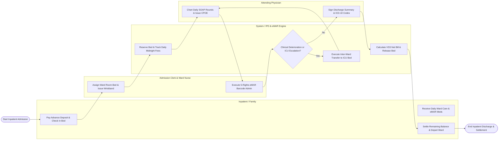

# Swimlane Diagram — Inpatient Management System

## Mermaid Code

## Flow Description | Mô tả luồng

| Lane | Actor / Subsystem | Role in Flow |
|------|-------------------|--------------|
| 1 | Inpatient / Family | Pays advance financial deposits, checks into assigned ward bed, receives daily bedside nursing and eMAR medication care, settles final bills, and departs ward. |
| 2 | Admission Clerk & Ward Nurse | Assigns available ward/room/bed numbers, prints barcode ID wristbands, conducts daily nursing vitals checks, and administers 5-Rights eMAR medications. |
| 3 | System / IPD & eMAR Engine | Reserves hospital beds, accumulates daily midnight bed/nursing fees, evaluates clinical deterioration alerts, manages ICU ward transfers, and calculates net VSS insurance bills. |
| 4 | Attending Physician | Conducts daily physician ward rounds, charts SOAP progress notes, issues CPOE orders for IV fluids and lab tests, and signs official clinical discharge summaries with ICD-10 codes. |
