# Action Tree — Inpatient Management System

## Mermaid Code

```mermaid
graph TD
    Root["Inpatient Management System"]

    Root --> M1["Inpatient Admission & Bed Allocation"]
    Root --> M2["Physician Ward Rounds & SOAP"]
    Root --> M3["Nursing eMAR & Vitals"]
    Root --> M4["Inter-Ward Transfer & ICU"]
    Root --> M5["CPOE Order Entry & Feeds"]
    Root --> M6["Daily Bed Charges & Ledger"]
    Root --> M7["Inpatient Discharge & Settlement"]
    Root --> M8["VSS Insurance & Bed Analytics"]

    M1 --> A11["Allocate Ward Room & Bed Number"]
    M1 --> A12["Collect Advance Financial Deposit"]
    M1 --> A13["Print Barcode ID Wristband Tag"]
    M1 --> A14["Verify Primary VSS Insurance Clearance"]

    M2 --> A21["Review 24-Hour Vitals & Lab Trends"]
    M2 --> A22["Document Daily SOAP Progress Notes"]
    M2 --> A23["Update Primary Admission ICD-10 Code"]
    M2 --> A24["Electronically Sign Ward Round Chart"]

    M3 --> A31["Scan Patient Barcode ID Wristband"]
    M3 --> A32["Verify 5-Rights eMAR Drug Barcode"]
    M3 --> A33["Record Dual Nurse Sign-Off for Insulin"]
    M3 --> A34["Log Fluid Intake & Output I/O Balance"]

    M4 --> A41["Issue Inter-Ward Transfer Orders"]
    M4 --> A42["Allocate Vacant ICU Ward Bed"]
    M4 --> A43["Log SBAR Nursing Handover Protocol"]
    M4 --> A44["Release Old Bed for Housekeeping"]

    M5 --> A51["Prescribe IV Fluids & Injection Orders"]
    M5 --> A52["Transmit Order Feeds to Central Pharmacy"]
    M5 --> A53["Screen Drug-Drug Allergy Safety Warnings"]
    M5 --> A54["Order Inpatient Therapeutic Diets"]

    M6 --> A61["Accumulate Midnight Bed Tier Charges"]
    M6 --> A62["Log Nursing & Equipment Daily Fees"]
    M6 --> A63["Track Deposit Usage Against Charges"]
    M6 --> A64["Issue Daily Financial Interim Statement"]

    M7 --> A71["Compile Discharge Summary with ICD-10"]
    M7 --> A72["Prescribe Post-Discharge Take-Home Meds"]
    M7 --> A73["Settle Remaining Financial Balance"]
    M7 --> A74["Generate VSS Inpatient Claim XML"]

    M8 --> A81["Query VSS DRG Cap Benefit Limits"]
    M8 --> A82["Calculate Bed Occupancy Percentage"]
    M8 --> A83["Audit Average Length of Stay ALOS"]
    M8 --> A84["Track Housekeeping Bed Turnover Time"]
```

## Module Description | Mô tả Module

| # | Module | Description | Actions |
|---|--------|-------------|---------|
| 1 | Inpatient Admission & Bed Allocation | Allocates ward/room/bed numbers, collects advance deposits, prints barcode wristbands, and verifies VSS insurance clearance. | Allocate Ward Room & Bed Number, Collect Advance Financial Deposit, Print Barcode ID Wristband Tag, Verify Primary VSS Insurance Clearance |
| 2 | Physician Ward Rounds & SOAP | Reviews vitals trends, documents daily SOAP progress notes, updates ICD-10 diagnoses, and electronically signs charts. | Review 24-Hour Vitals & Lab Trends, Document Daily SOAP Progress Notes, Update Primary Admission ICD-10 Code, Electronically Sign Ward Round Chart |
| 3 | Nursing eMAR & Vitals | Scans patient wristbands, verifies 5-Rights eMAR drug barcodes, enforces dual-nurse sign-off, and logs fluid I/O balance. | Scan Patient Barcode ID Wristband, Verify 5-Rights eMAR Drug Barcode, Record Dual Nurse Sign-Off for Insulin, Log Fluid Intake & Output I/O Balance |
| 4 | Inter-Ward Transfer & ICU | Manages inter-ward transfer orders, allocates vacant ICU beds, logs SBAR nursing handovers, and releases old beds for cleaning. | Issue Inter-Ward Transfer Orders, Allocate Vacant ICU Ward Bed, Log SBAR Nursing Handover Protocol, Release Old Bed for Housekeeping |
| 5 | CPOE Order Entry & Feeds | Prescribes IV fluids and injections, transmits CPOE order feeds to Central Pharmacy, screens drug safety, and orders diets. | Prescribe IV Fluids & Injection Orders, Transmit Order Feeds to Central Pharmacy, Screen Drug-Drug Allergy Safety Warnings, Order Inpatient Therapeutic Diets |
| 6 | Daily Bed Charges & Ledger | Accumulates midnight bed tier charges, logs nursing/equipment fees, tracks deposit usage against fees, and issues interim statements. | Accumulate Midnight Bed Tier Charges, Log Nursing & Equipment Daily Fees, Track Deposit Usage Against Charges, Issue Daily Financial Interim Statement |
| 7 | Inpatient Discharge & Settlement | Compiles clinical discharge summaries with ICD-10 codes, writes take-home e-prescriptions, settles final bills, and generates VSS XML. | Compile Discharge Summary with ICD-10, Prescribe Post-Discharge Take-Home Meds, Settle Remaining Financial Balance, Generate VSS Inpatient Claim XML |
| 8 | VSS Insurance & Bed Analytics | Queries VSS DRG benefit caps, calculates hospital bed occupancy percentages, audits Average Length of Stay (ALOS), and tracks turnover. | Query VSS DRG Cap Benefit Limits, Calculate Bed Occupancy Percentage, Audit Average Length of Stay ALOS, Track Housekeeping Bed Turnover Time |
