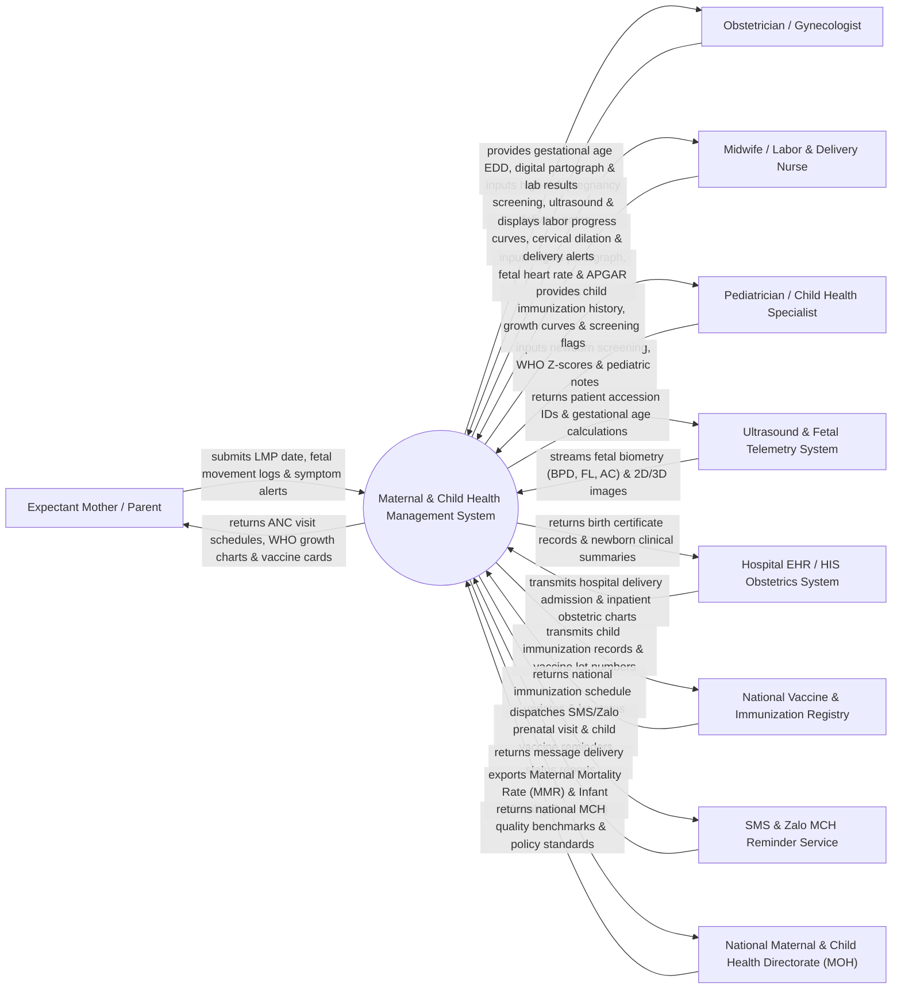

# Context Diagram — Maternal & Child Health Management System

## Mermaid Code

## Actor & Interaction Table | Bảng Actor & Tương tác

| # | Actor | Actor Type | Data Sent TO System | Data Received FROM System | Notes |
|---|-------|------------|---------------------|---------------------------|-------|
| 1 | Expectant Mother / Parent | Primary | Last Menstrual Period (LMP) date, daily kick-count logs, pregnancy symptoms, appointment bookings. | Estimated Due Date (EDD), ANC visit schedules, WHO child growth charts, digital immunization passport. | Mother during pregnancy and postpartum, or parent managing child health from 0 to 5 years. |
| 2 | Obstetrician / Gynecologist | Primary | High-risk pregnancy evaluations (preeclampsia, gestational diabetes), ultrasound interpretations, delivery plans. | Gestational age calculator, ANC visit history, fetal biometry parameters, lab blood panels. | Medical specialist diagnosing and managing high-risk obstetric cases and gynecological health. |
| 3 | Midwife / Labor & Delivery Nurse | Primary | Digital partograph entries (cervical dilation, fetal descent, contraction frequency), APGAR scores, delivery notes. | Real-time labor progress curves, fetal distress alerts, postpartum hemorrhage warnings. | Certified midwife managing normal labor, delivery, immediate newborn care, and partographs. |
| 4 | Pediatrician / Child Health Specialist | Primary | Newborn screening results (G6PD, CHT), WHO Z-score growth evaluations, vaccine administration logs. | Child immunization history, WHO growth curve trends, developmental milestone flags. | Child health specialist tracking infant growth, vaccinations, and pediatric illnesses up to age 5. |
| 5 | Ultrasound & Fetal Telemetry System | Supporting System | Fetal biometry parameters (Biparietal Diameter BPD, Femur Length FL, Abdominal Circumference AC), 2D/3D images. | Patient accession UIDs, gestational age calculation queries, study indexing tokens. | Diagnostic ultrasound hardware capturing fetal growth scans and Doppler flow telemetry. |
| 6 | Hospital EHR / HIS Obstetrics System | Supporting System | Hospital labor admission notes, operative delivery records (C-Section), inpatient neonatology charts. | Birth certificate registration data, newborn APGAR scores, maternal postpartum discharge summaries. | Enterprise hospital information system managing inpatient maternity wards and delivery rooms. |
| 7 | National Vaccine & Immunization Registry | Supporting System | National immunization schedule updates, vaccine batch lot safety recalls, global vaccine codes. | Child vaccination logs (BCG, HepB, DTP, Polio, Measles), vaccine batch lot numbers, coverage stats. | Government national immunization registry tracking childhood vaccine coverage. |
| 8 | SMS & Zalo MCH Reminder Service | Supporting System | Delivery confirmation receipts, SMS/Zalo message transmission logs, patient reply tokens. | Automated ANC visit reminders, tetanus vaccination alerts, child 2/3/4-month vaccine notices. | Multi-channel messaging gateway sending automated reminders to pregnant women and mothers. |
| 9 | National MCH Directorate (MOH) | Regulatory | National maternal/child health guidelines, WHO growth standards, mortality reporting rules. | Maternal Mortality Rate (MMR) reports, Infant Mortality Rate (IMR) statistics, ANC coverage metrics. | Public health authority monitoring national maternal, newborn, and child mortality and health targets. |

## System Boundary Description | Mô tả Phạm vi Hệ thống

The **Maternal & Child Health Management System (MCHMS)** is a specialized public health and clinical software solution designed for obstetric clinics, maternity hospitals, and pediatric centers. It tracks the complete maternal continuum of care from early pregnancy (Antenatal Care - ANC), high-risk pregnancy screening (preeclampsia, gestational diabetes), labor and delivery with a digital WHO Partograph, immediate newborn APGAR scoring, to 5-year child growth monitoring (WHO Z-scores) and national childhood immunization tracking.

**Inside System Scope:**
- Pregnancy registration, Last Menstrual Period (LMP) tracking, and Estimated Due Date (EDD) calculation.
- Antenatal Care (ANC) visit management and high-risk pregnancy screening (blood pressure, proteinuria, blood sugar).
- Digital WHO Partograph labor tracking (cervical dilation, fetal heart rate, contraction frequency, amniotic fluid).
- Delivery outcome logging (normal delivery, C-section), maternal blood loss, and newborn birth registration.
- Newborn APGAR scoring (1, 5, 10 minutes) and newborn metabolic/hearing screening.
- Postnatal Care (PNC) follow-up for maternal postpartum depression and uterine involution.
- WHO Child Growth Monitoring (Weight-for-age, Height-for-age, Weight-for-height Z-scores, MUAC).
- Childhood Immunization Schedule management (BCG, HepB, DTP, IPV, Measles, Rotavirus) and automated SMS/Zalo alerts.

**Outside System Scope:**
- Physical surgical execution of Caesarean sections in operating rooms (handled by surgical teams).
- Physical manufacturing and refrigeration of vaccines in cold rooms (handled by cold-chain logistics).
- Non-maternal general adult medical care and adult surgeries (handled by HIS / Hospitals).
- Commercial financial banking ledger accounting (handled by general accounting software).
