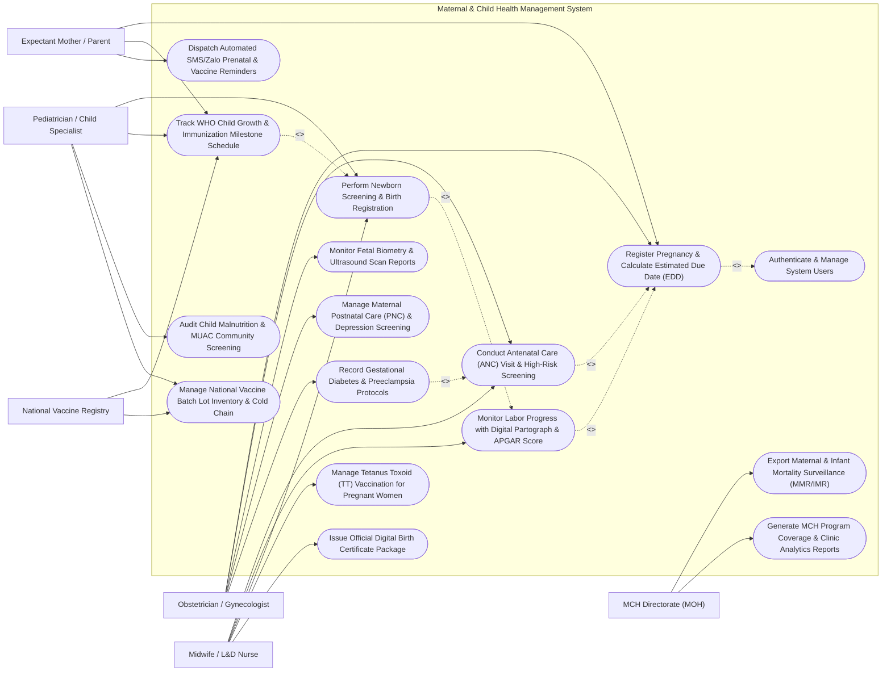

# Use Case Diagram — Maternal & Child Health Management System

## Mermaid Code

## Actor Table | Bảng Actor

| # | Actor | Actor Type | Role Description | Related Use Cases |
|---|-------|------------|------------------|-------------------|
| 1 | Expectant Mother / Parent | Primary | Pregnant woman or parent registering pregnancies, monitoring child growth curves, and receiving SMS reminders. | UC01, UC05, UC08 |
| 2 | Obstetrician / Gynecologist | Primary | Specialist physician conducting ANC exams, assessing high-risk pregnancies (preeclampsia), and interpreting ultrasound scans. | UC01, UC02, UC06, UC07, UC10 |
| 3 | Midwife / L&D Nurse | Primary | Healthcare professional monitoring labor with digital partographs, delivering babies, logging APGAR scores, and issuing birth certificates. | UC02, UC03, UC04, UC09, UC13 |
| 4 | Pediatrician / Child Specialist | Primary | Child health doctor performing newborn screening, assessing WHO growth Z-scores, administering vaccines, and auditing malnutrition. | UC04, UC05, UC11, UC12 |
| 5 | MCH Directorate (MOH) | Secondary / Regulatory | Public health authority analyzing national maternal mortality (MMR), infant mortality (IMR), and MCH program coverage statistics. | UC14, UC15 |
| 6 | National Vaccine Registry | Secondary / System | Governmental immunization agency synchronizing childhood vaccine records, schedules, and batch lot safety data. | UC05, UC12 |

## Use Case Table | Bảng Use Case

| # | UC ID | Use Case Name | Primary Actor | Secondary Actor | Description | Priority |
|---|-------|---------------|---------------|-----------------|-------------|----------|
| 1 | UC01 | Register Pregnancy & Calculate Estimated Due Date (EDD) | Obstetrician | Expectant Mother / Parent | Register new pregnancy episode, input Last Menstrual Period (LMP) date, calculate EDD using Naegele's rule, and assign Gravida/Para. | High |
| 2 | UC02 | Conduct Antenatal Care (ANC) Visit & High-Risk Screening | Obstetrician | Midwife | Perform routine ANC visits (min 4-8 visits), track gestational age, weight gain, blood pressure, fundal height, and screen for high risk. | High |
| 3 | UC03 | Monitor Labor Progress with Digital Partograph & APGAR Score | Midwife | None | Track active labor using WHO digital Partograph (cervical dilation, fetal heart rate, contractions), and log 1/5/10-min APGAR scores. | High |
| 4 | UC04 | Perform Newborn Screening & Birth Registration | Pediatrician | Midwife | Record birth weight, length, head circumference, perform metabolic (G6PD/CHT) and hearing screening, and log birth details. | High |
| 5 | UC05 | Track WHO Child Growth & Immunization Milestone Schedule | Pediatrician | National Vaccine Registry | Plot monthly child weight/height on WHO Z-score growth curves and manage childhood immunization schedules (BCG to Measles). | High |
| 6 | UC06 | Monitor Fetal Biometry & Ultrasound Scan Reports | Obstetrician | None | Ingest 1st/2nd/3rd trimester ultrasound scans, tracking Biparietal Diameter (BPD), Femur Length (FL), Abdominal Circumference (AC). | Medium |
| 7 | UC07 | Manage Maternal Postnatal Care (PNC) & Depression Screening | Obstetrician | None | Conduct PNC visits at Day 3, Day 7, Day 42 postpartum, assessing uterine involution, breast feeding, and Edinburgh Depression Scale. | High |
| 8 | UC08 | Dispatch Automated SMS/Zalo Prenatal & Vaccine Reminders | Expectant Mother / Parent | None | Auto-generate and dispatch multi-channel SMS/Zalo notifications for upcoming ANC visits, tetanus shots, and child vaccination dates. | Medium |
| 9 | UC09 | Manage Tetanus Toxoid (TT) Vaccination for Pregnant Women | Midwife | None | Track maternal Tetanus Toxoid (TT1 to TT5) immunization status to prevent maternal and neonatal tetanus. | High |
| 10 | UC10 | Record Gestational Diabetes & Preeclampsia Protocols | Obstetrician | None | Manage high-risk protocols: Oral Glucose Tolerance Test (OGTT), urine protein monitoring, anti-hypertensive meds, and seizure prevention. | High |
| 11 | UC11 | Audit Child Malnutrition & MUAC Community Screening | Pediatrician | None | Screen Mid-Upper Arm Circumference (MUAC) in community children to detect Severe Acute Malnutrition (SAM) and assign therapeutic food. | Medium |
| 12 | UC12 | Manage National Vaccine Batch Lot Inventory & Cold Chain | Pediatrician | National Vaccine Registry | Monitor clinic vaccine refrigerator temperature logs (2-8°C), track batch lot numbers, expiration dates, and vaccine wastage. | High |
| 13 | UC13 | Issue Official Digital Birth Certificate Package | Midwife | None | Generate official digital birth certificate data package featuring QR verification code for municipal civil registration. | High |
| 14 | UC14 | Export Maternal & Infant Mortality Surveillance (MMR/IMR) | MCH Directorate (MOH) | None | Compile statutory national reports on Maternal Mortality Ratio (MMR per 100,000 live births) and Infant Mortality Rate (IMR per 1,000). | High |
| 15 | UC15 | Generate MCH Program Coverage & Clinic Analytics Reports | MCH Directorate (MOH) | None | Render ANC 4-visit completion rates, institutional delivery percentages, full immunization coverage (FIC), and clinic performance. | Medium |
| 16 | UC16 | Authenticate & Manage System Users | All Users | None | Enforce secure role-based login, patient data confidentiality compliance, and electronic signature audit logging. | High |

## Use Case Specification | Đặc tả Use Case

---

### UC01 — Register Pregnancy & Calculate Estimated Due Date (EDD)

| Field | Detail |
|-------|--------|
| **UC ID** | UC01 |
| **Use Case Name** | Register Pregnancy & Calculate Estimated Due Date (EDD) |
| **Actor(s)** | Primary: Obstetrician   Secondary: Expectant Mother / Parent |
| **Description** | Registers a new pregnancy episode for a mother, captures obstetric history (Gravida, Para, Abortion, Living children - GPAL), calculates the Estimated Due Date (EDD) using Naegele’s Rule and early ultrasound biometry, and issues an MCH Health Passport. |
| **Precondition** | 1. The mother's master demographic profile is registered in MCHMS.   2. The mother presents with positive pregnancy test or early prenatal visit. |
| **Main Flow** | 1. The Obstetrician opens "New Pregnancy Registration" for the target mother profile.   2. The Obstetrician enters the Last Menstrual Period (LMP) date (e.g., May 15, 2025).   3. The System applies **Naegele’s Rule** to calculate Estimated Due Date (EDD): `EDD = LMP + 1 Year - 3 Months + 7 Days` (e.g., February 22, 2026).   4. The Obstetrician inputs GPAL Obstetric History: Gravida (Total pregnancies = 2), Para (Deliveries > 20 wks = 1), Abortion (0), Living children (1).   5. The Obstetrician inputs baseline medical history: Blood Type (O Positive), Rh Factor (Positive), Pre-pregnancy Weight (55 kg), Height (160 cm), and calculates baseline BMI (21.5 kg/m²).   6. The System generates a unique **Pregnancy Episode ID** (e.g., PREG-2026-0812) and creates a 40-week Gestational Calendar with mandatory ANC Visit milestones.   7. The System issues a digital **MCH Health Passport** accessible on the mother's mobile app. |
| **Alternative Flow** | **AF1** — EDD Calculation via 1st Trimester Ultrasound: If the LMP date is uncertain or irregular, the Obstetrician enters Crown-Rump Length (CRL mm) from a 9-week ultrasound; the System auto-calculates EDD based on CRL biometry.   **AF2** — Multiple Gestation Pregnancy: For twin or triplet pregnancies, the Obstetrician flags "Multiple Gestation (Twins)", and the System adjusts EDD target window to 37 weeks and flags high-risk monitoring rules. |
| **Exception Flow** | **EX1** — Discrepancy Between LMP and Ultrasound EDD (> 7 Days): If 1st trimester ultrasound EDD differs by > 7 days from LMP EDD, the System prompts the Obstetrician to confirm which EDD to set as the Official Clinical EDD.   **EX2** — Rh Negative Maternal Sensitivity Alert: If maternal blood type is Rh Negative, the System flashes a red "Rh Negative Alert", adding anti-D immunoglobulin prophylaxis reminders at 28 weeks. |
| **Postcondition** | Pregnancy episode is registered, EDD is calculated and locked, GPAL history is recorded, and 40-week ANC milestone calendar is active. |
| **Business Rule** | **BR1**: EDD calculations established by 1st trimester ultrasound (< 14 weeks) shall override LMP-based EDD if the discrepancy exceeds 7 calendar days.   **BR2**: Mothers with Rh Negative blood status MUST be flagged for antibody screening and Anti-D Immunoglobulin administration at 28 weeks gestational age. |

---

### UC02 — Conduct Antenatal Care (ANC) Visit & High-Risk Screening

| Field | Detail |
|-------|--------|
| **UC ID** | UC02 |
| **Use Case Name** | Conduct Antenatal Care (ANC) Visit & High-Risk Screening |
| **Actor(s)** | Primary: Obstetrician   Secondary: Midwife |
| **Description** | Manages routine Antenatal Care (ANC) visits (ANC 1 to ANC 8 per WHO 2016 guidelines), recording current gestational age, weight gain, blood pressure, fundal height, fetal heart rate, proteinuria, and screening for high-risk obstetric conditions. |
| **Precondition** | 1. An active pregnancy episode (UC01) is registered in the system.   2. The pregnant woman presents at the clinic for an ANC appointment. |
| **Main Flow** | 1. The Midwife or Obstetrician opens the active ANC Visit screen for the mother.   2. The System calculates current Gestational Age (e.g., 24 Weeks 3 Days) based on the official EDD.   3. The Midwife measures physical parameters: Current Weight (61 kg, calculating 6 kg total weight gain), Blood Pressure (118/76 mmHg), and Fundal Height (24 cm).   4. The Midwife performs Fetal Examination: Measures Fetal Heart Rate (FHR 144 bpm using Doppler), assesses Fetal Lie/Presentation (Cephalic), and records fetal movement kick count.   5. The Midwife logs routine ANC Point-of-Care Laboratory Results: Hemoglobin (Hb 11.5 g/dL), Dipstick Urine Protein (Negative), Dipstick Urine Glucose (Negative), and Syphilis/HIV rapid test results.   6. The System runs **High-Risk Screening Algorithms**:   &nbsp;&nbsp;&nbsp;&nbsp;- Checks Blood Pressure (`Systolic >= 140` or `Diastolic >= 90`) -> Preeclampsia Risk   &nbsp;&nbsp;&nbsp;&nbsp;- Checks Urine Protein (`>= 1+`) -> Proteinuria Risk   &nbsp;&nbsp;&nbsp;&nbsp;- Checks Hemoglobin (`Hb < 11.0 g/dL`) -> Maternal Anemia Risk   &nbsp;&nbsp;&nbsp;&nbsp;- Checks Maternal Age (`>= 35 Years` or `< 18 Years`).   7. If all parameters are within normal limits, the System updates ANC Visit count (e.g., ANC Visit #3 Completed) and schedules ANC Visit #4 at 28 weeks. |
| **Alternative Flow** | **AF1** — High-Risk Preeclampsia Escalation: If BP is 148/94 mmHg with 2+ Urine Protein, the System flags "HIGH-RISK PREECLAMPSIA DETECTED", alerts the Obstetrician, and auto-opens Gestational Hypertension Protocol (UC10).   **AF2** — Maternal Anemia Management: If Hb is 9.2 g/dL (Moderate Anemia), the System logs "Anemia Protocol", prescribing therapeutic oral iron/folic acid supplementation and scheduling a 4-week Hb re-check. |
| **Exception Flow** | **EX1** — Fetal Bradycardia / Tachycardia Alert (`FHR < 110` or `> 160 bpm`): If Doppler FHR is 102 bpm, the System flashes an urgent red "Fetal Distress Alert" and prompts immediate Cardiotocography (CTG) monitoring.   **EX2** — Severe Severe Anemia (< 7.0 g/dL): If Hb is < 7.0 g/dL, the System triggers an urgent referral alert for hospital admission and blood transfusion evaluation. |
| **Postcondition** | ANC Visit details (vitals, fundal height, FHR, labs) are recorded, high-risk screening algorithms are executed, visit status is updated, and next ANC visit is scheduled. |
| **Business Rule** | **BR1**: Every pregnant woman MUST complete a minimum of 4 ANC visits (WHO recommends 8 contact visits) prior to delivery.   **BR2**: Blood pressure >= 140/90 mmHg combined with urine protein >= 1+ past 20 weeks gestation MUST be classified as Preeclampsia requiring specialist referral. |

---

### UC03 — Monitor Labor Progress with Digital Partograph & APGAR Score

| Field | Detail |
|-------|--------|
| **UC ID** | UC03 |
| **Use Case Name** | Monitor Labor Progress with Digital Partograph & APGAR Score |
| **Actor(s)** | Primary: Midwife |
| **Description** | Digitally charts labor progress using the WHO Digital Partograph (recording cervical dilation, fetal head descent, uterine contraction frequency, amniotic fluid status, and vitals) to detect prolonged/obstructed labor, and logs 1-minute, 5-minute, and 10-minute newborn APGAR scores. |
| **Precondition** | 1. The mother is admitted to the hospital labor ward in active labor (cervical dilation >= 4 cm).   2. The Midwife is authenticated with labor ward charting privileges. |
| **Main Flow** | 1. The Midwife opens the "Digital Partograph" for the admitted labor patient.   2. Every 30-60 minutes, the Midwife inputs labor progress observations:   &nbsp;&nbsp;&nbsp;&nbsp;- **Cervical Dilation (cm)**: e.g., 5 cm at 08:00 AM, 7 cm at 10:00 AM   &nbsp;&nbsp;&nbsp;&nbsp;- **Fetal Head Descent (station 5/5 to 0/5)**   &nbsp;&nbsp;&nbsp;&nbsp;- **Uterine Contractions**: Frequency in 10 mins (e.g., 4 contractions in 10 mins, duration > 40 secs)   &nbsp;&nbsp;&nbsp;&nbsp;- **Fetal Heart Rate (FHR bpm)**: e.g., 140 bpm   &nbsp;&nbsp;&nbsp;&nbsp;- **Amniotic Fluid Status**: Clear (C), Meconium-stained (M), Absent (A), Intact membranes (I)   &nbsp;&nbsp;&nbsp;&nbsp;- **Maternal Vitals**: BP, Pulse, Oxytocin IV infusion rate.   3. The System renders the graphical **WHO Partograph Curve** displaying Cervical Dilation against the **Alert Line** and **Action Line**.   4. As labor progresses, the dilation curve remains to the left of the Alert Line (normal progress).   5. Upon full dilation (10 cm) and second stage labor, the Midwife assists delivery.   6. Immediately upon birth, the Midwife logs the newborn's **APGAR Scores** at 1 Minute and 5 Minutes across 5 parameters (0-2 points each):   &nbsp;&nbsp;&nbsp;&nbsp;- **A (Appearance / Color)**: Pink body, blue extremities (1)   &nbsp;&nbsp;&nbsp;&nbsp;- **P (Pulse / Heart Rate)**: > 100 bpm (2)   &nbsp;&nbsp;&nbsp;&nbsp;- **G (Grimace / Reflex)**: Cry on stimulation (2)   &nbsp;&nbsp;&nbsp;&nbsp;- **A (Activity / Muscle Tone)**: Active motion (2)   &nbsp;&nbsp;&nbsp;&nbsp;- **R (Respiration)**: Vigorous cry (2).   7. The System sums the Total 5-Minute APGAR Score = 9 / 10 (Normal Newborn Adaptation).   8. The Midwife logs birth completion, and the System creates the Delivery Record (UC04). |
| **Alternative Flow** | **AF1** — Partograph Action Line Breach (Obstructed Labor): If the cervical dilation curve crosses the **Action Line** (indicating failure to progress over 4 hours), the System flashes a red "OBSTRUCTED LABOR ALERT" and alerts the Obstetrician for emergency C-Section.   **AF2** — Neonatal Resuscitation Protocol (Low APGAR <= 6): If the 1-minute APGAR score is <= 6, the System triggers "Neonatal Resuscitation Protocol", prompting immediate bag-valve-mask ventilation and pediatrician assistance. |
| **Exception Flow** | **EX1** — Meconium Stained Amniotic Fluid Alert: If amniotic fluid status is logged as "Thick Meconium (M3)", the System alerts the team to prepare endotracheal suctioning for meconium aspiration prevention.   **EX2** — Fetal Distress Late Decelerations: If FHR drops below 100 bpm during contractions, the System flags "Severe Fetal Distress" and prompts position change and oxygen mask administration. |
| **Postcondition** | Digital partograph labor curve is plotted, labor progress milestone timestamps are saved, 1/5/10-minute APGAR scores are recorded, and delivery record is generated. |
| **Business Rule** | **BR1**: Cervical dilation crossing the WHO Partograph Action Line MUST trigger immediate specialist obstetric evaluation for emergency operative intervention.   **BR2**: Newborn 5-minute APGAR scores <= 6 require mandatory 10-minute APGAR re-scoring and immediate pediatric resuscitation logging. |

---

### UC04 — Perform Newborn Screening & Birth Registration

| Field | Detail |
|-------|--------|
| **UC ID** | UC04 |
| **Use Case Name** | Perform Newborn Screening & Birth Registration |
| **Actor(s)** | Primary: Pediatrician   Secondary: Midwife |
| **Description** | Registers the newborn child profile linked to the mother's record, captures birth measurements (birth weight, length, head circumference), logs metabolic heel-prick screening (G6PD deficiency, Congenital Hypothyroidism - CHT) and Otoacoustic Emission (OAE) hearing tests, and issues a Digital Birth Certificate. |
| **Precondition** | 1. Delivery is completed (UC03) and delivery record ID is active.   2. The Pediatrician/Midwife is authenticated with newborn registration privileges. |
| **Main Flow** | 1. The Midwife or Pediatrician opens "Newborn Registration" linked to the mother's delivery record.   2. The Pediatrician enters infant birth physical measurements: Birth Weight (e.g., 3,250 grams), Birth Length (50 cm), Head Circumference (34 cm), Gender (Male / Female), and Birth Timestamp.   3. The System evaluates Birth Weight Category: Normal Birth Weight (2,500g - 4,000g).   4. The Pediatrician logs immediate **Essential Newborn Care (ENC)** interventions: Skin-to-skin contact, early breastfeeding initiation within 1 hour, Vitamin K1 injection (1mg IM), and Eye Ointment prophylaxis.   5. At 24-48 hours postpartum, the Pediatrician performs **Newborn Metabolic Screening** (heel-prick blood spot card): G6PD Enzyme activity, Congenital Hypothyroidism (TSH level), and Congenital Adrenal Hyperplasia (CAH).   6. The Pediatrician performs **Automated OAE Hearing Screening** (Pass / Refer).   7. The Pediatrician signs the newborn exam, and the System generates a permanent **Child Master ID** (e.g., CHILD-2026-09182) linked to the Mother's Profile.   8. The System issues the **Digital Birth Certificate Package** (UC13) featuring an official civil registration QR code. |
| **Alternative Flow** | **AF1** — Low Birth Weight (LBW) Kangaroo Mother Care: If birth weight is < 2,500 grams (LBW) or < 1,500g (VLBW), the System places the infant in the "Kangaroo Mother Care (KMC) / NICU Protocol", tracking incubator temperature and special feeding.   **AF2** — Referral for Positive Metabolic Screening: If G6PD screening returns "Deficient", the System flags "G6PD Deficiency Alert", adding drug contraindication warnings (e.g., avoid Primaquine, Sulfa drugs, Fava beans) to the child's EHR. |
| **Exception Flow** | **EX1** — Newborn Hearing Test Refer (Fail): If OAE hearing test returns "Refer" in right ear, the System logs a "Pediatric Audiology Referral" for confirmatory ABR testing at 3 months.   **EX2** — Unidentified Multiple Birth Suffix Error: For twins, if birth order suffix is omitted, the System blocks registration until "Twin A" and "Twin B" suffixes are specified. |
| **Postcondition** | Child Master ID is created linked to mother, birth measurements and ENC procedures are recorded, metabolic/hearing screening results are saved, and birth certificate is generated. |
| **Business Rule** | **BR1**: All newborns weighing < 2,500 grams MUST be enrolled in Low Birth Weight (LBW) follow-up tracking and Kangaroo Mother Care protocols.   **BR2**: Newborn Vitamin K1 administration and 1-hour early breastfeeding initiation must be documented for 100% of live births. |

---

### UC05 — Track WHO Child Growth & Immunization Milestone Schedule

| Field | Detail |
|-------|--------|
| **UC ID** | UC05 |
| **Use Case Name** | Track WHO Child Growth & Immunization Milestone Schedule |
| **Actor(s)** | Primary: Pediatrician   Secondary: National Vaccine Registry |
| **Description** | Tracks childhood physical growth and development from birth to 5 years against standard WHO Child Growth Curves (Weight-for-Age, Height-for-Age, Weight-for-Height Z-scores, MUAC), and manages national childhood expanded immunization schedules (BCG, HepB, DTP, IPV, Measles-Rubella). |
| **Precondition** | 1. The child profile is registered in MCHMS (UC04).   2. The child presents at the pediatric clinic for routine 2-month, 4-month, 6-month, 9-month, or 12-month wellness check. |
| **Main Flow** | 1. The Pediatrician opens the "Child Growth & Immunization Tracker" for the target child (e.g., Age 2 Months).   2. The Pediatrician measures physical growth parameters: Current Weight (5.4 kg), Length/Height (58 cm), Mid-Upper Arm Circumference (MUAC 13.5 cm).   3. The System plots measurements on **WHO International Child Growth Charts**:   &nbsp;&nbsp;&nbsp;&nbsp;- **Weight-for-Age Z-score (WAZ)**: 0.1 SD (Normal Green Zone)   &nbsp;&nbsp;&nbsp;&nbsp;- **Height-for-Age Z-score (HAZ)**: -0.2 SD (Normal Green Zone)   &nbsp;&nbsp;&nbsp;&nbsp;- **Weight-for-Height Z-score (WHZ)**: 0.3 SD (Normal Green Zone).   4. The System loads the **National Childhood Immunization Schedule** for 2-Month Milestone:   &nbsp;&nbsp;&nbsp;&nbsp;- [x] Birth: BCG (Tuberculosis) & HepB-0 (Administered)   &nbsp;&nbsp;&nbsp;&nbsp;- [ ] 2 Months: Pentavalent 1 (DTP-HepB-Hib) + IPV-1 (Polio) + Rotavirus 1.   5. The Pediatrician selects the vaccines to administer, scans vaccine vial barcodes to verify Lot Number (e.g., Lot #VAC-2026-981) and Expiration Date.   6. The Pediatrician administers vaccines, and the System records Administration Date, Dose Number, Injection Site (Left Thigh IM), and Batch Lot Number.   7. The System updates the child's **Digital Immunization Passport**, syncs records with the National Vaccine Registry, and schedules 4-Month Vaccine Reminders (UC08). |
| **Alternative Flow** | **AF1** — Severe Acute Malnutrition (SAM) Detection: If Weight-for-Height Z-score drops below -3 SD or MUAC is < 11.5 cm, the System flags "Severe Acute Malnutrition (SAM)", auto-opening the Ready-to-Use Therapeutic Food (RUTF) Protocol (UC11).   **AF2** — Catch-Up Vaccine Scheduling: If a child missed their 6-month measles dose, the System auto-calculates an accelerated "Catch-Up Immunization Schedule" specifying minimum safe interval days between doses. |
| **Exception Flow** | **EX1** — Vaccine Expiration / Cold-Chain Breach Warning: If the scanned vaccine vial barcode belongs to an expired lot or a lot flagged for cold-chain temperature excursion (> 8°C), the System blocks administration and flashes "VACCINE LOT QUARANTINED".   **EX2** — Anaphylaxis History Contraindication: If the child had a severe allergic reaction to a previous DTP dose, the System blocks administration of DTP-2 and prompts DT acellular alternative. |
| **Postcondition** | Growth parameters are plotted on WHO Z-score curves, vaccine doses and batch lot numbers are recorded, digital immunization passport is updated, and next milestone is scheduled. |
| **Business Rule** | **BR1**: Child Weight-for-Height Z-score < -3 SD or MUAC < 11.5 cm MUST trigger immediate Severe Acute Malnutrition (SAM) therapeutic intervention.   **BR2**: Vaccine administration records MUST include verified vaccine batch lot number, expiration date, and administration site location for safety traceability. |
