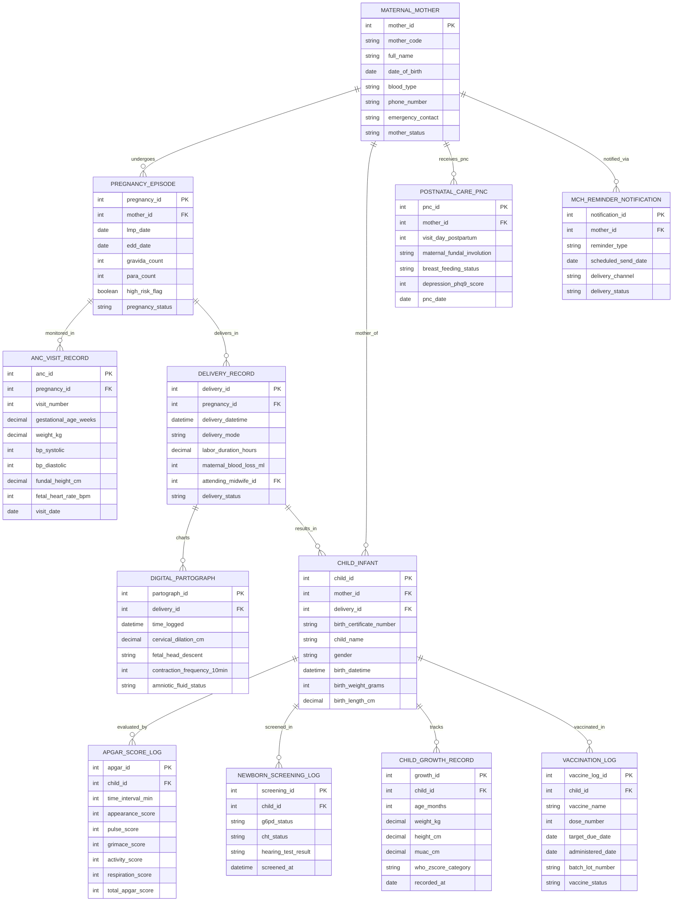

# Conceptual ERD — Maternal & Child Health Management System

## Mermaid Code

## Entity Description Table | Bảng mô tả Entity

| # | Entity Name | Vietnamese Name | Description | Key Attributes | Main Relationships |
|---|-------------|-----------------|-------------|----------------|-------------------|
| 1 | MATERNAL_MOTHER | Người Mẹ Master Profile | Master maternal profile storing mother code, full name, DOB, blood type (ABO/Rh), phone, and emergency contact. | mother_id, mother_code, full_name, dob, blood_type, phone_number, mother_status | Has many PREGNANCY_EPISODE, CHILD_INFANT, POSTNATAL_CARE_PNC, MCH_REMINDER_NOTIFICATION, etc. |
| 2 | PREGNANCY_EPISODE | Đợt Thai kỳ (Pregnancy) | Specific pregnancy episode record storing Last Menstrual Period (LMP), Estimated Due Date (EDD), GPAL counts, and high-risk flags. | pregnancy_id, mother_id, lmp_date, edd_date, gravida_count, para_count, high_risk_flag, pregnancy_status | Belongs to MATERNAL_MOTHER; Has many ANC_VISIT_RECORD and DELIVERY_RECORD entities. |
| 3 | ANC_VISIT_RECORD | Phám Thăm Khám Thai (ANC) | Antenatal care visit record logging gestational age weeks, maternal weight, BP systolic/diastolic, fundal height, and fetal heart rate. | anc_id, pregnancy_id, visit_number, gestational_age_weeks, weight_kg, bp_systolic, bp_diastolic, visit_date | Belongs to PREGNANCY_EPISODE. |
| 4 | DELIVERY_RECORD | Nhật ký Sinh nở (Delivery) | Labor and delivery operation record logging delivery datetime, delivery mode (Normal, C-Section), labor duration, blood loss, and midwife ID. | delivery_id, pregnancy_id, delivery_datetime, delivery_mode, labor_duration_hours, maternal_blood_loss_ml, delivery_status | Belongs to PREGNANCY_EPISODE; Has many DIGITAL_PARTOGRAPH and CHILD_INFANT entities. |
| 5 | DIGITAL_PARTOGRAPH | Biểu đồ Chuyển dạ Partograph | Digital WHO Partograph time entry tracking cervical dilation (cm), fetal head descent, contraction frequency per 10 mins, and amniotic fluid. | partograph_id, delivery_id, time_logged, cervical_dilation_cm, fetal_head_descent, contraction_frequency_10min | Belongs to DELIVERY_RECORD. |
| 6 | CHILD_INFANT | Trẻ em / Trẻ sơ sinh Profile | Master child record storing birth certificate number, child name, gender, birth datetime, birth weight, birth length, linked to mother. | child_id, mother_id, delivery_id, birth_certificate_number, child_name, gender, birth_weight_grams, birth_length_cm | Belongs to MATERNAL_MOTHER and DELIVERY_RECORD; Has APGAR_SCORE_LOG, CHILD_GROWTH_RECORD, VACCINATION_LOG, etc. |
| 7 | APGAR_SCORE_LOG | Chỉ số APGAR Sơ sinh | Newborn APGAR score evaluation record logging Appearance, Pulse, Grimace, Activity, and Respiration sub-scores at 1, 5, and 10 minutes. | apgar_id, child_id, time_interval_min, appearance_score, pulse_score, grimace_score, activity_score, total_apgar_score | Belongs to CHILD_INFANT. |
| 8 | NEWBORN_SCREENING_LOG | Sàng lọc Sơ sinh (Metabolic) | Newborn screening record logging G6PD enzyme deficiency, Congenital Hypothyroidism (CHT), and OAE hearing test results. | screening_id, child_id, g6pd_status, cht_status, hearing_test_result, screened_at | Belongs to CHILD_INFANT. |
| 9 | CHILD_GROWTH_RECORD | Nhật ký Phát triển WHO | Child physical growth record tracking age months, weight kg, height cm, MUAC cm, and WHO Z-score categories (WAZ, HAZ, WHZ). | growth_id, child_id, age_months, weight_kg, height_cm, muac_cm, who_zscore_category, recorded_at | Belongs to CHILD_INFANT. |
| 10 | VACCINATION_LOG | Nhật ký Tiêm chủng Trẻ em | Childhood vaccine log tracking vaccine name, dose number, target due date, administration date, batch lot number, and status. | vaccine_log_id, child_id, vaccine_name, dose_number, target_due_date, administered_date, batch_lot_number, vaccine_status | Belongs to CHILD_INFANT. |
| 11 | POSTNATAL_CARE_PNC | Thăm khám Sau sinh (PNC) | Maternal postpartum care record tracking visit day (Day 3, 7, 42), fundal involution, breast feeding status, and PHQ-9 depression score. | pnc_id, mother_id, visit_day_postpartum, maternal_fundal_involution, breast_feeding_status, depression_phq9_score, pnc_date | Belongs to MATERNAL_MOTHER. |
| 12 | MCH_REMINDER_NOTIFICATION | Nhắc lịch SMS / Zalo | Automated reminder notification log tracking reminder type (ANC, Vaccine, PNC), scheduled date, delivery channel, and delivery status. | notification_id, mother_id, reminder_type, scheduled_send_date, delivery_channel, delivery_status | Belongs to MATERNAL_MOTHER. |

## Relationship Description | Mô tả Quan hệ

| # | From Entity | Cardinality | To Entity | Relationship Label | Business Explanation |
|---|-------------|-------------|-----------|-------------------|----------------------|
| 1 | MATERNAL_MOTHER | one-to-many | PREGNANCY_EPISODE | undergoes | One mother undergoes one or more pregnancy episodes over time. |
| 2 | MATERNAL_MOTHER | one-to-many | CHILD_INFANT | mother_of | One mother is the biological parent of one or more children. |
| 3 | MATERNAL_MOTHER | one-to-many | POSTNATAL_CARE_PNC | receives_pnc | One mother receives postnatal care (PNC) postpartum follow-up visits. |
| 4 | MATERNAL_MOTHER | one-to-many | MCH_REMINDER_NOTIFICATION | notified_via | One mother is notified via SMS/Zalo for ANC and vaccine appointment reminders. |
| 5 | PREGNANCY_EPISODE | one-to-many | ANC_VISIT_RECORD | monitored_in | One pregnancy episode is monitored in multiple Antenatal Care (ANC) visits. |
| 6 | PREGNANCY_EPISODE | one-to-one | DELIVERY_RECORD | delivers_in | One pregnancy episode concludes in exactly one labor and delivery record. |
| 7 | DELIVERY_RECORD | one-to-many | DIGITAL_PARTOGRAPH | charts | One delivery record charts labor progress entries on a WHO digital partograph. |
| 8 | DELIVERY_RECORD | one-to-many | CHILD_INFANT | results_in | One delivery record results in the birth of one or more infants (twins). |
| 9 | CHILD_INFANT | one-to-many | APGAR_SCORE_LOG | evaluated_by | One infant is evaluated by APGAR scores at 1, 5, and 10 minutes post-birth. |
| 10 | CHILD_INFANT | one-to-many | NEWBORN_SCREENING_LOG | screened_in | One infant undergoes metabolic and hearing newborn screening tests. |
| 11 | CHILD_INFANT | one-to-many | CHILD_GROWTH_RECORD | tracks | One child tracks physical growth measurements against WHO Z-score curves up to 5 years. |
| 12 | CHILD_INFANT | one-to-many | VACCINATION_LOG | vaccinated_in | One child is vaccinated in national expanded immunization schedule doses. |
