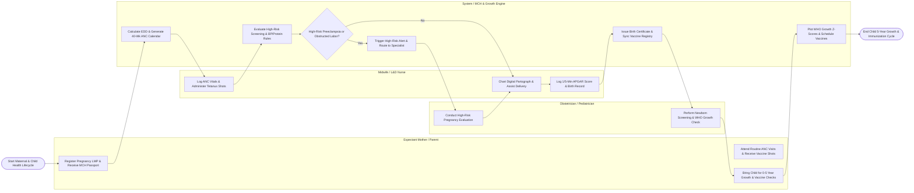

# Swimlane Diagram — Maternal & Child Health Management System

## Mermaid Code

## Flow Description | Mô tả luồng

| Lane | Actor / Subsystem | Role in Flow |
|------|-------------------|--------------|
| 1 | Expectant Mother / Parent | Registers pregnancy with LMP date, receives digital MCH Health Passport, attends routine ANC prenatal visits, and brings child for 0-5 year growth checks and vaccinations. |
| 2 | Midwife / L&D Nurse | Records ANC vitals and fundal height, administers maternal Tetanus Toxoid shots, charts labor progress on digital partograph, assists birth delivery, and logs newborn APGAR scores. |
| 3 | System / MCH & Growth Engine | Calculates Estimated Due Date (EDD), generates 40-week ANC visit calendar, evaluates preeclampsia/labor obstruction rules, plots WHO growth Z-scores, and syncs national vaccine registries. |
| 4 | Obstetrician / Pediatrician | Conducts high-risk pregnancy specialist consultations (preeclampsia, gestational diabetes), performs newborn metabolic/hearing screenings, and evaluates child WHO growth curves. |
