# Action Tree — Maternal & Child Health Management System

## Mermaid Code

```mermaid
graph TD
    Root["Maternal & Child Health Management System"]

    Root --> M1["Pregnancy Registration & EDD"]
    Root --> M2["Antenatal Care ANC & High-Risk"]
    Root --> M3["Digital Partograph & Delivery"]
    Root --> M4["Newborn Care & APGAR Screening"]
    Root --> M5["Postnatal Care PNC Follow-Up"]
    Root --> M6["WHO Child Growth Z-Scores"]
    Root --> M7["Childhood Immunization Tracker"]
    Root --> M8["SMS Reminders & MOH Analytics"]

    M1 --> A11["Calculate EDD via Naegele Rule & Ultrasound"]
    M1 --> A12["Record GPAL Master Obstetric History"]
    M1 --> A13["Issue Digital MCH Health Passport"]
    M1 --> A14["Flag Multiple Gestation Twin Pregnancy"]

    M2 --> A21["Track Gestational Weight Gain & Vitals"]
    M2 --> A22["Screen High-Risk Preeclampsia & Proteinuria"]
    M2 --> A23["Log OGTT Gestational Diabetes Results"]
    M2 --> A24["Administer Tetanus Toxoid TT Vaccines"]

    M3 --> A31["Chart Cervical Dilation on Partograph"]
    M3 --> A32["Monitor Fetal Heart Rate & Contractions"]
    M3 --> A33["Detect Obstructed Labor Action Line Breach"]
    M3 --> A34["Record Delivery Mode & Maternal Blood Loss"]

    M4 --> A41["Evaluate 1 5 10-Min APGAR Scores"]
    M4 --> A42["Log Essential Newborn Care ENC Steps"]
    M4 --> A43["Perform Heel-Prick G6PD & CHT Screening"]
    M4 --> A44["Issue Digital Birth Certificate Package"]

    M5 --> A51["Conduct Day 3 7 42 Postpartum Visits"]
    M5 --> A52["Assess Uterine Fundal Involution"]
    M5 --> A53["Screen Edinburgh Postpartum Depression"]
    M5 --> A54["Promote Exclusive Breastfeeding Counseling"]

    M6 --> A61["Measure Weight Height & MUAC Values"]
    M6 --> A62["Plot WHO Z-Scores WAZ HAZ WHZ"]
    M6 --> A63["Detect Severe Acute Malnutrition SAM"]
    M6 --> A64["Assign Therapeutic Food RUTF Protocols"]

    M7 --> A71["Manage National Immunization Schedule"]
    M7 --> A72["Verify Vaccine Vial Batch Lot & Expiry"]
    M7 --> A73["Sync Records with National Vaccine Registry"]
    M7 --> A74["Generate Accelerated Catch-Up Schedule"]

    M8 --> A81["Dispatch SMS Zalo ANC Visit Reminders"]
    M8 --> A82["Send Child Vaccine Due Date Alerts"]
    M8 --> A83["Export Maternal Mortality Ratio MMR"]
    M8 --> A84["Calculate Full Immunization Coverage FIC"]
```

## Module Description | Mô tả Module

| # | Module | Description | Actions |
|---|--------|-------------|---------|
| 1 | Pregnancy Registration & EDD | Registers pregnancy episodes, calculates EDD via Naegele's rule and ultrasound, records GPAL history, and issues MCH passports. | Calculate EDD via Naegele Rule & Ultrasound, Record GPAL Master Obstetric History, Issue Digital MCH Health Passport, Flag Multiple Gestation Twin Pregnancy |
| 2 | Antenatal Care ANC & High-Risk | Tracks ANC visit parameters, screens for preeclampsia and gestational diabetes, and administers Tetanus Toxoid vaccines. | Track Gestational Weight Gain & Vitals, Screen High-Risk Preeclampsia & Proteinuria, Log OGTT Gestational Diabetes Results, Administer Tetanus Toxoid TT Vaccines |
| 3 | Digital Partograph & Delivery | Charts cervical dilation and FHR on WHO digital partograph, detects labor obstruction, and logs delivery details and blood loss. | Chart Cervical Dilation on Partograph, Monitor Fetal Heart Rate & Contractions, Detect Obstructed Labor Action Line Breach, Record Delivery Mode & Maternal Blood Loss |
| 4 | Newborn Care & APGAR Screening | Evaluates 1/5/10-minute APGAR scores, records essential newborn care, logs metabolic (G6PD/CHT) screening, and issues birth certificates. | Evaluate 1 5 10-Min APGAR Scores, Log Essential Newborn Care ENC Steps, Perform Heel-Prick G6PD & CHT Screening, Issue Digital Birth Certificate Package |
| 5 | Postnatal Care PNC Follow-Up | Conducts maternal PNC visits at Day 3, 7, and 42, assesses uterine involution, screens postpartum depression, and supports breastfeeding. | Conduct Day 3 7 42 Postpartum Visits, Assess Uterine Fundal Involution, Screen Edinburgh Postpartum Depression, Promote Exclusive Breastfeeding Counseling |
| 6 | WHO Child Growth Z-Scores | Measures weight, height, and MUAC, plots WHO growth Z-scores (WAZ, HAZ, WHZ), detects malnutrition, and assigns therapeutic food. | Measure Weight Height & MUAC Values, Plot WHO Z-Scores WAZ HAZ WHZ, Detect Severe Acute Malnutrition SAM, Assign Therapeutic Food RUTF Protocols |
| 7 | Childhood Immunization Tracker | Manages childhood vaccine schedules (BCG to Measles), verifies vial batch lots, syncs national registries, and calculates catch-up schedules. | Manage National Immunization Schedule, Verify Vaccine Vial Batch Lot & Expiry, Sync Records with National Vaccine Registry, Generate Accelerated Catch-Up Schedule |
| 8 | SMS Reminders & MOH Analytics | Dispatches automated SMS/Zalo reminders for ANC visits and vaccines, exports Maternal Mortality Ratio (MMR), and renders coverage analytics. | Dispatch SMS Zalo ANC Visit Reminders, Send Child Vaccine Due Date Alerts, Export Maternal Mortality Ratio MMR, Calculate Full Immunization Coverage FIC |
