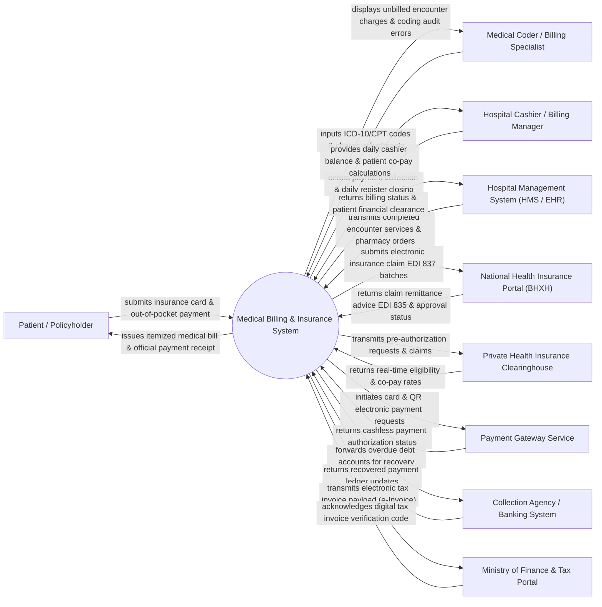

# Context Diagram — Medical Billing & Insurance System

## Mermaid Code

## Actor & Interaction Table | Bảng Actor & Tương tác

| # | Actor | Actor Type | Data Sent TO System | Data Received FROM System | Notes |
|---|-------|------------|---------------------|---------------------------|-------|
| 1 | Patient / Policyholder | Primary | Insurance policy ID, co-payment tenders, financial hardship applications. | Itemized medical invoices, deductible status statements, digital tax receipts. | Individual recipient of medical services making co-payments and receiving billing notices. |
| 2 | Medical Coder / Billing Specialist | Primary | ICD-10 diagnostic codes, CPT/HCPCS procedure codes, modifier tags, claim appeal arguments. | Charge validation errors, coding compliance alerts, unbilled encounter queues, claim denial reasons. | Certified billing professional converting clinical documentation into billable insurance claims. |
| 3 | Hospital Cashier / Billing Manager | Primary | Cash tenders, manual discount overrides, write-off approvals, daily register closeouts. | Co-pay calculation totals, itemized bill previews, shift financial summaries, payment receipts. | Front-office billing staff handling point-of-sale collections and patient account settlement. |
| 4 | Hospital Management System (HMS / EHR) | Supporting | Completed consultation items, bed day charges, lab test fees, surgical procedure logs, pharmacy orders. | Billing clearance flags, account deposit status, patient coverage authorization codes. | Enterprise hospital administrative software pushing clinical service charges to the billing engine. |
| 5 | National Health Insurance Portal (BHXH) | Supporting | Statutory coverage rules, tariff price caps, electronic remittance advice (EDI 835), claim approval tokens. | Electronic claim batch files (EDI 837), patient social security numbers, itemized medical cost logs. | Governmental health insurance portal processing national compulsory health insurance reimbursements. |
| 6 | Private Health Insurance Clearinghouse | Supporting | Real-time coverage eligibility, deductible balances, pre-authorization codes, claim adjudication status. | Electronic claim transactions (EDI 837P/837I), prior authorization requests, provider NPI numbers. | Commercial medical insurance clearinghouse handling private health insurance claims. |
| 7 | Payment Gateway Service | Supporting | Credit/debit card authorization tokens, QR transaction IDs, payment confirmation webhooks. | Payment processing requests, total bill amounts, merchant account identifiers. | Third-party financial service processing cashless digital payment transactions. |
| 8 | Collection Agency / Banking System | Supporting | Debt recovery payments, bank settlement feeds, uncollectible debt status updates. | Bad debt account details, aging balance records, debtor contact information. | External collection agency or partner bank recovering delinquent patient payment balances. |
| 9 | Ministry of Finance & Tax Portal | Regulatory | Digital tax signature policies, official invoice registration numbers, tax compliance acknowledgments. | Electronic tax invoice payloads (e-Invoice), VAT calculation summaries, seller/buyer details. | Governmental tax authority validating official digital VAT invoices issued to patients. |

## System Boundary Description | Mô tả Phạm vi Hệ thống

The **Medical Billing & Insurance System** is an enterprise financial platform designed to manage the end-to-end revenue cycle (RCM) of healthcare facilities, encompassing patient insurance eligibility verification, medical charge capture, ICD-10/CPT coding compliance, insurance claim generation (EDI 837), claim adjudication (EDI 835), patient co-payment processing, denial management, and fiscal tax invoicing.

**Inside System Scope:**
- Real-time insurance eligibility checking, benefit verification, and co-payment/deductible calculation.
- Automated charge capture from clinical departments, fee schedule management, and medical coding validation.
- Electronic claim batch generation (ANSI X12 837 format), claim scrubbing, and clearinghouse submission.
- Remittance advice parsing (ANSI X12 835 format), automated payment posting, and claim denial workflow management.
- Patient billing, point-of-sale cashiering, payment plan structuring, bad debt tracking, and electronic tax invoicing (e-Invoice).

**Outside System Scope:**
- Clinical diagnosis creation and physician care delivery (delegated to EHR/HMS systems).
- Direct banking ledger management and interbank fund settlement (delegated to commercial banking systems).
- Final insurance policy determination and payer claim adjudication rules (delegated to external Insurance Portals).
- Physical legal enforcement of debt collections (delegated to external collection agencies).
