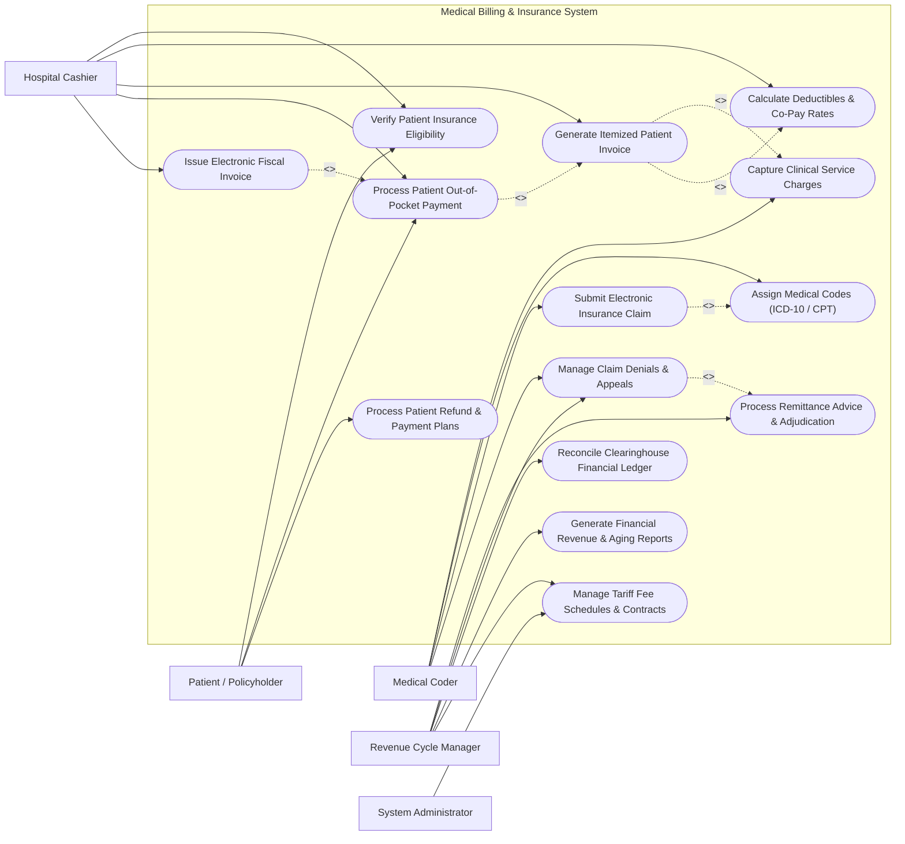

# Use Case Diagram — Medical Billing & Insurance System

## Mermaid Code

## Actor Table | Bảng Actor

| # | Actor | Actor Type | Role Description | Related Use Cases |
|---|-------|------------|------------------|-------------------|
| 1 | Patient / Policyholder | Primary | Individual receiving healthcare services, supplying insurance policy cards, paying out-of-pocket co-pays, and setting up payment plans. | UC01, UC08, UC10 |
| 2 | Medical Coder | Primary | Certified health information specialist translating clinical documentation into standardized ICD-10 diagnostic codes and CPT/HCPCS procedure codes. | UC02, UC03, UC06, UC09 |
| 3 | Hospital Cashier | Primary | Front-office billing staff verifying coverage eligibility, computing co-payments, collecting patient cash/card payments, and issuing fiscal invoices. | UC01, UC04, UC05, UC08, UC12 |
| 4 | Revenue Cycle Manager | Primary | Finance manager overseeing claim submissions, parsing remittance advice (835), managing denials, and reconciling financial accounts. | UC07, UC09, UC11, UC13, UC14 |
| 5 | System Administrator | Primary | Technical administrator configuring fee tariffs, insurance payer contracts, clearinghouse API links, and security access permissions. | UC14 |

## Use Case Table | Bảng Use Case

| # | UC ID | Use Case Name | Primary Actor | Secondary Actor | Description | Priority |
|---|-------|---------------|---------------|-----------------|-------------|----------|
| 1 | UC01 | Verify Patient Insurance Eligibility | Hospital Cashier | Insurance Clearinghouse | Queries national or private insurance portals to verify policy status, coverage caps, deductible balances, and co-payment rates. | High |
| 2 | UC02 | Capture Clinical Service Charges | Medical Coder | HMS / EHR System | Ingests completed consultation fees, lab test charges, surgical procedures, and pharmacy orders from clinical department systems. | High |
| 3 | UC03 | Assign Medical Codes (ICD-10 / CPT) | Medical Coder | System Engine | Maps physician clinical notes to standardized ICD-10 diagnostic codes, CPT/HCPCS procedure codes, and modifiers for billing compliance. | High |
| 4 | UC04 | Calculate Deductibles & Co-Pay Rates | Hospital Cashier | System Engine | Computes exact patient financial responsibility (co-pay, co-insurance, deductible) vs insurance covered portions based on tariff rules. | High |
| 5 | UC05 | Generate Itemized Patient Invoice | Hospital Cashier | Patient / Policyholder | Compiles all captured charges into a transparent itemized patient bill detailing description, unit costs, insurance coverage, and balance due. | High |
| 6 | UC06 | Submit Electronic Insurance Claim | Medical Coder | National Insurance Portal | Assembles, scrubs, and dispatches electronic claim batches formatted according to ANSI X12 837 (837P/837I) standards to clearinghouses. | High |
| 7 | UC07 | Process Remittance Advice & Adjudication | Revenue Cycle Manager | Insurance Clearinghouse | Parses electronic remittance advice (EDI 835) files, posting approved insurance payments and identifying partial payouts or claim rejections. | High |
| 8 | UC08 | Process Patient Out-of-Pocket Payment | Hospital Cashier | Payment Gateway | Collects patient co-payments via cash, credit card, e-wallet, or bank transfer, updating patient account ledger. | High |
| 9 | UC09 | Manage Claim Denials & Appeals | Medical Coder | Revenue Cycle Manager | Analyzes claim denial codes (CARC/RARC), corrects coding or documentation errors, and submits formal electronic claim appeals. | High |
| 10 | UC10 | Process Patient Refund & Payment Plans | Patient / Policyholder | Hospital Cashier | Establishes monthly installment payment schedules for high-balance patients or processes overpayment refunds. | Medium |
| 11 | UC11 | Reconcile Clearinghouse Financial Ledger | Revenue Cycle Manager | System Engine | Reconciles submitted claims against received bank deposits, identifying unallocated payments, clearinghouse fees, and write-offs. | High |
| 12 | UC12 | Issue Electronic Fiscal Invoice | Hospital Cashier | Tax Portal | Generates digitally signed official government e-invoices (VAT invoice) sent to Ministry of Finance tax portal and patient email. | High |
| 13 | UC13 | Generate Financial Revenue & Aging Reports | Revenue Cycle Manager | System Engine | Produces Accounts Receivable (A/R) aging reports, net revenue summaries, denial rate analytics, and payer performance metrics. | High |
| 14 | UC14 | Manage Tariff Fee Schedules & Contracts | Revenue Cycle Manager | System Administrator | Configures master fee schedules, relative value units (RVU), insurance reimbursement tariff contracts, and capitation rules. | Medium |

## Use Case Specification | Đặc tả Use Case

---

### UC01 — Verify Patient Insurance Eligibility

| Field | Detail |
|-------|--------|
| **UC ID** | UC01 |
| **Use Case Name** | Verify Patient Insurance Eligibility |
| **Actor(s)** | Primary: Hospital Cashier   Secondary: Insurance Clearinghouse |
| **Description** | Cashier initiates real-time electronic insurance eligibility lookup (EDI 270/271) to confirm patient active coverage status, benefit plan limits, remaining annual deductible, and co-payment percentages. |
| **Precondition** | 1. Cashier is logged into Medical Billing & Insurance System.   2. System has active clearinghouse API connection to National/Private Insurance portals. |
| **Main Flow** | 1. Cashier inputs Patient Insurance Card Number, Policy ID, or scans card barcode/QR.   2. System constructs an ANSI X12 270 Eligibility Inquiry payload.   3. System transmits inquiry payload to the target Insurance Clearinghouse API.   4. Insurance Clearinghouse evaluates policy status and returns an ANSI X12 271 Eligibility Response payload.   5. System parses response and displays: Active Status (Active/Expired), Coverage Type, Remaining Deductible ($), Co-pay amount per visit ($), and Co-insurance percentage (%).   6. Cashier confirms coverage verification and attaches eligibility verification token to the active billing encounter. |
| **Alternative Flow** | **AF1** — Manual Policy Entry: If automated clearinghouse API is unavailable, Cashier manually inputs physical insurance card details, policy expiry date, and attaches card photo scan for offline auditing. |
| **Exception Flow** | **EX1** — Policy Inactive / Terminated: If clearinghouse returns "Coverage Inactive", System displays a red warning banner. Cashier shifts patient billing status to 100% Out-of-Pocket Self-Pay.   **EX2** — Pre-Authorization Required: If requested medical service requires prior insurance approval, System flags "Pre-Auth Required Notice" and prompts billing specialist to submit prior authorization request. |
| **Postcondition** | Patient insurance eligibility status and co-payment rules are bound to the current billing session. |
| **Business Rule** | **BR1**: Real-time eligibility check must be executed within 24 hours prior to elective hospital admission or consultation. |

---

### UC04 — Calculate Deductibles & Co-Pay Rates

| Field | Detail |
|-------|--------|
| **UC ID** | UC04 |
| **Use Case Name** | Calculate Deductibles & Co-Pay Rates |
| **Actor(s)** | Primary: Hospital Cashier   Secondary: System Engine |
| **Description** | Automated rules engine evaluates captured medical service charges against active insurance tariff contracts, patient deductible balances, and co-insurance percentages to determine exact patient vs insurance liability. |
| **Precondition** | 1. Clinical service charges are captured (UC02).   2. Patient insurance eligibility status is verified (UC01). |
| **Main Flow** | 1. Cashier initiates "Calculate Bill Split" for the encounter.   2. System loads master fee schedule tariffs and insurance contracted rates for each line item.   3. System computes Contracted Allowance (Price Cap set by insurance contract).   4. System checks patient remaining annual deductible balance; if deductible is unmet, charge portion is allocated to patient.   5. System applies co-payment fixed fee (e.g., $15 consultation co-pay) or co-insurance ratio (e.g., 80% Insurance / 20% Patient).   6. System calculates non-covered items (e.g., cosmetic procedures, luxury ward fees) and assigns 100% to patient.   7. System displays itemized financial breakdown: Total Charge, Contracted Discount, Insurance Coverage Amount, and Patient Total Payable. |
| **Alternative Flow** | **AF1** — Statutory Social Insurance Benefit Cap: For National Social Health Insurance (BHXH), System applies statutory coverage percentages (e.g., 80%, 95%, 100% based on beneficiary group code) up to ceiling drug price caps. |
| **Exception Flow** | **EX1** — Annual Benefit Limit Exceeded: If insurance coverage calculation exceeds annual policy cap ($50,000 max benefit), System automatically re-allocates excess balance to patient responsibility. |
| **Postcondition** | Financial split between insurance claim liability and patient out-of-pocket obligation is locked for billing. |
| **Business Rule** | **BR1**: Balance billing (billing patient for contracted insurance discounts) is strictly prohibited for contracted in-network providers. |

---

### UC06 — Submit Electronic Insurance Claim

| Field | Detail |
|-------|--------|
| **UC ID** | UC06 |
| **Use Case Name** | Submit Electronic Insurance Claim |
| **Actor(s)** | Primary: Medical Coder   Secondary: National Insurance Portal |
| **Description** | Medical Coder reviews coded encounter charges, executes automated claim scrubbing rules, compiles electronic claim files (ANSI X12 837P/837I or XML), and submits batch claims to insurance payers. |
| **Precondition** | 1. Encounter charges are assigned valid ICD-10 and CPT/HCPCS codes (UC03).   2. Patient financial split is computed (UC04). |
| **Main Flow** | 1. Coder opens "Unsubmitted Claims Queue".   2. System runs automated Claim Scrubber checking for missing subscriber IDs, invalid ICD-10 codes, unbundled CPT codes, and missing NPI license numbers.   3. System flags clean claims as "Ready for Submission".   4. Coder selects claim batch and clicks "Submit Electronic Claims".   5. System formats claims into ANSI X12 837 Professional (837P) or Institutional (837I) batch standard.   6. System encrypts batch file and transmits via secure SFTP/API to National Insurance Portal (BHXH) or private clearinghouse.   7. System receives immediate 277 Claim Acknowledgment token confirming file receipt and updates claim status to "Submitted - Pending Adjudication". |
| **Alternative Flow** | **AF1** — Single Claim Priority Submission: For high-value emergency inpatient claims, Coder bypasses batch processing and submits an individual claim directly for real-time adjudication. |
| **Exception Flow** | **EX1** — Claim Scrubber Validation Error: If scrubber detects invalid code combination (e.g., gender-incompatible procedure code), claim is moved to "Claim Error Queue". Coder corrects code and re-runs scrubber. |
| **Postcondition** | Electronic claim batch is submitted to insurance payer, and claim audit tracking log is updated. |
| **Business Rule** | **BR1**: Claims must be submitted within timely filing limits (e.g., within 90 days of discharge date). |

---

### UC07 — Process Remittance Advice & Adjudication

| Field | Detail |
|-------|--------|
| **UC ID** | UC07 |
| **Use Case Name** | Process Remittance Advice & Adjudication |
| **Actor(s)** | Primary: Revenue Cycle Manager   Secondary: Insurance Clearinghouse |
| **Description** | System receives and parses Electronic Remittance Advice (ERA - ANSI X12 835) files from insurance payers, automatically posting approved claim payments and identifying line-item denials. |
| **Precondition** | 1. Electronic claim batch was previously submitted (UC06).   2. Payer dispatches 835 ERA file and Electronic Funds Transfer (EFT). |
| **Main Flow** | 1. System imports incoming ANSI X12 835 ERA file from clearinghouse inbox.   2. System parses ERA payload, matching claim control numbers (CCN) against open claim records in database.   3. For fully paid claim lines, System automatically posts approved insurance payment amounts and contractual adjustments to the general ledger.   4. For partially paid or denied claim lines, System extracts Claim Adjustment Reason Codes (CARC) and Remittance Advice Remark Codes (RARC).   5. System updates claim status to "Adjudicated - Paid" or "Adjudicated - Partially Denied".   6. System routes denied line items to the Denial & Appeals Queue (UC09).   7. Revenue Cycle Manager verifies payment posting totals against bank deposit notifications. |
| **Alternative Flow** | **AF1** — Manual Remittance Posting: If payer issues paper Explanation of Benefits (EOB) and paper check, Billing Manager manually enters payment amounts, adjustment codes, and check number into system. |
| **Exception Flow** | **EX1** — Unmatched Claim Number: If ERA contains a claim ID not found in system database, System flags entry as "Unassigned Payment" and prompts manual reconciliation. |
| **Postcondition** | Insurance payment accounts receivable balances are updated, contractual write-offs are posted, and denied claims are queued for appeal. |
| **Business Rule** | **BR1**: System must automatically separate contractual fee adjustments from patient secondary insurance balance transfers. |

---

### UC09 — Manage Claim Denials & Appeals

| Field | Detail |
|-------|--------|
| **UC ID** | UC09 |
| **Use Case Name** | Manage Claim Denials & Appeals |
| **Actor(s)** | Primary: Medical Coder   Secondary: Revenue Cycle Manager |
| **Description** | Billing staff investigates insurance claim rejections and denials, corrects underlying demographic or coding errors, attaches supporting clinical documentation, and submits formal electronic appeals. |
| **Precondition** | 1. Claim status is set to "Denied" or "Partially Denied" following ERA parsing (UC07). |
| **Main Flow** | 1. Coder opens "Claim Denial Management Workqueue".   2. System groups denied claims by CARC/RARC denial reason code (e.g., "CO-16: Claim lacks information", "PR-96: Non-covered charge").   3. Coder selects a denied claim ticket and reviews payer denial details.   4. Coder investigates root cause (e.g., incorrect diagnosis code, missing medical necessity notes).   5. Coder amends claim data (updates ICD-10 code, attaches physician clinical note PDF, or adds procedure modifier).   6. Coder generates an Electronic Claim Appeal package including cover letter, corrected 837 file, and clinical evidence.   7. System dispatches appeal package to payer clearinghouse and updates claim status to "Appeal Submitted - Under Review". |
| **Alternative Flow** | **AF1** — Uncollectible Write-Off Request: If denial reason is non-appealable (e.g., expired timely filing due to internal hospital delay), Coder submits a "Contractual Write-Off Request" for manager approval.   **AF2** — Transfer to Patient Liability: If service was rendered with signed Advance Beneficiary Notice (ABN) and denied as non-covered, System transfers denied balance to patient statement. |
| **Exception Flow** | **EX1** — Final Denial Exhaustion: If Level 2 appeal is rejected by payer, System locks further appeals and prompts manager to write off amount or pursue secondary insurance. |
| **Postcondition** | Corrected claim appeal is submitted to payer, and denial tracking metrics are updated in RCM analytics dashboard. |
| **Business Rule** | **BR1**: Appeals must be submitted within payer-defined appeal deadlines (e.g., within 60 days of ERA remittance date). |
