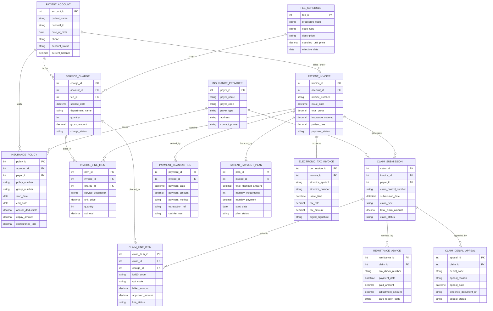

# Conceptual ERD — Medical Billing & Insurance System

## Mermaid Code

## Entity Description Table | Bảng mô tả Entity

| # | Entity Name | Vietnamese Name | Description | Key Attributes | Main Relationships |
|---|-------------|-----------------|-------------|----------------|-------------------|
| 1 | PATIENT_ACCOUNT | Tài khoản Bệnh nhân | Master financial billing account associated with a patient, tracking overall outstanding balances and status. | account_id, national_id, current_balance, account_status | Holds Insurance Policies, incurs Service Charges, billed under Invoices. |
| 2 | INSURANCE_PROVIDER | Đơn vị Bảo hiểm (Payer) | Health insurance company or national social insurance authority processing medical claims. | payer_id, payer_name, payer_code, payer_type | Issues Policies, adjudicates Claim Submissions. |
| 3 | INSURANCE_POLICY | Hợp đồng Bảo hiểm | Specific insurance policy held by a patient detailing policy numbers, deductibles, co-pay fees, and coverage ratios. | policy_id, policy_number, annual_deductible, copay_amount, coinsurance_rate | Belongs to Patient Account and Insurance Provider. |
| 4 | FEE_SCHEDULE | Bảng giá Dịch vụ Y tế | Master price catalog listing CPT/HCPCS procedure codes, standardized descriptions, and unit prices. | fee_id, procedure_code, code_type, standard_unit_price | Prices Service Charges. |
| 5 | SERVICE_CHARGE | Phí Dịch vụ Y tế | Discrete clinical billable items incurred during a patient encounter (consultations, labs, drugs, bed days). | charge_id, service_date, quantity, gross_amount | Linked to Patient Account, Fee Schedule, Billed in Invoice/Claim Line Items. |
| 6 | PATIENT_INVOICE | Hóa đơn Bệnh nhân | Summary billing statement presented to the patient detailing gross charges, insurance coverage, and balance due. | invoice_id, invoice_number, total_gross, insurance_covered, patient_due | Contains Invoice Line Items, generates Claims, settled by Payment Transactions. |
| 7 | INVOICE_LINE_ITEM | Chi tiết Hóa đơn | Line item breakdown of a patient invoice detailing specific services, unit costs, and subtotals. | item_id, service_description, unit_price, quantity, subtotal | Belongs to Patient Invoice, references Service Charge. |
| 8 | CLAIM_SUBMISSION | Hồ sơ Yêu cầu Bồi thường (Claim) | Electronic insurance claim transaction (EDI 837) submitted to an insurance provider for reimbursement. | claim_id, claim_control_number, submission_date, claim_type, claim_status | Generated from Invoice, sent to Provider, contains Claim Line Items. |
| 9 | CLAIM_LINE_ITEM | Chi tiết Hồ sơ Bồi thường | Individual billable service line in an insurance claim specifying ICD-10 and CPT codes and billed amounts. | claim_item_id, icd10_code, cpt_code, billed_amount, approved_amount | Belongs to Claim Submission, references Service Charge. |
| 10 | REMITTANCE_ADVICE | Thông báo Thanh toán (ERA) | Electronic remittance advice record (EDI 835) returned by payer detailing paid amounts, adjustments, and CARC codes. | remittance_id, era_check_number, payment_date, paid_amount, carc_reason_code | Remits Claim Submission. |
| 11 | CLAIM_DENIAL_APPEAL | Hồ sơ Khiếu nại Từ chối | Formal appeal file submitted to contest a rejected or partially denied insurance claim line item. | appeal_id, denial_code, appeal_reason, appeal_status | Appeals Claim Submission. |
| 12 | PAYMENT_TRANSACTION | Giao dịch Thanh toán | Out-of-pocket cash, credit card, e-wallet, or bank transfer payment transaction posted by a cashier. | payment_id, payment_date, payment_amount, payment_method, cashier_user | Settles Patient Invoice. |
| 13 | PATIENT_PAYMENT_PLAN | Kế hoạch Trả góp Bệnh nhân | Structured monthly installment agreement established for patients with large out-of-pocket balances. | plan_id, total_financed_amount, monthly_installments, monthly_payment | Finances Patient Invoice. |
| 14 | ELECTRONIC_TAX_INVOICE | Hóa đơn Điện tử (e-Invoice) | Official digitally signed fiscal VAT tax invoice submitted to Ministry of Finance tax portal. | tax_invoice_id, einvoice_number, issue_time, tax_amount, digital_signature | Produced from Patient Invoice. |

## Relationship Description | Mô tả Quan hệ

| # | From Entity | Cardinality | To Entity | Relationship Label | Business Explanation |
|---|-------------|-------------|-----------|-------------------|----------------------|
| 1 | PATIENT_ACCOUNT | one-to-many | INSURANCE_POLICY | holds | A patient account can maintain multiple active or historical insurance policies (primary/secondary). |
| 2 | PATIENT_ACCOUNT | one-to-many | SERVICE_CHARGE | incurs | A patient account incurs multiple discrete clinical service charges over time. |
| 3 | PATIENT_ACCOUNT | one-to-many | PATIENT_INVOICE | billed_under | A patient account is billed under multiple patient invoices for various hospital visits. |
| 4 | INSURANCE_PROVIDER | one-to-many | INSURANCE_POLICY | issues | An insurance provider issues multiple policy plans to registered policyholders. |
| 5 | INSURANCE_PROVIDER | one-to-many | CLAIM_SUBMISSION | adjudicates | An insurance provider adjudicates and processes multiple incoming electronic claim submissions. |
| 6 | FEE_SCHEDULE | one-to-many | SERVICE_CHARGE | prices | A master fee schedule entry sets standard unit prices for multiple service charge instances. |
| 7 | SERVICE_CHARGE | one-to-many | INVOICE_LINE_ITEM | billed_in | A clinical service charge is itemized within an invoice line item. |
| 8 | SERVICE_CHARGE | one-to-many | CLAIM_LINE_ITEM | claimed_in | A clinical service charge is mapped into an insurance claim line item with ICD/CPT codes. |
| 9 | PATIENT_INVOICE | one-to-many | INVOICE_LINE_ITEM | contains | A patient invoice contains one or more itemized charge line items. |
| 10 | PATIENT_INVOICE | one-to-many | CLAIM_SUBMISSION | generates | A patient invoice generates electronic insurance claim submissions sent to payers. |
| 11 | PATIENT_INVOICE | one-to-many | PAYMENT_TRANSACTION | settled_by | A patient invoice is settled by one or more out-of-pocket payment transactions. |
| 12 | PATIENT_INVOICE | one-to-one | PATIENT_PAYMENT_PLAN | financed_by | A large patient invoice may be financed by an optional monthly payment plan. |
| 13 | PATIENT_INVOICE | one-to-one | ELECTRONIC_TAX_INVOICE | produces | Each completed patient invoice produces exactly one official electronic fiscal tax invoice. |
| 14 | CLAIM_SUBMISSION | one-to-many | CLAIM_LINE_ITEM | includes | A claim submission includes multiple diagnosis/procedure claim lines. |
| 15 | CLAIM_SUBMISSION | one-to-many | REMITTANCE_ADVICE | remitted_by | A claim submission receives one or more remittance advice transactions (EDI 835). |
| 16 | CLAIM_SUBMISSION | one-to-many | CLAIM_DENIAL_APPEAL | appealed_by | A denied claim submission can trigger formal electronic appeal filings. |
