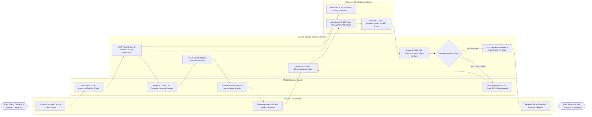

# Swimlane Diagram — Medical Billing & Insurance System

## Mermaid Code

## Flow Description | Mô tả luồng

| Lane | Actor | Role in Flow |
|------|-------|-------------|
| 1 | Patient / Policyholder | Presents insurance card during check-in, reviews itemized bill preview, pays out-of-pocket co-payment/deductible balance, and receives official fiscal e-invoice and payment receipts. |
| 2 | Medical Coder / Cashier | Initiates electronic eligibility check, maps clinical encounter documentation into standardized ICD-10 and CPT codes, collects patient co-payments at POS terminal, and investigates denied claims to file appeals. |
| 3 | Medical Billing & Insurance System | Performs automated coverage calculations, executes claim scrubbing validation, compiles ANSI X12 837 claim batches, parses incoming 835 ERA remittance advice files, posts approved payments, and dispatches tax e-invoices. |
| 4 | Insurance Clearinghouse / Payer | Processes real-time EDI 270/271 eligibility inquiries, adjudicates electronic EDI 837 medical claims, calculates benefit payouts, and dispatches EDI 835 remittance advice with EFT bank deposits. |
