# Action Tree — Medical Billing & Insurance System

## Mermaid Code

```mermaid
graph TD
    Root["Medical Billing & Insurance System"]

    Root --> M1["1. Patient Registration & Eligibility"]
    Root --> M2["2. Charge Capture & Coding Compliance"]
    Root --> M3["3. Fee Schedule & Tariff Management"]
    Root --> M4["4. Electronic Claims & EDI Processing"]
    Root --> M5["5. Point of Sale & Patient Billing"]
    Root --> M6["6. Denial & Appeals Management"]
    Root --> M7["7. Financial Accounting & ERA Reconciliation"]
    Root --> M8["8. System Administration & Tax Integration"]

    M1 --> A11["Verify Insurance Policy Status EDI 270"]
    M1 --> A12["Check Remaining Annual Deductible"]
    M1 --> A13["Manage Multi-Payer Primary Secondary"]
    M1 --> A14["Attach Prior Authorization Reference"]

    M2 --> A21["Ingest Clinical Charges from HMS"]
    M2 --> A22["Assign Standard ICD-10 Diagnosis Codes"]
    M2 --> A23["Assign CPT HCPCS Procedure Codes"]
    M2 --> A24["Run Automated Claim Scrubber Rules"]

    M3 --> A31["Maintain Master Fee Schedule Prices"]
    M3 --> A32["Configure Payer Tariff Contracts"]
    M3 --> A33["Define Statutory BHXH Coverage Caps"]
    M3 --> A34["Update Relative Value Units RVU"]

    M4 --> A41["Generate ANSI X12 837P Professional Claim"]
    M4 --> A42["Generate ANSI X12 837I Institutional Claim"]
    M4 --> A43["Dispatch Electronic Claim Batches"]
    M4 --> A44["Track Claim Submission Status 277"]

    M5 --> A51["Generate Itemized Patient Invoice"]
    M5 --> A52["Calculate Co-Pay & Co-Insurance Split"]
    M5 --> A53["Process Card / QR / Cash Payment"]
    M5 --> A54["Structure Monthly Payment Installment Plan"]

    M6 --> A61["Group Denials by CARC RARC Codes"]
    M6 --> A62["Investigate Medical Necessity Rejections"]
    M6 --> A63["Assemble Electronic Claim Appeal Package"]
    M6 --> A64["Track Appeal Re-submission Queue"]

    M7 --> A71["Parse ANSI X12 835 Remittance Advice"]
    M7 --> A72["Post Auto-Match Approved Payments"]
    M7 --> A73["Reconcile Bank EFT Clearinghouse Ledger"]
    M7 --> A74["Generate Accounts Receivable AR Aging"]

    M8 --> A81["Generate Digitally Signed Tax E-Invoice"]
    M8 --> A82["Manage User RBAC & Cashier Registers"]
    M8 --> A83["Audit Revenue Cycle Security Logs"]
    M8 --> A84["Configure Payer Clearinghouse API Links"]
```

## Module Description | Mô tả Module

| # | Module | Description | Actions |
|---|--------|-------------|---------|
| 1 | Patient Registration & Eligibility | Handles real-time insurance eligibility checks (EDI 270/271), deductible balance verifications, primary/secondary payer prioritization, and prior-authorization tracking. | Verify Insurance Policy Status EDI 270, Check Remaining Annual Deductible, Manage Multi-Payer Primary Secondary, Attach Prior Authorization Reference. |
| 2 | Charge Capture & Coding Compliance | Ingests completed clinical charges from HMS/EHR systems, assigns standardized ICD-10 and CPT/HCPCS codes, and runs automated claim scrubbing validation rules. | Ingest Clinical Charges from HMS, Assign Standard ICD-10 Diagnosis Codes, Assign CPT HCPCS Procedure Codes, Run Automated Claim Scrubber Rules. |
| 3 | Fee Schedule & Tariff Management | Configures hospital master price schedules, payer tariff reimbursement contracts, statutory social health insurance (BHXH) price caps, and relative value unit (RVU) multipliers. | Maintain Master Fee Schedule Prices, Configure Payer Tariff Contracts, Define Statutory BHXH Coverage Caps, Update Relative Value Units RVU. |
| 4 | Electronic Claims & EDI Processing | Formats and dispatches electronic claim batches adhering to ANSI X12 837P (Professional) and 837I (Institutional) standards, capturing 277 claim submission acknowledgments. | Generate ANSI X12 837P Professional Claim, Generate ANSI X12 837I Institutional Claim, Dispatch Electronic Claim Batches, Track Claim Submission Status 277. |
| 5 | Point of Sale & Patient Billing | Calculates patient financial responsibility (co-pays, co-insurance, deductibles), generates itemized patient bills, collects cashless/cash payments, and structures monthly installment plans. | Generate Itemized Patient Invoice, Calculate Co-Pay & Co-Insurance Split, Process Card / QR / Cash Payment, Structure Monthly Payment Installment Plan. |
| 6 | Denial & Appeals Management | Groups denied claims by CARC/RARC codes, enables root cause investigation of rejected line items, assembles electronic appeal packages, and tracks resubmission queues. | Group Denials by CARC RARC Codes, Investigate Medical Necessity Rejections, Assemble Electronic Claim Appeal Package, Track Appeal Re-submission Queue. |
| 7 | Financial Accounting & ERA Reconciliation | Parses electronic remittance advice files (EDI 835), automatically posts approved payments, reconciles clearinghouse bank deposits, and monitors Accounts Receivable (A/R) aging. | Parse ANSI X12 835 Remittance Advice, Post Auto-Match Approved Payments, Reconcile Bank EFT Clearinghouse Ledger, Generate Accounts Receivable AR Aging. |
| 8 | System Administration & Tax Integration | Issues digitally signed official fiscal tax e-invoices, manages cashier registers and user RBAC credentials, audits RCM security logs, and maintains clearinghouse API gateways. | Generate Digitally Signed Tax E-Invoice, Manage User RBAC & Cashier Registers, Audit Revenue Cycle Security Logs, Configure Payer Clearinghouse API Links. |
