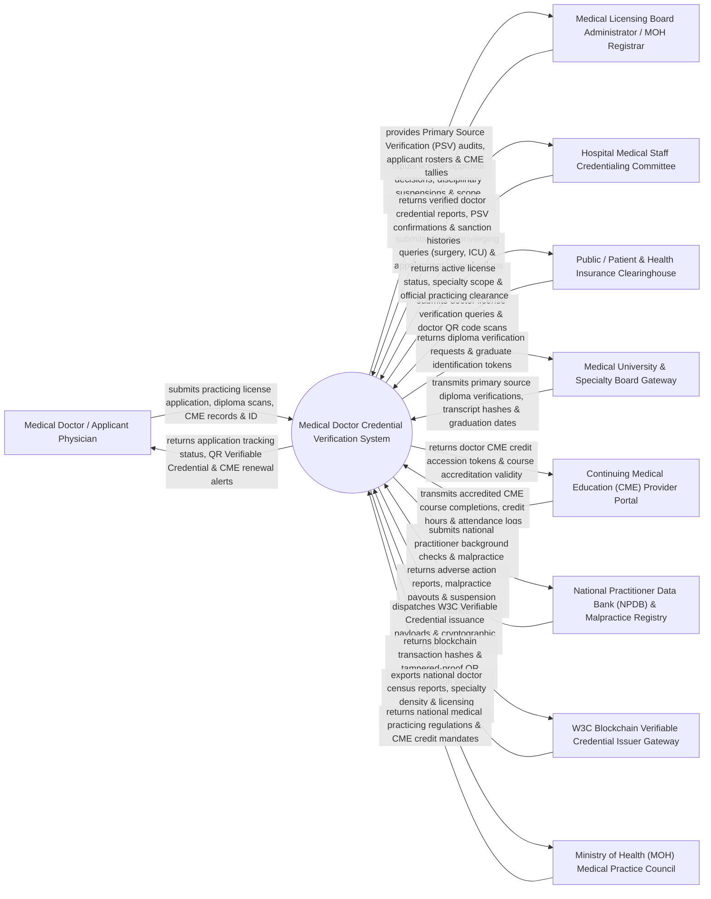

# Context Diagram — Medical Doctor Credential Verification System

## Mermaid Code

## Actor & Interaction Table | Bảng Actor & Tương tác

| # | Actor | Actor Type | Data Sent TO System | Data Received FROM System | Notes |
|---|-------|------------|---------------------|---------------------------|-------|
| 1 | Medical Doctor / Applicant Physician | Primary | License applications, diploma scans, internship certificates, CME credit logs, Citizen ID. | Application status updates, official QR Verifiable Credential, license renewal reminders. | Licensed physician or medical graduate applying for or renewing a medical practicing license. |
| 2 | Medical Licensing Board Administrator / MOH Registrar | Primary | License approvals/denials, scope of practice restrictions, disciplinary suspensions, board decisions. | Primary Source Verification (PSV) audit reports, applicant queue rosters, CME compliance tallies. | Government licensing board officer or MOH registrar approving medical practicing certificates. |
| 3 | Hospital Medical Staff Credentialing Committee | Primary | Clinical privileging queries (e.g., robotic surgery authorization), hospital appointment reviews. | Verified physician credential packages, PSV degree confirmations, malpractice sanction histories. | Hospital committee verifying physician credentials prior to granting clinical privileges and employment. |
| 4 | Public / Patient & Health Insurance Clearinghouse | Primary | Doctor license number searches, public QR code scans on doctor badges, insurance billing checks. | Active license status (Valid/Suspended/Revoked), specialty board certifications, practice location. | Patients and health insurance providers verifying doctor legitimacy before treatment or claim reimbursement. |
| 5 | Medical University & Specialty Board Gateway | Supporting System | Primary Source Verification (PSV) degree confirmations, medical diploma serials, residency certificates. | Automated diploma verification requests, graduate accession tokens. | Accredited medical schools and specialty boards validating primary medical education credentials. |
| 6 | CME Provider Portal | Supporting System | Accredited Continuing Medical Education (CME / CBYT) course completion records, credit hours. | Physician CME credit accession tokens, course accreditation validity status. | Accredited medical education providers uploading physician CME training completion data. |
| 7 | NPDB & Malpractice Registry | Supporting System | Adverse action reports, malpractice claim settlement amounts, state licensing board suspensions. | Automated practitioner background queries, national provider identifier (NPI) lookups. | Federal/National practitioner database tracking medical malpractice payouts and disciplinary actions. |
| 8 | W3C Blockchain VC Issuer Gateway | Supporting System | Cryptographic W3C Verifiable Credential JSON-LD payloads, Decentralized Identifiers (DIDs). | Blockchain transaction hashes, tamper-proof QR verification keys, public key signatures. | Blockchain network issuing tamper-proof, cryptographic digital credentials for medical licenses. |
| 9 | MOH Medical Practice Council | Regulatory | Statutory medical practicing regulations, mandatory CME credit hour requirements (e.g., 48 CME hrs / 2 yrs). | National physician census metrics, specialty distribution maps, licensing compliance reports. | Ministry of Health council regulating medical practicing laws (Luật Khám bệnh, chữa bệnh). |

## System Boundary Description | Mô tả Phạm vi Hệ thống

The **Medical Doctor Credential Verification System (MDCVS)** is an enterprise regulatory, biosecurity, and healthcare credentialing software platform operating across Medical Licensing Boards, Ministries of Health (MOH), hospital credentialing committees, medical universities, and health insurance clearinghouses. It automates Primary Source Verification (PSV) of medical degrees, tracks Continuing Medical Education (CME) credit compliance, issues W3C blockchain-backed QR Verifiable Credentials, manages hospital clinical privileging, tracks disciplinary/malpractice sanctions, and provides public physician license verification.

**Inside System Scope:**
- Electronic physician medical practicing license (Chứng chỉ Hành nghề Y - CCHN) application and renewal workflow.
- Primary Source Verification (PSV) of medical diplomas, residency training, and specialty board certifications.
- Continuing Medical Education (CME / CBYT) credit hour tracking, provider accreditation, and renewal clearance.
- Cryptographic W3C Verifiable Credential (VC) generation and public QR code verification.
- Hospital clinical privileging management (defining surgical and clinical scope of practice per hospital).
- Disciplinary action tracking (license suspension, probation, revocation, malpractice claim registry).
- Foreign medical graduate equivalency evaluation, language proficiency verification, and background checks.
- Public online physician verification portal and health insurance doctor credential clearance.

**Outside System Scope:**
- Teaching medical student classes inside university lecture halls (handled by University LMS).
- Financial collection of annual medical board membership dues (handled by ERP / Payment Gateway).
- Physical execution of surgical procedures inside hospital operating rooms (handled by Surgical System).
- Legal court trials for criminal medical malpractice lawsuits (handled by Judicial System).
