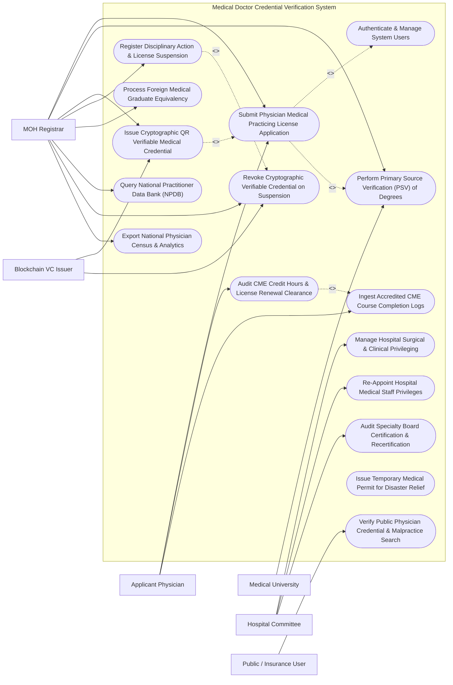

# Use Case Diagram — Medical Doctor Credential Verification System

## Mermaid Code

## Actor Table | Bảng Actor

| # | Actor | Actor Type | Role Description | Related Use Cases |
|---|-------|------------|------------------|-------------------|
| 1 | Applicant Physician | Primary | Medical doctor applying for a new practicing license, uploading diplomas, or logging CME credits for renewal. | UC01, UC04, UC08 |
| 2 | MOH Registrar | Primary | Government licensing board administrator verifying PSV results, approving practicing certificates, and taking disciplinary action. | UC01, UC02, UC03, UC07, UC09, UC10, UC14, UC15 |
| 3 | Medical University | Secondary / System | Accredited medical school verifying primary source diplomas, transcripts, and graduation dates. | UC02 |
| 4 | Hospital Committee | Primary | Hospital medical staff credentialing committee granting clinical practice privileges and reviewing physician appointments. | UC06, UC11, UC12 |
| 5 | Public / Insurance User | Primary | Patient or health insurance claims auditor verifying physician license validity and searching public disciplinary records. | UC05 |
| 6 | Blockchain VC Issuer | Secondary / System | W3C Blockchain gateway issuing tamper-proof, cryptographic digital credentials and Decentralized Identifiers (DIDs). | UC03, UC14 |

## Use Case Table | Bảng Use Case

| # | UC ID | Use Case Name | Primary Actor | Secondary Actor | Description | Priority |
|---|-------|---------------|---------------|-----------------|-------------|----------|
| 1 | UC01 | Submit Physician Medical Practicing License Application | Applicant Physician | MOH Registrar | Submit medical practicing license application (CCHN), uploading diploma scans, Citizen ID, internship certificates, and health check. | High |
| 2 | UC02 | Perform Primary Source Verification (PSV) of Degrees | MOH Registrar | Medical University | Perform automated or manual Primary Source Verification (PSV) directly with issuing medical universities to validate diploma authenticity. | High |
| 3 | UC03 | Issue Cryptographic QR Verifiable Medical Credential | MOH Registrar | Blockchain VC Issuer | Issue W3C-compliant Verifiable Credential (VC) containing Decentralized Identifier (DID) and tamper-proof QR code for approved doctor. | High |
| 4 | UC04 | Audit CME Credit Hours & License Renewal Clearance | Applicant Physician | MOH Registrar | Audit Continuing Medical Education (CME / CBYT) credit compliance (minimum 48 hours / 2 years) to clear license renewal. | High |
| 5 | UC05 | Verify Public Physician Credential & Malpractice Search | Public / Insurance User | None | Provide public online verification of doctor license status (Valid/Suspended/Revoked), specialty scope, and public disciplinary actions. | High |
| 6 | UC06 | Manage Hospital Surgical & Clinical Privileging | Hospital Committee | None | Define and grant hospital-specific clinical and surgical practice privileges (e.g., Laparoscopic Surgery Level 3, ICU Intubation). | High |
| 7 | UC07 | Register Disciplinary Action & License Suspension | MOH Registrar | None | Record medical board disciplinary sanctions (License Suspension, Revocation, Probation) resulting from medical malpractice or ethics breach. | High |
| 8 | UC08 | Ingest Accredited CME Course Completion Logs | Applicant Physician | None | Ingest certified CME course completion records, verifying provider accreditation status and adding earned credit hours to physician profile. | Medium |
| 9 | UC09 | Process Foreign Medical Graduate Equivalency | MOH Registrar | None | Evaluate foreign medical school diplomas (ECFMG / WHO Directory), language proficiency, and internship equivalency for foreign doctors. | Medium |
| 10 | UC10 | Query National Practitioner Data Bank (NPDB) | MOH Registrar | None | Query national malpractice registry for adverse actions, settlement payouts, and out-of-state license suspensions prior to licensing. | High |
| 11 | UC11 | Re-Appoint Hospital Medical Staff Privileges | Hospital Committee | None | Conduct bi-annual clinical privilege re-appointment reviews based on physician peer reviews, surgical complication rates, and CME. | Medium |
| 12 | UC12 | Audit Specialty Board Certification & Recertification | Hospital Committee | None | Track specialty board certification status (Cardiology, Neurosurgery) and enforce mandatory recertification exam cycles (every 10 yrs). | Medium |
| 13 | UC13 | Issue Temporary Medical Permit for Disaster Relief | MOH Registrar | None | Issue expedited 30-day temporary emergency practicing permits for doctors responding to epidemics, floods, or national disasters. | Medium |
| 14 | UC14 | Revoke Cryptographic Verifiable Credential on Suspension | MOH Registrar | Blockchain VC Issuer | Publish revocation status to the blockchain smart contract registry when a physician's license is suspended or revoked. | High |
| 15 | UC15 | Export National Physician Census & Analytics | MOH Registrar | None | Render national health workforce analytics: physician-to-population ratio, specialty distribution by province, and age demographics. | Medium |
| 16 | UC16 | Authenticate & Manage System Users | All Users | None | Enforce multi-factor authentication, PKI digital signatures, role-based access control, and audit trail logging per Ministry of Health rules. | High |

## Use Case Specification | Đặc tả Use Case

---

### UC01 — Submit Physician Medical Practicing License Application

| Field | Detail |
|-------|--------|
| **UC ID** | UC01 |
| **Use Case Name** | Submit Physician Medical Practicing License Application |
| **Actor(s)** | Primary: Applicant Physician   Secondary: MOH Registrar |
| **Description** | Submits an official application for a Medical Practicing Certificate (Chứng chỉ Hành nghề Y - CCHN) under Ministry of Health regulations, uploading medical school diplomas, Citizen ID (CCCD), 18-month hospital internship certificate, health clearance, and judicial record certificate. |
| **Precondition** | 1. The physician applicant has graduated from an accredited medical university and completed 18 months of clinical internship.   2. The physician is authenticated in MDCVS via National Digital ID (VNeID). |
| **Main Flow** | 1. The Applicant Physician opens "New Medical Practicing License Application" in MDCVS.   2. The System retrieves verified personal identity via VNeID: Full Name (Dr. Nguyen Van D), Citizen ID (`034085001234`), Date of Birth (May 12, 1994), Gender (Male), and Email.   3. The Physician inputs **Education & Specialty Details**:   &nbsp;&nbsp;&nbsp;&nbsp;- Medical School: *Hanoi Medical University (Đại học Y Hà Nội)*   &nbsp;&nbsp;&nbsp;&nbsp;- Degree Title: Doctor of Medicine (Bác sĩ Đa khoa)   &nbsp;&nbsp;&nbsp;&nbsp;- Graduation Year: 2024   &nbsp;&nbsp;&nbsp;&nbsp;- Diploma Serial Number: `MED-HMU-2024-9918`.   4. The Physician uploads **Mandatory Application Documents**:   &nbsp;&nbsp;&nbsp;&nbsp;- Medical Diploma & Academic Transcript Scans   &nbsp;&nbsp;&nbsp;&nbsp;- 18-Month Hospital Clinical Internship Certificate (Issued by Bach Mai Hospital)   &nbsp;&nbsp;&nbsp;&nbsp;- Health Clearance Certificate (Category I Fitness)   &nbsp;&nbsp;&nbsp;&nbsp;- Judicial Record Certificate #2 (Phiếu Lý lịch Tư pháp Số 2 - No Criminal Record).   5. The Physician selects Requested Scope of Practice: *General Internal Medicine (Nội khoa)*.   6. The Physician signs the application using a PKI Digital Signature and submits the application.   7. The System assigns a unique Application Tracking Number (`APP-CCHN-2026-08192`) and auto-triggers Primary Source Verification (UC02) with Hanoi Medical University. |
| **Alternative Flow** | **AF1** — Specialist Doctor License Application (Bác sĩ Chuyên khoa I/II): Physician applies for Specialist License in *Cardiology*; System mandates submission of Specialist Level I Diploma and 24-month specialty practice certificate.   **AF2** — Foreign Doctor License Application: A foreign physician applies for a license; the System routes the application to Foreign Graduate Equivalency Evaluation (UC09). |
| **Exception Flow** | **EX1** — Incomplete Clinical Internship Duration (< 18 Months): Uploaded internship certificate shows only 12 months completed; System blocks submission with error "Statutory 18-Month Clinical Internship Requirement Not Met".   **EX2** — Active Criminal Record Warning: Judicial record certificate indicates active criminal conviction; System flags "Judicial Record Hold — Manual Legal Review Required". |
| **Postcondition** | Application APP-CCHN-2026-08192 is registered, mandatory document scans are stored, and Primary Source Verification (PSV) is initiated. |
| **Business Rule** | **BR1**: Medical practicing license applications MUST include an 18-month clinical internship certificate from a recognized teaching hospital per Law on Medical Examination and Treatment (Luật Khám bệnh, chữa bệnh).   **BR2**: Application submission MUST automatically initiate electronic Primary Source Verification (PSV) with the degree-granting medical university. |

---

### UC02 — Perform Primary Source Verification (PSV) of Degrees

| Field | Detail |
|-------|--------|
| **UC ID** | UC02 |
| **Use Case Name** | Perform Primary Source Verification (PSV) of Degrees |
| **Actor(s)** | Primary: MOH Registrar   Secondary: Medical University |
| **Description** | Performs electronic Primary Source Verification (PSV) directly with the issuing medical university or specialty board, verifying that the applicant's medical diploma, degree title, graduation date, and diploma serial number match primary registrar records, eliminating fraudulent medical credentials. |
| **Precondition** | 1. A practicing license application (UC01) is submitted.   2. The Medical University API gateway or PSV verification interface is active. |
| **Main Flow** | 1. The **PSV Verification Engine** receives Application `APP-CCHN-2026-08192` (Applicant: Dr. Nguyen Van D, Diploma: `MED-HMU-2024-9918`).   2. The System dispatches an automated **Electronic PSV Query** to Hanoi Medical University's API Gateway.   3. The University API queries its official **Graduation Registry Database**:   &nbsp;&nbsp;&nbsp;&nbsp;- Diploma Serial: `MED-HMU-2024-9918`   &nbsp;&nbsp;&nbsp;&nbsp;- Graduate Name: Nguyen Van D   &nbsp;&nbsp;&nbsp;&nbsp;- National ID: `034085001234`   &nbsp;&nbsp;&nbsp;&nbsp;- Degree Granted: Doctor of Medicine (Bác sĩ Đa khoa)   &nbsp;&nbsp;&nbsp;&nbsp;- Graduation Date: June 20, 2024   &nbsp;&nbsp;&nbsp;&nbsp;- Academic Standing: Pass / Good.   4. The University API returns an electronic **PSV Verification Confirmation Payload** with cryptographic digital signature.   5. The System verifies the university's digital signature -> **PSV Verification PASSED (100% Match)**.   6. The System updates PSV Record `PSV-2026-99182` status to "Primary Source Verified", attaches the digital PSV Certificate, and routes the application to the MOH Registrar for final license approval. |
| **Alternative Flow** | **AF1** — Manual Paper PSV Verification (Non-API University): For older diplomas (pre-2000), the System generates an official PSV Inquiry Letter; the Registrar dispatches a physical verification request to the university archives.   **AF2** — International ECFMG Primary Source Verification: For degrees earned abroad (e.g., Harvard Medical School), the System routes PSV verification through the ECFMG / DataFlow Group international verification portal. |
| **Exception Flow** | **EX1** — Fake / Fraudulent Diploma Detection: University API returns "Record Not Found — Diploma Serial MED-HMU-2024-9918 is FRAUDULENT"; System flags "CRITICAL CREDENTIAL FRAUD ALARM", blocks application, and alerts legal authorities.   **EX2** — Name / Date Discrepancy Error: University record shows middle name "Van E" instead of "Van D"; System flags "Name Discrepancy — Manual Registrar Verification Required". |
| **Postcondition** | Degree authenticity is primary-source verified, cryptographic PSV certificate is attached, and application is cleared for license approval. |
| **Business Rule** | **BR1**: All medical practicing licenses MUST undergo mandatory Primary Source Verification (PSV) directly with issuing universities prior to license issuance.   **BR2**: Detection of fraudulent diplomas during PSV MUST result in immediate permanent application blacklisting and reporting to law enforcement authorities. |

---

### UC03 — Issue Cryptographic QR Verifiable Medical Credential

| Field | Detail |
|-------|--------|
| **UC ID** | UC03 |
| **Use Case Name** | Issue Cryptographic QR Verifiable Medical Credential |
| **Actor(s)** | Primary: MOH Registrar   Secondary: Blockchain VC Issuer |
| **Description** | Issues an official Medical Practicing Certificate (CCHN) upon registrar approval, generating a W3C-compliant Verifiable Credential (VC) signed with the Ministry of Health's private key, embedding a Decentralized Identifier (DID) and tamper-proof QR code, and publishing the credential hash to the public blockchain registry. |
| **Precondition** | 1. Application (UC01) passes PSV verification (UC02) and NPDB background checks (UC10).   2. The MOH Registrar approves the license. |
| **Main Flow** | 1. The MOH Registrar reviews Application `APP-CCHN-2026-08192` (PSV Status: *Verified*, NPDB Status: *Clean*).   2. The Registrar clicks **"APPROVE & ISSUE MEDICAL PRACTICING LICENSE"**.   3. The System assigns Official Medical License Number: **`CCHN-MOH-2026-091823`**.   4. The System compiles the **W3C Verifiable Credential (VC) JSON-LD Payload**:   &nbsp;&nbsp;&nbsp;&nbsp;- **Issuer DID**: `did:moh:vn:credential-authority`   &nbsp;&nbsp;&nbsp;&nbsp;- **Subject DID**: `did:vneid:034085001234` (Dr. Nguyen Van D)   &nbsp;&nbsp;&nbsp;&nbsp;- **License Number**: `CCHN-MOH-2026-091823`   &nbsp;&nbsp;&nbsp;&nbsp;- **Specialty Scope**: General Internal Medicine (Nội khoa)   &nbsp;&nbsp;&nbsp;&nbsp;- **Issue Date**: October 14, 2026   &nbsp;&nbsp;&nbsp;&nbsp;- **Expiration Date**: October 14, 2031 (5-Year Validity).   5. The System signs the VC payload using the MOH Master Private Key (Ed25519 Signature).   6. The System publishes the cryptographic hash to the **Public Blockchain Credential Registry**: `TxHash: 0x8f9918204128...`   7. The System generates the official **Tamper-Proof Verification QR Code**.   8. The System issues the Digital License Card to Dr. Nguyen Van D's VNeID mobile wallet and dispatches a physical printed certificate featuring the holographic QR code. |
| **Alternative Flow** | **AF1** — Specialty Board Certification VC Addendum: When a doctor passes the Cardiovascular Specialty Exam, the System issues a child Verifiable Credential adding "Cardiology Intervention" to their primary DID scope.   **AF2** — Temporary Emergency Permit VC: Issues a 30-day temporary emergency permit VC (UC13) with automated auto-expiration rules built into the smart contract. |
| **Exception Flow** | **EX1** — Blockchain Smart Contract Transaction Failure: If blockchain network fails to acknowledge transaction, System queues transaction in retry pool and flags "Blockchain Confirmation Pending".   **EX2** — Key Signing Hardware (HSM) Error: Hardware Security Module fails to sign; System alerts security admin. |
| **Postcondition** | Official license CCHN-MOH-2026-091823 is issued, W3C Verifiable Credential and DID are generated, transaction hash is published to blockchain, and QR code is delivered to doctor's wallet. |
| **Business Rule** | **BR1**: Issued medical practicing licenses MUST be formatted as W3C-compliant Verifiable Credentials backed by a Decentralized Identifier (DID) and public key signature.   **BR2**: Scanning an official license QR code MUST instantly display real-time cryptographic validity (Valid, Expired, Revoked) without requiring manual login. |

---

### UC04 — Audit CME Credit Hours & License Renewal Clearance

| Field | Detail |
|-------|--------|
| **UC ID** | UC04 |
| **Use Case Name** | Audit CME Credit Hours & License Renewal Clearance |
| **Actor(s)** | Primary: Applicant Physician   Secondary: MOH Registrar |
| **Description** | Audits a physician's accumulated Continuing Medical Education (CME / CBYT) credit hours against statutory renewal requirements (minimum 48 CME credit hours over 2 consecutive years), verifying course accreditation, issuing a CME Renewal Clearance Certificate, and approving license renewal. |
| **Precondition** | 1. The physician's medical practicing license is due for 5-year statutory renewal.   2. CME course completion logs (UC08) are recorded in the physician's profile. |
| **Main Flow** | 1. The System initiates an automated **License Renewal Audit** 90 days prior to license expiration for Dr. Nguyen Van D (License: `CCHN-MOH-2026-091823`).   2. The **CME Audit Engine** compiles the physician's 24-month CME credit portfolio:   &nbsp;&nbsp;&nbsp;&nbsp;- **Course 1**: Advanced ECG Interpretation (Hanoi Med Univ - 12 CME Hours)   &nbsp;&nbsp;&nbsp;&nbsp;- **Course 2**: National Cardiology Congress 2025 (VN Heart Assn - 16 CME Hours)   &nbsp;&nbsp;&nbsp;&nbsp;- **Course 3**: Medical Ethics & Patient Safety 2026 (MOH Portal - 8 CME Hours)   &nbsp;&nbsp;&nbsp;&nbsp;- **Course 4**: Hypertension Management Clinical Workshop (16 CME Hours).   3. The Engine calculates Total Accumulated Credits: **`52.0 CME Hours`** (Statutory Requirement = 48.0 Hours over 2 years).   4. The Engine verifies **CME Category Distribution Rules**:   &nbsp;&nbsp;&nbsp;&nbsp;- Clinical Specialty Hours: 44.0 Hrs (Min 36.0 Required -> Passed)   &nbsp;&nbsp;&nbsp;&nbsp;- Medical Ethics & Law Hours: 8.0 Hrs (Min 4.0 Required -> Passed).   5. The System issues **CME Renewal Clearance Certificate** `CME-CLR-2026-99182`.   6. The Physician submits License Renewal Fee ($20 USD equivalent).   7. The MOH Registrar approves renewal, and the System extends license expiration date by 5 years (to Oct 14, 2031) and updates the W3C Verifiable Credential on the blockchain (UC03). |
| **Alternative Flow** | **AF1** — Deficit CME Hours Penalty Extension: Physician has only 36 CME Hours (12-hour deficit); System flags "CME Deficit", granting a 90-day grace period to complete 12 approved online CME modules.   **AF2** — Out-of-Country Academic CME Waiver: Physician presents proof of completing a 1-year clinical fellowship at Johns Hopkins Hospital; System converts fellowship into 96 CME Hours. |
| **Exception Flow** | **EX1** — Unaccredited CME Course Provider Rejection: Physician uploads a 20-hour certificate from an unaccredited commercial vendor; System rejects hours with error "Unaccredited CME Provider — Hours Excluded".   **EX2** — Failed CME Compliance past Grace Period: Physician fails to meet 48 CME hours after 90-day grace period; System updates license status to "License Suspended — CME Non-Compliance" (UC07). |
| **Postcondition** | CME credit hours (52.0 hrs) are audited and verified, CME clearance certificate is issued, and practicing license is renewed for 5 years. |
| **Business Rule** | **BR1**: Medical practicing license renewal MUST mandate proof of at least 48 accredited Continuing Medical Education (CME) credit hours completed within the preceding 2-year period.   **BR2**: CME credit portfolios MUST include a minimum of 4.0 credit hours dedicated to Medical Ethics, Patient Safety, and Health Legislation. |

---

### UC05 — Verify Public Physician Credential & Malpractice Search

| Field | Detail |
|-------|--------|
| **UC ID** | UC05 |
| **Use Case Name** | Verify Public Physician Credential & Malpractice Search |
| **Actor(s)** | Primary: Public / Insurance User |
| **Description** | Provides instant public online verification of a doctor's medical practicing license legitimacy, searching by doctor name, license number, or scanning the QR code on a doctor's badge, displaying verified specialty scope, active hospital affiliations, board certifications, and public disciplinary sanction history. |
| **Precondition** | 1. The public physician verification portal is active.   2. Blockchain Verifiable Credential registry is online. |
| **Main Flow** | 1. A Patient or Health Insurance Claims Auditor opens the "Public Medical Doctor Verification Portal" or scans the QR code on Dr. Nguyen Van D's hospital badge.   2. The System queries License Number `CCHN-MOH-2026-091823` or reads the scanned W3C QR Verifiable Credential.   3. The System verifies **Cryptographic Blockchain Validity**:   &nbsp;&nbsp;&nbsp;&nbsp;- Validates MOH Digital Signature against Public Key -> **Signature Valid**   &nbsp;&nbsp;&nbsp;&nbsp;- Checks Blockchain Revocation Registry -> **Not Revoked**.   4. The System renders the **Official Physician Credential Profile**:   &nbsp;&nbsp;&nbsp;&nbsp;- **Full Name**: Dr. Nguyen Van D (Portrait Photo Displayed)   &nbsp;&nbsp;&nbsp;&nbsp;- **License Status**: `ACTIVE / VALID (Giấy phép Hợp pháp)`   &nbsp;&nbsp;&nbsp;&nbsp;- **License Number**: `CCHN-MOH-2026-091823`   &nbsp;&nbsp;&nbsp;&nbsp;- **Licensed Scope**: General Internal Medicine & Clinical Cardiology   &nbsp;&nbsp;&nbsp;&nbsp;- **Primary Source Degree**: Doctor of Medicine, Hanoi Medical University (Verified)   &nbsp;&nbsp;&nbsp;&nbsp;- **Current Hospital Affiliation**: Bach Mai General Hospital (Department of Cardiology)   &nbsp;&nbsp;&nbsp;&nbsp;- **Disciplinary Record**: `CLEAN (No Public Sanctions / Suspensions)`.   5. The Insurance Claims Auditor downloads a PDF **Doctor Verification Statement** for insurance claim reimbursement clearance. |
| **Alternative Flow** | **AF1** — Suspended Doctor License Verification Result: Auditor scans QR code of a suspended doctor; System flashes a RED banner: `WARNING: LICENSE SUSPENDED (Tạm đình chỉ Hành nghề) — Reason: Professional Ethics Violation (Effective Oct 1 - Dec 31, 2026)`.   **AF2** — Health Insurance Billing Eligibility Clearance: An insurance clearinghouse API automatically queries 50 doctor IDs simultaneously to verify billing eligibility for submitted insurance claims. |
| **Exception Flow** | **EX1** — Fake License QR Code Detection: User scans a fake QR code pointing to an unofficial domain; System displays "WARNING: UNTRUSTED / FAKE CREDENTIAL — QR Code Failed Cryptographic Signature Validation".   **EX2** — Revoked License Search Result: Doctor was permanently revoked; System displays "LICENSE PERMANENTLY REVOKED (Thu hồi Giấy phép Vĩnh viễn)". |
| **Postcondition** | Public credential profile is displayed, cryptographic signature validity is verified, active practice scope is confirmed, and verification statement is generated. |
| **Business Rule** | **BR1**: Public verification queries MUST display real-time license status (Active, Suspended, Revoked) without concealing active public disciplinary sanctions.   **BR2**: Health insurance claims submitted for physician services MUST verify active license status on the service date prior to authorizing reimbursement. |
