# Conceptual ERD — Medical Doctor Credential Verification System

## Mermaid Code

```mermaid
erDiagram
    PHYSICIAN_APPLICANT {
        int physician_id PK
        string physician_code
        string national_id
        string full_name
        date date_of_birth
        string gender
        string email
        string physician_status
    }

    MEDICAL_PRACTICING_LICENSE {
        int license_id PK
        string license_number
        int physician_id FK
        string specialty_scope
        date issue_date
        date expiration_date
        string license_status
    }

    PRIMARY_SOURCE_VERIFICATION {
        int psv_id PK
        int physician_id FK
        string verifying_institution
        string degree_type
        string psv_status
        datetime verified_at
    }

    EDUCATIONAL_DEGREE_CREDENTIAL {
        int degree_id PK
        int physician_id FK
        string university_name
        string degree_title
        int graduation_year
        string diploma_serial_num
        string degree_status
    }

    SPECIALTY_BOARD_CERTIFICATION {
        int board_cert_id PK
        int physician_id FK
        string board_name
        string specialty_code
        date certified_date
        date recertification_due_date
        string cert_status
    }

    CME_CREDIT_RECORD {
        int cme_id PK
        int physician_id FK
        string cme_provider_name
        string course_title
        decimal cme_hours
        date completed_date
        string cme_status
    }

    DISCIPLINARY_MALPRACTICE_RECORD {
        int record_id PK
        int physician_id FK
        date incident_date
        string sanction_type
        string board_action_summary
        boolean active_suspension_flag
    }

    HOSPITAL_CLINICAL_PRIVILEGE {
        int privilege_id PK
        int physician_id FK
        string hospital_name
        string scope_of_practice
        date granted_date
        date expiration_date
        string privilege_status
    }

    VERIFIABLE_CREDENTIAL_ISSUANCE {
        int vc_id PK
        int license_id FK
        string did_uri
        string qr_verification_code
        string vc_hash_blockchain
        datetime issued_at
        string vc_status
    }

    NPDB_BACKGROUND_QUERY {
        int query_id PK
        int physician_id FK
        string npdb_control_num
        datetime query_datetime
        boolean adverse_action_found_flag
    }

    FOREIGN_DOCTOR_EQUIVALENCY {
        int equivalency_id PK
        int physician_id FK
        string origin_country
        decimal language_test_score
        string equivalency_status
        datetime approved_at
    }

    PUBLIC_VERIFICATION_LOG {
        int log_id PK
        string license_number
        string queried_by_ip
        string verification_purpose
        datetime queried_at
    }

    PHYSICIAN_APPLICANT ||--o{ MEDICAL_PRACTICING_LICENSE : "holds_license"
    PHYSICIAN_APPLICANT ||--o{ PRIMARY_SOURCE_VERIFICATION : "verified_via"
    PHYSICIAN_APPLICANT ||--o{ EDUCATIONAL_DEGREE_CREDENTIAL : "earned_degree"
    PHYSICIAN_APPLICANT ||--o{ SPECIALTY_BOARD_CERTIFICATION : "certified_by"
    PHYSICIAN_APPLICANT ||--o{ CME_CREDIT_RECORD : "completed_cme"
    PHYSICIAN_APPLICANT ||--o{ DISCIPLINARY_MALPRACTICE_RECORD : "flagged_in"
    PHYSICIAN_APPLICANT ||--o{ HOSPITAL_CLINICAL_PRIVILEGE : "granted_privilege"
    PHYSICIAN_APPLICANT ||--o{ NPDB_BACKGROUND_QUERY : "queried_in"
    PHYSICIAN_APPLICANT ||--o{ FOREIGN_DOCTOR_EQUIVALENCY : "assessed_in"
    MEDICAL_PRACTICING_LICENSE ||--o{ VERIFIABLE_CREDENTIAL_ISSUANCE : "issued_vc"
    MEDICAL_PRACTICING_LICENSE ||--o{ PUBLIC_VERIFICATION_LOG : "publicly_queried"
```

## Entity Description Table | Bảng mô tả Entity

| # | Entity Name | Vietnamese Name | Description | Key Attributes | Main Relationships |
|---|-------------|-----------------|-------------|----------------|-------------------|
| 1 | PHYSICIAN_APPLICANT | Bác sĩ Nộp Hồ sơ Master | Master physician profile record storing physician code, national Citizen ID, full name, DOB, gender, email, and status. | physician_id, physician_code, national_id, full_name, dob, gender, email, physician_status | Has LICENSE, PSV, DEGREE, BOARD_CERT, CME, DISCIPLINARY, PRIVILEGE, NPDB, EQUIVALENCY. |
| 2 | MEDICAL_PRACTICING_LICENSE | Chứng chỉ Hành nghề Y (CCHN) | Official medical practicing license record storing license number, physician ID, specialty scope, issue date, expiration date, and status. | license_id, license_number, physician_id, specialty_scope, issue_date, expiration_date, license_status | Belongs to PHYSICIAN_APPLICANT; Has VERIFIABLE_CREDENTIAL and PUBLIC_VERIFICATION_LOG. |
| 3 | PRIMARY_SOURCE_VERIFICATION | Thẩm định Nguồn gốc (PSV) | Primary Source Verification (PSV) audit record tracking verifying institution (University), degree type, PSV status, and verification timestamp. | psv_id, physician_id, verifying_institution, degree_type, psv_status, verified_at | Belongs to PHYSICIAN_APPLICANT. |
| 4 | EDUCATIONAL_DEGREE_CREDENTIAL | Bằng cấp Y khoa | Educational medical degree record tracking university name, degree title (MD, MBBS), graduation year, diploma serial number, and status. | degree_id, physician_id, university_name, degree_title, graduation_year, diploma_serial_num, degree_status | Belongs to PHYSICIAN_APPLICANT. |
| 5 | SPECIALTY_BOARD_CERTIFICATION | Chứng nhận Hội Chuyên khoa | Medical specialty board certification record tracking board name (Cardiology, Surgery), specialty code, certified date, recertification due date, and status. | board_cert_id, physician_id, board_name, specialty_code, certified_date, recertification_due_date, cert_status | Belongs to PHYSICIAN_APPLICANT. |
| 6 | CME_CREDIT_RECORD | Nhật ký Tín chỉ Đào tạo (CME) | Continuing Medical Education (CME / CBYT) credit record tracking CME provider name, course title, credit hours, completion date, and status. | cme_id, physician_id, cme_provider_name, course_title, cme_hours, completed_date, cme_status | Belongs to PHYSICIAN_APPLICANT. |
| 7 | DISCIPLINARY_MALPRACTICE_RECORD | Hồ sơ Kỷ luật & Thất bại Y khoa | Disciplinary action and malpractice record tracking incident date, sanction type (Suspension, Revocation), board action summary, and active flag. | record_id, physician_id, incident_date, sanction_type, board_action_summary, active_suspension_flag | Belongs to PHYSICIAN_APPLICANT. |
| 8 | HOSPITAL_CLINICAL_PRIVILEGE | Phân quyền Lực lượng Bệnh viện | Hospital clinical and surgical privileging record tracking hospital name, scope of practice authorized, granted date, expiration date, and status. | privilege_id, physician_id, hospital_name, scope_of_practice, granted_date, expiration_date, privilege_status | Belongs to PHYSICIAN_APPLICANT. |
| 9 | VERIFIABLE_CREDENTIAL_ISSUANCE | Chứng thực Chuỗi khối (W3C VC) | W3C Blockchain Verifiable Credential record tracking license ID, DID URI, QR verification code, blockchain hash, issue timestamp, and status. | vc_id, license_id, did_uri, qr_verification_code, vc_hash_blockchain, issued_at, vc_status | Belongs to MEDICAL_PRACTICING_LICENSE. |
| 10 | NPDB_BACKGROUND_QUERY | Truy vấn Lý lịch Y tế NPDB | National Practitioner Data Bank (NPDB) query log tracking physician ID, NPDB control number, query datetime, and adverse action found flag. | query_id, physician_id, npdb_control_num, query_datetime, adverse_action_found_flag | Belongs to PHYSICIAN_APPLICANT. |
| 11 | FOREIGN_DOCTOR_EQUIVALENCY | Thẩm định Bác sĩ Nước ngoài | Foreign medical doctor equivalency evaluation record tracking origin country, language proficiency score, equivalency status, and approval timestamp. | equivalency_id, physician_id, origin_country, language_test_score, equivalency_status, approved_at | Belongs to PHYSICIAN_APPLICANT. |
| 12 | PUBLIC_VERIFICATION_LOG | Nhật ký Tra cứu Công khai | Public verification query log tracking queried license number, IP address, verification purpose, and query timestamp. | log_id, license_number, queried_by_ip, verification_purpose, queried_at | Belongs to MEDICAL_PRACTICING_LICENSE. |

## Relationship Description | Mô tả Quan hệ

| # | From Entity | Cardinality | To Entity | Relationship Label | Business Explanation |
|---|-------------|-------------|-----------|-------------------|----------------------|
| 1 | PHYSICIAN_APPLICANT | one-to-many | MEDICAL_PRACTICING_LICENSE | holds_license | One physician applicant holds medical practicing licenses (CCHN). |
| 2 | PHYSICIAN_APPLICANT | one-to-many | PRIMARY_SOURCE_VERIFICATION | verified_via | One physician applicant is verified via Primary Source Verification (PSV) audits. |
| 3 | PHYSICIAN_APPLICANT | one-to-many | EDUCATIONAL_DEGREE_CREDENTIAL | earned_degree | One physician applicant earned medical school degrees and diplomas. |
| 4 | PHYSICIAN_APPLICANT | one-to-many | SPECIALTY_BOARD_CERTIFICATION | certified_by | One physician applicant is certified by medical specialty boards (Cardiology, Surgery). |
| 5 | PHYSICIAN_APPLICANT | one-to-many | CME_CREDIT_RECORD | completed_cme | One physician applicant completed Continuing Medical Education (CME) credit courses. |
| 6 | PHYSICIAN_APPLICANT | one-to-many | DISCIPLINARY_MALPRACTICE_RECORD | flagged_in | One physician applicant may be flagged in medical board disciplinary action records. |
| 7 | PHYSICIAN_APPLICANT | one-to-many | HOSPITAL_CLINICAL_PRIVILEGE | granted_privilege | One physician applicant is granted clinical and surgical privileges in hospitals. |
| 8 | PHYSICIAN_APPLICANT | one-to-many | NPDB_BACKGROUND_QUERY | queried_in | One physician applicant is queried in national practitioner malpractice databases. |
| 9 | PHYSICIAN_APPLICANT | one-to-many | FOREIGN_DOCTOR_EQUIVALENCY | assessed_in | One foreign physician applicant is assessed in equivalency evaluation records. |
| 10 | MEDICAL_PRACTICING_LICENSE | one-to-one | VERIFIABLE_CREDENTIAL_ISSUANCE | issued_vc | One medical practicing license issues a cryptographic W3C Verifiable Credential on blockchain. |
| 11 | MEDICAL_PRACTICING_LICENSE | one-to-many | PUBLIC_VERIFICATION_LOG | publicly_queried | One medical practicing license is publicly queried by patients and insurance providers. |
