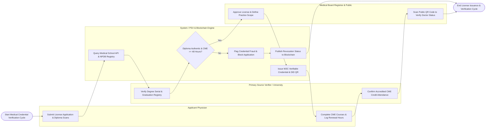

# Swimlane Diagram — Medical Doctor Credential Verification System

## Mermaid Code

## Flow Description | Mô tả luồng

| Lane | Actor / Subsystem | Role in Flow |
|------|-------------------|--------------|
| 1 | Applicant Physician | Submits medical practicing license applications (CCHN), uploads diploma scans, completes accredited CME courses, logs renewal credit hours, and holds digital QR credentials. |
| 2 | Primary Source Verifier / University | Accredited medical universities and specialty boards that verify diploma serial numbers, graduation registries, academic standing, and accredited CME course attendance. |
| 3 | System / PSV & Blockchain Engine | Executes automated Primary Source Verification (PSV) queries, checks NPDB malpractice background registries, formats W3C Verifiable Credentials, and publishes DID hashes on blockchain. |
| 4 | Medical Board Registrar & Public | Medical Board registrars approving practicing licenses, defining scope of practice, registering disciplinary suspensions, and patients/insurance providers scanning public QR codes. |
