# Action Tree — Medical Doctor Credential Verification System

## Mermaid Code

```mermaid
graph TD
    Root["Medical Doctor Credential Verification System"]

    Root --> M1["License Intake & Application"]
    Root --> M2["Primary Source Verification PSV"]
    Root --> M3["Blockchain Verifiable Credentials"]
    Root --> M4["CME Audit & License Renewal"]
    Root --> M5["Hospital Clinical Privileging"]
    Root --> M6["Disciplinary Action & Malpractice"]
    Root --> M7["Foreign Doctor Equivalency"]
    Root --> M8["Public Verification & Census"]

    M1 --> A11["Submit Medical License Application CCHN"]
    M1 --> A12["Upload Medical Diploma & Transcript Scans"]
    M1 --> A13["Validate 18-Month Clinical Internship Certificate"]
    M1 --> A14["Verify National Citizen ID VNeID Integration"]

    M2 --> A21["Dispatch Automated University API PSV Queries"]
    M2 --> A22["Verify Medical Diploma Serial Numbers"]
    M2 --> A23["Audit Academic Standing & Graduation Year"]
    M2 --> A24["Detect Fraudulent Diploma & Credential Forgery"]

    M3 --> A31["Generate W3C-Compliant Verifiable Credentials"]
    M3 --> A32["Assign Doctor Decentralized Identifier DID"]
    M3 --> A33["Publish Credential Cryptographic Hash to Blockchain"]
    M3 --> A34["Generate Holographic QR Code Verification Badge"]

    M4 --> A41["Ingest Accredited CME Course Credit Hours"]
    M4 --> A42["Audit Statutory 48-Hour CME Renewal Limit"]
    M4 --> A43["Issue CME Renewal Clearance Certificate"]
    M4 --> A44["Grant 5-Year Practicing License Extension"]

    M5 --> A51["Define Hospital Surgical Scope of Practice"]
    M5 --> A52["Grant Specialized Clinical Procedure Privileges"]
    M5 --> A53["Execute Bi-Annual Staff Privileging Re-Appointing"]
    M5 --> A54["Audit Specialty Board Certification Recertification"]

    M6 --> A61["Register Medical Board Disciplinary Sanctions"]
    M6 --> A62["Execute License Suspension & Revocation Orders"]
    M6 --> A63["Publish Blockchain Smart Contract Revocation Status"]
    M6 --> A64["Query Malpractice Settlement Payout Registries"]

    M7 --> A71["Process Foreign Medical Graduate ECFMG Evaluation"]
    M7 --> A72["Assess Medical English & Language Proficiency"]
    M7 --> A73["Query NPDB Practitioner Background Checks"]
    M7 --> A74["Issue Temporary Emergency Permit for Disasters"]

    M8 --> A81["Provide Online Public Doctor QR Code Verification"]
    M8 --> A82["Verify Health Insurance Doctor Billing Eligibility"]
    M8 --> A83["Render National Physician Census & Density Maps"]
    M8 --> A84["Export Statutory MOH Medical Practice Bulletins"]
```

## Module Description | Mô tả Module

| # | Module | Description | Actions |
|---|--------|-------------|---------|
| 1 | License Intake & Application | Processes practicing license applications (CCHN), ingests medical diplomas, validates 18-month clinical internships, and verifies VNeID. | Submit Medical License Application CCHN, Upload Medical Diploma & Transcript Scans, Validate 18-Month Clinical Internship Certificate, Verify National Citizen ID VNeID Integration |
| 2 | Primary Source Verification PSV | Dispatches automated API PSV queries to medical universities, verifies diploma serial numbers, audits graduation registries, and detects forgery. | Dispatch Automated University API PSV Queries, Verify Medical Diploma Serial Numbers, Audit Academic Standing & Graduation Year, Detect Fraudulent Diploma & Credential Forgery |
| 3 | Blockchain Verifiable Credentials | Generates W3C-compliant Verifiable Credentials (VC), assigns Decentralized Identifiers (DIDs), publishes hashes to blockchain, and prints QR codes. | Generate W3C-Compliant Verifiable Credentials, Assign Doctor Decentralized Identifier DID, Publish Credential Cryptographic Hash to Blockchain, Generate Holographic QR Code Verification Badge |
| 4 | CME Audit & License Renewal | Ingests accredited CME credit hours, audits statutory 48-hour/2-year renewal limits, issues clearance certificates, and extends 5-year license validity. | Ingest Accredited CME Course Credit Hours, Audit Statutory 48-Hour CME Renewal Limit, Issue CME Renewal Clearance Certificate, Grant 5-Year Practicing License Extension |
| 5 | Hospital Clinical Privileging | Defines surgical/clinical scopes of practice, grants hospital-specific procedure privileges, conducts bi-annual re-appointees, and audits specialty boards. | Define Hospital Surgical Scope of Practice, Grant Specialized Clinical Procedure Privileges, Execute Bi-Annual Staff Privileging Re-Appointing, Audit Specialty Board Certification Recertification |
| 6 | Disciplinary Action & Malpractice | Registers medical board disciplinary sanctions, executes suspensions/revocations, publishes blockchain revocation status, and logs malpractice payouts. | Register Medical Board Disciplinary Sanctions, Execute License Suspension & Revocation Orders, Publish Blockchain Smart Contract Revocation Status, Query Malpractice Settlement Payout Registries |
| 7 | Foreign Doctor Equivalency | Evaluates foreign medical diplomas (ECFMG), assesses language proficiency, queries NPDB background checks, and issues temporary emergency permits. | Process Foreign Medical Graduate ECFMG Evaluation, Assess Medical English & Language Proficiency, Query NPDB Practitioner Background Checks, Issue Temporary Emergency Permit for Disasters |
| 8 | Public Verification & Census | Provides online QR code public verification, verifies health insurance billing eligibility, renders national physician density maps, and exports reports. | Provide Online Public Doctor QR Code Verification, Verify Health Insurance Doctor Billing Eligibility, Render National Physician Census & Density Maps, Export Statutory MOH Medical Practice Bulletins |
