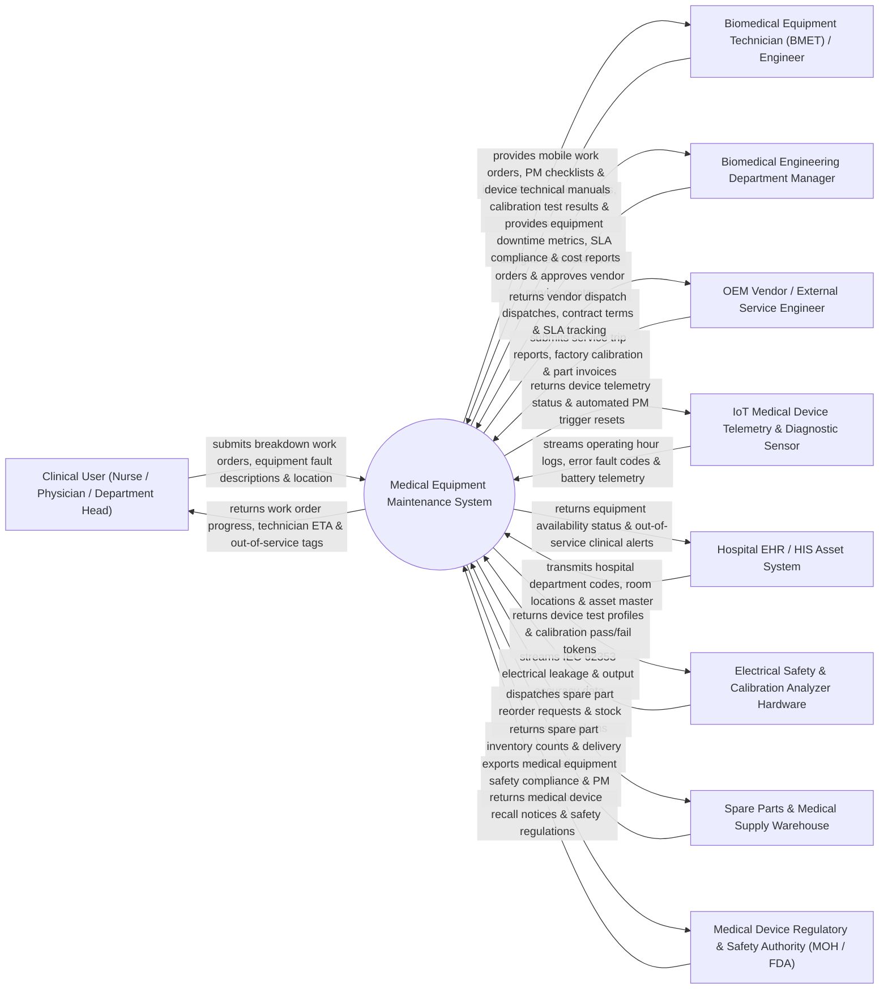

# Context Diagram — Medical Equipment Maintenance System

## Mermaid Code

## Actor & Interaction Table | Bảng Actor & Tương tác

| # | Actor | Actor Type | Data Sent TO System | Data Received FROM System | Notes |
|---|-------|------------|---------------------|---------------------------|-------|
| 1 | Clinical User (Nurse / Physician / Department Head) | Primary | Equipment breakdown reports, error messages, physical damage notes, equipment location pin. | Work order ticket numbers, technician arrival ETAs, digital "Out of Service" quarantine tags. | Hospital clinical staff operating medical devices in wards, operating rooms, and ICUs. |
| 2 | Biomedical Equipment Technician (BMET) / Engineer | Primary | Preventive maintenance (PM) completed checklists, labor hours, replacement parts used, calibration values. | Assigned work orders, mobile PM inspection checklists, device schematic manuals, history logs. | Certified biomedical engineer performing PM, repairs, calibration, and safety testing on medical devices. |
| 3 | Biomedical Engineering Department Manager | Primary | Work order assignments, technician shift rosters, external vendor quote approvals, asset retirement decisions. | Equipment downtime dashboards, mean time between failures (MTBF), SLA compliance, PM completion %. | Department manager overseeing hospital biomedical engineering operations and maintenance budgets. |
| 4 | OEM Vendor / External Service Engineer | Primary | Factory service reports, specialized calibration certificates, OEM part cost quotes, maintenance invoices. | Vendor dispatch tickets, contract terms, equipment maintenance history, SLA performance metrics. | Third-party equipment manufacturer (e.g., GE, Siemens, Philips) service engineer providing specialized repairs. |
| 5 | IoT Medical Device Telemetry & Diagnostic Sensor | Supporting System | Real-time device operating hours, error fault logs, battery health telemetry, environmental temperature. | Diagnostic telemetry query requests, automated PM trigger resets, operating hour benchmarks. | On-board IoT sensor streaming operating data from high-risk devices (Ventilators, Dialysis units, MRI). |
| 6 | Hospital EHR / HIS Asset System | Supporting System | Hospital department codes, room numbers, clinical asset master updates, patient usage schedules. | Real-time device operational status (In-Service, In-Maintenance, Quarantined), clinical safety alerts. | Enterprise hospital information system managing hospital facilities and clinical operations. |
| 7 | Electrical Safety & Calibration Analyzer Hardware | Supporting System | IEC 62353 electrical safety test results (chassis leakage current, protective earth resistance), accuracy output. | Device test profile parameters, calibration pass/fail status tokens. | Biomedical test equipment (e.g., Fluke Biomedical Analyzer) measuring electrical safety compliance. |
| 8 | Spare Parts & Medical Supply Warehouse | Supporting System | Spare part inventory stock levels, part location bin codes, order delivery status confirmations. | Spare part reorder requests, parts usage reservations, part issue logs. | Internal hospital warehouse managing replacement components (sensors, batteries, cables, filters). |
| 9 | Medical Device Regulatory & Safety Authority (MOH / FDA) | Regulatory | Medical device safety regulations, mandatory calibration standards, Class I/II/III device recall notices. | Annual PM compliance audit logs, high-risk equipment safety reports, recall execution proof. | Government health authority (e.g., MOH Vietnam, US FDA) enforcing biomedical device safety standards. |

## System Boundary Description | Mô tả Phạm vi Hệ thống

The **Medical Equipment Maintenance System (MEMS)** is an enterprise Computerized Maintenance Management System (CMMS) designed for hospital biomedical engineering departments, medical equipment service providers, and healthcare facilities. It manages the complete lifecycle of medical assets (High-risk life support to low-risk diagnostic devices), automates Preventive Maintenance (PM) schedules, dispatches breakdown Work Orders to BMET engineers, executes IEC 62353 electrical safety and calibration testing, tracks spare parts inventory, monitors OEM vendor Service Level Agreements (SLAs), and enforces FDA/MOH device recall compliance.

**Inside System Scope:**
- Medical asset inventory registry, QR/barcode tagging, and ECRI risk classification (High, Medium, Low Risk).
- Automated Preventive Maintenance (PM) scheduling based on calendar intervals (3, 6, 12 months) or IoT operating hours.
- Breakdown Corrective Work Order creation, BMET technician dispatching, and mobile work order completion.
- Electrical safety testing (IEC 62353 / NFPA 99) and output calibration certificate generation.
- Medical equipment spare parts inventory management, reorder points, and parts usage logging.
- OEM vendor Service Level Agreement (SLA) tracking, response time monitoring, and contract renewals.
- Medical device safety recall ingestion (FDA/MOH) and asset quarantine management.

**Outside System Scope:**
- Physical assembly and soldering of circuit boards inside broken devices (performed by BMET hands).
- Physical manufacturing of replacement medical spare parts (handled by equipment manufacturers).
- General non-medical building facility maintenance like HVAC or plumbing (handled by Facilities Management).
- Commercial corporate financial general ledger accounting (handled by enterprise ERP).
