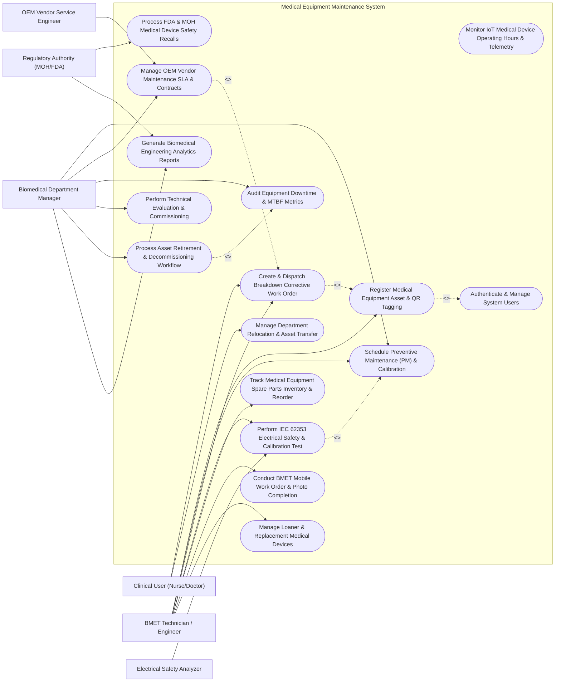

# Use Case Diagram — Medical Equipment Maintenance System

## Mermaid Code

## Actor Table | Bảng Actor

| # | Actor | Actor Type | Role Description | Related Use Cases |
|---|-------|------------|------------------|-------------------|
| 1 | Clinical User (Nurse/Doctor) | Primary | Nurse, physician, or ward manager reporting medical device faults, scanning QR tags, and tracking repair progress. | UC03, UC12 |
| 2 | BMET Technician / Engineer | Primary | Certified biomedical equipment technician executing PM inspections, repairing breakdowns, testing electrical safety, and managing parts. | UC01, UC02, UC03, UC04, UC07, UC13, UC14 |
| 3 | Biomedical Department Manager | Primary | Engineering manager assigning work orders, approving PM schedules, managing vendor SLAs, and auditing downtime/costs. | UC02, UC05, UC09, UC10, UC11, UC15 |
| 4 | OEM Vendor Service Engineer | Secondary / System | External service engineer (GE, Siemens, Philips) performing specialized repairs under SLA contracts. | UC05 |
| 5 | Regulatory Authority (MOH/FDA) | Secondary / Regulatory | Public health agency issuing device safety recalls, calibration standards, and inspecting hospital PM compliance. | UC08, UC15 |
| 6 | Electrical Safety Analyzer | Secondary / System | Connected biomedical analyzer measuring IEC 62353 chassis leakage currents and output calibration accuracy. | UC04 |

## Use Case Table | Bảng Use Case

| # | UC ID | Use Case Name | Primary Actor | Secondary Actor | Description | Priority |
|---|-------|---------------|---------------|-----------------|-------------|----------|
| 1 | UC01 | Register Medical Equipment Asset & QR Tagging | BMET Technician / Engineer | None | Intake new medical equipment, attach tamper-evident QR asset tag, assign ECRI risk category, and log warranty terms. | High |
| 2 | UC02 | Schedule Preventive Maintenance (PM) & Calibration | Biomedical Department Manager | BMET Technician / Engineer | Generate recurring PM schedules (3, 6, 12 months), assign PM inspection checklists, and track calibration due dates. | High |
| 3 | UC03 | Create & Dispatch Breakdown Corrective Work Order | Clinical User (Nurse/Doctor) | BMET Technician / Engineer | Report urgent device breakdown, tag out-of-service status, calculate priority tier (Priority 1 Life Support), and dispatch BMET. | High |
| 4 | UC04 | Perform IEC 62353 Electrical Safety & Calibration Test | BMET Technician / Engineer | Electrical Safety Analyzer | Execute electrical safety testing (earth resistance, leakage current) and output accuracy calibration, issuing certs. | High |
| 5 | UC05 | Manage OEM Vendor Maintenance SLA & Contracts | Biomedical Department Manager | OEM Vendor Service Engineer | Monitor vendor maintenance contracts (Full Service vs PM Only), track response SLA hours, and log external service reports. | High |
| 6 | UC06 | Monitor IoT Medical Device Operating Hours & Telemetry | BMET Technician / Engineer | None | Ingest IoT sensor telemetry (operating hours, battery health, error codes) to trigger usage-based PM inspection orders. | Medium |
| 7 | UC07 | Track Medical Equipment Spare Parts Inventory & Reorder | BMET Technician / Engineer | None | Manage biomedical spare parts (sensors, cables, batteries, filters), set reorder thresholds, and log parts used on work orders. | High |
| 8 | UC08 | Process FDA & MOH Medical Device Safety Recalls | Regulatory Authority (MOH/FDA) | None | Ingest Class I/II/III medical device recall notices, identify affected hospital assets, and quarantine recalled units. | High |
| 9 | UC09 | Audit Equipment Downtime & MTBF Metrics | Biomedical Department Manager | None | Calculate Mean Time Between Failures (MTBF), Mean Time to Repair (MTTR), total downtime hours, and equipment availability %. | Medium |
| 10 | UC10 | Perform Technical Evaluation & Commissioning | Biomedical Department Manager | None | Conduct pre-purchase technical evaluation, verify manufacturer specs, perform acceptance testing, and commission new assets. | Medium |
| 11 | UC11 | Process Asset Retirement & Decommissioning Workflow | Biomedical Department Manager | None | Evaluate unrepairable or end-of-life assets, calculate cumulative maintenance vs replacement cost, and authorize disposal. | Medium |
| 12 | UC12 | Manage Department Relocation & Asset Transfer | Clinical User (Nurse/Doctor) | None | Log equipment transfer between hospital wards (e.g., ICU to Emergency), updating GIS location maps and custody logs. | Medium |
| 13 | UC13 | Conduct BMET Mobile Work Order & Photo Completion | BMET Technician / Engineer | None | Complete work orders on mobile tablet: attach repair photos, log labor hours, capture digital signatures, and remove out-of-service tags. | High |
| 14 | UC14 | Manage Loaner & Replacement Medical Devices | BMET Technician / Engineer | None | Track temporary loaner equipment supplied during long-term repairs, logging loaner serial numbers and return due dates. | Medium |
| 15 | UC15 | Generate Biomedical Engineering Analytics Reports | Biomedical Department Manager | Regulatory Authority (MOH/FDA) | Render PM completion percentage, work order backlog, cost per asset, vendor SLA compliance, and regulatory compliance reports. | Medium |
| 16 | UC16 | Authenticate & Manage System Users | All Users | None | Enforce multi-factor authentication, role-based permissions (Nurse, BMET, Manager), and 21 CFR Part 11 audit trails. | High |

## Use Case Specification | Đặc tả Use Case

---

### UC01 — Register Medical Equipment Asset & QR Tagging

| Field | Detail |
|-------|--------|
| **UC ID** | UC01 |
| **Use Case Name** | Register Medical Equipment Asset & QR Tagging |
| **Actor(s)** | Primary: BMET Technician / Engineer |
| **Description** | Registers a newly acquired or transferred medical device into the master asset repository, assigning a unique QR Code Asset Tag, classifying ECRI Risk Category (High Risk / Life Support, Medium Risk, Low Risk), logging manufacturer specs, warranty terms, and initial location. |
| **Precondition** | 1. The medical equipment has passed initial technical acceptance testing.   2. Physical QR code barcode asset tags are available. |
| **Main Flow** | 1. The BMET opens "New Asset Registration" in the MEMS mobile app or desktop.   2. The BMET scans a physical QR Code Asset Tag (e.g., Asset QR: `EQ-2026-09812`).   3. The BMET enters Device Master Metadata: Equipment Name (e.g., Mechanical Ventilator), Manufacturer (e.g., Hamilton Medical), Model (e.g., C1), Serial Number (e.g., SN-881924), and Purchase Date.   4. The BMET selects **ECRI Risk Category**:   &nbsp;&nbsp;&nbsp;&nbsp;- **High Risk (Life Support / Critical)**: Ventilator, Defibrillator, Anesthesia Machine, Dialysis   &nbsp;&nbsp;&nbsp;&nbsp;- **Medium Risk (Diagnostic / Therapeutic)**: Patient Monitor, Infusion Pump, Ultrasound   &nbsp;&nbsp;&nbsp;&nbsp;- **Low Risk (General Medical)**: Examination Lamp, Medical Scale, Centrifuge.   5. The BMET assigns Hospital Department Location (e.g., ICU Ward 3, Room 302, Bed 04) and Warranty Expiration Date (e.g., 24 months out).   6. The System auto-generates the initial **Preventive Maintenance (PM) Profile** based on risk category (e.g., High Risk = 6-Month PM Interval).   7. The BMET affixes the physical QR tag to the device chassis, captures a photo of the installed tag, and saves the record. |
| **Alternative Flow** | **AF1** — Bulk Asset Intake via Purchase Order: The BMET imports a CSV/Excel file containing 50 new Infusion Pumps from a single purchase order; the System auto-generates sequential asset IDs and queues QR tag printing.   **AF2** — Software/Firmware Version Tracking: For software-driven imaging devices (CT/MRI), the BMET logs DICOM version and OS patch release numbers under the asset record. |
| **Exception Flow** | **EX1** — Duplicate Serial Number Alert: If the scanned Serial Number already exists in the system under another record, the System flags a "Duplicate Asset Alert" and prompts verification.   **EX2** — Missing Warranty / Vendor Data: If purchase warranty information is omitted, the System sets warranty status to "Unverified" and alerts the BMET Manager. |
| **Postcondition** | Device is registered with unique QR Asset Tag ID, ECRI Risk Category is assigned, PM frequency profile is attached, and asset status is "In-Service". |
| **Business Rule** | **BR1**: All Life Support / High Risk medical devices MUST be assigned a mandatory 6-month (or shorter) Preventive Maintenance inspection schedule.   **BR2**: Asset QR tags must be affixed to the front or side chassis of the medical device in an easily accessible, non-heated location. |

---

### UC02 — Schedule Preventive Maintenance (PM) & Calibration

| Field | Detail |
|-------|--------|
| **UC ID** | UC02 |
| **Use Case Name** | Schedule Preventive Maintenance (PM) & Calibration |
| **Actor(s)** | Primary: Biomedical Department Manager   Secondary: BMET Technician / Engineer |
| **Description** | Configures and executes automated recurring Preventive Maintenance (PM) inspection schedules (3, 6, 12 months) and output calibration tasks based on manufacturer service manuals, generating digital PM Work Orders and assigning inspection checklists to BMET engineers. |
| **Precondition** | 1. Medical equipment assets are registered with assigned PM profiles (UC01).   2. Standard PM inspection checklists are defined in the system. |
| **Main Flow** | 1. The System runs the automated daily PM Scheduler job.   2. The System queries all active assets where `Next PM Due Date <= Current Date + 14 Days`.   3. The System generates automated **PM Work Orders** (e.g., PM-2026-0412) for upcoming due assets (e.g., Anesthesia Machine EQ-2026-0041).   4. The System attaches the protocol-specific **PM Inspection Checklist**:   &nbsp;&nbsp;&nbsp;&nbsp;- [ ] Visual Inspection (Chassis, Power Cord, Gas Hoses)   &nbsp;&nbsp;&nbsp;&nbsp;- [ ] Battery Backup Operation Test (Run for 30 mins)   &nbsp;&nbsp;&nbsp;&nbsp;- [ ] Replace Air Intake Filter & O-Rings   &nbsp;&nbsp;&nbsp;&nbsp;- [ ] Vaporizer Output Concentration Calibration   &nbsp;&nbsp;&nbsp;&nbsp;- [ ] Perform IEC 62353 Electrical Safety Test (UC04).   5. The Manager reviews the generated PM queue and assigns PM Work Orders to specific BMET technicians based on specialty certification and workload.   6. The System dispatches PM Work Orders to the assigned BMET's mobile app.   7. The BMET performs the PM inspection, ticks off checklist items, logs replacement parts (UC07), and submits the completed PM log.   8. The System updates `Last PM Date = Current Date`, recalculates `Next PM Due Date = Current Date + 6 Months`, and issues a green PM Inspection Pass Sticker. |
| **Alternative Flow** | **AF1** — IoT Usage-Based PM Trigger: For high-use X-ray tubes or CT scanners, the IoT telemetry module (UC06) triggers a PM order when total exposure count reaches 10,000 shots, regardless of calendar date.   **AF2** — Vendor OEM Contracted PM Dispatch: For specialized devices under OEM contract (e.g., MRI magnet), the System dispatches the PM order payload directly to the OEM Vendor (UC05). |
| **Exception Flow** | **EX1** — Overdue PM Escalation (`Due Date Passed > 7 Days`): If a High Risk Life Support device's PM is overdue by > 7 days, the System flags "CRITICAL OVERDUE PM" and auto-issues an Out-of-Service quarantine tag.   **EX2** — Failed PM Inspection Component: If the device fails a critical PM checklist step (e.g., battery backup fails 30-min test), the System converts the PM order into a Breakdown Corrective Work Order (UC03). |
| **Postcondition** | PM Work Order is generated and completed, checklist items and calibration values are logged, and Next PM Due Date is recalculated. |
| **Business Rule** | **BR1**: High-risk life-support devices with overdue PM inspections > 14 days MUST be automatically tagged Out-of-Service until PM clearance is completed.   **BR2**: Completed PM records must archive original raw test measurements (leakage current, battery runtime, output pressure) for audit compliance. |

---

### UC03 — Create & Dispatch Breakdown Corrective Work Order

| Field | Detail |
|-------|--------|
| **UC ID** | UC03 |
| **Use Case Name** | Create & Dispatch Breakdown Corrective Work Order |
| **Actor(s)** | Primary: Clinical User (Nurse/Doctor)   Secondary: BMET Technician / Engineer |
| **Description** | Enables clinical ward users (nurses, physicians) to report medical device breakdowns by scanning the device QR code, specifying fault symptoms, placing the device in "Out of Service" quarantine, and triggering automated BMET technician dispatch based on priority. |
| **Precondition** | 1. A medical device experiences a malfunction, physical damage, or error code in a clinical ward.   2. The Clinical User has access to the MEMS mobile reporting portal or ward workstation. |
| **Main Flow** | 1. The Nurse scans the device's QR code (EQ-2026-09812) using a smartphone or ward tablet.   2. The System displays device details: Mechanical Ventilator - ICU Ward 3, Bed 04.   3. The Nurse inputs Fault Symptoms: "Device displaying Error Code E-04 (Low Airway Pressure Alarm), continuous alarm beep, not delivering target tidal volume".   4. The System evaluates **Priority Level**:   &nbsp;&nbsp;&nbsp;&nbsp;- **Priority 1 (Emergency - Life Support / ICU / OR)**: Immediate dispatch required (SLA <= 15 mins)   &nbsp;&nbsp;&nbsp;&nbsp;- **Priority 2 (Urgent - Ward Critical)**: Dispatch required (SLA <= 1 hour)   &nbsp;&nbsp;&nbsp;&nbsp;- **Priority 3 (Routine - Non-Critical)**: Dispatch required (SLA <= 4 hours).   5. The System assigns Priority 1, generates Breakdown Work Order `WO-2026-08192`, and sets device status to "Out of Service - Quarantined".   6. The System dispatches an urgent push notification and alarm to the duty BMET technician's mobile app.   7. The BMET acknowledges the dispatch, arrives at ICU Ward 3, performs troubleshooting, replaces faulty pressure transducer (UC07), and logs repair details.   8. The BMET executes post-repair calibration, removes the "Out of Service" tag, captures the Nurse's digital sign-off, and updates device status to "In-Service". |
| **Alternative Flow** | **AF1** — Automated IoT Fault Code Work Order: An IoT-connected hemodialysis machine detects an internal blood pump motor stall and auto-generates a Priority 1 Breakdown Work Order without nurse intervention.   **AF2** — Loaner Equipment Request during Repair: If the repair requires 3 days for parts delivery, the BMET issues a temporary Loaner Medical Device (UC14) to the ICU ward. |
| **Exception Flow** | **EX1** — BMET SLA Response Timeout: If no BMET acknowledges a Priority 1 work order within 15 minutes, the System escalates the alarm to the Biomedical Department Manager.   **EX2** — Unrepairable / OEM Vendor Escalation: If the BMET determines the motherboard is fried, the BMET escalates the work order to the OEM Vendor (UC05) under warranty. |
| **Postcondition** | Breakdown Work Order is created, device is quarantined Out-of-Service, BMET is dispatched within SLA, repair and calibration are logged, and device is restored to In-Service. |
| **Business Rule** | **BR1**: Priority 1 breakdown calls on Life Support devices MUST be acknowledged by a BMET within 15 minutes of work order creation.   **BR2**: Malfunctioning medical devices MUST be tagged with a physical/digital "Out of Service - Do Not Use" quarantine indicator until repair is certified. |

---

### UC04 — Perform IEC 62353 Electrical Safety & Calibration Test

| Field | Detail |
|-------|--------|
| **UC ID** | UC04 |
| **Use Case Name** | Perform IEC 62353 Electrical Safety & Calibration Test |
| **Actor(s)** | Primary: BMET Technician / Engineer   Secondary: Electrical Safety Analyzer |
| **Description** | Executes mandatory electrical safety testing (IEC 62353 / NFPA 99 standards) and physical output calibration (measuring chassis leakage currents, protective earth resistance, defibrillator joules, or ventilator pressure accuracy) using connected biomedical analyzer hardware, issuing a digital Safety & Calibration Certificate. |
| **Precondition** | 1. The medical device has undergone PM or breakdown repair (UC02 / UC03).   2. A calibrated Electrical Safety Analyzer (e.g., Fluke ESA615) is connected. |
| **Main Flow** | 1. The BMET connects the medical device (e.g., Defibrillator EQ-2026-0031) to the Electrical Safety Analyzer hardware.   2. The BMET opens "Safety & Calibration Module" on the MEMS app and selects test standard **IEC 62353 (Medical Electrical Equipment Recurrent Test)**.   3. The System executes **Electrical Safety Test Sequence**:   &nbsp;&nbsp;&nbsp;&nbsp;- **Protective Earth Resistance**: Measured 0.08 Ω (Limit <= 0.20 Ω -> PASS)   &nbsp;&nbsp;&nbsp;&nbsp;- **Equipment Leakage Current (Direct Method)**: Measured 42 μA (Limit <= 500 μA -> PASS)   &nbsp;&nbsp;&nbsp;&nbsp;- **Applied Part Leakage Current (CF Type)**: Measured 8 μA (Limit <= 50 μA -> PASS)   &nbsp;&nbsp;&nbsp;&nbsp;- **Insulation Resistance**: Measured 85 MΩ (Limit >= 2 MΩ -> PASS).   4. The BMET connects the Output Calibration Energy Meter to test Defibrillator Energy Discharge:   &nbsp;&nbsp;&nbsp;&nbsp;- Target 200 Joules -> Delivered 198 Joules (Accuracy -1.0% -> PASS).   5. The System aggregates test measurements from the analyzer hardware.   6. The System evaluates overall test status: **PASSED (100% Parameter Compliance)**.   7. The System generates an official **Safety & Calibration Certificate** (Cert ID: `CERT-2026-04192`) with digital signature.   8. The BMET affixes a green "CALIBRATED & SAFETY PASSED" sticker with certificate QR code onto the medical device. |
| **Alternative Flow** | **AF1** — Manual Test Entry (Non-Connected Analyzer): If using a manual analog analyzer, the BMET manually types measured leakage currents and resistance values into the mobile app form.   **AF2** — Gas Flow & Pressure Calibration for Ventilators: The BMET connects a Digital Gas Flow Analyzer (e.g., VT650) to measure Tidal Volume accuracy (500 mL ± 10 mL) and PEEP pressure calibration. |
| **Exception Flow** | **EX1** — Electrical Leakage Current Failure (`Leakage > 500 μA`): If chassis leakage current exceeds 500 μA, the System logs "FAILED ELECTRICAL SAFETY", blocks device activation, and orders power supply insulation replacement.   **EX2** — Defibrillator Energy Discharge Out-of-Tolerance: If delivered energy is 160J for a 200J setting (> 15% error), the System flags "Calibrator Out-of-Tolerance" and quaratines the unit. |
| **Postcondition** | IEC 62353 electrical safety and output calibration test measurements are saved, Safety & Calibration Certificate is issued, and device is cleared for clinical use. |
| **Business Rule** | **BR1**: Medical equipment failing IEC 62353 electrical safety testing MUST NOT be returned to clinical service under any circumstances until repaired and re-tested.   **BR2**: Calibration test equipment used by BMET engineers must itself possess an active, unexpired calibration certificate traceable to national standards. |

---

### UC05 — Manage OEM Vendor Maintenance SLA & Contracts

| Field | Detail |
|-------|--------|
| **UC ID** | UC05 |
| **Use Case Name** | Manage OEM Vendor Maintenance SLA & Contracts |
| **Actor(s)** | Primary: Biomedical Department Manager   Secondary: OEM Vendor Service Engineer |
| **Description** | Manages third-party equipment maintenance contracts (Full Comprehensive, PM Only, Labor Only) with Original Equipment Manufacturers (OEM e.g., GE, Siemens, Philips), monitoring vendor response SLA performance, dispatching vendor work orders, and approving service invoices. |
| **Precondition** | 1. High-tech medical equipment (CT, MRI, Cath Lab, Linear Accelerator) is under vendor contract.   2. Vendor contract terms and SLA response hours are configured in MEMS. |
| **Main Flow** | 1. The Manager opens "OEM Vendor Contract Management" and selects vendor (e.g., Siemens Healthineers).   2. The System displays active Contract Details: Contract # `CTR-2025-SIEMENS-01`, Scope: Comprehensive Maintenance for SOMATOM CT Scanner, Response SLA: 2 Hours On-Site, Guaranteed Uptime: 95%, Expiry: Dec 31, 2026.   3. When a complex CT scanner tube error occurs, the System dispatches an electronic **Vendor Work Order Dispatch** payload to Siemens Support.   4. The System starts the **Vendor Response SLA Timer** (Target <= 2 hours).   5. The Siemens OEM Service Engineer arrives on site 1 hour 15 mins later (SLA Met) and logs arrival via vendor portal.   6. The OEM Engineer replaces the X-ray tube, conducts factory calibration, and uploads the **Service Field Report (FSR)** and Calibration Certificate.   7. The Manager reviews the FSR, verifies total downtime (4.5 hours), checks that repair is covered 100% under Comprehensive Contract, and signs the vendor service completion ticket.   8. The System updates Siemens' quarterly **Vendor SLA Performance Index** (On-Time Response: 98%, Guaranteed Uptime Achieved: 97.2%). |
| **Alternative Flow** | **AF1** — Non-Contract Time & Materials (T&M) Repair Quote: For an out-of-warranty device, the vendor submits a T&M repair price quote ($8,500 for replacement laser diode); the Manager reviews and approves the quote before work begins.   **AF2** — Penalty Calculation for Uptime Guarantee Breach: If annual CT scanner uptime drops to 91% (violating 95% SLA guarantee), the System automatically calculates contract penalty deductions for the next billing cycle. |
| **Exception Flow** | **EX1** — Vendor SLA Response Time Breach (`Response > 2 Hours`): If the vendor arrives 5 hours after dispatch, the System flags "SLA RESPONSE BREACH", deducting SLA penalty points from vendor performance rating.   **EX2** — Contract Expiration Warning (30 Days Out): The System alerts the Manager 30 days prior to contract expiration, prompting contract renewal negotiation or competitive bidding. |
| **Postcondition** | Vendor work order is dispatched, response SLA is tracked, OEM service report is verified and archived, and vendor performance metrics are updated. |
| **Business Rule** | **BR1**: External vendor service reports (FSR) MUST be uploaded and approved by the hospital Biomedical Manager before vendor invoice payment authorization.   **BR2**: High-value imaging equipment (CT/MRI) contracts must include guaranteed uptime clauses (minimum 95% annual uptime) with financial penalty enforcement. |
