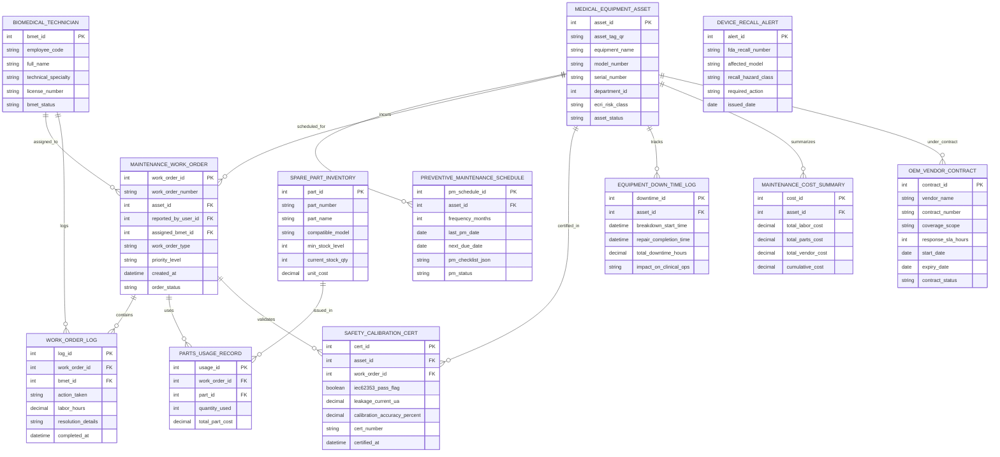

# Conceptual ERD — Medical Equipment Maintenance System

## Mermaid Code

## Entity Description Table | Bảng mô tả Entity

| # | Entity Name | Vietnamese Name | Description | Key Attributes | Main Relationships |
|---|-------------|-----------------|-------------|----------------|-------------------|
| 1 | MEDICAL_EQUIPMENT_ASSET | Thiết bị Y tế Master | Master medical device asset record storing QR tag ID, equipment name, model, serial number, ECRI risk category, and status. | asset_id, asset_tag_qr, equipment_name, model_number, serial_number, ecri_risk_class, asset_status | Has many PREVENTIVE_MAINTENANCE_SCHEDULE, MAINTENANCE_WORK_ORDER, SAFETY_CALIBRATION_CERT, etc. |
| 2 | BIOMEDICAL_TECHNICIAN | Kỹ sư Kỹ thuật Sinh học | Certified BMET engineer profile storing employee code, full name, technical specialty (Imaging, Life Support), and license number. | bmet_id, employee_code, full_name, technical_specialty, license_number, bmet_status | Has many MAINTENANCE_WORK_ORDER and WORK_ORDER_LOG entities. |
| 3 | PREVENTIVE_MAINTENANCE_SCHEDULE | Lịch Bảo trì Định kỳ (PM) | PM schedule definition tracking PM frequency (3, 6, 12 months), last PM date, next due date, PM checklist JSON, and status. | pm_schedule_id, asset_id, frequency_months, last_pm_date, next_due_date, pm_status | Belongs to MEDICAL_EQUIPMENT_ASSET. |
| 4 | MAINTENANCE_WORK_ORDER | Phiếu Yêu cầu Bảo trì (WO) | Maintenance work order tracking order number, asset ID, reported user ID, assigned BMET ID, WO type (Breakdown, PM), priority, and status. | work_order_id, work_order_number, asset_id, assigned_bmet_id, work_order_type, priority_level, order_status | Belongs to MEDICAL_EQUIPMENT_ASSET and BIOMEDICAL_TECHNICIAN; Has WORK_ORDER_LOG, PARTS_USAGE_RECORD, etc. |
| 5 | WORK_ORDER_LOG | Nhật ký Thực hiện Bảo trì | Work order execution log documenting BMET action taken, labor hours spent, technical resolution details, and completion timestamp. | log_id, work_order_id, bmet_id, action_taken, labor_hours, resolution_details, completed_at | Belongs to MAINTENANCE_WORK_ORDER and BIOMEDICAL_TECHNICIAN. |
| 6 | SAFETY_CALIBRATION_CERT | Chứng nhận An toàn & Hiệu chuẩn | IEC 62353 electrical safety and calibration certificate storing pass/fail flag, chassis leakage current, accuracy %, and cert number. | cert_id, asset_id, work_order_id, iec62353_pass_flag, leakage_current_ua, calibration_accuracy_percent, cert_number | Belongs to MEDICAL_EQUIPMENT_ASSET and MAINTENANCE_WORK_ORDER. |
| 7 | SPARE_PART_INVENTORY | Kho Phụ tùng Linh kiện | Biomedical spare part inventory record tracking part number, part name, compatible models, min stock level, current quantity, and unit cost. | part_id, part_number, part_name, compatible_model, min_stock_level, current_stock_qty, unit_cost | Has many PARTS_USAGE_RECORD entities. |
| 8 | PARTS_USAGE_RECORD | Nhật ký Sử dụng Phụ tùng | Record tracking replacement spare parts used on specific work orders, quantity used, and total part cost. | usage_id, work_order_id, part_id, quantity_used, total_part_cost | Belongs to MAINTENANCE_WORK_ORDER and SPARE_PART_INVENTORY. |
| 9 | OEM_VENDOR_CONTRACT | Hợp đồng Hãng Bảo trì | OEM vendor maintenance SLA contract record tracking vendor name, contract number, coverage scope, response SLA hours, and expiration. | contract_id, vendor_name, contract_number, coverage_scope, response_sla_hours, expiry_date, contract_status | Belongs to MEDICAL_EQUIPMENT_ASSET. |
| 10 | DEVICE_RECALL_ALERT | Cảnh báo Thu hồi Thiết bị | Regulatory medical device recall notice tracking FDA/MOH recall number, affected model, hazard class, required action, and issue date. | alert_id, fda_recall_number, affected_model, recall_hazard_class, required_action, issued_date | Standalone regulatory alert entity linked to affected models. |
| 11 | EQUIPMENT_DOWN_TIME_LOG | Nhật ký Thời gian Ngừng hoạt động | Equipment operational downtime log recording breakdown start time, repair completion time, total downtime hours, and clinical impact. | downtime_id, asset_id, breakdown_start_time, repair_completion_time, total_downtime_hours, impact_on_clinical_ops | Belongs to MEDICAL_EQUIPMENT_ASSET. |
| 12 | MAINTENANCE_COST_SUMMARY | Tổng hợp Chi phí Bảo trì | Cumulative financial maintenance cost summary tracking total labor cost, parts cost, OEM vendor cost, and cumulative lifecycle cost per asset. | cost_id, asset_id, total_labor_cost, total_parts_cost, total_vendor_cost, cumulative_cost | Belongs to MEDICAL_EQUIPMENT_ASSET. |

## Relationship Description | Mô tả Quan hệ

| # | From Entity | Cardinality | To Entity | Relationship Label | Business Explanation |
|---|-------------|-------------|-----------|-------------------|----------------------|
| 1 | MEDICAL_EQUIPMENT_ASSET | one-to-many | PREVENTIVE_MAINTENANCE_SCHEDULE | scheduled_for | One medical device asset is scheduled for recurring PM inspections. |
| 2 | MEDICAL_EQUIPMENT_ASSET | one-to-many | MAINTENANCE_WORK_ORDER | incurs | One medical device asset incurs multiple breakdown or PM work orders. |
| 3 | MEDICAL_EQUIPMENT_ASSET | one-to-many | SAFETY_CALIBRATION_CERT | certified_in | One medical device asset is certified in IEC 62353 safety and calibration tests. |
| 4 | MEDICAL_EQUIPMENT_ASSET | one-to-many | EQUIPMENT_DOWN_TIME_LOG | tracks | One medical device asset tracks breakdown operational downtime hours. |
| 5 | MEDICAL_EQUIPMENT_ASSET | one-to-one | MAINTENANCE_COST_SUMMARY | summarizes | One medical device asset summarizes cumulative lifecycle maintenance costs. |
| 6 | BIOMEDICAL_TECHNICIAN | one-to-many | MAINTENANCE_WORK_ORDER | assigned_to | One BMET engineer is assigned to resolve maintenance work orders. |
| 7 | BIOMEDICAL_TECHNICIAN | one-to-many | WORK_ORDER_LOG | logs | One BMET engineer logs technical repair actions and labor hours. |
| 8 | MAINTENANCE_WORK_ORDER | one-to-many | WORK_ORDER_LOG | contains | One work order contains one or more technical repair execution logs. |
| 9 | MAINTENANCE_WORK_ORDER | one-to-many | PARTS_USAGE_RECORD | uses | One work order uses replacement spare parts from warehouse inventory. |
| 10 | MAINTENANCE_WORK_ORDER | one-to-many | SAFETY_CALIBRATION_CERT | validates | One completed work order validates electrical safety and calibration certificates. |
| 11 | SPARE_PART_INVENTORY | one-to-many | PARTS_USAGE_RECORD | issued_in | One spare part item is issued in multiple work order repair records. |
| 12 | MEDICAL_EQUIPMENT_ASSET | one-to-many | OEM_VENDOR_CONTRACT | under_contract | One high-tech medical device asset is under OEM vendor maintenance SLA contracts. |
