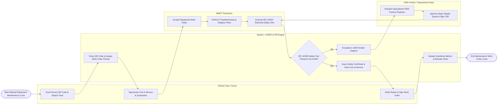

# Swimlane Diagram — Medical Equipment Maintenance System

## Mermaid Code

## Flow Description | Mô tả luồng

| Lane | Actor / Subsystem | Role in Flow |
|------|-------------------|--------------|
| 1 | Clinical User / Nurse | Scans broken medical device QR code, reports fault symptoms, tags the device Out-of-Service, and verifies/signs the work order upon repair completion. |
| 2 | BMET Technician | Receives dispatched work order, troubleshoots malfunction, replaces faulty spare parts, performs post-repair IEC 62353 electrical safety and calibration testing, and logs labor. |
| 3 | System / CMMS & PM Engine | Parses device QR tags, assigns work order priority tiers (Priority 1 Life Support), evaluates electrical safety pass/fail tokens, updates asset downtime metrics, and triggers spare part reorders. |
| 4 | OEM Vendor / Department Head | Receives escalated complex repairs, dispatches factory-certified OEM service engineers, evaluates major component replacement quotes, and approves Field Service Reports (FSR). |
