# Action Tree — Medical Equipment Maintenance System

## Mermaid Code

```mermaid
graph TD
    Root["Medical Equipment Maintenance System"]

    Root --> M1["Asset Registration & QR Lifecycle"]
    Root --> M2["Preventive Maintenance & Calibration"]
    Root --> M3["Breakdown Work Orders & Dispatch"]
    Root --> M4["Electrical Safety & Testing"]
    Root --> M5["Spare Parts Inventory Control"]
    Root --> M6["OEM Vendor SLA & Contracts"]
    Root --> M7["Device Safety Recalls & Quarantine"]
    Root --> M8["Downtime & Reliability Analytics"]

    M1 --> A11["Scan QR Asset Tag & Intake Metadata"]
    M1 --> A12["Classify ECRI High Medium Risk Category"]
    M1 --> A13["Attach Warranty & Purchase Invoice"]
    M1 --> A14["Commission New Asset to Clinical Ward"]

    M2 --> A21["Generate Recurring PM Inspection Queue"]
    M2 --> A22["Execute Device PM Verification Checklist"]
    M2 --> A23["Recalculate Next PM Due Expiration Date"]
    M2 --> A24["Issue Green PM Inspection Pass Sticker"]

    M3 --> A31["Scan QR Tag to Report Ward Fault"]
    M3 --> A32["Assign Priority 1 Life Support SLA Tier"]
    M3 --> A33["Tag Device Out-of-Service Quarantine"]
    M3 --> A34["Complete Mobile BMET Repair Log & Photo"]

    M4 --> A41["Execute IEC 62353 Electrical Leakage Test"]
    M4 --> A42["Measure Earth Resistance & Insulation"]
    M4 --> A43["Calibrate Output Energy & Pressure Accuracy"]
    M4 --> A44["Generate Digital Safety Calibration Cert"]

    M5 --> A51["Track Spare Part Stock & Bin Location"]
    M5 --> A52["Log Part Serial Usage on Work Orders"]
    M5 --> A53["Auto-Trigger Reorder Point Thresholds"]
    M5 --> A54["Audit Part Inventory Cost Expenditure"]

    M6 --> A61["Dispatch Work Orders to OEM Vendors"]
    M6 --> A62["Monitor Vendor 2-Hour Response SLA"]
    M6 --> A63["Verify Field Service Reports & FSR Invoices"]
    M6 --> A64["Track Guaranteed Uptime Penalty Clauses"]

    M7 --> A71["Ingest FDA & MOH Device Safety Alerts"]
    M7 --> A72["Cross-Match Recalled Model Serial Numbers"]
    M7 --> A73["Enforce Immediate Asset Quarantine Flag"]
    M7 --> A74["Document Recall Corrective Modification"]

    M8 --> A81["Calculate Equipment Downtime Hours"]
    M8 --> A82["Audit Mean Time Between Failures MTBF"]
    M8 --> A83["Calculate PM Completion Compliance %"]
    M8 --> A84["Export Cumulative Maintenance Lifecycle Cost"]
```

## Module Description | Mô tả Module

| # | Module | Description | Actions |
|---|--------|-------------|---------|
| 1 | Asset Registration & QR Lifecycle | Intakes new medical devices, affixes QR asset tags, classifies ECRI risk categories (High, Medium, Low Risk), and commissions assets. | Scan QR Asset Tag & Intake Metadata, Classify ECRI High Medium Risk Category, Attach Warranty & Purchase Invoice, Commission New Asset to Clinical Ward |
| 2 | Preventive Maintenance & Calibration | Generates recurring PM queues (3, 6, 12 months), executes PM inspection checklists, recalculates next due dates, and issues PM pass stickers. | Generate Recurring PM Inspection Queue, Execute Device PM Verification Checklist, Recalculate Next PM Due Expiration Date, Issue Green PM Inspection Pass Sticker |
| 3 | Breakdown Work Orders & Dispatch | Ingests ward breakdown fault reports via QR scan, assigns Priority 1 SLAs, tags devices Out-of-Service, and logs BMET mobile repairs. | Scan QR Tag to Report Ward Fault, Assign Priority 1 Life Support SLA Tier, Tag Device Out-of-Service Quarantine, Complete Mobile BMET Repair Log & Photo |
| 4 | Electrical Safety & Testing | Executes IEC 62353 electrical leakage and earth resistance tests, calibrates output energy/pressure, and issues digital safety certificates. | Execute IEC 62353 Electrical Leakage Test, Measure Earth Resistance & Insulation, Calibrate Output Energy & Pressure Accuracy, Generate Digital Safety Calibration Cert |
| 5 | Spare Parts Inventory Control | Manages biomedical replacement parts, logs parts used on work orders, auto-triggers reorder points, and audits spare parts expenditure. | Track Spare Part Stock & Bin Location, Log Part Serial Usage on Work Orders, Auto-Trigger Reorder Point Thresholds, Audit Part Inventory Cost Expenditure |
| 6 | OEM Vendor SLA & Contracts | Dispatches work orders to OEM vendors (GE, Siemens, Philips), tracks 2-hour response SLAs, verifies Field Service Reports, and audits uptime guarantees. | Dispatch Work Orders to OEM Vendors, Monitor Vendor 2-Hour Response SLA, Verify Field Service Reports & FSR Invoices, Track Guaranteed Uptime Penalty Clauses |
| 7 | Device Safety Recalls & Quarantine | Ingests FDA and MOH device safety recall alerts, cross-matches serial numbers, enforces asset quarantines, and logs recall modifications. | Ingest FDA & MOH Device Safety Alerts, Cross-Match Recalled Model Serial Numbers, Enforce Immediate Asset Quarantine Flag, Document Recall Corrective Modification |
| 8 | Downtime & Reliability Analytics | Calculates total equipment downtime hours, audits MTBF and MTTR reliability metrics, tracks PM compliance %, and exports lifecycle costs. | Calculate Equipment Downtime Hours, Audit Mean Time Between Failures MTBF, Calculate PM Completion Compliance %, Export Cumulative Maintenance Lifecycle Cost |
