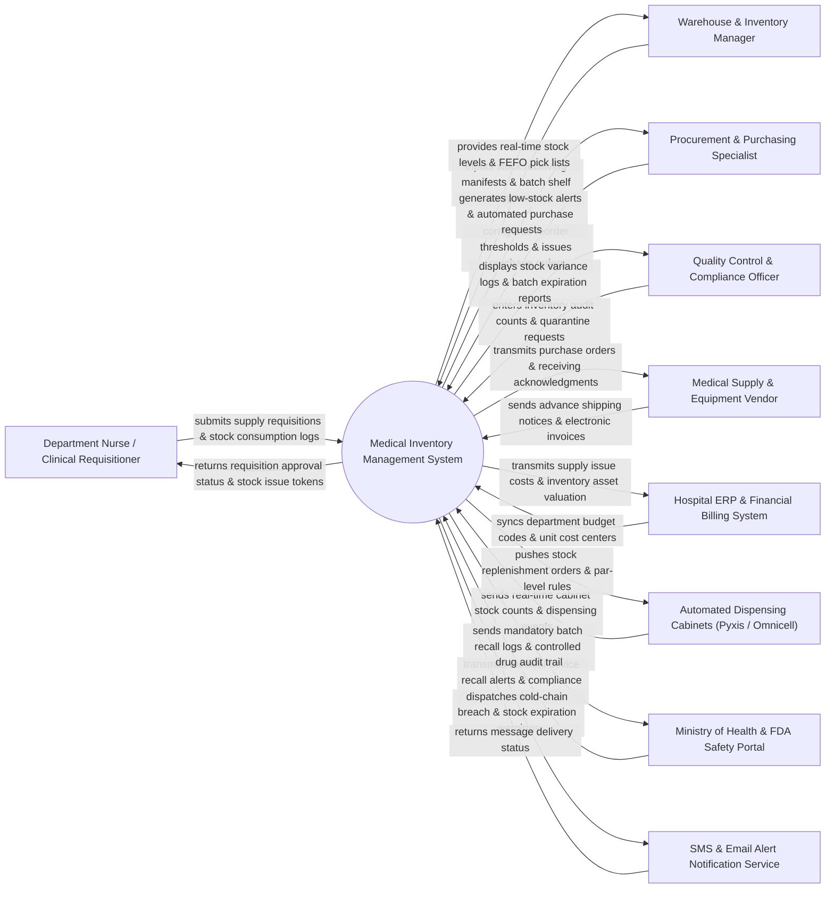

# Context Diagram — Medical Inventory Management System

## Mermaid Code

## Actor & Interaction Table | Bảng Actor & Tương tác

| # | Actor | Actor Type | Data Sent TO System | Data Received FROM System | Notes |
|---|-------|------------|---------------------|---------------------------|-------|
| 1 | Department Nurse / Clinical Requisitioner | Primary | Material supply requisitions, clinical consumption logs, emergency stock requests, returned item logs. | Requisition approval status, stock issuance tokens, item availability status, order tracking. | Clinical hospital staff requesting medical supplies, surgical kits, and consumables for ward/operating room use. |
| 2 | Warehouse & Inventory Manager | Primary | Receiving inspection logs, batch bin/shelf assignments, physical stock counts, stock movement confirmations. | Real-time warehouse inventory counts, FEFO picking lists, low-stock warnings, expired unit alerts. | Inventory personnel managing central medical warehouse operations, storage locations, and goods dispatches. |
| 3 | Procurement & Purchasing Specialist | Primary | Reorder point configurations, supplier contract terms, purchase order approvals, vendor evaluation scores. | Automated purchase requisitions, low-stock reorder suggestions, supplier performance analytics, PO status updates. | Purchasing staff responsible for vendor sourcing, order placement, and inventory replenishment planning. |
| 4 | Quality Control & Compliance Officer | Primary | Physical inventory audit counts, batch quarantine orders, temperature/humidity storage logs, inspection notes. | Stock discrepancy reports, batch traceability records, quarantine status summaries, compliance audit trails. | Quality assurance specialist enforcing storage standards, regulatory compliance, and inventory accuracy. |
| 5 | Medical Supply & Equipment Vendor | External / Supporting | Advance Shipping Notices (ASN), catalog updates, electronic invoices, lot/batch quality certificates. | Transmitted purchase orders, delivery receipt acknowledgments, stock return notices, payment clearing tokens. | Commercial suppliers providing pharmaceuticals, medical devices, PPE, surgical tools, and laboratory consumables. |
| 6 | Hospital ERP & Financial Billing System | Supporting System | Department budget codes, cost center allocations, chart of accounts mappings, fiscal period rules. | Inventory asset valuation metrics, department consumption costs, billable patient supply entries, PO invoice matching data. | Enterprise hospital management software tracking financial accounting, general ledger, and patient billing. |
| 7 | Automated Dispensing Cabinets (Pyxis / Omnicell) | Supporting System | Real-time cabinet stock counts, drawer opening events, patient supply transaction logs, cabinet stock par-levels. | Stock replenishment orders, item master data sync, batch expiration metadata, par-level configuration updates. | Point-of-use smart cabinet systems installed in ICUs, emergency rooms, and surgical suites for automated medication/supply access. |
| 8 | Ministry of Health & FDA Safety Portal | Regulatory | Medical device recall alerts, pharmaceutical safety advisories, national regulatory compliance guidelines. | Mandatory batch recall execution reports, controlled substance consumption audit logs, regulatory compliance metrics. | Governmental health authority regulating medical devices, drug safety, controlled substance tracking, and product recalls. |
| 9 | SMS & Email Alert Notification Service | Supporting System | Delivery status receipts, SMS transmission logs, email bounce notifications. | Emergency low-stock alerts, cold-chain temperature breach warnings, critical batch expiration notices. | Third-party alert dispatch system broadcasting high-priority warnings to warehouse and clinical managers. |

## System Boundary Description | Mô tả Phạm vi Hệ thống

The **Medical Inventory Management System** is a domain-specific enterprise inventory platform designed to handle the end-to-end operational lifecycle of medical supplies, surgical instruments, pharmaceuticals, laboratory reagents, PPE, and medical devices within a healthcare facility. It manages catalog master data, batch lot and expiration tracking following First-Expired, First-Out (FEFO) principles, multi-location storage bin management, automated purchasing reorders, department supply dispatches, physical stock auditing, temperature-sensitive cold chain monitoring, and regulatory recall quarantines.

**Inside System Scope:**
- Central medical warehouse and decentralized point-of-use inventory location management.
- Batch lot, barcode/RFID tag, and expiration date tracking enforced via FEFO algorithms.
- Department supply requisition workflows, approval chains, stock picking, and issue dispatches.
- Automated reorder calculations based on minimum/maximum stock thresholds and lead times.
- Quality control receiving inspections, supplier performance evaluation, and defect return processing.
- Immediate quarantine management and automated tracing for FDA/MOH medical product recalls.
- Audit trail reporting for controlled substances and high-value medical devices.

**Outside System Scope:**
- Physical transport of supplies between warehouse and clinical wards (handled by hospital logistics staff).
- Financial ledger posting, cash disbursement, and vendor bank transfers (delegated to Hospital ERP).
- Clinical administration of medications and consumables to individual patients at bedside (handled by EHR/E-Prescribing).
- Physical maintenance and mechanical repair of medical machinery (handled by Biomedical Engineering systems).
