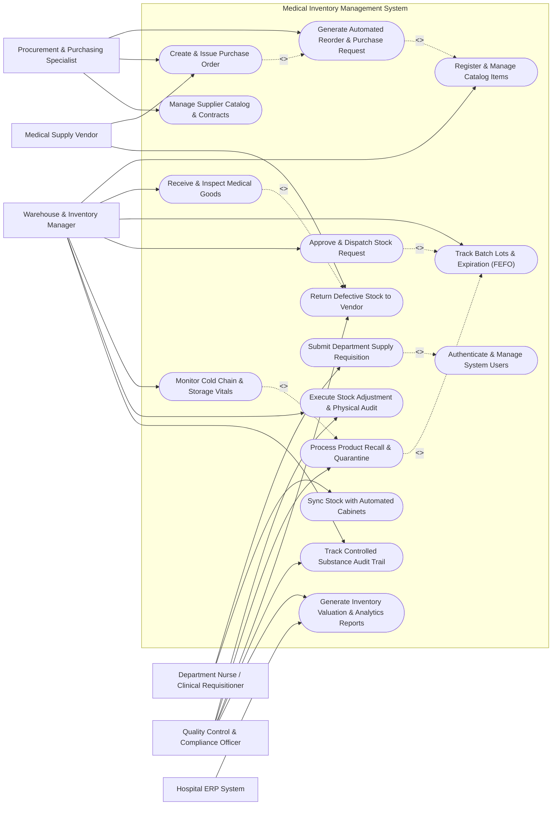

# Use Case Diagram — Medical Inventory Management System

## Mermaid Code

## Actor Table | Bảng Actor

| # | Actor | Actor Type | Role Description | Related Use Cases |
|---|-------|------------|------------------|-------------------|
| 1 | Department Nurse / Clinical Requisitioner | Primary | Clinical staff member requesting consumables, surgical supplies, and pharmaceuticals for specific hospital wards or units. | UC04, UC12, UC16 |
| 2 | Warehouse & Inventory Manager | Primary | Warehouse operational leader overseeing stock receiving, bin placement, picking, stock dispatches, and storage conditions. | UC01, UC02, UC03, UC05, UC06, UC07, UC13 |
| 3 | Procurement & Purchasing Specialist | Primary | Purchasing officer responsible for evaluating stock replenishment triggers, managing supplier contracts, and issuing purchase orders. | UC08, UC09, UC14 |
| 4 | Quality Control & Compliance Officer | Primary | Compliance expert monitoring safety recalls, conducting inventory audits, supervising controlled substances, and filing quality reports. | UC07, UC10, UC11, UC13, UC15 |
| 5 | Medical Supply Vendor | Secondary / External | Commercial supplier delivering ordered goods, providing shipping manifests, and accepting product returns. | UC09, UC11 |
| 6 | Hospital ERP System | Secondary / System | External enterprise resource planning platform integrating cost centers, budget approvals, and financial ledger data. | UC15 |

## Use Case Table | Bảng Use Case

| # | UC ID | Use Case Name | Primary Actor | Secondary Actor | Description | Priority |
|---|-------|---------------|---------------|-----------------|-------------|----------|
| 1 | UC01 | Register & Manage Catalog Items | Warehouse & Inventory Manager | None | Create, update, and maintain master catalog records for medical supplies, pharmaceuticals, and equipment. | High |
| 2 | UC02 | Receive & Inspect Medical Goods | Warehouse & Inventory Manager | Medical Supply Vendor | Record incoming shipments against purchase orders, verify quantities, batch details, and inspection results. | High |
| 3 | UC03 | Track Batch Lots & Expiration (FEFO) | Warehouse & Inventory Manager | None | Track item lot numbers, manufacture/expiration dates, and enforce First-Expired, First-Out picking logic. | High |
| 4 | UC04 | Submit Department Supply Requisition | Department Nurse / Clinical Requisitioner | None | Submit formal request for medical supplies and consumables needed for clinical unit operations. | High |
| 5 | UC05 | Approve & Dispatch Stock Request | Warehouse & Inventory Manager | Department Nurse / Clinical Requisitioner | Review requested supply requisitions, pick stock from designated bins using FEFO, and issue dispatch tokens. | High |
| 6 | UC06 | Monitor Cold Chain & Storage Vitals | Warehouse & Inventory Manager | None | Track temperature and humidity sensors in cold storage rooms and refrigerators to ensure compliance. | High |
| 7 | UC07 | Execute Stock Adjustment & Physical Audit | Quality Control & Compliance Officer | Warehouse & Inventory Manager | Perform cycle counts, record physical stock variances, log spoilage, and update inventory balances. | Medium |
| 8 | UC08 | Generate Automated Reorder & Purchase Request | Procurement & Purchasing Specialist | None | Evaluate current inventory against minimum stock levels and automatically create purchase requests. | High |
| 9 | UC09 | Create & Issue Purchase Order | Procurement & Purchasing Specialist | Medical Supply Vendor | Convert purchase requests into vendor purchase orders, route for budget approval, and transmit to suppliers. | High |
| 10 | UC10 | Process Product Recall & Quarantine | Quality Control & Compliance Officer | Warehouse & Inventory Manager | Identify affected batch lots following manufacturer or FDA recalls and move stock to locked quarantine storage. | High |
| 11 | UC11 | Return Defective Stock to Vendor | Quality Control & Compliance Officer | Medical Supply Vendor | Initiate return documentation for damaged, expired, or failed-inspection medical supplies. | Medium |
| 12 | UC12 | Sync Stock with Automated Cabinets | Department Nurse / Clinical Requisitioner | None | Synchronize stock levels, par levels, and consumption logs with point-of-use smart dispensing cabinets. | Medium |
| 13 | UC13 | Track Controlled Substance Audit Trail | Quality Control & Compliance Officer | Warehouse & Inventory Manager | Maintain dual-signature chain-of-custody logs and usage tracking for narcotic and controlled pharmaceuticals. | High |
| 14 | UC14 | Manage Supplier Catalog & Contracts | Procurement & Purchasing Specialist | Medical Supply Vendor | Store vendor lead times, contract pricing, unit conversion ratios, and compliance certificates. | Medium |
| 15 | UC15 | Generate Inventory Valuation & Analytics Reports | Quality Control & Compliance Officer | Hospital ERP System | Produce stock turnover, inventory asset valuation, obsolescence cost, and consumption trend reports. | Medium |
| 16 | UC16 | Authenticate & Manage System Users | All Users | None | Authenticate user credentials, enforce role-based permissions, and log access activity. | High |

## Use Case Specification | Đặc tả Use Case

---

### UC02 — Receive & Inspect Medical Goods

| Field | Detail |
|-------|--------|
| **UC ID** | UC02 |
| **Use Case Name** | Receive & Inspect Medical Goods |
| **Actor(s)** | Primary: Warehouse & Inventory Manager   Secondary: Medical Supply Vendor |
| **Description** | Allows warehouse staff to process incoming medical supply shipments against open purchase orders, inspect physical goods for damage/cold-chain integrity, verify batch numbers and expiration dates, and register accepted stock into warehouse locations. |
| **Precondition** | 1. The Warehouse Manager is authenticated into the system with Inventory Receiving privileges.   2. An active, approved Purchase Order (PO) exists in the system for the delivered shipment. |
| **Main Flow** | 1. The Warehouse Manager selects "Receive Shipment" and inputs or scans the PO Number or Vendor Delivery Note.   2. The System retrieves and displays the PO details, line items, ordered quantities, and expected item specifications.   3. The Warehouse Manager scans the barcode/RFID on each received item container and inputs the received quantity, batch/lot number, manufacture date, and expiration date.   4. For cold-chain items (e.g., vaccines, insulin), the Warehouse Manager attaches the temperature log data or confirms temperature indicator compliance.   5. The System verifies that the expiration date meets the minimum acceptable shelf-life threshold (e.g., at least 6 months remaining).   6. The Warehouse Manager performs a physical quality inspection, marks items as "Passed" or "Quarantined/Failed", and confirms the receiving manifest.   7. The System updates the inventory balance for accepted batch lots, generates location bin storage labels, marks the PO status as "Partially Received" or "Fully Received", and notifies the Procurement department. |
| **Alternative Flow** | **AF1** — Over-Shipment Received: If the received quantity exceeds the PO quantity, the System flags a warning. The Warehouse Manager can choose to accept the excess after obtaining Procurement approval or reject the overage.   **AF2** — Partial Delivery Handling: If only a portion of the PO line items is delivered, the System updates the received quantity and leaves the PO in "Partially Received" status, keeping the remaining line items open for future delivery. |
| **Exception Flow** | **EX1** — Temperature Breach Detected: If the cold-chain indicator shows a thermal excursion, the System flags the batch as "Cold Chain Failed" and automatically moves the entire shipment into digital Quarantine status, notifying Quality Control.   **EX2** — Short Expiration Date: If the item expiration date is below the hospital's mandatory remaining shelf-life threshold, the System blocks acceptance and prompts the Manager to generate a Vendor Rejection Slip. |
| **Postcondition** | Received batch lots are logged with unique batch IDs, warehouse location bins are updated, inventory stock balances increase, and receiving inspection audit logs are recorded. |
| **Business Rule** | **BR1**: No pharmaceutical or consumable item with less than 180 days remaining shelf-life may be accepted into primary storage without explicit written waiver from the Quality Assurance Director.   **BR2**: Cold-chain products must be scanned and physically transferred to cold storage within 15 minutes of receipt. |

---

### UC03 — Track Batch Lots & Expiration (FEFO)

| Field | Detail |
|-------|--------|
| **UC ID** | UC03 |
| **Use Case Name** | Track Batch Lots & Expiration (FEFO) |
| **Actor(s)** | Primary: Warehouse & Inventory Manager |
| **Description** | Enforces First-Expired, First-Out (FEFO) inventory management by tracking batch numbers, manufacturing dates, and expiration dates, automatically prioritizing oldest expiring stock for picking and flagging impending expirations. |
| **Precondition** | 1. Items in the warehouse are registered with valid batch lot numbers and expiration dates.   2. The user has access to stock management and dispatch features. |
| **Main Flow** | 1. The Warehouse Manager accesses the "Batch & Expiration Management" dashboard or triggers a stock dispatch workflow.   2. The System queries all active batch lots for the requested item and sorts them chronologically by expiration date (FEFO rule).   3. The System automatically allocates stock quantities starting from the batch lot with the nearest valid expiration date.   4. The System displays the pick list specifying the exact batch lot number, warehouse aisle, shelf, and bin location.   5. The Warehouse Manager scans the batch barcode during physical picking to confirm that the assigned FEFO lot is selected.   6. The System validates the scanned batch against the assigned pick list and updates the current quantity of the selected batch lot. |
| **Alternative Flow** | **AF1** — Manual FEFO Override for Urgent Surgery: If a clinical unit explicitly requests a specific lot number (e.g., specific manufacturer for specialized surgery), the Warehouse Manager enters a override reason, which the System logs for audit.   **AF2** — Automated Expiration Warning Trigger: The System background scheduler scans stock daily and automatically flags batches expiring within 30, 60, and 90 days, updating their status color to Yellow/Orange/Red. |
| **Exception Flow** | **EX1** — Scanned Incorrect Batch Lot: If the Manager scans a batch lot different from the FEFO-assigned lot, the System generates an audible error and blocks picking completion until the correct batch is scanned or override is authorized.   **EX2** — Expired Stock Attempted Picking: If a batch lot reaches its expiration date, the System automatically locks the batch, preventing any dispatch allocation and alerting Quality Control for removal. |
| **Postcondition** | Stock is picked strictly according to FEFO principles, batch quantities are decremented accurately, and near-expiry alerts are updated on the dashboard. |
| **Business Rule** | **BR1**: The System must strictly block the issuance of any item whose expiration date is within 7 days unless designated as an emergency override by the Chief Pharmacist.   **BR2**: FEFO override events must be logged with the user ID, timestamp, and justification code. |

---

### UC04 — Submit Department Supply Requisition

| Field | Detail |
|-------|--------|
| **UC ID** | UC04 |
| **Use Case Name** | Submit Department Supply Requisition |
| **Actor(s)** | Primary: Department Nurse / Clinical Requisitioner |
| **Description** | Enables clinical department staff (e.g., Operating Room, ICU, Emergency Ward) to create and submit electronic requisitions for medical consumables, pharmaceuticals, and surgical supplies required for clinical care. |
| **Precondition** | 1. The Requisitioner is logged into the system and assigned to a specific hospital clinical cost center/department.   2. Catalog items are active in the master item repository. |
| **Main Flow** | 1. The Requisitioner opens the "New Supply Requisition" module and selects their department cost center.   2. The System displays the authorized item catalog filtered by the department's profile and approved item lists.   3. The Requisitioner searches for required medical items by name, barcode, or catalog code and adds items to the requisition cart with required quantities and urgency level (Normal / Urgent / Emergency).   4. The System checks current central warehouse availability and displays stock availability indicators.   5. The Requisitioner reviews the order summary, attaches clinical notes or case references if required, and clicks "Submit Requisition".   6. The System validates department monthly budget limits and generates a unique Requisition ID (e.g., REQ-2026-0891).   7. The System routes the requisition to the Warehouse Manager and Department Head for approval and dispatches a notification. |
| **Alternative Flow** | **AF1** — Stock Template Usage: The Requisitioner selects a pre-saved "Standard Ward Replenishment Template" to automatically populate 20+ standard routine consumables with pre-configured par quantities.   **AF2** — Emergency Requisition Fast-Track: If marked as "Emergency", the System bypasses routine Department Head approval and routes the requisition directly to the central warehouse emergency pick station. |
| **Exception Flow** | **EX1** — Department Budget Exceeded: If the total requisition cost exceeds the remaining monthly cost center budget, the System blocks submission and notifies the user to request a budget threshold override.   **EX2** — Item Out of Stock: If a requested item is out of stock in the central warehouse, the System flags the item, suggests alternative substitute catalog items, or places the item on backorder. |
| **Postcondition** | The supply requisition is saved with status "Pending Approval", budget commitments are recorded, and notifications are sent to approvers. |
| **Business Rule** | **BR1**: Emergency requisitions require mandatory text justification and must be fulfilled by the warehouse within 30 minutes of submission.   **BR2**: Routine ward requisitions must be submitted prior to 10:00 AM for same-day afternoon delivery. |

---

### UC08 — Generate Automated Reorder & Purchase Request

| Field | Detail |
|-------|--------|
| **UC ID** | UC08 |
| **Use Case Name** | Generate Automated Reorder & Purchase Request |
| **Actor(s)** | Primary: Procurement & Purchasing Specialist |
| **Description** | Automatically calculates current inventory levels across all warehouse bins, compares against established minimum stock and safety stock thresholds, and generates automated purchase requests for items needing replenishment. |
| **Precondition** | 1. Master catalog items have defined Reorder Points (ROP), Minimum Stock Levels, and Economic Order Quantities (EOQ).   2. Inventory balances are up to date. |
| **Main Flow** | 1. The System background engine runs a daily automated stock audit or the Procurement Specialist manually triggers "Run Reorder Calculation".   2. The System evaluates available stock, reserved stock, stock in transit, and pending requisitions for each catalog item.   3. The System identifies items where `(Available Stock + In Transit Stock) <= Reorder Point`.   4. For identified items, the System calculates the suggested order quantity using the formula: `Suggested Quantity = (Max Stock Level - Available Stock - In Transit Stock)`.   5. The System groups suggested line items by primary vendor based on active vendor contracts and generates a draft Purchase Request.   6. The Procurement Specialist reviews the draft Purchase Request, adjusts recommended quantities or vendor assignments if needed, and clicks "Approve Purchase Request".   7. The System changes the request status to "Approved Purchase Request" and forwards it to the Purchase Order creation queue. |
| **Alternative Flow** | **AF1** — Seasonal / Epidemic Demand Surge Adjustment: The Procurement Specialist applies a demand multiplier factor (e.g., 1.5x during flu season), and the System recalculates higher reorder quantities accordingly.   **AF2** — Single-Source Emergency Reorder: For vital life-saving drugs dropping below safety stock, the System automatically sends an urgent alert to the Procurement Director's mobile app. |
| **Exception Flow** | **EX1** — Vendor Contract Expired: If the primary supplier's contract is expired, the System flags the line item with a warning and prompts the Purchasing Specialist to select an approved secondary vendor.   **EX2** — Minimum Order Quantity (MOQ) Constraint: If the calculated reorder quantity is below the vendor's MOQ, the System automatically rounds up the order quantity to meet the MOQ threshold. |
| **Postcondition** | Approved purchase requests are created in the system, grouped by vendor, and ready for formal PO conversion. |
| **Business Rule** | **BR1**: Reorder calculations must account for vendor lead times to ensure safety stock is never breached during transit periods.   **BR2**: High-value items (> $5,000 per unit) require manual review by the Procurement Director regardless of automated calculations. |

---

### UC10 — Process Product Recall & Quarantine

| Field | Detail |
|-------|--------|
| **UC ID** | UC10 |
| **Use Case Name** | Process Product Recall & Quarantine |
| **Actor(s)** | Primary: Quality Control & Compliance Officer   Secondary: Warehouse & Inventory Manager |
| **Description** | Handles urgent safety recalls issued by drug manufacturers, the FDA, or the Ministry of Health by immediately locking affected batch lots, moving them to physical/digital quarantine, and generating tracing logs for already-issued items. |
| **Precondition** | 1. The Quality Control Officer has received an official recall notice specifying item codes and batch/lot numbers.   2. The user has Quality Control administration privileges. |
| **Main Flow** | 1. The Quality Control Officer accesses the "Product Recall & Quarantine" module and selects "Initiate New Recall".   2. The Officer enters the Recall Reference Code, Issuing Authority (e.g., FDA/MOH), affected Catalog Item, affected Batch/Lot Numbers, and Recall Reason (e.g., contamination, packaging defect).   3. The System performs an instant multi-location inventory scan to locate all matching batch lots across central warehouses, clinical wards, and automated cabinets.   4. The System instantly changes the status of all matching batch lots to "Quarantined - Do Not Dispense", blocking any pick, issue, or transfer operations.   5. The System generates a Quarantine Transfer Manifest instructing warehouse staff to physically move affected stock to the locked Quarantine Storage Room.   6. The System generates an Emergency Recall Audit Report listing all clinical departments that received the affected batch lot within the last 90 days.   7. The Officer reviews the audit report, verifies physical quarantine placement, and transmits recall notifications to affected department head nurses and hospital risk management. |
| **Alternative Flow** | **AF1** — Full Item Recall (All Batches): If the recall applies to all batches of a specific medical device model, the System locks the entire item catalog master record, preventing any future ordering.   **AF2** — Supplier Return Processing: Once quarantine is complete, the System generates a Vendor Return Authorization (RMA) ticket to return quarantined goods for credit or replacement. |
| **Exception Flow** | **EX1** — Batch Already Fully Consumed: If the affected batch lot has zero current stock but was issued to clinical wards, the System highlights the historical usage log red and triggers patient safety tracking notifications.   **EX2** — Discrepancy in Quarantined Physical Count: If the physical count in quarantine does not match system records, the System prompts an immediate mandatory discrepancy investigation workflow. |
| **Postcondition** | Affected batch lots are locked in quarantine, picking is disabled, clinical departments are alerted, and complete traceability audit reports are recorded. |
| **Business Rule** | **BR1**: System-wide digital quarantine locking must execute across all warehouse locations and connected automated cabinets within 30 seconds of recall submission.   **BR2**: Quarantined stock cannot be un-quarantined without dual digital signatures from both the Quality Control Director and Chief Pharmacist. |
