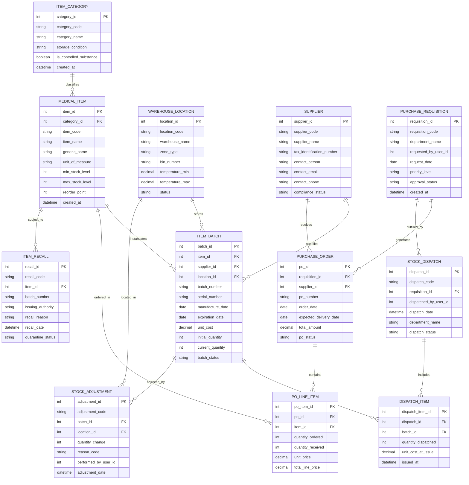

# Conceptual ERD — Medical Inventory Management System

## Mermaid Code

## Entity Description Table | Bảng mô tả Entity

| # | Entity Name | Vietnamese Name | Description | Key Attributes | Main Relationships |
|---|-------------|-----------------|-------------|----------------|-------------------|
| 1 | ITEM_CATEGORY | Danh mục Vật tư | Master category defining storage rules, classification (pharmaceuticals, PPE, surgical tools, controlled drugs). | category_id, category_code, category_name, storage_condition, is_controlled_substance | Has many MEDICAL_ITEM entities. |
| 2 | MEDICAL_ITEM | Vật tư Y tế Master | Central catalog master entity for medical supplies, equipment consumables, and drugs. | item_id, category_id, item_code, item_name, reorder_point, min_stock_level | Belongs to ITEM_CATEGORY; Has many ITEM_BATCH, PO_LINE_ITEM, and ITEM_RECALL entities. |
| 3 | WAREHOUSE_LOCATION | Vị trí Kho | Warehouse storage bins, shelves, aisles, cold rooms, and cabinet drawers with temperature constraints. | location_id, location_code, warehouse_name, zone_type, bin_number, temperature_min/max | Has many ITEM_BATCH and STOCK_ADJUSTMENT entities. |
| 4 | SUPPLIER | Nhà cung cấp | Verified commercial vendor supplying pharmaceuticals, medical devices, and laboratory consumables. | supplier_id, supplier_code, supplier_name, tax_identification_number, compliance_status | Has many ITEM_BATCH and PURCHASE_ORDER entities. |
| 5 | ITEM_BATCH | Lô hàng & Hạn dùng | Individual batch lot record holding manufacturing date, expiration date, cost, unit quantities, and location bin. | batch_id, item_id, supplier_id, location_id, batch_number, expiration_date, current_quantity | Belongs to MEDICAL_ITEM, SUPPLIER, and WAREHOUSE_LOCATION; Has many DISPATCH_ITEM and STOCK_ADJUSTMENT entities. |
| 6 | PURCHASE_REQUISITION | Yêu cầu Mua hàng | Internal formal request submitted by hospital departments or automated reorder engine for supply replenishment. | requisition_id, requisition_code, department_name, request_date, priority_level, approval_status | Has many PURCHASE_ORDER and STOCK_DISPATCH entities. |
| 7 | PURCHASE_ORDER | Đơn hàng Mua (PO) | Commercial purchase contract issued to a supplier for specified medical items and quantities. | po_id, requisition_id, supplier_id, po_number, order_date, total_amount, po_status | Belongs to PURCHASE_REQUISITION and SUPPLIER; Has many PO_LINE_ITEM entities. |
| 8 | PO_LINE_ITEM | Chi tiết Đơn Mua | Line-item detail mapping individual medical items, ordered quantities, unit prices, and received quantities to a PO. | po_item_id, po_id, item_id, quantity_ordered, quantity_received, unit_price | Belongs to PURCHASE_ORDER and MEDICAL_ITEM. |
| 9 | STOCK_DISPATCH | Phiếu Xuất kho | Stock fulfillment record documenting issuance of requested goods from central warehouse to a clinical department. | dispatch_id, dispatch_code, requisition_id, dispatch_date, department_name, dispatch_status | Belongs to PURCHASE_REQUISITION; Has many DISPATCH_ITEM entities. |
| 10 | DISPATCH_ITEM | Chi tiết Xuất kho | Specific batch lot allocations and issued quantities decremented from inventory during a dispatch session. | dispatch_item_id, dispatch_id, batch_id, quantity_dispatched, unit_cost_at_issue | Belongs to STOCK_DISPATCH and ITEM_BATCH. |
| 11 | STOCK_ADJUSTMENT | Điều chỉnh Tồn kho | Audit transaction logging physical inventory count variances, damage write-offs, spillage, or manual balance corrections. | adjustment_id, adjustment_code, batch_id, location_id, quantity_change, reason_code | Belongs to ITEM_BATCH and WAREHOUSE_LOCATION. |
| 12 | ITEM_RECALL | Thu hồi & Cách ly | Formal record tracking FDA/MOH regulatory recalls, locking specific item batch lots into digital and physical quarantine. | recall_id, recall_code, item_id, batch_number, issuing_authority, quarantine_status | Belongs to MEDICAL_ITEM. |

## Relationship Description | Mô tả Quan hệ

| # | From Entity | Cardinality | To Entity | Relationship Label | Business Explanation |
|---|-------------|-------------|-----------|-------------------|----------------------|
| 1 | ITEM_CATEGORY | one-to-many | MEDICAL_ITEM | classifies | One item category classifies multiple specific medical catalog items. |
| 2 | MEDICAL_ITEM | one-to-many | ITEM_BATCH | instantiates | One master medical item has multiple incoming batch lots over time. |
| 3 | SUPPLIER | one-to-many | ITEM_BATCH | supplies | One vendor supplies multiple batch lots of medical items. |
| 4 | WAREHOUSE_LOCATION | one-to-many | ITEM_BATCH | stores | One warehouse storage bin/location holds multiple item batch lots. |
| 5 | PURCHASE_REQUISITION | one-to-many | PURCHASE_ORDER | generates | One department purchase requisition can generate one or more vendor purchase orders. |
| 6 | SUPPLIER | one-to-many | PURCHASE_ORDER | receives | One supplier receives multiple purchase orders from the hospital. |
| 7 | PURCHASE_ORDER | one-to-many | PO_LINE_ITEM | contains | One purchase order contains multiple individual item detail lines. |
| 8 | MEDICAL_ITEM | one-to-many | PO_LINE_ITEM | ordered_in | One catalog medical item can be ordered in multiple purchase order line items. |
| 9 | PURCHASE_REQUISITION | one-to-many | STOCK_DISPATCH | fulfilled_by | One approved internal requisition is fulfilled by one or more stock dispatches. |
| 10 | STOCK_DISPATCH | one-to-many | DISPATCH_ITEM | includes | One stock dispatch ticket includes multiple batch line items. |
| 11 | ITEM_BATCH | one-to-many | DISPATCH_ITEM | allocated_to | One item batch lot is allocated across multiple dispatch transactions following FEFO rules. |
| 12 | ITEM_BATCH | one-to-many | STOCK_ADJUSTMENT | adjusted_by | One item batch lot can undergo multiple inventory physical adjustments or cycle counts. |
| 13 | WAREHOUSE_LOCATION | one-to-many | STOCK_ADJUSTMENT | located_in | One storage bin location is associated with multiple stock adjustment logs. |
| 14 | MEDICAL_ITEM | one-to-many | ITEM_RECALL | subject_to | One medical item master record can be subject to regulatory recall events. |
